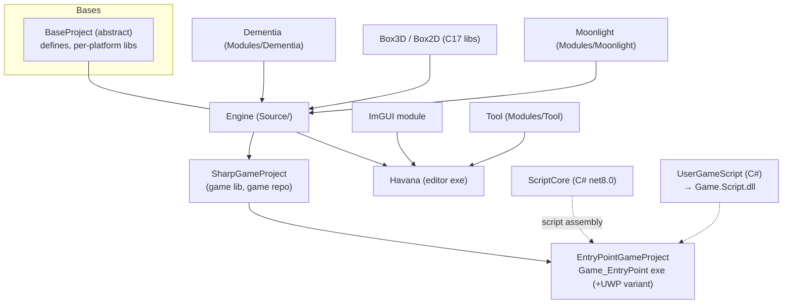

# Build System

Builds are generated by **Sharpmake** (C# build-description, vendored at `Tools/Sharpmake/`): the game repo's `Game.sharpmake.cs` includes `Engine.sharpmake.cs`, and generation scripts produce Visual Studio solutions, Xcode projects, or GNU makefiles. The signature behavior to understand: **feature flags are set by directory existence** — if a ThirdParty SDK folder is present at generation time, the feature compiles in; if not, it silently compiles out. This doc maps the project graph, the target matrix, the define conditions, and the Linux/Nix dev shell.

> Verified against engine commit 047f57b8 (+ Linux CI/packaging changes), 2026-07-11; the ThirdParty inventory and project graph against 8fdd99b1, 2026-10-09; the .NET wiring against 6a4b006f, 2026-10-09; Recast / Detour against 8d6769a5, 2026-10-10.

## Overview

Nothing is built without regenerating projects first — adding files, changing defines, or installing an SDK all require re-running the generation script. Generated artifacts (`.sln`, `.vcxproj`, `.make`, `Makefile`, `compile_commands.json`) are gitignored and must never be committed.

## Key Files

| Path | Role |
|------|------|
| `Engine.sharpmake.cs` | `Globals` (all SDK paths + `RootDir`), `BaseProject`, `Engine`, `EntryPointGameProject` (+UWP), solution bases |
| `Tools/CommonTarget.sharpmake.cs` | The target matrix (platform × mode × optimization) |
| `Tools/BaseProject.sharpmake.cs` | Per-platform/per-config define + lib wiring (the "why is my feature off" file) |
| `Tools/BaseTool.sharpmake.cs`, `Tools/SharpmakeProject.sharpmake.cs` | Tool-app + sharpmake-project bases |
| `Modules/ScriptCore/ScriptCore.sharpmake.cs` | The C# script assembly (net8.0) for Visual Studio (Windows only) |
| `Modules/ScriptCore/ScriptCore.csproj` + `../Project/Game.Script.csproj` (game repo) | SDK-style projects the engine builds with the dotnet CLI on Linux/macOS and for hot reload (`Docs/Scripting-DotNet.md`) |
| `Tools/GenerateScriptAPI.py` | Generates the script ABI from `Source/Scripting/ScriptAPI.def` (`--check` to verify) |
| `../Game.sharpmake.cs` (game repo) | `SharpGameProject` (game lib), `UserGameScript`, solution — includes the engine file |
| `../Project/GenerateSolution.sh` / `.bat` / `.command` (game repo) | Generation entry points |
| `ThirdParty/GenerateSolutions.sh` / `.bat` / `.command` | One-time third-party project generation (`.sh`: cmake configure only; `--build-bgfx` rebuilds the bgfx archives) |
| `nix/flake.nix` / `nix/mkDevShell.nix` | Engine-owned Linux environment; optional private game additions in `devshell.nix` |
| `Tools/NewProjectSetup.sh` / `.bat` / `.command` | New-project bootstrap (clone engine, copy template, generate); `.sh` uses the engine-owned environment on Linux |
| `Havana --build-game` (`Source/Tools/Build/`) | Build Game: a shippable game folder (Retail executable, scripts, cooked pak, app-local .NET, bundled libraries, launcher); see `Docs/Building.md` |
| `Tools/PackageLinuxBuild.sh` | Packages a `.build/<Target>` folder into a tar.gz with bundled libs and a `run.sh` launcher. Only the engine CI's editor artifacts still use it; games use Build Game (ME-264) |
| `.github/workflows/Linux.yml` (+ `Windows.yml`, `macOS.yml`, `UWP.yml`) | CI: sets up an `EmptyProject` from the template and builds Editor/Game × Debug/Release; Linux builds inside the SDK environment and uploads tar.gz artifacts |

## How It Works

### Project graph



Outputs land in `.build/[target.Name]/` at the game-repo root (e.g. `.build/Editor_Debug/Havana`, `.build/Game_linux_Debug/Game_EntryPoint_x64`). Post-build steps copy runtime DLLs (FMOD, nethost, Optick) from `ThirdParty` locations into the output dir.

### Target matrix (`CommonTarget`)

- **Platforms**: `win64`, `uwp`, `mac`, `linux`
- **Mode fragment**: `Game` and `Editor` (editor targets add `DEFINE_ME_EDITOR` + `DEFINE_ME_TOOLS`)
- **Optimization**: `Debug`, `Release`, `Retail` — third-party libs map Retail→Release (`GetThirdPartyOptimization`)

Linux makefile config names follow `<mode>_<platform>_<opt>` lowercased, e.g. `make -f Drumsmith.make Havana config=editor_debug`, `Game_EntryPoint config=game_linux_debug`.

All three optimizations are generated for both game and editor targets on Windows, Linux and macOS:

| Optimization | Linux editor config | Linux game config | Behavior |
|--------------|---------------------|-------------------|----------|
| Debug | `editor_debug` | `game_linux_debug` | Unoptimized engine code, debug symbols, tools and profiling |
| Release | `editor_release` | `game_linux_release` | Optimized code with debug symbols, tools and profiling |
| Retail | `editor_retail` | `game_linux_retail` | Optimized engine code, debug-symbol generation and profiling disabled; game tools disabled, editor tools retained |

Retail uses Release third-party libraries. Release/Retail Linux builds use `-O3` for engine code; the source-built physics and navigation libraries retain their own optimization settings. Prebuilt archives can retain debug information; Retail does not strip the final executable. These configurations are local builds; portable Linux packaging and the distribution toolchain are separate steps.

### The define conditions — "why is my feature compiled out"

From `Tools/BaseProject.sharpmake.cs` (+ `Engine.sharpmake.cs` `Globals`):

| Define | Condition |
|--------|-----------|
| `DEFINE_ME_PLATFORM_*` | The target platform, always |
| `DEFINE_ME_EDITOR` + `DEFINE_ME_TOOLS` | Editor-mode targets |
| `DEFINE_ME_DEBUG` + `DEFINE_ME_TOOLS` | Debug optimization (tools ride along in debug game builds) |
| `DEFINE_ME_RELEASE` + `DEFINE_ME_TOOLS` | Release optimization (optimized development build) |
| `DEFINE_ME_RETAIL` | Retail optimization (tools only if the target is an editor) |
| `DEFINE_ME_RMLUI` | Always (RmlUi + FreeType build from source on every platform) |
| `DEFINE_ME_FMOD` | `Globals.FMOD_<Platform>_Dir` exists (Win64/UWP: installed SDK path; Linux: SDK dir with `api/core/lib/x86_64`) |
| `DEFINE_ME_DOTNET` | `Globals.DOTNET_Win64_Dir` (Win64/UWP) or `Globals.DOTNET_Linux_Dir` (Linux) exists — **no macOS path** |
| `DEFINE_ME_OPTICK` | Win64 (per-optimization lib copy from `ThirdParty/Lib/Optick/Win64/…`) |
| `DEFINE_ME_RENDERDOC` | RenderDoc integration available |

Because these are **generation-time filesystem checks**, two machines with different SDKs silently produce different feature sets from identical source. When a feature "doesn't work", check the generation log/defines before debugging code. The Mono integration is gone; `Globals.MONO_*_Dir` remain only so older game sharpmake files that set them still compile.

### Generating and building

1. **Once**: run `ThirdParty/GenerateSolutions.sh` (or `.bat`/`.command`) to generate third-party projects. On Linux this is cmake-configure only (produces `assimp/config.h` etc.); the engine links the prebuilt archives committed under `ThirdParty/Lib/*/linux/{Debug,Release}`. `GenerateSolutions.sh --build-bgfx` rebuilds the bgfx toolchain/archives from source when refreshing `ThirdParty/Lib/BGFX/linux`.
2. **Per change**: run the game repo's `Project/GenerateSolution.sh` (Linux — also runs `bear -- make …` to produce `compile_commands.json` for clangd/CLion), `.bat` (Windows → `.sln`), or `.command` (macOS → Xcode). All three invoke `dotnet Engine/Tools/Sharpmake/Sharpmake.Application.dll /sources('../Game.sharpmake.cs')`.
3. Build in the IDE, or on Linux: `make -f <Game>.make <Project> config=<config> -j$(nproc)`.

The local Linux binaries also need the dev shell at runtime. From a regular terminal at the game-repo root, launch with `Engine/Tools/NixEnv.sh ./.build/Editor_Release/Havana` (or the corresponding game executable). The shell supplies `LD_LIBRARY_PATH` for SDL2, Wayland/X11 and the graphics loaders; the executable's own RUNPATH does not cover all of these, so a direct launch outside the shell can fail at the loader with a missing-library error. The MitchGame VS Code launch configurations enter the same environment through `Tools/NixGdb.sh`.

For example, from the MitchGame root inside `Engine/Tools/DevShell.sh`, build and test the optimized configurations with:

```bash
for optimization in release retail; do
    make -f MitchGame.make Havana MitchEngine_Tests config=editor_$optimization -j"$(nproc)" || exit
    make -f MitchGame.make Game_EntryPoint MitchEngine_Tests config=game_linux_$optimization -j"$(nproc)" || exit
done
for optimization in Release Retail; do
    ./.build/Editor_$optimization/MitchEngine_Tests || exit
    ./.build/Game_linux_$optimization/MitchEngine_Tests || exit
done
```

When scripting is enabled, the Retail game expects precompiled script assemblies beside its executable; it does not run the development script compiler. Before running it locally, build those assemblies with:

```bash
dotnet build Project/Game.Script.csproj -c Release -o .build/Game_linux_Retail \
    --artifacts-path .tmp/dotnet --nologo
```

### ThirdParty inventory

`ThirdParty/`: `Assimp`, `bgfx` + `bimg` + `bx`, `box3d` + `box2d` + `recastnavigation` (submodules), `FMOD`, `glm`, `ImGui`, `JSON` (nlohmann), `Optick`, `RenderDoc`, `SDL`, `RmlUi` + `freetype`, `ChromeTrace`, plus prebuilt outputs under `ThirdParty/Lib/` and runtime binaries under `ThirdParty/Bin/`. Some are source-built (bgfx family; Box3D and Box2D as the `Box3D` / `Box2D` C17 static-library projects in `ThirdParty/Box3D.sharpmake.cs` / `ThirdParty/Box2D.sharpmake.cs`, and Recast + Detour + DetourCrowd as the `RecastNavigation` C++ library in `ThirdParty/RecastNavigation.sharpmake.cs`, all public dependencies of the engine and optimized even in debug builds), some prebuilt SDK drops (FMOD, Ultralight, Optick libs).

### Tools (`Tools/` at engine root)

Prebuilt per-platform binaries in `Tools/Win64|macOS|linux/` (**`shaderc`**, `texturec` — used by the asset cook, `Docs/Resources-and-Assets.md`), the vendored **Sharpmake** application and **Optick.exe** (profiler viewer; projects are picked in Havana's Project Hub, `Docs/Projects.md`, and shader graphs edited inside Havana, `Docs/Materials-and-Shaders.md`), plus `ProjectTemplate`/`NewProjectSetup` scripts for spinning up new game projects. Python helpers: `GenerateScriptAPI.py` (the script ABI, `Docs/Scripting-DotNet.md`) and `ScreenshotRegression.py` (capture scenes with `--frame-time` and compare with reference PNGs; `Docs/Architecture.md`).

**Checks (Linux).** One command guards the engine. Run it from the project root inside the dev shell:

```bash
Engine/Tools/RunChecks.sh               # build, unit tests, every editor flow, screenshot regression
Engine/Tools/RunChecks.sh --skip-build  # with the current binaries
Engine/Tools/RunChecks.sh --only Nav    # only the editor flows whose path contains "Nav"
```

- `Tools/RunEditorFlows.py` finds every `*.edscript` under `Assets/Scenes`, opens the scene its header names (`--scene ...`) in the editor and reports which flows pass. Logs go to `.tmp/EditorFlows/`. While another Havana is open, it skips flows that edit files.
- `Tools/Headless.sh <command>` runs a GUI program on a private virtual display (Xvfb, `:99`, started when needed) with software Vulkan (Mesa's lavapipe). Automated runs therefore never open windows on the desktop and render the same pixels on any machine. Both scripts above use it.

### The Linux/Nix development environment

The engine owns `nix/flake.nix`, its lock, and the shared shell definition. New projects get VS Code tasks/launch configuration that call `Tools/BuildProject.sh` and `Tools/NixGdb.sh`. Both enter the engine environment, so F5 works when VS Code starts outside a development terminal. Builds generate missing third-party headers and regenerate the project before invoking make.

Run `Engine/Tools/DevShell.sh` from a game root for an interactive shell, or `Engine/Tools/NixEnv.sh <command>` for a command. Optional game-specific additions live in the game's `devshell.nix`; no project flake, copied lock, or engine-side game profile is needed. The base environment includes Python, bear, patchelf, Xvfb and the matching lavapipe ICD alongside the C++/.NET, SDL and graphics dependencies.

See [Development-Environment.md](Development-Environment.md) for the extension API, CLI, SDK installation support, ownership, and maintenance. Linux CI uses the same launchers.

### .NET on Linux

When `Globals.DOTNET_Linux_Dir` (from `DOTNET_LINUX_NATIVE_DIR`) exists at generation time, Sharpmake defines `DEFINE_ME_DOTNET`. `Tools/BaseProject.sharpmake.cs` then links every executable against `libnethost.so` from that directory, with an rpath to it. Sharpmake can't generate C# projects for makefiles, so `Engine.sharpmake.cs` adds the `ScriptCore`/`UserGameScript` dependencies only for Win64. Elsewhere the engine compiles the scripts itself with `dotnet build` (tools builds do it on startup when sources are newer). Generate from inside `Engine/Tools/DevShell.sh`: outside it the variable is unset and scripting silently compiles out.

## Caveats & Fragility

- **Feature variance by machine**: directory-existence defines mean a fresh clone without SDKs builds a reduced engine (no FMOD, no scripting). Generation prints a **feature report** (`BaseGameSolution.ReportFeatures`): each optional feature, on or OFF, with the directory it found or what to do (e.g. "generate inside `Engine/Tools/DevShell.sh`"). Read it when a feature seems missing.
- **Regeneration is mandatory** after adding/removing source files or SDKs — stale projects fail in confusing ways (missing defines rather than missing files).
- **Prebuilt `ThirdParty/Lib` archives can drift from submodule headers**: the Linux BGFX *Release* archives sat stale for a long time (undefined `bgfx::setViewName`/`createTexture2D` at link) while Debug was current. If a `*_release` config fails with undefined bgfx symbols, refresh via `GenerateSolutions.sh --build-bgfx` and copy the `.a` files from `bgfx/.build/linux64_gcc/bin` into `Lib/BGFX/linux/Release` (only the already-tracked set — the shaderc-only deps like `spirv-opt`/`tint-*` are ~700MB and stay uncommitted).
- **Hardcoded SDK paths on Windows** (e.g. FMOD under Program Files, the .NET host pack version in `Globals.DOTNET_Win64_Dir`) — version bumps of installed SDKs require editing `Engine.sharpmake.cs`.
- **macOS scripting is unwired** (no `DEFINE_ME_DOTNET` path or host-pack link) and Optick is Win64-only — platform feature parity is uneven by construction (see the matrix in `Docs/State-of-the-Engine.md`).
- **The dev shell is load-bearing on Linux**: outside the SDK environment, the .NET native dir and EGL paths must be assembled by hand.
- **`ScriptCore`/`UserGameScript` sharpmake configs are near-duplicates** (in-code TODO: factor a common base "when there's a third one"), and the SDK-style `.csproj` files mirror them for CLI builds; a new script-side setting belongs in both.
- **Retail game builds omit development tools**: compile code that depends on editor inspection, ImGui or profiling behind the corresponding feature flag. Retail editor targets still need editor tools.

## Related Docs

- `Docs/Architecture.md` — the feature-flag system these defines feed
- `Docs/Scripting-DotNet.md` — the .NET host dirs in detail
- `Docs/Resources-and-Assets.md` / `Docs/Materials-and-Shaders.md` — the cook tools shipped in `Tools/`
- `Docs/State-of-the-Engine.md` — platform matrix and debt items
