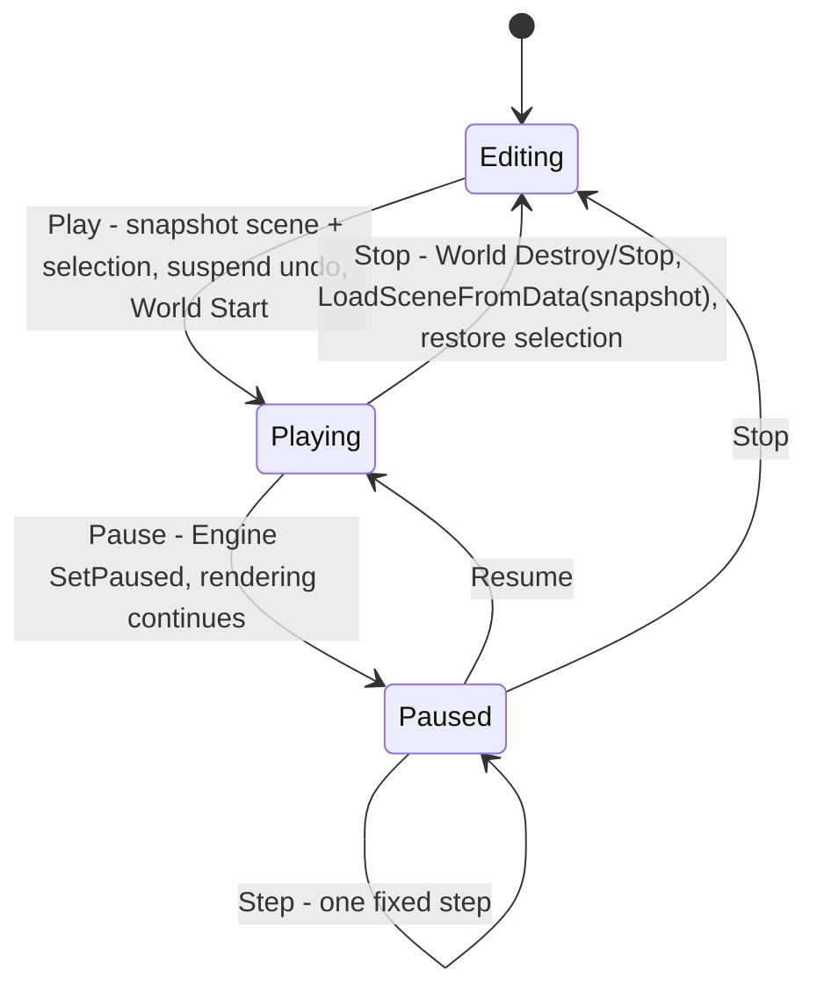

# Havana Editor

Havana is the ImGui-based editor. `EditorApp` is itself a `Game` subclass (standard entry point in `Modules/Havana/Source/main.cpp`) that hosts dockable widgets around a small set of **editor services**: one `Selection`, an `UndoStack`, named `EditorActions` (menus, shortcuts, command palette, scripts) and `EditorOps`, the undoable operations every widget uses to change the scene. Play mode snapshots the scene in memory and restores it on Stop. `--editor-exec` drives all of it from a script for unattended testing.

> Verified against engine commit 7e869c6e, 2026-10-09; Create menu, overlays and View menu rendering toggles against 1fa55311, 2026-10-09 (Wave 3); physics gizmos, menus and settings against 8fdd99b1, 2026-10-09 (Wave 4); audio gizmos and settings, and the `pick` / `assert-audio` commands against afce7083, 2026-10-09; tabbed Project Settings, data assets and `show-asset` against e0ca1f26, 2026-10-09; `wait-log` / `replace-in-file` against 6a4b006f, 2026-10-09; navigation menus, settings and choice fields against 8d6769a5, 2026-10-10; the Hardware tab and the budget overlay against 3f04199c plus the hardware profiles change, 2026-10-22; the rectangle light gizmo and preset against 94407e9d plus the concert lighting change, 2026-10-29; render textures (Create menu, details, pickers, the Camera preview and the `rtt-*` commands) against 89e036be plus the render texture change, 2026-10-29.

## Overview

Editor builds are gated by `ME_EDITOR` (Sharpmake "Editor" targets, `Docs/Build-System.md`). The editor camera renders into its own framebuffer that the **World View** displays; `PickingPass` reads entity IDs back from it (`Docs/Rendering-Pipeline.md`). A second `Input` (`Engine::GetEditorInput`) keeps editor input alive while the game owns the keyboard. Editor shortcuts themselves go through ImGui (`EditorActions::ProcessShortcuts`).

## Key Files

| Path | Role |
|------|------|
| `Modules/Havana/Source/EditorApp.h/.cpp` | The editor "game": play/pause/step/stop, scene management (new/open/save, unsaved prompt, autosave/recovery), quit veto |
| `Modules/Havana/Source/Havana.h/.cpp` | UI container: widgets, dockspace, action registration, focus contexts |
| `Modules/Havana/Source/Editor/Selection.*` | Selection service (multi-select, active entity/core, pick drill-down) |
| `Modules/Havana/Source/Editor/UndoStack.*` | Undo/redo history, transactions, merging, dirty tracking |
| `Modules/Havana/Source/Editor/EditorOperations.*` | `EditorOps`: undoable create/delete/duplicate/paste/reparent/rename/active/layer/add/remove component/component edits |
| `Modules/Havana/Source/Editor/EditorActions.*`, `DefaultEditorActions.*` | Action registry, shortcuts, command palette, rebinding |
| `Modules/Havana/Source/Editor/ReflectionUI.*` | Inspector widgets generated from reflection |
| `Modules/Havana/Source/Editor/PrefabTools.*` | Prefab create/override/apply/revert/unpack |
| `Modules/Havana/Source/Editor/EditorCameraController.*` | Scene camera navigation |
| `Modules/Havana/Source/Editor/SceneTools.*` | Bounds, ray picking, grid/selection/gizmo overlays |
| `Modules/Havana/Source/Editor/EditorAutomation.*` | `--editor-exec` script runner |
| `Modules/Havana/Source/Cores/EditorCore.*` | Owns the scene camera, queues overlays, saves scenes |
| `Modules/Havana/Source/Widgets/` | `SceneViewWidget` (World/Game View), `SceneHierarchyWidget`, `PropertiesWidget`, `AssetBrowser`, `LogWidget`, `HistoryWidget`, `ProfilerWidget`, `SettingsWidgets` (Preferences, Project Settings), `BuildGameWidget` (File > Build Game), `MainMenuWidget`, `AssetPreviewWidget`, `ResourceMonitorWidget` |
| `Modules/Havana/Source/Utils/EditorConfig.h` | Editor state and preferences: per project in `.tmp/Havana.cfg`, per user in `Preferences.json` in the OS preference folder (ED-2) |
| `Source/Engine/ProjectSettings.*` | Project settings (layer names, layer collision matrix, gravity) in the project's `ProjectSettings.json` under `Assets/Config` |

## How It Works

### Selection

`Selection::Get()` is the single source of truth: an ordered list of entities (the last one is **active**, the one the inspector shows) or one core. Widgets query it every frame; `GetVersion()` changes on every edit, `SelectionChangedEvent` fires after changes, and the legacy `InspectEvent`/`ClearInspectEvent`/`PickingEvent` are accepted as requests. `GetRootEntities()` drops entities whose ancestor is also selected (what delete/duplicate/drag act on). `SaveGUIDs`/`RestoreGUIDs` let selection survive play mode and undo.

Scene-view picking: a click (press and release without dragging) requests a GPU pick; empty space clears the selection, Ctrl toggles, Shift adds. `ResolvePickTarget` selects the outermost model or prefab-instance root first, then one level deeper per click on the same branch.

### Undo and editor operations

Every scene edit goes through `EditorOps`, which applies the change and pushes an `UndoCommand`. Commands identify entities by **GUID**, never pointers, so they survive deletes and re-creates:

- Create/delete/duplicate/paste serialize the affected subtrees (`SceneSerializer::SerializeEntities`) and restore them with identical GUIDs and sibling positions. Undoing a create re-selects what was selected before.
- Reparent/reorder records parent, sibling index and transform state before and after (world transforms are kept).
- Component edits store before/after JSON. The inspector captures them generically: it keeps a baseline snapshot, refreshes it before inspector input, and commits when the interaction in that component's UI ends. Pending edits keep their original baseline. Idle selection does not repeatedly serialize large models. Custom `OnEditorInspect` code therefore gets undo for free. Gizmo drags record one step per drag.

`UndoStack` supports transactions (`UndoTransaction` RAII), merging consecutive commands with the same merge key, a 256-entry cap, and dirty tracking: the scene is dirty when the undo cursor isn't at the saved position, which drives the `*` in the title and the unsaved-changes prompts. While playing, the stack is **suspended**: pushes are dropped and undo/redo are disabled.

### Actions, shortcuts and the command palette

`EditorActions` holds named actions (`Edit.Undo`, `Gizmo.Rotate`, ...) with display names, categories, shortcuts (`ImGuiMod_Shortcut` = Ctrl, or Cmd on macOS), an optional alternate shortcut, an enabled predicate and a **context**:

- `Global` actions fire anywhere.
- `Scene` actions (delete, copy/paste, gizmo keys, frame selected) only fire while the Hierarchy or World View has focus.

Shortcuts don't fire while typing in a text field unless the action opts in (Save does). While the game owns input, only actions flagged `AllowWhileGameFocused` (Play/Stop/Pause/Step) fire. Menus use `EditorActions::MenuItem(id)`, so labels, shortcuts and enabled state stay consistent. Ctrl+Shift+P opens the fuzzy command palette. Shortcuts can be rebound in Preferences > Shortcuts; overrides persist in the editor config and apply to actions registered later.

| Default shortcut | Action |
|------|------|
| Ctrl+Z / Ctrl+Y, Ctrl+Shift+Z | Undo / Redo |
| Ctrl+X / C / V / D, Delete, F2 | Cut / Copy / Paste / Duplicate, Delete, Rename (scene context) |
| Ctrl+A, Esc | Select all / deselect (scene context) |
| Ctrl+Shift+N, Alt+Shift+N | Create empty / create empty child |
| Ctrl+N / O / S, Ctrl+Shift+S | New / Open / Save / Save As |
| Ctrl+P or F5, Ctrl+Alt+P or F10, F11 | Play/Stop, Pause, Step one fixed frame |
| W / E / R / T, X, Z | Move / Rotate / Scale / Universal gizmo, local/world, pivot/center (scene context) |
| F, Keypad 1/3/7, Keypad 5 | Frame selection, front/right/top views, perspective/ortho |
| Ctrl+H, Ctrl+Space, Ctrl+, | History panel, asset browser, Preferences |
| Ctrl+Shift+B | Build Game window |

### Play mode



`EditorApp::Play` serializes the world in memory (`SceneSerializer::SerializeWorld`), records the selection GUIDs and dirty state, suspends undo and starts the world. `Stop` destroys the world and reloads the snapshot through `Engine::LoadSceneFromData` under the scene's real path. Because GUIDs are preserved, the selection and the whole undo history are valid again afterwards. The Game View's "Maximize On Play" option fills the dock area while playing. The main menu has a time-scale slider while playing.

### Scene management

New/Open/Quit (including closing the window) go through `RunWithUnsavedCheck`. If the scene is dirty, a modal offers Save / Don't Save / Cancel. Closing the window is vetoed via `Game::OnQuitRequested` and `IWindow::CancelClose` until answered. Scene loads are queued events, processed at the start of the next frame. File > Open Recent lists the last 10 scenes.

**Autosave**: while the scene is dirty, every `Autosave.IntervalSeconds` (default 120 s, 0 = off) the world is written to `.tmp/Autosave/Autosave.lvl` with `Session.json`. A clean exit deletes them. If they exist at startup, the editor offers to recover the autosave under the original scene path, marked dirty.

### Scene view (World View)

- **Shading** (World View and Game View): each toolbar has a **Shading: Lit** menu with **Lit** (scene lighting and post-processing), **Unlit** (base colors and textures), **Solid** (neutral surfaces with a soft camera light), and **Normals** (world-space surface normals, including normal maps). Use Unlit or Solid to navigate dark levels. Inspection modes bypass fog, exposure, grading, bloom, ambient occlusion and vignette, and hide decals and particles. They retain mesh transparency, alpha cutouts, animation, picking and editor overlays. Each view remembers its choice independently in editor preferences; camera components and scene materials are unchanged. The command palette exposes `View.Shading.<mode>` and `GameView.Shading.<mode>`. Mesh inspection shading applies to StandardMaterial and its legacy Diffuse/White aliases; custom shaders keep their own shading.
- **Additional shading modes**: Wireframe draws actual triangle edges at the selected mesh LOD, using the same static, skinned or posed vertices. Vertex Normals omits normal maps. Metallic, Roughness and Occlusion display the final material values as grayscale; Emissive isolates emission (intensities above display white clip). UV Checker shows ten checks per UV tile, including material tiling, with blue tile borders. Depth displays linear camera distance from white to black over the configurable Depth Range. Lighting Only shows scene lights and shadows on neutral, nonmetallic surfaces, retaining normal maps and camera image settings. Their action suffixes are `Wireframe`, `VertexNormals`, `Metallic`, `Roughness`, `Occlusion`, `Emissive`, `UVChecker`, `Depth`, and `LightingOnly`.
- **View options** (both windows): independently toggle post-processing, fog, background, transparent meshes, particles, decals, debug drawing, backface culling and game UI. Exposure adds an EV offset to Lit / Lighting Only without editing the camera. Depth Range sets the depth display scale in metres. Inspection modes hide particles and decals; wireframe and depth use dark backgrounds. Reset View Options restores the defaults without changing the chosen shading mode. All options persist per viewport in `.tmp/Havana.cfg`, survive Play/Stop, and never dirty the scene. Command palette actions use `View.Toggle.<option>` / `GameView.Toggle.<option>` and `View.ResetOptions` / `GameView.ResetOptions`. The World View menu also contains its existing overlays and camera tools.
- **Gizmo** (upstream ImGuizmo): Move/Rotate/Scale/Universal, local/world, pivot/center, snapping with per-mode increments (toolbar toggle, Ctrl inverts while dragging). With several selected entities the gizmo drives a proxy matrix P, and every dragged root gets `W = P * P0^-1 * W0` through `Transform::SetWorldMatrix`, so parents and rotation are handled correctly. Physics bodies follow because `PhysicsCore` notices the moved Transforms and teleports their bodies.
- **View cube** (top right) snaps the camera around its pivot.
- **Camera** (`EditorCameraController`): RMB fly (WASD/QE/Space, wheel changes speed, Shift fast), Alt+LMB orbit, MMB pan, Alt+RMB dolly, wheel zoom toward the pivot (orthographic size in ortho; switching to orthographic keeps the pivot the same size on screen). While dragging to navigate, the cursor wraps across the scene viewport's edges for continuous movement and full rotations. F frames the selection's bounds, or the whole scene when nothing is selected, fitting both FOV axes. The view persists in the editor config.
- **Overlays** (`SceneTools`, drawn with `DebugDraw` as editor-only lines): a distance-faded grid at y = 0 whose spacing follows camera height, with X/Z axis lines; selection bounds (bright where visible, faint through geometry); camera frustums; light gizmos per type (directional arrow, point range sphere, spot cones, a selected rectangle's beam frustum from its face at the outer and inner cone angles); the selected particle system's emission shape; decal projection boxes with their direction; clickable camera/light/audio/particle/decal icons; a stats overlay (fps, ms, GPU ms, draws, triangles, entities). Each can be toggled from the View menu. The View menu also switches shadows, the shadow-cascade tint, the physics debug draw and the navigation debug draw on and off (actions `View.Shadows`, `View.ShadowCascades`, `View.Physics`, `View.Navigation`; see `Docs/Navigation.md`). `Navigation.BakeAll` (command palette) bakes every NavMeshSurface. The selected entity's 3D and 2D colliders (green, triggers blue), character capsule and joint anchors are drawn too (`SceneTools::DrawPhysicsGizmos` / `DrawPhysics2DGizmos`), as are a selected 3D audio source's min / max distance spheres.
- **Marquee**: drag on empty space to box-select pickable entities (resolved to their pick roots), Shift/Ctrl add.
- **Drops**: models and prefabs dropped on the view land on the surface under the cursor (oriented-bounds raycast), else on the ground plane.

### Hierarchy

Multi-select (Ctrl toggles, Shift ranges), search with `t:Type` to filter by component, inline rename (F2 or double-click), drag onto a row to reparent or between rows to reorder (keeps world transforms, cycle-safe), an active toggle per row, prefab instances drawn blue and inactive rows dimmed. The Create menu (and Create Child) offers empty entities, 3D Objects (Cube, Plane, Sphere, Cylinder, Capsule; StandardMaterial, each with a fitting static collider), Physics (dynamic Cube/Sphere/Capsule, Trigger Volume, Character Controller), Physics 2D (Dynamic Box/Circle, Static Platform, Trigger Area, Character Controller 2D; thin meshes as stand-ins), Camera, Light (Directional, Point, Spot, Bar, Box, Rectangle), Effects (Fire, Smoke, Sparks particle presets, and a downward Decal), Audio Source and Navigation (NavMesh Surface, Agent, Link, Modifier Volume, Obstacle). Transform-less entities are listed under "Utility". Scene-view picks reveal and scroll to the picked row.

The **Editor Entities → Scene Camera** entry selects the editor camera settings in Properties. It exposes position (m), pitch/yaw, fly speed (m/s), sensitivity, focus smoothing, projection, FOV and near/far clipping (m). The default near clip is 0.1 m. Clear settings follow the scene camera by default; turn off **Use Scene Environment** to customize the editor background. These settings persist in `.tmp/Havana.cfg` and do not dirty or serialize into the scene. The World View's View menu and command palette also offer **Scene Camera Settings** (`View.CameraSettings`).

### Inspector

The entity header shows active, name, layer (with Project Settings names) and GUID (click to copy), plus a prefab bar for instances. Components are drawn as collapsible sections with an enable toggle and a context menu: Reset (reflected defaults), Copy/Paste Values, Remove, and Revert/Apply to Prefab for instances.

Reflected components get generated UI from `ReflectionUI`, chosen from each field's `PropertyType` and metadata:

- Ranges become sliders; floating-point fields with `.Drag( speed )` instead use a drag at that
  sensitivity while retaining their range as bounds. Angles are edited in degrees.
- Colours and HDR colours get colour pickers; vectors get axis-coloured drags; quaternions are edited as stable Euler angles.
- Enums become combos; nested structs and arrays (with +/-) are expanded. Int fields registered with `.Choices( count, nameFn )` become combos of named choices, and `.MaskChoices` makes a multi-select bit mask (navigation areas, layers).
- Asset paths get drag-drop and a picker; `EntityHandle` fields accept hierarchy drags.

Hand-written `OnEditorInspect` still runs after the generated UI for extras. The Camera's, for one, says whether the camera supplies the Game View or renders into a texture, and previews that texture live with its size and update interval (or says why there's nothing to show; `Docs/Rendering-Pipeline.md`, Render textures).

With several entities selected, the inspector shows the components every selected entity has. Fields whose values differ are flagged, and an edit applies to all of them as one undo step. Searchable Add Component lists only components the entity doesn't have.

### Prefabs

Instances carry a link: `EntityRecord::PrefabAsset` (project-local path) and `PrefabSource` (the entity's GUID inside the prefab file).

- **Create**: dropping a hierarchy entity on an asset-browser folder calls `PrefabTools::CreatePrefab`. It writes the prefab with `SceneSerializer::SerializePrefab`, and the entity becomes the first instance.
- **Overrides** are top-level component values that differ from the source (float-tolerant). The instance root's position and rotation never count. Overridden fields get a blue marker and label. Right-click a label to revert or apply that field.
- **Apply All** rewrites the prefab from the instance, keeping stable source GUIDs. It then pushes the changes into every other instance whose values still match the old prefab, and adds components the prefab gained.
- **Revert All** restores values, re-adds removed components, and removes added components and added child entities. It is undoable.
- **Unpack** clears the links (undoable). Nested prefab links inside a prefab are kept.

### Asset browser

A searchable project-wide table is the default: type icon, name, local path and last modified, with sortable/reorderable columns, checkbox type filters and a resizable inspector on the right. Search matches paths as well as names (comma-separated terms and `-exclusions`). **Folder View** retains the folder tree, breadcrumbs and grid/list browser as an explicit option; that code is kept for a separate UX pass. **Project Table** returns to the original layout.

- **Navigation**: back/forward/up, clickable breadcrumbs, recursive search and a type filter.
- **Thumbnails**: textures that are already compiled, at most two loaded per frame. A render texture shows its live image once a camera or material has loaded it (a thumbnail never creates a render target).
- **Details pane**: texture and shader graph previews, plus registered import settings (Apply re-exports and reloads). Graph previews compile in the background without exporting or changing the graph; target/surface settings are summarized beside an Open Shader Graph button. Shader graphs have no separate import settings. Data assets (metadata that exposes a reflected object, e.g. `.inputactions`, `.rendertexture`) show their contents in the reflection inspector with a Save button. A render texture's Save hot reloads it at the new width, height, mips or wrap.
- **Opening**: double-click opens terrains in the Terrain panel, shader graphs in their editor, sequences in the sequencer, `.mtree` trees in MitchTree (`Docs/MitchTree.md`) and scenes in place.
- **File operations**: create folder/scene/prefab/material/render texture (a default 640 × 360 `.rendertexture`)/input actions/C# script/tree (Create > Tree > preset), rename (F2, moves the `.meta`; a script's name is its class name, so a new script takes the first free name in the project, `NewScript`, `NewScript2`..., and renaming one keeps it a unique C# identifier, `my door` becoming `MyDoor.cs`, renames the class with it and adds a `[FormerName]` when a scene or prefab still names the old class), duplicate (Ctrl+D), move (Alt-drag files, or drag folders, onto folders or breadcrumbs), delete to `.tmp/Trash` after confirmation, show in file manager, copy path, reimport.
- **Picker mode**: the same window serves `RequestAssetSelectionEvent`. Double-click selects; save dialogs save into the browsed folder with the right extension. A Texture filter also lists render textures, unless the request sets `ImagesOnly` because the picker needs an image's pixels (terrain layers, a camera's skybox).
- **Build Assets** (toolbar; *Cook All Textures, Models & Shaders* in the context menu) cooks every texture, model and shader whose cooked twin is missing or stale, for this platform (`Cook::CookInPlace`).
- `AssetsChangedEvent` from the asset watcher refreshes it.

### Projects: `--project`

`Havana --project <folder>` opens that project (a folder with `Project/Game.meproj`, or the file itself) instead of the working directory; every mode below works on it. **File > Open Project...** browses to another project and reopens the editor on it (after the unsaved-changes prompt), and a project's first open lands on its startup scene. C#-only projects run on the editor's own engine. See `Docs/Projects.md`.

### Cooking: `--cook`

`Havana --cook --scene <lvl> --out <dir>` runs the dependency cooker without opening the editor and exits non-zero on failure. It writes a cooked tree (`--pak` also packs it) that the game runs without sources. `Havana --cook-textures [folder]` cooks only textures, on every core. See `Docs/Cooking.md`. `Havana --build-game [profile]` makes a shippable build the same way (`Docs/Building.md`).

### Console, history, profiler, settings

- **Log**: level toggles with counts, search, duplicate collapsing, timestamps, auto-scroll that pauses when you scroll up, a detail pane, copy. Double-click opens the first source reference in an entry (`file:line`, a compiler's `file(line,col)` or a .NET stack frame's `file:line N`; `Utils/SourceLocation.h`) in the code editor (`PlatformUtils::OpenInCodeEditor`: Preferences command, `$ME_CODE_EDITOR`, or `code -g`).
- **History**: the undo stack; click an entry to jump there.
- **Build Game** (File > Build Game, Ctrl+Shift+B): the project's build profiles and a Build button that runs `Havana --build-game` as a child process, streaming its output with step progress, Cancel, Open Folder and Run (`Docs/Building.md`).
- **Profiler**: CPU/GPU frame history, per-phase and per-core CPU scopes from `FrameStats` (`ME_STAT_SCOPE`), per-view GPU timings (the bgfx profiler is enabled only while this window is open). **F9** records the next 10 frames into `.tmp/Captures/capture_<time>` (`.opt` with Optick on Win64, Chrome Trace `.json` elsewhere); only the newest 5 are kept. `--capture-startup` records the first 10 frames into `.tmp/Captures/startup`. Nothing is captured unless asked.
- **Preferences.** They come in two kinds:
  - **Per user, across every project:** appearance, camera feel, snapping, gizmos, shortcuts, the code editor command, autosave and Maximize On Play (`EditorConfig::IsUserPreference`). These live in `Preferences.json` in the OS preference folder (`SDL_GetPrefPath("MitchEngine", "Havana")`, beside the Hub's recent projects). They win over a project's older copy, and unattended runs neither read nor write the file.
  - **Per project:** everything else (asset browser folder, view options, workspaces), in `.tmp/Havana.cfg`.
- **High DPI and keyboard navigation (ED-1).**
  - **UI scale:** Appearance > UI scale (`Appearance.UIScale`, per user) multiplies the font size, and spacing follows the font, so the editor scales without blurring (the atlas is rebuilt at the scaled size). Auto (the default) uses the window's monitor (its DPI over 96, in quarter steps, 1-3x) and follows the window to a monitor with a different DPI. On Windows the process is per-monitor DPI aware (`SDL_WINDOWS_DPI_AWARENESS = permonitorv2`), so the OS doesn't stretch it.
  - **Keyboard navigation:** ImGui's is on: Tab and the arrows move through the focused window's widgets, and Space / Enter press them.
  - **Proof:** `DpiFlows.edscript`, a 2x capture plus the tour driven by keys only. The `imgui-focus` and `imgui-key` commands support it.
  - **macOS:** not yet asked for a high-DPI drawable; that needs the renderer to use the drawable size.
- **Help and onboarding (ED-3).** The Help menu has these entries, each also a `Help.*` action:
  - **Documentation** (F1) opens `Docs/README.md`, and **Getting Started** opens `Docs/Projects.md`, in the OS viewer. Unattended runs log `Help: <doc>` instead.
  - **Take the Tour** steps through six stops, opening and focusing Hierarchy, Properties, the asset browser and the Log. It starts on a user's first launch, records `Editor.TourDone`, and `Help.TourNext` / `TourBack` drive it from scripts.
  - **What's New** renders `Docs/WhatsNew.md` (headings and bullets). It opens by itself once whenever the page changes (`Editor.WhatsNewSeen`).
  - **Code:** `Widgets/OnboardingWidgets.cpp`. **Proof:** `HelpFlows.edscript`.
- **Workspaces (ED-2).** Ctrl+1..9 switch between nine workspaces, each with its own dock layout (`.tmp/imgui-workspace-N.ini`) and open panels. Workspaces 1..5 are named Scene, Animation, Shader, UI and Debug. Until you arrange a named workspace, it opens its subject's panels: the Sequencer, the Shader Graph editor, Localization, or the Profiler, Resource Monitor and Log. **View > Reset Layout** (`View.ResetLayout`) puts the active workspace back to the shipped layout and its own panels.
  - **Reloading the layout.** The reload runs between frames (an ImGui `NewFramePre` hook) and asks for a full dock rebuild (`DockContext.WantFullRebuild`), as workspace switches do too.
  - **Proof:** `Tests/Editor/LayoutFlows.edscript`, run by RunChecks' "Editor layouts" step in a fresh Empty project. The `assert-window` command checks a panel is open.
  - **Known issue (ME-272):** a project layout with dangling dock ids can still trip ImGui's docking asserts.
- **Other state** ( the dock layout is per user too, `.tmp/imgui.ini`, and a checkout without one starts from the project's `Assets/Config/imgui.cfg`, which the editor never writes) and **Project Settings**, tabbed into Time, Hardware, Layers, Physics, Input, Audio, Terrain and Navigation. Time holds the fixed update rate and frame cap in `Engine.cfg`. The rest live in the project's `ProjectSettings.json` under `Assets/Config`: the hardware profile and whether it's enforced (with live budget bars and a feature caps table; `Docs/Hardware-Profiles.md`), layer names, gravity, the triangular layer collision matrix over the named layers, the action map path (with connected pads and a live action table), the audio bus volumes, terrain streaming limits, and the navigation area names and costs.
- **Stats overlay** (World View and Game View, including the maximized Game View; each view's View > Stats, saved as `Scene.ShowStats` / `GameView.ShowStats`): fps, CPU and GPU time, draws, triangles and entities. With a hardware profile chosen, a second box below it gives the verdict ("Xbox 360: 2 over budget") and lists the budgets that are near or over.
- **Appearance** (Edit > Preferences): dark or light theme, typeface and size, and an accent color (blue by default; Pink, Lavender, Mint, Amber presets or a custom hex). The dark palette is the editor's original one (near-black chrome, charcoal panels, lighter controls) with the accent filling hovered, pressed and focused-tab surfaces, darkened when needed so labels keep 4.5:1 contrast. Fonts are bundled in `Engine/Assets/Fonts` with their licenses: Inter (default), Inconsolata (a Consolas look-alike), JetBrains Mono and Hack, plus the renderer's embedded Roboto as fallback. Sizes run 18 to 28 px; `ImGuiRenderer::kMinFontSize` (18) is enforced for every ImGui font, and `ImGuiRenderer::SetFont` rebuilds the atlas before the next frame. Padding, spacing, indents and roundings are authored at 18 px and scale with the font in whole pixels, as do the layout tokens below, so every size keeps the same proportions. Everything applies live and saves to `Appearance.Theme` / `Accent` / `Font` / `FontSize` in `.tmp/Havana.cfg`. The palette lives in `Modules/ImGUI/Source/ImGuiTheme.h`; it assigns every ImGui color slot, and a compile-time count check catches new slots when ImGui changes.

### Automation: `--editor-exec`

```bash
./.build/Editor_Debug/Havana --scene Assets/Scenes/Tests/HierarchyTest.lvl \
    --editor-exec Assets/Scenes/Tests/EditorFlows.edscript --editor-exec-result .tmp/result.json
```

The script runs one command per frame after a short warm-up and logs `[editor-exec] PASSED` or `FAILED (n)` (plus an optional JSON report), then quits. With `--scene` the editor opens only that scene, not the last one opened (`CurrentScene` in `.tmp/Engine.user.cfg`), so a flow doesn't depend on what was last opened. Unattended runs never write `.tmp/Engine.user.cfg`, `.tmp/Havana.cfg` or the ImGui layout (`.tmp/imgui.ini`). Commands with two arguments use `a | b` when a name contains spaces.

| Command | Effect |
|------|------|
| `wait N`, `log text` | Wait frames, log |
| `model-compact`, `model-expose path-or-name` | Compact the selected expanded Model, or expose one of its source nodes as an entity; both operations support undo/redo |
| `profile-start`, `profile-stop path.json` | Record steady-state frame/GPU timings, draw counts, and CPU scopes to JSON; place a `wait N` between them and warm up before recording |
| `trace-start`, `trace-stop path` | Capture detailed CPU scopes to an Optick/Chrome Trace file (the Linux tracer writes `.json`) |
| `action Id`, `undo`, `redo` | Run an editor action / undo / redo |
| `select a,b`, `select-add a`, `select-none` | Selection (names, or `Parent/Child` paths) |
| `pick fx fy` | Clicks the scene view at that fraction of its size; GPU picking selects what is drawn there |
| `show-asset path` | Opens the Assets window on a file with its details shown (data assets show their editable contents) |
| `assert-browser-layout Project` (or `Folder`), `assert-browser-asset path`, `wait-asset-preview` | Check the browser layout and project-wide listing, or wait for the selected graph's GPU preview (fails on graph/shader errors or timeout) |
| `assert-mod-loaded id | 0/1` (MOD-6: what loaded at start; a flow header's `--mods` / `--mod-dir <folder>` reach the editor through RunEditorFlows) | Mods |
| `copy-file from | to`, `write-file path | text` (under the project), `material-texture Name | Slot | texture` (as the material inspector assigns it), `assert-texture-format texture | BC5` (its cooked .dds: BC1/BC3/BC5/BC7/Uncompressed; `!BC5` for anything else) | Texture and material checks |
| `create-script folder | Script, Networked Script, ...` (Create > C# Script's templates, written at once), `delete-file path` (under the project only), `assert-script-type Name` (a loaded script or data asset class) | Make, remove and check scripts |
| `replace-in-file path | old | new`, `wait-log text | frames` | Edit a file in place (hot reload tests) / wait until a log line containing the text appears (lines logged since the previous command started count, so `action X` then `wait-log` can't miss what X logged; consecutive `wait-log`s share that window, so several lines X logged at once can each be awaited), failing after the frame budget |
| `create Name [| Parent]`, `rename Name`, `reparent Child | Parent|root` | Structural edits |
| `add-component T`, `remove-component T`, `set Type.Field <json>`, `set-ref Type.Field | Entity/Path` | Component edits on the active entity (`set-ref` fills an entity reference with that entity's GUID) |
| `create-prefab Entity | path`, `instantiate path`, `prefab-apply/-revert/-unpack Entity` | Prefab workflow |
| `play`, `stop`, `load path`, `save-as path`, `show-assets folder`, `show-window Title` (opens a panel), `focus-window name`, `screenshot path`, `quit` | Editor state |
| `preference Key | <json>` | Set an editor preference for this run (never saved by unattended runs); `Appearance.*` keys re-apply the theme, e.g. `preference Appearance.FontSize | 28` or `preference Appearance.Theme | "Light"` |
| `open-project <folder>` | File > Open Project for that folder; an unattended run logs the reopen command instead of starting another editor (`Tests/Samples/ScriptOnly/ScriptOnlyFlows.edscript`) |
| `assert-project Name`, `project-hub` | The open project's name (its `Game.meproj` ProjectName) / File > Project Hub, which an unattended run logs instead of reopening |
| `hub-create Template | folder`, `hub-open folder`, `hub-add folder`, `hub-remove folder`, `hub-assert-template Name`, `hub-assert-recent folder | 1/0`, `hub-screenshot path` | Run by the **Project Hub** (Havana started outside a project, or with `--hub`) before it opens a project; the editor it starts runs the same script and skips them (`Tests/Hub/HubFlows.edscript`, `Projects.md`) |
| `build-game <profile json> [| no-compile no-record]`, `build-game-wait` | Build the profile in the Build Game window (shown, not saved) / hold until its build ends, failing unless it succeeded and wrote `BuildInfo.json` (`BuildGameFlows.edscript`) |
| `pack-assets out.mpak | root,root` | Write an `.mpak` of what the VFS serves under each logical root (all of `Assets` when the list is omitted); game runs mount it with `--pak` (see `VFS.md`) |
| `mark-count`, `assert-count N`, `assert-count-delta N`, `wait-count-stable frames | timeout` | Entity counts; the wait holds until the count is unchanged for that many consecutive frames (settles async scene population before a `mark-count`), failing at the timeout |
| `input-press Gamepad/DPadDown` (or `Key/Tab`, `Key/ShiftTab`, `Gamepad/South`, arrows), `ui-assert-focused #id`, `ui-set-text-scale 1.5`, `ui-set-language es` (empty resets) | One RmlUi navigation press through the live gamepad mapping's key path / assert the focused element / dp text scale / swap the string table and reload documents |
| `input-hold Keyboard/W`, `input-release Keyboard/W` (alone: every held key) | Hold a key for the game's input actions until released (control paths as in an input map; `Input::SetSimulatedKey`), so flows can drive a player in Play (`Tests/Templates/*.edscript`) |
| `wait-field Entity | Type.Field | <json> | frames` | Holds until the assert-field condition (same `~`/`!=` forms) is true, failing at the frame budget — for state that arrives on its own schedule (a sequence's first animated frame, an async load's effect) |
| `rtt-assert-size <t> | W | H [| frames]`, `rtt-mark <t>`, `rtt-wait <t> [| renders [| frames]]`, `rtt-assert-renders <t> | frames | min | max`, `rtt-assert-changed <t> [| fraction]`, `rtt-assert-lit <t> | fraction [| x y w h]`, `rtt-assert-dark <t> | fraction | x y w h`, `rtt-capture <t> | path.png` | Render textures (`Modules/Havana/Source/Editor/RenderTextureAutomation.h`); `<t>` is a `.rendertexture` path or `@Entity` for that camera's target. `assert-size` can wait up to `frames` for a reload to resize it; `mark` remembers the render count and the image; `wait` holds until that many renders (1) since the mark (in all without one), failing after `frames` (600); `assert-renders` needs `min` to `max` renders over the next `frames` (an update interval); `assert-changed` waits for a render since the mark, then needs that fraction of pixels (0.01) to differ from the marked image; `assert-lit` / `assert-dark` need at least / at most that fraction of pixels lit (a channel above 24 of 255), in a normalized rect from the top left; `capture` writes a PNG. Pixel checks read the texture back from the GPU (`RenderTextureFlows.edscript`, `ConcertTest.edscript`) |
| `script-set Field.Path | <json>`, `script-assert Field.Path | <json>` (same `~`/`!=` forms as assert-field), `script-set-ref Field | Entity` | The active entity's live C# script fields by dotted path (list indices are numbers: `Weights.1`); set-ref fills an `EntityRef` field's `Guid` with that entity's scene GUID. Creates the instance if .NET finished booting after the scene loaded |
| `assert-exists/-missing Name`, `assert-selected N`, `assert-active Name`, `assert-parent Child | Parent`, `assert-children Name | N`, `assert-near A | B | metres` (world positions) | Scene structure |
| `assert-field Name | Type.Field | <json>` (numbers within 1e-3; append `~ tolerance` to widen; prefix `!=` to require a different value; `Type.Field.N` indexes arrays), `assert-dirty 0/1`, `assert-playing 0/1`, `assert-paused 0/1` (`pause` toggles it), `assert-build-errors N` (the Error List's error count), `assert-audio Name | 0/1` (its AudioSource is playing), `assert-occlusion Name | 0.7 ~ 0.05` (its AudioSource's current occlusion, within 0.05 unless `~` widens it) — both log `[editor-exec] SKIP` instead of asserting in builds without the FMOD SDK (CI checkouts), `assert-prefab Name | path/none`, `assert-overridden Name | Type.Field | 0/1` | State |
| `assert-sky-time Camera | 17.2` (or `!= 17.2`), `assert-sky-animation-time Camera | 0` | Check evaluated sky clocks. `@scene-view` reads the rendered viewport settings; `@editor-camera` reads the persistent editor camera. |

`Assets/Scenes/Tests/EditorFlows.edscript` and `PrefabFlows.edscript` (run with `HierarchyTest.lvl`) `PhysicsFlows.edscript` (run with `PhysicsTest.lvl`) and `Physics2DFlows.edscript` (run with `Physics2DTest.lvl`) in the game repository are the regression scripts.

### Agents: the MCP server (NEXT-1)

`Tools/HavanaMCP/havana_mcp.py` is an MCP server (stdio, JSON-RPC, no dependencies) that lets an agent build and check games with the editor. It's built on the automation above: every editor tool runs one headless, unattended Havana session, so the user's own editor, layout and preferences are never touched.

| Tool | What it does |
|---|---|
| `run_edscript` | An edscript in a scene (any command in this section: edits, play/stop, asserts, `save-as`, screenshots). Returns pass/fail, failures and the log's key lines |
| `screenshot` | A PNG of a scene, optionally after playing it some frames |
| `scene_summary` | A scene file's entities and components |
| `list_assets` | Project files by folder and extension |
| `edscript_commands` | Every command with its usage comment, read from `EditorAutomation.cpp` |
| `build_game` | `Havana --build-game [profile]` |
| `read_log` | The tail of a log under `.tmp/` |

- **Registering it.** MitchGame's `.mcp.json` registers it for Claude Code. Elsewhere: `claude mcp add havana -- python3 Engine/Tools/HavanaMCP/havana_mcp.py`, from the project root.
- **Environment.** Outside the Nix dev shell it starts the editor through `nix develop Engine/nix`, and `HAVANA_EDITOR` picks another editor binary.
- **Proof:** `Tools/HavanaMCP/test_havana_mcp.py` (RunChecks "MCP server") does a client handshake, then calls each tool.

## How to Extend

**Add an editor action** (menus, palette, shortcuts and scripts all pick it up):

```cpp
EditorAction action{ "Tools.Bake", "Bake Lighting", "Tools", ImGuiMod_Shortcut | ImGuiKey_B, 0,
    []() { /* ... */ }, []() { return !app->IsGameRunning(); } };
action.Context = ActionContext::Global;
EditorActions::Get().Register( action );
```

**Make an edit undoable**: change the scene through `EditorOps` where an operation exists. Otherwise capture `EditorOps::CaptureComponent` before and after and call `EditorOps::RecordComponentEdit`, or push your own `UndoCommand` that identifies entities by GUID.

**Get an inspector for a component**: reflect its fields (`Docs/ECS.md`). Override `OnEditorInspect` only for extra UI such as buttons or previews.

**Lay out editor UI** (inspectors, settings, panels) so it matches the rest at every font size:

- Forms are property rows: `HavanaUtils::Label( "Name" )`, then the widget with a `##id` label (Label sets its width and returns it). Values start at one column per window whatever the indentation (40% of the row, at most 14 em) and end one panel inset from the right edge, in padded and unpadded panels alike. `HavanaUtils::SkipLabel()` puts a button or note under the values; `HavanaUtils::RowWidth()` replaces `-1` widths, which run to the window edge in panels without padding. Vectors use `HavanaUtils::DragAxes`.
- Sizes come from `ImGuiTheme` (`Modules/ImGUI/Source/ImGuiTheme.h`), never pixel literals: `Em( n )` for fixed widths, table columns and popup or list sizes; `InnerGap()` between the parts of one control (a field and its buttons, vector components); `IconButtonSize()` / `IconButtonsWidth( n )` for square browse, clear, add and remove buttons; `ButtonWidth( label )`; `DialogButtonSize()` for dialog footers; `SectionGap()` between stacked groups; `PanelInset()` where a panel zeroes its padding.
- Every control is one frame tall: use `Button`, not `SmallButton`, next to fields and in toolbars, and give inspector tree nodes `ImGuiTreeNodeFlags_FramePadding`. Inside an inspector, sub-sections are tree nodes or `SeparatorText`; full-width collapsing headers are for component groups.
- Use `ImGui::SeparatorText( "Section" )` for non-collapsing section and menu category labels, and `ImGui::Separator()` for unlabeled dividers. The theme supplies a visible neutral line color independent of panel borders, one-pixel rules, and font-scaled spacing with lines on both sides of the label. Add Component, Create / Create Child, and the shader node palette use this same styling.
- Colors come from the style or the theme: `ImGuiTheme::AccentText()` for accent text (prefab instances, overrides), `InfoText()`, `SuccessText()`, `WarningText()`, `ErrorText()` for status. They stay readable in both themes. Viewport overlays (stats, gizmo icons) keep fixed light-on-dark colors so they read over any scene.

## Caveats & Fragility

- **Asset references follow moves by GUID.** Moving or renaming in the browser updates the asset database and relinks open prefab instances. Scenes and prefabs remap the paths when they load and write the new ones on their next save. Files without GUIDs (`.lvl`, `.cs`) aren't tracked (see `Docs/Serialization-and-Scenes.md`).
- **Prefab Apply isn't undoable** (it writes the file). Propagation only adds components and changes values; entities added to a prefab don't appear in other existing instances until they're re-instanced.
- **Non-reflected components** (Mesh, Model) can't be multi-edited. Their prefab overrides show at component level only.
- **Undo during play** is unavailable by design. Edits made while playing are discarded on Stop.
- **Thumbnails** exist only for textures that are already compiled and render textures already loaded; models and materials show icons.
- **Engine/Assets vs Assets**: local asset paths are ambiguous between the two trees (the engine's `Path` falls back to `Engine/Assets`). The browser tracks folders by absolute path to avoid this.

## Related Docs

- `Docs/Serialization-and-Scenes.md` — GUIDs, `SerializeEntities`, prefab data
- `Docs/ECS.md` — reflection and component lifecycle
- `Docs/Rendering-Pipeline.md` — picking pass, debug draw
- `Docs/Architecture.md` — frame loop, FrameStats scopes, quit flow
- `Docs/State-of-the-Engine.md` — assessment and priorities
