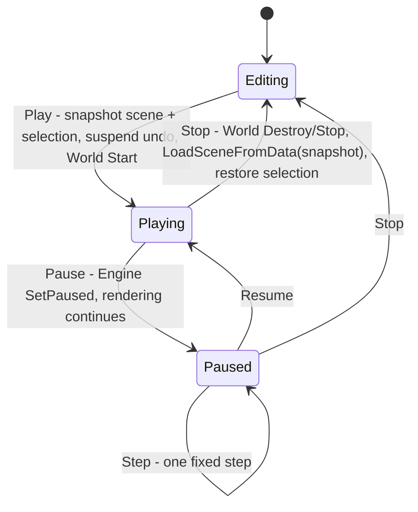

# Havana Editor

Havana is the ImGui-based editor. `EditorApp` is itself a `Game` subclass (standard entry point in `Modules/Havana/Source/main.cpp`) that hosts dockable widgets around a small set of **editor services**: one `Selection`, an `UndoStack`, named `EditorActions` (menus, shortcuts, command palette, scripts) and `EditorOps`, the undoable operations every widget uses to change the scene. Play mode snapshots the scene in memory and restores it on Stop. `--editor-exec` drives all of it from a script for unattended testing.
- **Search everywhere (ED-15):** once something is typed, the palette also finds entities (select and frame), assets (shown in the Asset Browser), settings (the Preferences / Project Settings tabs) and docs (`Engine/Docs/*.md`, opened in the code editor). Providers live in `EditorActions::SearchProviders`; results are cached per filter for a second.
- **What's working (ED-14):** background work shows in the title bar (a spinner, the first task, its progress, "+N" for more; the tooltip lists all). That includes script builds, asset and shader reimports, navmesh bakes and cooks, reported through `WorkStatus` (Dementia: `Begin` / `End` / `WorkStatus::Scope`, thread-safe). Notices (`WorkStatus::Notify`) show bottom right for 8 s with the action that fixes or shows them; a failed script build offers "Show errors" (`View.ErrorList`).

> Verified against engine commit 7e869c6e, 2026-10-09; Create menu, overlays and View menu rendering toggles against 1fa55311, 2026-10-09 (Wave 3); physics gizmos, menus and settings against 8fdd99b1, 2026-10-09 (Wave 4); audio gizmos and settings, and the `pick` / `assert-audio` commands against afce7083, 2026-10-09; tabbed Project Settings, data assets and `show-asset` against e0ca1f26, 2026-10-09; `wait-log` / `replace-in-file` against 6a4b006f, 2026-10-09; navigation menus, settings and choice fields against 8d6769a5, 2026-10-10; the Hardware tab and the budget overlay against 3f04199c plus the hardware profiles change, 2026-10-22; the rectangle light gizmo and preset against 94407e9d plus the concert lighting change, 2026-10-29; render textures (Create menu, details, pickers, the Camera preview and the `rtt-*` commands) against 89e036be plus the render texture change, 2026-10-29.

## Overview

Editor builds are gated by `ME_EDITOR` (Sharpmake "Editor" targets, `Docs/Build-System.md`). The editor camera renders into its own framebuffer that the **World View** displays; `PickingPass` reads entity IDs back from it (`Docs/Rendering-Pipeline.md`). A second `Input` (`Engine::GetEditorInput`) keeps editor input alive while the game owns the keyboard. Editor shortcuts themselves go through ImGui (`EditorActions::ProcessShortcuts`).

## Key Files

| Path | Role |
|------|------|
| `Modules/Havana/Source/EditorApp.h/.cpp` | The editor "game": play/pause/step/stop, scene management (new/open/save, unsaved prompt, autosave/recovery), quit veto |
| `Modules/Havana/Source/Havana.h/.cpp` | UI container: widgets, dockspace, action registration, focus contexts |
| `Modules/Havana/Source/Editor/Selection.*` | Selection service (multi-select, active entity/core, pick drill-down) |
| `Modules/Havana/Source/Editor/UndoStack.*` | Undo/redo history, transactions, merging, dirty tracking |
| `Modules/Havana/Source/Editor/EditorOperations.*` | `EditorOps`: undoable create/delete/duplicate/paste/reparent/rename/active/layer/add/remove component/component edits |
| `Modules/Havana/Source/Editor/EditorActions.*`, `DefaultEditorActions.*` | Action registry, shortcuts, command palette, rebinding |
| `Modules/Havana/Source/Editor/ReflectionUI.*` | Inspector widgets generated from reflection; field decorators |
| `Modules/Havana/Source/Editor/Inspectors/LightInspector.cpp` | The Light's decorators: temperature bar, intensity references, cone, falloff graph |
| `Modules/Havana/Source/Editor/Inspectors/CameraInspector.cpp` | The Camera's and PostProcess's decorators: focal length, lens wedge, render resolution, iris dial, focus band |
| `Modules/Havana/Source/Editor/Inspectors/PostProcessInspector.cpp` | The PostProcess's grading decorators: EV ladder, tonemap curve, white balance pad, lift / gamma / gain curve, fog visibility |
| `Modules/Havana/Source/Editor/Inspectors/PhysicsInspector.cpp` | The Rigidbody's, Rigidbody2D's and colliders' decorators: mass ladder, damping decay graphs, axis lock chips, bouncing ball, slide-angle ramp |
| `Modules/Havana/Source/Editor/Inspectors/AudioInspector.cpp` | The AudioSource's decorators: level meter, pitch keyboard, 2D / 3D slider, distance falloff graph |
| `Modules/Havana/Source/Editor/Inspectors/TransformInspector.cpp` | The Transform's uniform-scale lock (on Scale) and rotation dials (under Rotation) |
| `Modules/Havana/Source/Editor/Inspectors/CharacterInspector.cpp` | The CharacterController's, CharacterController2D's and NavMeshAgent's decorators: capsule (or cylinder) beside a person, pace strip, jump arc, slope wedge |
| `Modules/ImGUI/Source/Widgets/Graph.h`, `LightWidgets.h`, `CameraWidgets.h`, `PostWidgets.h`, `PhysicsWidgets.h`, `AudioWidgets.h`, `CharacterWidgets.h`, `TransformWidgets.h`, `MaterialWidgets.h`, `ChoiceWidgets.h`, `Color.h` | Plot canvases with draggable handles; the light, camera, post, physics, audio and character widgets built on them (with the lens math, the shaders' tonemap, grading and fog math, Box3D's bounce, friction and damping math, decibels, semitones and FMOD's rolloffs, and the character mover's capsule and jump math); the transform widgets (glyph toggles, the scale lock, angle dials, the spring pill, vector copy/paste text); the material widgets (the metallic x roughness sphere pad, emissive stops, the relief tile); the choice widgets (segmented controls for enums, toggle chips for masks, with their fit and shortening rules); colour temperature |
| `Modules/Havana/Source/Editor/PrefabTools.*` | Prefab create/override/apply/revert/unpack |
| `Modules/Havana/Source/Editor/EditorCameraController.*` | Scene camera navigation |
| `Modules/Havana/Source/Editor/SceneTools.*` | Bounds, ray picking, grid/selection/gizmo overlays |
| `Modules/Havana/Source/Editor/EditorAutomation.*` | `--editor-exec` script runner |
| `Modules/Havana/Source/Cores/EditorCore.*` | Owns the scene camera, queues overlays, saves scenes |
| `Modules/Havana/Source/Widgets/` | `SceneViewWidget` (World/Game View), `SceneHierarchyWidget`, `PropertiesWidget`, `AssetBrowser`, `LogWidget`, `HistoryWidget`, `ProfilerWidget`, `SettingsWidgets` (Preferences, Project Settings), `BuildGameWidget` (File > Build Game), `MainMenuWidget`, `AssetPreviewWidget`, `ResourceMonitorWidget` |
| `Modules/Havana/Source/Utils/EditorConfig.h` | Editor state and preferences: per project in `.tmp/Havana.cfg`, per user in `Preferences.json` in the OS preference folder (ED-2) |
| `Source/Engine/ProjectSettings.*` | Project settings (layer names, layer collision matrix, gravity) in the project's `ProjectSettings.json` under `Assets/Config` |

## How It Works

### Selection

`Selection::Get()` is the single source of truth: an ordered list of entities (the last one is **active**, the one the inspector shows) or one core. Widgets query it every frame; `GetVersion()` changes on every edit, `SelectionChangedEvent` fires after changes, and the legacy `InspectEvent`/`ClearInspectEvent`/`PickingEvent` are accepted as requests. `GetRootEntities()` drops entities whose ancestor is also selected (what delete/duplicate/drag act on). `SaveGUIDs`/`RestoreGUIDs` let selection survive play mode and undo.

Scene-view picking: a click (press and release without dragging) requests a GPU pick; empty space clears the selection, Ctrl toggles, Shift adds. `ResolvePickTarget` selects the outermost model or prefab-instance root first, then one level deeper per click on the same branch.

### Undo and editor operations

Every scene edit goes through `EditorOps`, which applies the change and pushes an `UndoCommand`. Commands identify entities by **GUID**, never pointers, so they survive deletes and re-creates:

- Create/delete/duplicate/paste serialize the affected subtrees (`SceneSerializer::SerializeEntities`) and restore them with identical GUIDs and sibling positions. Undoing a create re-selects what was selected before.
- Reparent/reorder records parent, sibling index and transform state before and after (world transforms are kept).
- Component edits store before/after JSON. The inspector captures them generically: it keeps a baseline snapshot, refreshes it before inspector input, and commits when the interaction in that component's UI ends. Pending edits keep their original baseline. Idle selection does not repeatedly serialize large models. Custom `OnEditorInspect` code therefore gets undo for free. Gizmo drags record one step per drag.

Outside the scene (ED-13), the same history also covers these. None of them mark the scene modified, since the commands report `AffectsSavedState() == false`.
- **Asset Browser renames and moves:** `AssetMoveCommand`, which moves the file with its `.meta` through `MoveWithMeta`. Renaming a script also restores the old class name and file contents.
- **Deletes:** each deleted asset goes to its own folder under `.tmp/Trash`, and `.tmp/Trash/Trash.json` records where it came from and its GUID. Undo puts the asset back and registers the GUID again. The browser's background menu has **Trash...**, a window listing what's there with Restore (itself undoable).
- **Project Settings:** every save of `ProjectSettings` is recorded as before/after snapshots of the file (`ProjectSettings::Serialize/Deserialize`, `ProjectSettingsWidget::TrackChanges`). Saves less than a second apart merge into one step. The Time tab (Engine.cfg) isn't covered.
- **Prefab Apply:** field and whole-instance applies record the prefab file before and after. Undo writes the old file and pushes it back into the other instances. The applying instance keeps its values, which become overrides again.

`UndoStack` supports transactions (`UndoTransaction` RAII), merging consecutive commands with the same merge key, a 256-entry cap, and dirty tracking: the scene is dirty when the undo cursor isn't at the saved position, which drives the `*` in the title and the unsaved-changes prompts. While playing, the stack is **suspended**: pushes are dropped and undo/redo are disabled.

### Actions, shortcuts and the command palette

`EditorActions` holds named actions (`Edit.Undo`, `Gizmo.Rotate`, ...) with display names, categories, shortcuts (`ImGuiMod_Shortcut` = Ctrl, or Cmd on macOS), an optional alternate shortcut, an enabled predicate and a **context**:

- `Global` actions fire anywhere.
- `Scene` actions (delete, copy/paste, gizmo keys, frame selected) only fire while the Hierarchy or World View has focus.

Shortcuts don't fire while typing in a text field unless the action opts in (Save does). While the game owns input, only actions flagged `AllowWhileGameFocused` (Play/Stop/Pause/Step) fire. Menus use `EditorActions::MenuItem(id)`, so labels, shortcuts and enabled state stay consistent. Ctrl+Shift+P opens the fuzzy command palette. Shortcuts can be rebound in Preferences > Shortcuts; overrides persist in the editor config and apply to actions registered later.

| Default shortcut | Action |
|------|------|
| Ctrl+Z / Ctrl+Y, Ctrl+Shift+Z | Undo / Redo |
| Ctrl+X / C / V / D, Delete, F2 | Cut / Copy / Paste / Duplicate, Delete, Rename (scene context) |
| Ctrl+A, Esc | Select all / deselect (scene context) |
| Ctrl+Shift+N, Alt+Shift+N | Create empty / create empty child |
| Ctrl+N / O / S, Ctrl+Shift+S | New / Open / Save / Save As |
| Ctrl+P or F5, Ctrl+Alt+P or F10, F11 | Play/Stop, Pause, Step one fixed frame |
| W / E / R / T, X, Z | Move / Rotate / Scale / Universal gizmo, local/world, pivot/center (scene context) |
| F, Keypad 1/3/7, Keypad 5 | Frame selection, front/right/top views, perspective/ortho |
| Ctrl+H, Ctrl+Space, Ctrl+, | History panel, asset browser, Preferences |
| Ctrl+Shift+B | Build Game window |

### Play mode



`EditorApp::Play` serializes the world in memory (`SceneSerializer::SerializeWorld`), records the selection GUIDs and dirty state, suspends undo and starts the world. `Stop` destroys the world and reloads the snapshot through `Engine::LoadSceneFromData` under the scene's real path. Because GUIDs are preserved, the selection and the whole undo history are valid again afterwards. The Game View's "Maximize On Play" option fills the dock area while playing. The main menu has a time-scale slider while playing.

Play options (ED-9):

- **Simulate** (the toolbar button next to Play, `Play.Simulate`) plays without scripts. `ScriptCore::SetSuspended` keeps every script from starting or updating, while physics, animation, particles, sequences and the other cores run. Stop ends it like Play.
- **Keep Values After Stop** (a component's context menu, in Play) carries that component's values at Stop into the edited scene. `EditorOps::CapturePlayValues` reads them before the world is torn down, and `ApplyPlayValues` writes them onto the restored snapshot as one undo step ("Keep Play Mode Values"). Components that weren't kept go back as usual.
- **Play From Scene Camera** (the Game View menu, preference `Play.FromSceneCamera`) starts the game's current camera where the World View is looking. A camera under a rig or a character moves its top-level ancestor by the same offset instead, keeping the rig's orientation. The snapshot is taken first, so Stop puts it back.
- **The Game View's display preset** (Freeform, 16:9, 1080p, Steam Deck...) is remembered when picked from its menu (preference `GameView.Display`). Automation's `designer-preview` doesn't change the remembered one.
- **Play over the network** (the toolbar's **Net** button, NET-7): with Clients above 0, Play hosts a listen server in the editor and starts that many game Players that join it, each driven over its stdin and its log in the Log as `[client N] ...`; the popup's link conditions (lag, jitter, loss, duplicates, both directions at the editor's end) change live, and Stop closes the session and every client (none outlives the editor). Unattended runs start offline whatever the popup says. **View > Net Debugger** (or the popup's **Net Debugger...**) is the same in a dockable panel: the settings and condition sliders, the clients with Stop / Start / Restart, the listen server's connections (RTT, loss, kbps, slack, missed commands, killcams on their way) and top-bandwidth entities, its lag-compensation overlays, and a tab per client with the server's end of its link as graphs and that client's own Net Debugger (asked over its stdin, drawn with the Player's code). See `Networking.md`, Play In Editor over the network.
- **Build & Run** (File > Build & Run, or the button in Build Game) builds the selected profile and, if it succeeds, starts it through its launcher from its build folder.
- **Automation:** `simulate`, `keep-values <Component>` (the selected entity's) and `build-game <profile> | ... run <game args>`. `wait-file <path> | <frames>` waits for something a launched game writes. PlayOptionsFlows, SimulateFlows and BuildGameFlows cover them.

### Scene management

New/Open/Quit (including closing the window) go through `RunWithUnsavedCheck`. If the scene is dirty, a modal offers Save / Don't Save / Cancel. Closing the window is vetoed via `Game::OnQuitRequested` and `IWindow::CancelClose` until answered. Scene loads are queued events, processed at the start of the next frame. File > Open Recent lists the last 10 scenes.

**Autosave**: while the scene is dirty, every `Autosave.IntervalSeconds` (default 120 s, 0 = off) the world is written to `.tmp/Autosave/Autosave.lvl` with `Session.json`. A clean exit deletes them. If they exist at startup, the editor offers to recover the autosave under the original scene path, marked dirty.

### Scene view (World View)

- **Shading** (World View and Game View): each toolbar has a **Shading: Lit** menu with **Lit** (scene lighting and post-processing), **Unlit** (base colors and textures), **Solid** (neutral surfaces with a soft camera light), and **Normals** (world-space surface normals, including normal maps). Use Unlit or Solid to navigate dark levels. Inspection modes bypass fog, exposure, grading, bloom, ambient occlusion and vignette, and hide decals and particles. They retain mesh transparency, alpha cutouts, animation, picking and editor overlays. Each view remembers its choice independently in editor preferences; camera components and scene materials are unchanged. The command palette exposes `View.Shading.<mode>` and `GameView.Shading.<mode>`. Mesh inspection shading applies to StandardMaterial and its legacy Diffuse/White aliases; custom shaders keep their own shading.
- **Additional shading modes**: Wireframe draws actual triangle edges at the selected mesh LOD, using the same static, skinned or posed vertices. Vertex Normals omits normal maps. Metallic, Roughness and Occlusion display the final material values as grayscale; Emissive isolates emission (intensities above display white clip). UV Checker shows ten checks per UV tile, including material tiling, with blue tile borders. Depth displays linear camera distance from white to black over the configurable Depth Range. Lighting Only shows scene lights and shadows on neutral, nonmetallic surfaces, retaining normal maps and camera image settings. Their action suffixes are `Wireframe`, `VertexNormals`, `Metallic`, `Roughness`, `Occlusion`, `Emissive`, `UVChecker`, `Depth`, and `LightingOnly`.
- **View options** (both windows): independently toggle post-processing, fog, background, transparent meshes, particles, decals, debug drawing, backface culling and game UI. Exposure adds an EV offset to Lit / Lighting Only without editing the camera. Depth Range sets the depth display scale in metres. Inspection modes hide particles and decals; wireframe and depth use dark backgrounds. Reset View Options restores the defaults without changing the chosen shading mode. All options persist per viewport in `.tmp/Havana.cfg`, survive Play/Stop, and never dirty the scene. Command palette actions use `View.Toggle.<option>` / `GameView.Toggle.<option>` and `View.ResetOptions` / `GameView.ResetOptions`. The World View menu also contains its existing overlays and camera tools.
- **Gizmo** (upstream ImGuizmo): Move/Rotate/Scale/Universal, local/world, pivot/center, snapping with per-mode increments (toolbar toggle, Ctrl inverts while dragging). With several selected entities the gizmo drives a proxy matrix P, and every dragged root gets `W = P * P0^-1 * W0` through `Transform::SetWorldMatrix`, so parents and rotation are handled correctly. Physics bodies follow because `PhysicsCore` notices the moved Transforms and teleports their bodies.
- **Gizmo modes toolbar** (UX-11): Move / Rotate / Scale / Universal sit on one track with a highlight pill that springs to the active mode (`MeWidgets::SpringPill`, through Juice: static at Juice Off or with reduce motion). Each button reports `active` / `inactive` (`World View/Rotate`).
- **View cube** (top right) snaps the camera around its pivot.
- **Camera** (`EditorCameraController`): RMB fly (WASD/QE/Space, wheel changes speed, Shift fast), Alt+LMB orbit, MMB pan, Alt+RMB dolly, wheel zoom toward the pivot (orthographic size in ortho; switching to orthographic keeps the pivot the same size on screen). While dragging to navigate, the cursor wraps across the scene viewport's edges for continuous movement and full rotations. F frames the selection's bounds, or the whole scene when nothing is selected, fitting both FOV axes. The view persists in the editor config.
- **Overlays** (`SceneTools`, drawn with `DebugDraw` as editor-only lines): a distance-faded grid, by default at y = 0 with its spacing following the camera's height and X/Z axis lines (ED-8: View > Grid Settings picks the XZ, XY or YZ plane, a fixed cell size and an offset along the plane's normal: preferences `Scene.GridPlane`, `Scene.GridSpacing`, `Scene.GridOffset`); selection bounds (bright where visible, faint through geometry); camera frustums; light gizmos per type (directional arrow, point range sphere, spot cones, a selected rectangle's beam frustum from its face at the outer and inner cone angles); the selected particle system's emission shape; decal projection boxes with their direction; clickable camera/light/audio/particle/decal icons; a stats overlay (fps, ms, GPU ms, draws, triangles, entities). Each can be toggled from the View menu. The View menu also switches shadows, the shadow-cascade tint, the physics debug draw and the navigation debug draw on and off (actions `View.Shadows`, `View.ShadowCascades`, `View.Physics`, `View.Navigation`; see `Docs/Navigation.md`). `Navigation.BakeAll` (command palette) bakes every NavMeshSurface. The selected entity's 3D and 2D colliders (green, triggers blue), character capsule and joint anchors are drawn too (`SceneTools::DrawPhysicsGizmos` / `DrawPhysics2DGizmos`), as are a selected 3D audio source's min / max distance spheres.
- **Marquee**: drag on empty space to box-select pickable entities (resolved to their pick roots), Shift/Ctrl add.
- **Drops**: models and prefabs dropped on the view land on the surface under the cursor (oriented-bounds raycast), else on the ground plane.
- **Drop to Surface** (ED-8, End, `Edit.DropToSurface`): each selected root moves straight down until the bottom of its bounds rests on the mesh below it, ignoring itself and its children (`EditorOps::DropToSurface`, one undo step). Without anything below, it drops to the y = 0 plane if it's above it.
- **Surface snap** (ED-8): hold Shift while dragging the Move gizmo and the selection slides over the surface under the cursor. The active root's bounds bottom centre sits on the hit, the rest follow rigidly, and the drag is one undo step as usual (`EditorOps::PlaceOnSurface`; `surface-place <fx> <fy>` from an edscript).
- **Vertex snap** (ED-8): hold V while dragging the Move gizmo and the active root's pivot jumps to the mesh vertex nearest the cursor (within 30 px; the moved entities' own meshes don't count, compact model parts do). The rest of the selection follows rigidly; a yellow dot marks the vertex (`SceneTools::NearestVertex`; `vertex-snap [x, y, z]` snaps to the vertex nearest that point's projection).
- **Measure** (ED-8, the toolbar's Measure toggle): drag in the World View to measure between surface points (mesh hits, else the y = 0 plane). The line and its length in metres stay until the next measure or until the tool is turned off. `measure <fx> <fy> | <fx> <fy>` logs `Measure: <m> m from [..] to [..]`.
- **Camera bookmarks** (ED-8): Ctrl+Shift+1..9 stores the World View camera for the open scene, and Shift+1..9 returns to it (View > Camera Bookmarks; preference `Camera.Bookmarks`).
- **Automation:** `assert-scene-camera [x, y, z] ~ tol` (or `!=`), and `view-option <Id> | true` (a World View option for the session). SceneViewFlows covers drop, undo, landing on a stacked mesh, surface placement, a measure, the bookmarks and an XY-grid capture.

### Hierarchy

Multi-select (Ctrl toggles, Shift ranges), search with `t:Type` to filter by component, inline rename (F2 or double-click), drag onto a row to reparent or between rows to reorder (keeps world transforms, cycle-safe), an active toggle per row, prefab instances drawn blue and inactive rows dimmed. The Create menu (and Create Child) offers empty entities, 3D Objects (Cube, Plane, Sphere, Cylinder, Capsule; StandardMaterial, each with a fitting static collider), Physics (dynamic Cube/Sphere/Capsule, Trigger Volume, Character Controller), Physics 2D (Dynamic Box/Circle, Static Platform, Trigger Area, Character Controller 2D; thin meshes as stand-ins), Camera, Light (Directional, Point, Spot, Bar, Box, Rectangle), Effects (Fire, Smoke, Sparks particle presets, and a downward Decal), Audio Source and Navigation (NavMesh Surface, Agent, Link, Modifier Volume, Obstacle). Transform-less entities are listed under "Utility". Scene-view picks reveal and scroll to the picked row.

**Lock Picking** (ED-7, the row's context menu, for the selection) makes the World View unable to pick an entity or its children. A click on one selects nothing, and the marquee and gizmo icons skip it, so you can work on what sits behind or inside it. Locked rows show "(locked)". The lock is editor-only and lasts the session (it's kept by GUID, so it survives Play and reloads). `pick-lock <name> | 1|0` sets it from an edscript, and SpritePickFlows checks it.

The **Editor Entities → Scene Camera** entry selects the editor camera settings in Properties. It exposes position (m), pitch/yaw, fly speed (m/s), sensitivity, focus smoothing, projection, FOV and near/far clipping (m). The default near clip is 0.1 m. Clear settings follow the scene camera by default; turn off **Use Scene Environment** to customize the editor background. These settings persist in `.tmp/Havana.cfg` and do not dirty or serialize into the scene. The World View's View menu and command palette also offer **Scene Camera Settings** (`View.CameraSettings`).

### Inspector

The entity header shows active, name, layer (with Project Settings names) and GUID (click to copy), plus a prefab bar for instances. Components are drawn as collapsible sections with an enable toggle and a context menu: Reset (reflected defaults), Copy/Paste Values, Remove, and Revert/Apply to Prefab for instances.

Reflected components get generated UI from `ReflectionUI`, chosen from each field's `PropertyType` and metadata:

- Numbers (floats, doubles, integers without named choices) are **unit fields** (UX-2, `MeWidgets::UnitField` in `Modules/ImGUI/Source/Widgets/ScrubField.h`). The value shows in its unit ("10 m", "20°", "-6.0 dB") over a fill bar for its range. Drag the row's label or the value to scrub (Shift fine, Ctrl coarse, Alt snaps to round steps). The range spans the field's width: the soft range when there is one, else the hard range; without either, `Speed` per pixel. Log fields scrub and fill in log space. Click the value (or Ctrl+click, or Space on it) to type: units of the same kind convert ("150 cm", "0.25 turn", "36 km/h", "-6 dB") and `+ - * / ( )` work ("2*3 m"). A value of the wrong kind is refused, with the reason shown for a moment. Double-click the label to reset to the field's `.Default( v )`, or else to a new component's value. Every gesture is one undo step. `.Widget( WidgetKind::Slider )` keeps a classic slider. Angles (`.Angle()`, stored in radians) are shown in degrees.
- **Juice** (UX-3, `MeWidgets::Juice` in `Modules/ImGUI/Source/Widgets/Juice.h`):
  - the fill bar springs to a new value (with a little overshoot at Full);
  - a typed or reset value flashes, and a reset throws sparks;
  - a scrub ticks at each Alt-snapped step, at a hard limit and at the soft range's ends;
  - a refused entry shakes;
  - a looping preview (the physics **Bounce** ball) runs on `Juice::LoopTime`, which stops at Off and with reduce motion.

  Edit > Preferences > Appearance > Motion sets **Juice** to Off, Subtle or Full (`Appearance.Juice`, Full by default). At Off the widgets are visually static. **Reduce motion** (`Appearance.ReduceMotion`) keeps the flashes and drops everything that moves. **Sounds** (`Appearance.JuiceSounds`, off by default) turns on the editor's sound cues: tick, reset, commit and refuse. The editor ships no UI sounds yet, so the cues are logged (`[juice] sound cue Tick`). Runs with `--frame-time` animate on that fixed step, so captures of an animation match on every machine.
- **Widget Gallery** (View > Widget Gallery, `Widgets/WidgetGalleryWidget.cpp`): every kit widget with fixed sample values. **Poke** fires every kind of feedback at once and **Reset** restores the samples. Use it for screenshot regression and for trying the juice levels (`Tests/Editor/UX3Juice.edscript`: two captures differ at Full and Subtle and are identical at Off). `Tests/Editor/UX4GalleryReference.edscript` compares it, with juice Off, against `Tests/Editor/Reference/WidgetGallery.png`, then scrolls to the camera widgets and compares them against `WidgetGalleryCamera.png`, to the post widgets against `WidgetGalleryPost.png`, to the physics widgets against `WidgetGalleryPhysics.png`, to the audio widgets against `WidgetGalleryAudio.png`, to the character widgets against `WidgetGalleryCharacter.png`, the transform widgets (UX-11) against `WidgetGalleryTransform.png`, the material widgets (UX-12) against `WidgetGalleryMaterial.png` and the choice widgets (UX-13, at the bottom: 3- and 5-value segments, icon segments, a mixed control, mask chips) against `WidgetGalleryChoice.png`. After a deliberate look change, copy the flow's `.tmp/UX4-Gallery.png`, `.tmp/UX4-Gallery-Camera.png`, `.tmp/UX4-Gallery-Post.png`, `.tmp/UX4-Gallery-Physics.png`, `.tmp/UX4-Gallery-Audio.png`, `.tmp/UX4-Gallery-Character.png`, `.tmp/UX4-Gallery-Transform.png`, `.tmp/UX4-Gallery-Material.png` and `.tmp/UX4-Gallery-Choice.png` over the references. Adding a section below the others changes how far the earlier captures scroll, so check each one by eye before copying it.
- **Units everywhere** (UX-4): every component's numbers carry their unit, log scale and soft range. Labels no longer repeat the unit ("Range", not "Range (m)"). `UnitMetadataTests` checks the metadata of every reflected component: soft ranges sit inside hard ranges, log fields have usable ranges, defaults are in range, and labels don't repeat units. `Tests/Editor/UX4UnitLabels.edscript` reads each unit-tagged field's default back from the inspector, exactly as it is shown ("10 m", "60°", "-6.0 dB").
- **Field decorators** (UX-5, `ReflectionUI::RegisterFieldDecorator`): extra rows drawn right under a field, inside the component's group, so a gesture on one is one undo step and its edits reach every selected entity. They are hidden while the field search is active. The **Light** inspector uses them (`Editor/Inspectors/LightInspector.cpp`, widgets in `Modules/ImGUI/Source/Widgets/LightWidgets.h`):
  - **Temperature** under Color: a bar of blackbody colours from 1000 K to 12000 K (log scale). Click or drag it to set Color to that temperature's sRGB colour, brightest channel 1 (`MeWidgets::ColorTemperature`, Tanner Helland's fit). The arrows under it are presets: Candle 1900 K, Tungsten 2700 K, Halogen 3200 K, Daylight 5600 K, Overcast 6500 K, Shade 7500 K and Blue sky 10000 K. A drag snaps to a preset and ticks as it passes one. When Color lies on the blackbody curve, a marker shows its temperature ("5600 K Daylight"); a colour off the curve shows no marker.
  - **Reference** under Intensity: a log strip over the soft range with labelled rungs. Local lights get Candle 0.1×, Bulb 1× and Floodlight 8×; directional lights get Moonlight 0.05×, Overcast 1× and Sun 5×. These are looks-like references for the default exposure, not photometric values (the tooltip says so). Click a rung to use it, or drag along the strip to scrub.
  - **Cone** under the cone angles (spot and rectangle lights only): the beam seen side-on, fully lit inside the inner half angle and feathered to the outer one. Drag the **Inner Cone** and **Outer Cone** handles on its arcs (0..89°, whole degrees, Shift for tenths). Dragging one past the other carries the other along, so inner never exceeds outer. Past horizontal a handle stays at 89°, even carried over the top of the apex.
  - **Falloff** under Range (every type but directional): the engine's attenuation, `distanceAttenuation` in `Assets/Shaders/Lighting.sh` (inverse square windowed to zero at Range), as log brightness against distance from 0 to 1.2× Range in metres. For bar, box and rectangle lights the curve includes the emitter's near-field softening at its world scale (`Light::BuildCommand`). A faint plain inverse-square curve sits beside it. Drag the **Range** handle on the axis. The axis holds still while you drag, then eases to the new range.

  The widgets are built on `MeWidgets::Graph` (`Widgets/Graph.h`): a plot canvas with linear or log axes, a grid labelled in the axis unit, plotted functions, and draggable handles. Handles are real items. They grow on hover, tick at detents and only move once a press becomes a drag (a click leaves the value alone), and automation finds them in the widget's row: `Light/Temperature/Candle`, `Light/Reference/Bulb`, `Light/Cone/Inner Cone`, `Light/Falloff/Range`. The widget itself (`Light/Temperature`) reports what it shows ("5600 K", "off curve"). `Tests/Editor/UX5Lighting.edscript` drives each of them, and `GraphTests.cpp` covers the mapping and colour math.
- **Camera and lens** (UX-6, `Editor/Inspectors/CameraInspector.cpp`, widgets in `Modules/ImGUI/Source/Widgets/CameraWidgets.h`). Lens sizes are measured against a sensor height: the camera's PostProcess **Sensor Height** when its entity has one, else 24 mm (full-frame 35 mm). The tooltips say which.
  - **Focal Length** under Field of View (perspective cameras): the focal length that gives the vertical field of view on that sensor, f = h / (2 tan(fov / 2)). It is a unit field in millimetres. Type a lens ("35 mm") and the field of view becomes 2 atan(h / 2f); scrubbing works too (log scale).
  - **Lens** under it: the frustum seen from the side, a wedge of the vertical field of view. Drag its **FOV** handle, or anywhere in the wedge, to set the full angle in whole degrees. The corner shows the focal length and its class (Wide, Normal, Telephoto, from the full-frame equivalent). Under the wedge, a lens ring holds the primes 14, 24, 35, 50, 85, 135 and 200 mm. Click one to use it (50 mm on full frame is 26.99°), or drag along the ring to zoom; the drag snaps to a prime and ticks as it passes one.
  - **Resolution** under Render Scale: the internal resolution against the output, e.g. "1280 x 720 of 1920 x 1080", computed like the renderer does (`Moonlight::ComputeRenderSize`; the pixel filter's 1/N snapping; Pixel Perfect's own size), including what the renderer adds to game cameras that aren't Pixel Perfect: the player's render scale and upscale filter and the hardware profile's render scale and pixel caps (the tooltip names whichever applies). The output is the Game View for the main camera, the render texture's size for a camera with a Target Texture, and the Game View size (or its viewport rect of it) for other cameras, as it would be once current. Click the 50%, 67%, 75% or 100% detents, or drag along the strip in whole percents.
  - **Iris** under Aperture: a seven-bladed iris whose opening follows the f-number (radius ∝ 1/√N, so it stays visible at f/22), beside the full stops f/1.4 to f/22. Click a stop, or drag along the row (or from a stop) to scrub in log space. The drag snaps to nominal third stops (f/3.2, f/4.5, ...) and ticks at each one.
  - **Focus Band** under Focus Distance: a log bar from 0.1 m to 1 km with the band the lens keeps sharp. The near and far limits come from the hyperfocal distance H = f² / (N c) + f, with f the camera's focal length, N the aperture and c = 0.03 mm × sensor height / 24. They read "6.31 m to 10.9 m" (50 mm at f/2.8, focused at 8 m). Drag the **Focus** handle or click the bar to focus. **H** focuses at the hyperfocal distance, sharp from half of it to infinity. The Focus Distance field keeps its own 1 mm-per-pixel drag.

  Automation finds the parts as `Camera/Lens/FOV`, `Camera/Lens/50 mm`, `Camera/Focal Length`, `Camera/Resolution/50%`, `PostProcess/Iris/2.8` and `PostProcess/Focus Band/Focus` (or `/Hyperfocal`). Each widget reports what it shows (`Camera/Lens`: "50 mm"; `Camera/Resolution`: "470 x 141 of 939 x 281"; `PostProcess/Iris`: "f/2.8"; `PostProcess/Focus Band`: "6.31 m to 10.9 m"). `Tests/Editor/UX6Camera.edscript` drives each one in `DepthOfFieldTest.lvl`, and `CameraWidgetTests.cpp` covers the field-of-view, depth-of-field and third-stop math (`MeWidgets::Lens`).
- **Post and grading** (UX-7, `Editor/Inspectors/PostProcessInspector.cpp`, widgets in `Modules/ImGUI/Source/Widgets/PostWidgets.h`). The curves come from the shaders' own math, replicated in `MeWidgets::PostMath` (`Assets/Shaders/Post/Tonemap.frag` and `PostCommon.sh`, `Assets/Shaders/Fog.sh`):
  - **Lit Like** under Exposure Compensation: a bipolar strip from -6 to +6 EV with a centre detent at 0 and looks-like rungs: Sunlight -3, Overcast 0, Indoor +2 and Night street +5 EV. They fit the engine's lights (the Light inspector's Sun 5×, Overcast 1×), not metered EV; the tooltip says so. Click a rung or the strip, or drag along the strip (or from a rung) in third stops; the drag snaps to 0 and the rungs and ticks as it passes them. Double-click the value's marker (`PostProcess/Lit Like/Value`) to return to 0: pressing the marker doesn't move the value, so the reset is one undo step.
  - **Tonemap Curve** under Tonemapper: what the screen shows (sRGB 0..1) against scene luminance (log, 0.001..100) for a grey, with the exposure compensation applied, before grading. The active tonemapper is drawn bold over the other three, faint. A dot marks mid grey (0.18) and its display value. Click None, ACES, AgX or Reinhard under the plot to switch. It reports "ACES: 0.18 -> 0.32" (the Fog showcase at -0.2 EV). With auto exposure, luminance is relative to the adapted average.
  - **White Balance** under Tint: an XY pad, Temperature across (cool to warm) and Tint up and down (magenta to green), tinted with what the white balance does to a light grey (`whiteBalance`: red ×(1 + 0.2 t), green ×(1 - 0.1 tint), blue ×(1 - 0.2 t)). Drag the **Puck** or click the pad, in hundredths. An axis only changes while the pointer moves along it, so a drag straight across keeps the other value exactly (a typed 0.123 stays). Each axis snaps to 0 when a drag crosses the crosshair and holds there within a third of an em; every other hundredth stays reachable. Double-click the puck to reset both to 0. A double-click elsewhere on the pad is a click: its first click moves the puck there, and the second doesn't reset.
  - **Lift Gamma Gain** under Gain: the grade's tone curve, output against input, both as seen (sRGB), with Contrast included (c = (c - 0.18) k + 0.18; c = c gain + lift (1 - c); c^(1 / gamma)). The diagonal is "no change"; the shaded bands clip. Drag the **Lift** (black) and **Gain** (white) handles up or down; each solves its parameter for that point. **Gamma** (mid) stays on the curve and works like a scrub: 3 em of vertical travel doubles (or halves) it, Shift ten times finer (15 px up at the default font is 1.21, or 1.02 with Shift), with a detent at 1. Double-click a handle to reset it (0, 1, 1). The engine grades luminance only: Lift, Gamma and Gain are single values, so there are no colour wheels (adding hue offsets would need new PostProcess fields and shader uniforms).
  - **Fog Visibility** under Fog Density: "visibility 86 m", the distance where the fog reaches 95% looking level at its base height: start + ln 20 / density (unlimited when the density is 0). Under 95% Max Opacity the fog never hides anything: the readout says "unlimited: 80% cap (86 m uncapped)", and the handle sits where the fog would reach 95% at full opacity, so dragging it moves what it shows. Below it, the fog's opacity against distance on a log bar (1 m to 10 km) shaded in the fog colour. Drag the **Visibility** handle (or click the bar; the readout above it doesn't take clicks) to set the density for that visibility, at two significant digits (350 m sets 0.00856 /m). The tooltip gives the visibility 5 m above the base height, where the fog is thinner.

  Automation finds the parts as `PostProcess/Lit Like/Sunlight`, `PostProcess/Tonemap Curve/AgX`, `PostProcess/White Balance/Puck`, `PostProcess/Lift Gamma Gain/Gain` (or `/Lift`, `/Gamma`) and `PostProcess/Fog Visibility/Visibility`. Each widget reports what it shows (`PostProcess/Lit Like`: "-0.2 EV"; `PostProcess/White Balance`: "0.3, 0.38"; `PostProcess/Lift Gamma Gain`: "Lift 0, Gamma 1, Gain 1"; `PostProcess/Fog Visibility`: "visibility 86 m"). `Tests/Editor/UX7PostGrading.edscript` drives each one on the Fog showcase (`Assets/Scenes/Showcase/Fog.lvl`), and `PostWidgetTests.cpp` checks the tonemap, grading, white balance and fog math against values computed from the shaders.
- **Physics feel** (UX-8, `Editor/Inspectors/PhysicsInspector.cpp`, widgets in `Modules/ImGUI/Source/Widgets/PhysicsWidgets.h`). The math is Box3D's (Box2D's is the same), in `MeWidgets::PhysicsMath`:
  - **Weighs Like** under Mass (Rigidbody and Rigidbody2D): a log strip from 5 g to 30 t with everyday rungs: Feather 0.01 kg, Apple 0.1, Cat 4, Human 70, Motorbike 200, Car 1500 and Truck 15000. Names that don't fit side by side stagger over up to three rows. Click a rung or the strip, or drag along the strip (or from a rung) at two significant digits. The drag snaps to a rung near the pointer and ticks as it passes one. Double-click the value's marker (`Rigidbody/Weighs Like/Value`) to reset to the field's default, 1 kg. The **Auto** chip before the strip sets 0 kg, where the mass comes from the colliders' densities; the chip lights up and the widget reports "Auto (from density)".
  - **Linear Decay** and **Angular Decay** under the damping fields: the speed (or spin) left over time with nothing else acting. The time axis is 3 s, widening to 5, 10, 20 or 30 s so the half-life fits with a quarter to spare (it holds still while you drag and eases over after). Box3D damps each substep (`solver.c`): v *= 1 / (1 + h d), with h the fixed step over the cores' 4 substeps (1/240 s at 60 Hz). The plotted curve is that factor compounded, v(t) = (1 + h d)^(-t / h), evaluated continuously. The faint curve behind it is exp(-d t), which the factor approximates. The readout says "half speed after 1.3 s". Drag the **Half-life** handle along the dashed 50% line to set the damping that halves it in that time, at two significant digits: d = (2^(h / t) - 1) / h, so 1.3 s sets 0.5338. When the half-life is past 30 s, or never (no damping), the handle sits pinned at the right edge behind two chevrons, still reports the true value ("never", "45 s"), and a drag starts from the edge's 30 s, so nudging the default angular damping (0.05, 14 s) keeps it at 14 s instead of jumping to the 3 s value.
  - **Lock Position** and **Lock Rotation** under the Rigidbody's lock fields: a chip per axis in the axis colour, with a closed padlock when locked. Click one to toggle its bool, one undo step a click. A summary ("Y locked") follows the chips. Rigidbody2D has only Freeze Rotation, so it gets a single **Z** chip under it and no position row. The six checkboxes stay, so search, prefab overrides and multi-edit keep working.
  - **Slide Angle** under every collider's Friction: a ramp at atan(friction) with a block on it, and "slides above 31°" (friction 0.6). A block on a ramp of the same material slides past that angle: Box3D mixes two shapes' friction as sqrt(a b), so the same material gives friction itself. Drag the **Angle** handle on the ramp's crest to set friction = tan(angle), in whole degrees (Shift for tenths, up to atan(2) = 63.4° at the field's 2 maximum).
  - **Bounce** under every collider's Restitution: a ball dropped on the floor. Each bounce leaves at e times the speed it hit with, so it rises to e² of the height it fell from (h_n = h0 e^(2n)). Dots mark the apexes, and a dashed rule marks the first bounce's height. It reports "bounces to 36%" (e = 0.6). At Subtle and Full the ball moves along the path on a loop clocked by Juice (`Juice::LoopTime`, so it follows `--frame-time`), and a new restitution restarts it from the drop. At Off or with reduce motion the ball rests at its drop point. It only shows the value: Box3D bounces two shapes with the larger restitution of the pair, which the tooltip says.

  Automation finds the parts as `Rigidbody/Weighs Like/Cat` (or `/Auto`, `/Value`), `Rigidbody/Linear Decay/Half-life`, `Rigidbody/Lock Rotation/Y`, `BoxCollider/Slide Angle/Angle` and `SphereCollider/Bounce`. Each widget reports what it shows (`Rigidbody/Weighs Like`: "2 kg"; `Rigidbody/Linear Decay`: "half-life never", and its `Half-life` handle "never"; `Rigidbody/Lock Position/X`: "locked" or "free"; `BoxCollider/Slide Angle`: "slides above 8.5°"; `SphereCollider/Bounce`: "bounces to 36%"). `Tests/Editor/UX8PhysicsFeel.edscript` drives each one on `Assets/Scenes/Tests/PhysicsTest.lvl`, including a light-theme pass, and `PhysicsWidgetTests.cpp` checks the ladder mapping, bounce heights, slide angle and damping half-life math.
- **Audio** (UX-9, `Editor/Inspectors/AudioInspector.cpp`, widgets in `Modules/ImGUI/Source/Widgets/AudioWidgets.h`). The math is in `MeWidgets::AudioMath`: Volume is a linear amplitude (FMOD `Channel::setVolume`, 0 dB = 20 log10(gain)), Pitch a playback-rate ratio (2^(n / 12) for n semitones), and the rolloffs are FMOD's with AudioCore's settings (rolloff scale 1, min distance at least 1 mm, max at least 1 mm past it):
  - **Level** under Volume: the volume on a level meter from -inf to +6 dB, on the IEC 60268-18 meter scale (wide steps near 0 dB, the quiet end compressed), with ticks at 0, -6, -12, -24 and -48 dB. Labels that would overlap are left out, so at narrow widths -48 gives way to -inf. Press the strip to jump the level to the pointer and drag along it in half decibels; drag the marker and it moves by the pointer's travel from where you grabbed it (a click on it, even a shaky one, never moves it). Without Shift the drag snaps to a tick near the pointer, but never past halfway to the next half-decibel step, so -0.5 dB stays reachable. Hold Shift for tenths with no snapping. The drag ticks as it passes a tick, and the far left (under -60 dB) is silence, "-inf dB". Double-click the value's marker (`AudioSource/Level/Value`) for 0 dB. The field stops at gain 1 (0 dB), so the range isn't changed: the 0 to +6 dB end is hatched headroom the field doesn't allow, and its "+6" is dimmed. While the source plays, a bar along the bottom of the strip shows its live level, FMOD's audibility after the bus, distance and occlusion: green, amber over -6 dB. In edit mode only the set level shows. It reports "-6.0 dB", like the field.
  - **Keyboard** under Pitch: one octave each way (-12 to +12 semitones). Key 0 is the clip as recorded, drawn as a C with a dot. Click a key (`AudioSource/Keyboard/+7`, `/-12`, `/0`) for ratio 2^(n / 12), so +7 sets 1.4983. Drag across the keys (or from one) and the pitch follows the key under the pointer (black keys only in their upper band), ticking at each. A press on a key becomes a drag only past the drag threshold, so a click that wobbles is still a click on that key. Hold Shift for cents, which scrubs at once between the key centres: dragging +7 five pixels right with Shift gives +7.5 st. A press that scrubbed is not also a click when it lets go. The marker on the rail above the keys sits at the exact pitch, with a line down through the keys. Dragging it moves the pitch by the pointer's travel, past the drag threshold (or at once with Shift), so pressing it keeps any cents. Double-click it (`AudioSource/Keyboard/Value`) for 0 st (ratio 1). A pitch past an octave (the field allows 0.1 to 3) pins chevrons to that end. Under the keys: "+7 st, +0 cents, ×1.498", which is also what it reports.
  - **Spatial** under Spatial Blend: a track between a **2D** and a **3D** end (`AudioSource/Spatial/2D`, `/3D`). Click an end to snap to 0 or 1. A press on the track jumps to the pointer in hundredths and drags on from there, with detents at both ends and the middle: it snaps when it crosses one and holds within 0.4 em. It reports "2D", "3D" or "71% 3D".
  - **Falloff** under Rolloff: gain (dB) against distance on a log axis spanning 1.25× Max Distance. The axis holds still while a handle is dragged, then eases over. The active rolloff is bold over the other two, faint:
    - Inverse: min / d, holding at min / max past Max Distance.
    - Linear: (max - d) / (max - min).
    - Linear Square: that ratio squared.

    A dot marks where it reaches -6 dB, and the reading says so: "Inverse: -6 dB at 2 m" for the defaults, or "Inverse: -3.5 dB at 1.5 m and beyond" when it never gets that quiet. Drag the **Min Distance** handle on the 0 dB line and the **Max Distance** handle at the curve's end, at two significant digits; Min stays at or under Max. Click Inverse, Linear or Linear Square under the plot to switch. At Spatial Blend 0 the curve dims and the reading says "2D: no distance fade". The Min Distance, Max Distance and Rolloff fields stay above it.

  Automation finds the parts as `AudioSource/Level/Value`, `AudioSource/Keyboard/+7` (or `/Value`), `AudioSource/Spatial/3D` and `AudioSource/Falloff/Min Distance` (or `/Max Distance`, `/Linear`, `/Linear Square`). Each widget reports what it shows. `Tests/Editor/UX9Audio.edscript` drives each one on a new AudioSource in `Assets/Scenes/Tests/AudioTest.lvl`, including a light-theme pass. `AudioWidgetTests.cpp` checks the decibel, semitone, meter-scale and rolloff math. Builds without FMOD never play, so the live level is only in the Widget Gallery's sample (a fixed gain of 0.18, -14.9 dB).
- **Characters and navigation** (UX-10, `Editor/Inspectors/CharacterInspector.cpp`, widgets in `Modules/ImGUI/Source/Widgets/CharacterWidgets.h`). The math is in `MeWidgets::CharacterMath` and follows the physics cores' character step (`PhysicsCore::StepCharacter`, `Physics2DCore`): Height is end to end with the caps, so the capsule's segment is max(Height / 2 - Radius, 0) each way, and a jump leaves the ground at v = sqrt(2 |g| JumpHeight) with g = gravity.y x GravityScale, signed: the cores keep adding g each step, so only a downward g brings the character back down. The gravity is the project's (Project Settings > Physics, `ProjectSettings::Gravity`), which both physics worlds start from. The same widgets decorate CharacterController and CharacterController2D:
  - **Capsule** under Height: the capsule from the side, to scale beside a 1.8 m person (simple shapes, a dashed rule at their height), on the ground with metre ticks up the left. Drag its **Height** handle (the top) and **Radius** handle (the side) in centimetres, Shift for millimetres. Height snaps to the person's 1.8 m. A capsule is never shorter than its two caps: the Height handle stops at 2 x Radius, and dragging Radius past half the height pushes Height up with it, in the same undo step. With several controllers selected only the field the drag changed is copied to the others, and then each of them gets the same rule: its Height rises to 2 x its Radius if it fell short. The vertical span is the first of 2.5, 3, 4, 5, 6, 8, 10, 15, 20 or 25 m that fits the taller of the two (and the capsule's width beside the person). It holds still under a dragged handle, then eases over. Under it: "1.8 m x 0.4 m" (height x radius), which is also what it reports. NavMeshAgent gets the same picture as a **Cylinder** under its Height: Recast agents are cylinders, so there are no caps to keep and a short, wide agent is fine.
  - **Pace** under MaxSpeed (and NavMeshAgent's Speed): the speed on a 0 to 10 m/s strip with rungs at **Walk** 1.4, **Jog** 3, **Run** 5 and **Sprint** 7.5 m/s. Click a rung (`CharacterController/Pace/Run`) to set it. Press the strip, or drag a rung past the drag threshold, and the speed follows the pointer in tenths of a m/s (Shift: hundredths), snapping to a rung near the pointer and ticking as it passes one. Drag the value's marker (`/Value`) and it moves by the pointer's travel. Double-click the marker for the component's default (6 m/s on CharacterController, 7 on CharacterController2D, 3.5 on NavMeshAgent). Faster than 10 m/s pins chevrons to the right end. It reports "5 m/s, run", or "4.3 m/s" off the rungs.
  - **Jump** under JumpHeight: the jump's arc running at MaxSpeed, with dashed marks at a **Curb** (0.15 m), a **Table** (0.75 m) and a **Human** (1.8 m). Under it: "takeoff 4.85 m/s, 0.989 s in the air" (air time 2 v / g) and "lands 5.94 m away at 6 m/s". Drag the **Apex** handle up and down to set JumpHeight in centimetres (Shift: millimetres). It snaps to a mark near the pointer and ticks as it passes one. Both axes hold still under the dragged handle, then ease over. With no gravity (or Gravity Scale 0) the cores give the jump no takeoff speed, and it says so. When the scaled gravity pulls up (a positive Gravity Y, or a negative Gravity Scale) the character takes off and never comes down: no arc, and it says "gravity pulls up: it never lands". In a narrow inspector the first line shortens to "4.85 m/s, 0.989 s" and the second is left out. It reports "1.2 m apex, 4.85 m/s takeoff, 0.989 s in the air".
  - **Walks Up** under SlopeLimit: a ramp wedge at the limit with a small figure walking up it, the angle's arc and a faint arc above it where steeper ground counts as a wall. Beside it: "walks up 50°", the grade ("119% grade", rise over run) and "steeper is a wall". Drag its **Slope** handle around the arc in whole degrees (Shift: tenths), or click a mark: **Ramp** (an accessible 1 in 12 ramp, 4.8°), **Stairs** (35°), **Steep** (60°). It reports "walks up 50°".

  NavMeshAgent's LinkJumpHeight has no arc widget: a link crossing lifts the agent by a fixed parabola, LinkJumpHeight x 4u(1 - u) along the link (`NavigationCore`), with no gravity or takeoff speed to show. Automation finds the parts as `CharacterController/Capsule/Height` (or `/Radius`), `CharacterController/Pace/Run` (or `/Walk`, `/Jog`, `/Sprint`, `/Value`), `CharacterController/Jump/Apex`, `CharacterController/Walks Up/Slope` (or `/Ramp`, `/Stairs`, `/Steep`) and `NavMeshAgent/Cylinder/Height`. Each widget reports what it shows. `Tests/Editor/UX10Characters.edscript` drives each one on a new CharacterController and a new NavMeshAgent in `Assets/Scenes/Tests/PhysicsTest.lvl`, with one undo step per gesture and a light-theme pass. `CharacterWidgetTests.cpp` checks the capsule clamp, the jump's takeoff speed, air time and arc, the slope grade and the paces.
- **Graph handles** (`MeWidgets::Graph::HandleSpec`): `ReportY` makes a handle that is dragged up and down show, report and tick on its Y, in the Y axis unit (the capsule's Height, the jump's Apex). `Step` rounds dragged values (Shift: a tenth of it). `SnapToDetents` makes a detent within a third of an em of the pointer catch the value (Shift drags past). `FreezeAxis` keeps the drag on the mapping it started with.
- Colours and HDR colours get colour pickers; vectors get axis-coloured drags; quaternions are edited as stable Euler angles (round-trip dust shows as 0, not "-0.00°").
- **Vector rows** (UX-11, `HavanaUtils::DragAxes`, `MeWidgets::TransformWidgets.h`). Every vector drawn by `DragAxes` (reflected vectors, World Space, gravity, shader graph values) starts each axis with a coloured **X / Y / Z handle**. Drag it sideways to scrub that axis at the field's speed (Shift fine, Ctrl coarse, Alt snaps, like a row label), one undo step per scrub; double-click it to reset the axis where the row has a reset value. Handles are items named `X:axis` in the row (`Transform/Position/X:axis`), drawn after the fields, so `Transform/Position/X` and `Transform/Position@2` still name the fields. Right-click a reflected vector row's **label** for **Reset** (to the type's default: Position 0, Rotation 0, Scale 1), **Copy** (the shown values as `[x, y, z]`, Euler degrees for a quaternion, with round-trip dust shown and copied as 0) and **Paste** (`[1, 2, 3]`, `1, 2, 3`, `1 2 3`, `(1; 2; 3)`; the menu previews what it would paste). Text that isn't exactly that many finite numbers is refused: the label is outlined and a tooltip says why for a moment, and nothing changes. Each Reset or Paste is one undo step (`PropertiesWidget` treats any edit `DrawType` reports as pending and commits it once nothing is held). Prefab instances get Revert / Apply in the same menu. The parsing and formatting are `MeWidgets::TransformMath::ParseVector` / `FormatVector`.
  - `ReflectionUI::SetVectorRowOptions( type, field, { lockPreference, dialPreference } )` adds a toggle at the end of a vector row. The **Transform** uses it (`Editor/Inspectors/TransformInspector.cpp`):
  - **Scale lock** (`Transform/Scale/Lock`, reports `locked` / `unlocked`): a chain toggle, linked when on. While on, editing one axis (a drag, a handle scrub or typed entry) scales the others in proportion; an axis that was 0 has no ratio, so editing it moves the others by the same difference instead, and an axis at 0 stays at 0 (`TransformMath::ProportionalScale`). The ratios come from the values when the gesture started (`TransformMath::ScaleLockEdit`), so a drag or typed entry that passes through 0 (typing `0.5` goes through `0`) keeps them, and long drags don't drift. The state is the editor preference `Inspector.ScaleLock` (shared by every entity, off by default).
  - **Rotation dials** (`Transform/Rotation/Dial`, reports `open` / `closed`; preference `Inspector.RotationDials`, off by default): when open, a **Dials** row under Rotation has a dial per axis (`Transform/Dials/X`, `/Y`, `/Z`, each reporting "45°"). Press or drag around a dial to point it: 0° to the right, counter-clockwise positive, wrapping at ±180, whole degrees (Shift tenths, Alt 15° steps with a tick). The centre third has no direction, so a press there does nothing; double-click for 0°. The other axes hold their Euler angles while one dial drags. One undo step per drag.

  `Tests/Editor/UX11Transform.edscript` scrubs Position X and Y from their handles (undo per scrub), locks Scale and edits X and Z, points the Y and Z dials (wrap and Alt snap), copies Alpha's Position into Beta, pastes `1 2 3` and refused text, resets rows, switches gizmo modes (the pill moves at Full, still at Off) and captures dark and light (`.tmp/UX11-*.png`). `TransformWidgetTests` covers the math. The Widget Gallery has a **Transform widgets** section with each of them.
- **Materials** (UX-12, `StandardMaterial::OnEditorInspect` in `Modules/Moonlight/Source/Materials/StandardMaterial.cpp`, widgets in `Modules/ImGUI/Source/Widgets/MaterialWidgets.h`). A Mesh's material is drawn under its **Material Properties** node (and under each part's **Material** node in a compact Model). Material edits are saved in the owning component's JSON (`Mesh::OnSerialize` writes `Material`; a compact Model writes each part's Mesh under `Parts`), so the inspector's per-interaction diff of the component makes every gesture below one undo step; `assert-field <entity> | Mesh.Material.Metallic | 0.5` reads them. A `.mat` file is only written by **Save As Material File...**; nothing edits `.mat` files in place, so there is no separate material undo. The rows:
  - **Opacity**, **Occlusion Strength** and **Alpha Cutoff** are unit fields in percent; **Metallic** and **Roughness** are unit fields 0..1 (defaults 0 and 0.5); **Normal Strength** is 0..2×. The texture slots above use the same names, so automation reaches these fields as `Mesh/Metallic@2`, `Mesh/Roughness@2` and `Mesh/Opacity@2` (as before).
  - **Surface**: a pad with Roughness across (smooth to rough) and Metallic up (dielectric to metal) over a 5 x 5 grid of spheres in the Diffuse Color, at 0, 0.25 .. 1 of each. Captions name the axes' ends: Smooth / Rough under the pad, Metal / Dielectric beside its top and bottom rows in the label column. The spheres are concentric gradient circles (`MeWidgets::MaterialMath::ShadeSphere`): dielectrics show their albedo with a white highlight; metals have no diffuse body and reflect a dim sky and the light in their own colour, with a bright rim when smooth. Roughness widens and dims the highlight. Drag the **Puck** (`Mesh/Surface/Puck`, reporting "metallic 0.50, roughness 0.75") or click a sphere, in hundredths; each axis only moves while the pointer moves along it. Alt snaps to the sphere centres (with a tick); the sphere the puck sits on is ringed. Double-click the puck for metallic 0, roughness 0.5. Under the pad, what the surface reads as (`Mesh/Surface` reports it: Lacquer, Glossy plastic, Satin, Matte, Chalk, Dusty metal, Polished / Satin / Brushed metal, Cast iron).
  - **Relief** under Normal Strength: a tile of round bumps tinted by the base colour, lit from the upper left, with normals scaled by the strength (flat at 0, twice as deep at 2). The **Tile** (`Mesh/Relief/Tile`, reporting "1.0×") scrubs the strength like the field; double-click it for 1×.
  - **Emissive Intensity** is in stops: EV = log2(intensity), from **Off** (0) through -8 EV to +10 EV (1024×), 0 EV = 1× by default. Type "+2 EV" (4×), a multiplier ("8x", "0.5×"; a negative one is refused, "0x" is Off) or "off". A lit intensity under 2^-9 reads -9.0 EV, just above Off, so "off" (or the strip's Off end) still stores a true 0. These two typed-entry extras are `NumberSpec::MinText` and `NumberSpec::AlternateUnit` / `AlternateToStored` (`MeWidgets::ParseTyped`). The Emissive colour keeps its colour picker.
  - **Glow** under it: a strip of stops from Off to +10 EV painted with the emissive colour at each intensity as the screen would show it (colours above 1 keep their hue and roll towards white), ticks every stop and labels at Off, 1/16×, 1×, 16× and 256×. Click or drag along it (third stops; the left half stop is Off; 1× holds within a third of an em); double-click the value's marker (`Mesh/Glow/Value`) for 1×. `Mesh/Glow` reports "+2.0 EV" or "Off". The **Swatch** beside it (`Mesh/Glow/Swatch`) is the colour times the intensity, tonemapped, and reports it as "#RRGGBB".

  `Tests/Editor/UX12Materials.edscript` (Lighting showcase) Alt-drags the puck (undo, redo, a plain drag, the double-click reset), types the rows, scrubs Normal Strength and the tile (captures differ, flat at 0), types "+2 EV", "8x" and "off" into Emissive Intensity on a neon tube and undoes each, resets the glow marker, and captures the pad and glow in both themes. The math is unit tested in `Tests/Source/MaterialWidgetTests.cpp`.
- **Enums and choices** (UX-13, `MeWidgets::ChoiceWidgets.h`, routed in `ReflectionUI.cpp`). An enum with up to five values is a **segmented control**: one segment per value across the value column, with an accent pill under the chosen one. The pill springs to a clicked value through Juice. It stays still at Juice Off or with reduce motion, and jumps when the value changes from elsewhere (undo, another entity). Hovered segments brighten, and a tooltip gives the full name and the field's tooltip. Names that don't fit are shortened with a dot ("LinearSqu."). Text Renderer's Alignment and Anchor show icons (`EnumIcon` in `ReflectionUI.cpp`, Tabler names drawn through `EditorIcons`); every other enum shows its names. When a segment has keyboard focus (after a click, or Tab), **Left / Right** step the choice and stop at the ends. Every click or key press is one undo step. Int fields with `.Choices( count, nameFn )` do the same when they have up to five named values: unused slots with an empty name are skipped, so a NavMeshAgent's Agent Type shows Any and the project's agent types. With several entities selected and the values differing, no segment is chosen, the control is outlined in the warning colour, the row reports "Mixed", and a click sets them all. A `.MaskChoices` field with up to eight bits gets **toggle chips**: one per named bit, filled when on, every name whole, wrapping onto more lines when needed. Right-click the chips for Everything / Nothing. Bigger masks (Area Mask's sixteen areas, Include Layers' 32 layers) keep the combo with a checkbox per bit, since a wall of chips is harder to read than the list. Enums with more than five values (Light Type) and choice fields with more than five names (nav Area) keep their **combos**. So does a segmented control when the column is too narrow to show at least three characters (plus the dot) of every name, or when two names would shorten to the same text (Sequence keys' SmoothStep / SmoothFocalLength), and a mask whose longest name doesn't fit the column. For automation, the control is an item in the row that reports what the row shows (`imgui-assert-value Rigidbody/Body Type | Dynamic`, `Everything`, `Mixed`). Each segment or chip is an item named by its value under the row: `imgui-click Rigidbody/Body Type/Kinematic`, which reports `selected` / `unselected` (chips report `on` / `off`). A segment's or chip's name only matches when the query includes its row, so `PhysicsJoint/Distance` still finds the Distance field and not Joint Type's Distance segment (`ItemLog::MarkLastItemRowScoped`). `Tests/Editor/UX13Enums.edscript` clicks Body Type, Rolloff, Projection and Agent Type segments with undo / redo, steps Body Type with the arrow keys, ticks an area in Area Mask's combo with undo, checks that Light Type is still a combo, and captures the mixed state of two bodies and both themes. `Tests/Source/ChoiceWidgetTests.cpp` tests the fit, shortening, stepping and mask logic, and walks every reflected enum and choice field: each few-valued one fits as segments with distinct names in a typical value column, and each small mask fits as chips.
- Nested structs and arrays (with +/-) are expanded.
- Asset paths get drag-drop and a picker; `EntityHandle` fields accept hierarchy drags.

Hand-written `OnEditorInspect` still runs after the generated UI for extras. The Camera's, for one, says whether the camera supplies the Game View or renders into a texture, and previews that texture live with its size and update interval (or says why there's nothing to show; `Docs/Rendering-Pipeline.md`, Render textures).

With several entities selected, the inspector shows the components every selected entity has. Fields whose values differ are flagged, and an edit applies to all of them as one undo step. Searchable Add Component lists only components the entity doesn't have.

Above the entity, a toolbar (ED-7) holds the field search and the lock:

- **Search components and fields:** a component whose name contains the text shows whole. Otherwise only its reflected fields whose name or label contains it are drawn, and a component with none is hidden. Custom `OnEditorInspect` UI and Add Component are hidden while searching.
- **Lock:** keeps inspecting the current selection (all of it, for multi-editing) while other entities are selected, for example to drag one into an `EntityHandle` field. Click **Locked** to follow the selection again. The lock lets go by itself when its entities are destroyed.
- **Automation:** `inspector-search <text>` (empty clears it), `inspector-lock 1|0`, `inspector-assert-shows <Type>[.<Field>] | 1|0` (whether the last frame drew it) and `inspector-assert-entity <name>`. `InspectorFlows.edscript` covers them.

### Prefabs

Instances carry a link: `EntityRecord::PrefabAsset` (project-local path) and `PrefabSource` (the entity's GUID inside the prefab file).

- **Create**: dropping a hierarchy entity on an asset-browser folder calls `PrefabTools::CreatePrefab`. It writes the prefab with `SceneSerializer::SerializePrefab`, and the entity becomes the first instance.
- **Overrides** are top-level component values that differ from the source (float-tolerant). The instance root's position and rotation never count. Overridden fields get a blue marker and label. Right-click a label to revert or apply that field.
- **Apply All** rewrites the prefab from the instance, keeping stable source GUIDs. It then pushes the changes into every other instance whose values still match the old prefab, and adds components the prefab gained.
- **Revert All** restores values, re-adds removed components, and removes added components and added child entities. It is undoable.
- **Unpack** clears the links (undoable). Nested prefab links inside a prefab are kept.
- **Prefab mode** (ED-6): double-click a prefab in the asset browser to edit it alone (`EditorApp::OpenPrefab`).
  - **Open:** the open scene, its selection and its undo history wait in memory, and a temporary scene holds one instance of the prefab. The hierarchy shows a bar naming it, with Save and Back to Scene.
  - **Save** (or Ctrl+S) writes the prefab like Apply All, with entities added while editing joining it. Undo works within prefab mode.
  - **Back to Scene** restores the scene and history, then pushes the saved changes into its instances like an Apply: values still equal to the old prefab take the new ones, and overrides stay. That's one undo step ("Edit Prefab"). Unsaved changes prompt for Save or Discard.
  - **Restrictions:** Play and autosave are off while a prefab is open.
  - **Automation:** `prefab-open`, `prefab-save`, `prefab-close [save]` and `assert-prefab-mode <path or 0>`. PrefabModeFlows covers them.
- **Variants** (ED-6): right-click a prefab in the asset browser > **Create Variant** (`PrefabTools::CreateVariant`). A variant file names its `Base` and stores only its differences: `Overrides` (per base entity GUID: changed entity fields, and per component the changed top-level fields, a whole component the base lacks, or `null` for one it removed), `Added` entities and `Removed` base entities (with their children). See `SceneSerializer.h`.
  - **Loading:** `SceneSerializer::LoadPrefabData` resolves a variant over its base's resolved data, so variants of variants work and instancing is unchanged. A loop of bases fails to load with an error.
  - **Editing:** open it in prefab mode (the bar says "Variant of ..."), or Apply from an instance. Saving writes the diff against the current base (`MakePrefabVariant`), never a full copy.
  - **Base edits:** saving or applying a base pushes the change into the scene's instances of its variants too, wherever the variant doesn't override the field (same undo step).
  - **Limits:** like plain prefabs, existing instances take value and component changes, not entities a save added or removed; new instances get the full structure. Override components are keyed by type, so an entity with two components of one type can't override the second.
  - **Automation:** `prefab-variant <base> | <path>` and `assert-prefab-base <path> | <base or none>`. PrefabVariantFlows covers them.

### Asset browser

A searchable project-wide table is the default: type icon, name, local path and last modified, with sortable/reorderable columns, checkbox type filters and a resizable inspector on the right. Search matches paths as well as names (comma-separated terms and `-exclusions`). **Folder View** retains the folder tree, breadcrumbs and grid/list browser as an explicit option; that code is kept for a separate UX pass. **Project Table** returns to the original layout.

- **Navigation**: back/forward/up, clickable breadcrumbs, recursive search and a type filter.
- **Thumbnails**: textures that are already compiled, at most two loaded per frame. A render texture shows its live image once a camera or material has loaded it (a thumbnail never creates a render target).
- **Details pane**: texture and shader graph previews, plus registered import settings (Apply re-exports and reloads). Graph previews compile in the background without exporting or changing the graph; target/surface settings are summarized beside an Open Shader Graph button. Shader graphs have no separate import settings. Data assets (metadata that exposes a reflected object, e.g. `.inputactions`, `.rendertexture`) show their contents in the reflection inspector with a Save button. A render texture's Save hot reloads it at the new width, height, mips or wrap.
- **Opening**: double-click opens terrains in the Terrain panel, shader graphs in their editor, sequences in the sequencer, `.mtree` trees in MitchTree (`Docs/MitchTree.md`) and scenes in place.
- **File operations**: create folder/scene/prefab/material/render texture (a default 640 × 360 `.rendertexture`)/input actions/C# script/tree (Create > Tree > preset), rename (F2, moves the `.meta`; a script's name is its class name, so a new script takes the first free name in the project, `NewScript`, `NewScript2`..., and renaming one keeps it a unique C# identifier, `my door` becoming `MyDoor.cs`, renames the class with it and adds a `[FormerName]` when a scene or prefab still names the old class), duplicate (Ctrl+D), move (Alt-drag files, or drag folders, onto folders or breadcrumbs), delete to `.tmp/Trash` after confirmation, show in file manager, copy path, reimport.
- **Picker mode**: the same window serves `RequestAssetSelectionEvent`. Double-click selects; save dialogs save into the browsed folder with the right extension. A Texture filter also lists render textures, unless the request sets `ImagesOnly` because the picker needs an image's pixels (terrain layers, a camera's skybox).
- **Build Assets** (toolbar; *Cook All Textures, Models & Shaders* in the context menu) cooks every texture, model and shader whose cooked twin is missing or stale, for this platform (`Cook::CookInPlace`).
- `AssetsChangedEvent` from the asset watcher refreshes it.

### Projects: `--project`

`Havana --project <folder>` opens that project (a folder with `Project/Game.meproj`, or the file itself) instead of the working directory; every mode below works on it. **File > Open Project...** browses to another project and reopens the editor on it (after the unsaved-changes prompt), and a project's first open lands on its startup scene. C#-only projects run on the editor's own engine. See `Docs/Projects.md`.

### Cooking: `--cook`

`Havana --cook --scene <lvl> --out <dir>` runs the dependency cooker without opening the editor and exits non-zero on failure. It writes a cooked tree (`--pak` also packs it) that the game runs without sources. `Havana --cook-textures [folder]` cooks only textures, on every core. See `Docs/Cooking.md`. `Havana --build-game [profile]` makes a shippable build the same way (`Docs/Building.md`).

### Console, history, profiler, settings

- **Log**: level toggles with counts, search, duplicate collapsing, timestamps, auto-scroll that pauses when you scroll up, a detail pane, copy. Double-click opens the first source reference in an entry (`file:line`, a compiler's `file(line,col)` or a .NET stack frame's `file:line N`; `Utils/SourceLocation.h`) in the code editor (`PlatformUtils::OpenInCodeEditor`: Preferences command, `$ME_CODE_EDITOR`, or `code -g`).
- **History**: the undo stack; click an entry to jump there.
- **Build Game** (File > Build Game, Ctrl+Shift+B): the project's build profiles and a Build button that runs `Havana --build-game` as a child process, streaming its output with step progress, Cancel, Open Folder and Run (`Docs/Building.md`).
- **Profiler**: CPU/GPU frame history, per-phase and per-core CPU scopes from `FrameStats` (`ME_STAT_SCOPE`), per-view GPU timings (the bgfx profiler is enabled only while this window is open), and the job workers: every lane's jobs, busy ms and share of the frame, plus the main thread's wait (`Docs/Jobs-and-Events.md`). **F9** records the next 10 frames into `.tmp/Captures/capture_<time>` (`.opt` with Optick on Win64, Chrome Trace `.json` elsewhere); only the newest 5 are kept. `--capture-startup` records the first 10 frames into `.tmp/Captures/startup`. Nothing is captured unless asked.
- **Preferences.** They come in two kinds:
  - **Per user, across every project:** appearance, camera feel, snapping, gizmos, shortcuts, the code editor command, autosave and Maximize On Play (`EditorConfig::IsUserPreference`). These live in `Preferences.json` in the OS preference folder (`SDL_GetPrefPath("MitchEngine", "Havana")`, beside the Hub's recent projects). They win over a project's older copy, and unattended runs neither read nor write the file.
  - **Per project:** everything else (asset browser folder, view options, workspaces), in `.tmp/Havana.cfg`.
- **High DPI and keyboard navigation (ED-1).**
  - **UI scale:** Appearance > UI scale (`Appearance.UIScale`, per user) multiplies the font size, and spacing follows the font, so the editor scales without blurring (the atlas is rebuilt at the scaled size). Auto (the default) uses the window's monitor (its DPI over 96, in quarter steps, 1-3x) and follows the window to a monitor with a different DPI. On Windows the process is per-monitor DPI aware (`SDL_WINDOWS_DPI_AWARENESS = permonitorv2`), so the OS doesn't stretch it.
  - **Keyboard navigation:** ImGui's is on: Tab and the arrows move through the focused window's widgets, and Space / Enter press them.
  - **Proof:** `DpiFlows.edscript`, a 2x capture plus the tour driven by keys only. The `imgui-focus` and `imgui-key` commands support it.
  - **macOS:** not yet asked for a high-DPI drawable; that needs the renderer to use the drawable size.
- **Help and onboarding (ED-3).** The Help menu has these entries, each also a `Help.*` action:
  - **Documentation** (F1) opens `Docs/README.md`, and **Getting Started** opens `Docs/Projects.md`, in the OS viewer. Unattended runs log `Help: <doc>` instead.
  - **Take the Tour** steps through six stops, opening and focusing Hierarchy, Properties, the asset browser and the Log. It starts on a user's first launch, records `Editor.TourDone`, and `Help.TourNext` / `TourBack` drive it from scripts.
  - **What's New** renders `Docs/WhatsNew.md` (headings and bullets). It opens by itself once whenever the page changes (`Editor.WhatsNewSeen`).
  - **Code:** `Widgets/OnboardingWidgets.cpp`. **Proof:** `HelpFlows.edscript`.
- **Workspaces (ED-2).** Ctrl+1..9 switch between nine workspaces, each with its own dock layout (`.tmp/imgui-workspace-N.ini`) and open panels. Workspaces 1..5 are named Scene, Animation, Shader, UI and Debug. Until you arrange a named workspace, it opens its subject's panels: the Sequencer, the Shader Graph editor, Localization, or the Profiler, Resource Monitor and Log. **View > Reset Layout** (`View.ResetLayout`) puts the active workspace back to the shipped layout and its own panels.
  - **Reloading the layout.** The reload runs between frames (an ImGui `NewFramePre` hook) and asks for a full dock rebuild (`DockContext.WantFullRebuild`), as workspace switches do too.
  - **Proof:** `Tests/Editor/LayoutFlows.edscript`, run by RunChecks' "Editor layouts" step in a fresh Empty project. The `assert-window` command checks a panel is open.
  - **Known issue (ME-272):** a project layout with dangling dock ids can still trip ImGui's docking asserts.
- **Other state** ( the dock layout is per user too, `.tmp/imgui.ini`, and a checkout without one starts from the project's `Assets/Config/imgui.cfg`, which the editor never writes) and **Project Settings**, tabbed into Time, Hardware, Layers, Physics, Input, Audio, Terrain and Navigation. Time holds the fixed update rate and frame cap in `Engine.cfg`. The rest live in the project's `ProjectSettings.json` under `Assets/Config`: the hardware profile and whether it's enforced (with live budget bars and a feature caps table; `Docs/Hardware-Profiles.md`), layer names, gravity, the triangular layer collision matrix over the named layers, the action map path (with connected pads and a live action table), the audio bus volumes, terrain streaming limits, and the navigation area names and costs.
- **Stats overlay** (World View and Game View, including the maximized Game View; each view's View > Stats, saved as `Scene.ShowStats` / `GameView.ShowStats`): fps, CPU and GPU time, draws, triangles and entities, and the job workers (jobs per frame, their summed busy ms, the main thread's wait on them; `Docs/Jobs-and-Events.md`). With a hardware profile chosen, a second box below it gives the verdict ("Xbox 360: 2 over budget") and lists the budgets that are near or over.
- **Appearance** (Edit > Preferences): dark or light theme, typeface and size, and an accent color (blue by default; Pink, Lavender, Mint, Amber presets or a custom hex). The dark palette is the editor's original one (near-black chrome, charcoal panels, lighter controls) with the accent filling hovered, pressed and focused-tab surfaces, darkened when needed so labels keep 4.5:1 contrast. Fonts are bundled in `Engine/Assets/Fonts` with their licenses: Inter (default), Inconsolata (a Consolas look-alike), JetBrains Mono and Hack, plus the renderer's embedded Roboto as fallback. Sizes run 18 to 28 px; `ImGuiRenderer::kMinFontSize` (18) is enforced for every ImGui font, and `ImGuiRenderer::SetFont` rebuilds the atlas before the next frame. Padding, spacing, indents and roundings are authored at 18 px and scale with the font in whole pixels, as do the layout tokens below, so every size keeps the same proportions. Everything applies live and saves to `Appearance.Theme` / `Accent` / `Font` / `FontSize` in `.tmp/Havana.cfg`. The palette lives in `Modules/ImGUI/Source/ImGuiTheme.h`; it assigns every ImGui color slot, and a compile-time count check catches new slots when ImGui changes.

### Automation: `--editor-exec`

```bash
./.build/Editor_Debug/Havana --scene Assets/Scenes/Tests/HierarchyTest.lvl \
    --editor-exec Assets/Scenes/Tests/EditorFlows.edscript --editor-exec-result .tmp/result.json
```

The script runs one command per frame after a short warm-up and logs `[editor-exec] PASSED` or `FAILED (n)` (plus an optional JSON report), then quits. With `--scene` the editor opens only that scene, not the last one opened (`CurrentScene` in `.tmp/Engine.user.cfg`), so a flow doesn't depend on what was last opened. Unattended runs never write `.tmp/Engine.user.cfg`, `.tmp/Havana.cfg` or the ImGui layout (`.tmp/imgui.ini`). Commands with two arguments use `a | b` when a name contains spaces.

| Command | Effect |
|------|------|
| `wait N`, `log text` | Wait frames, log |
| `model-compact`, `model-expose path-or-name` | Compact the selected expanded Model, or expose one of its source nodes as an entity; both operations support undo/redo |
| `profile-start`, `profile-stop path.json` | Record steady-state frame/GPU timings, draw counts, CPU scopes and the job workers (`Workers`: `Count`, `BusyMs[]`, `Jobs`, `WaitMs`, ...; `Docs/Jobs-and-Events.md`) to JSON, one object per frame; place a `wait N` between them and warm up before recording |
| `trace-start`, `trace-stop path` | Capture detailed CPU scopes to an Optick/Chrome Trace file (the Linux tracer writes `.json`) |
| `action Id`, `undo`, `redo` | Run an editor action / undo / redo |
| `select a,b`, `select-add a`, `select-none` | Selection (names, or `Parent/Child` paths) |
| `pick fx fy` | Clicks the scene view at that fraction of its size; GPU picking selects what is drawn there |
| `show-asset path` | Opens the Assets window on a file with its details shown (data assets show their editable contents) |
| `assert-browser-layout Project` (or `Folder`), `assert-browser-asset path`, `wait-asset-preview` | Check the browser layout and project-wide listing, or wait for the selected graph's GPU preview (fails on graph/shader errors or timeout) |
| `work-begin label | progress`, `work-end`, `notify message | actionId`, `assert-work label | 0/1` (ED-14: stand-in background work and notices, and what's running) | Status |
| `asset-rename path | name`, `asset-move path | folder`, `asset-delete path`, `asset-restore path`, `asset-trash-window`, `assert-file path | 0/1`, `project-settings-file path`, `project-set Key | json`, `project-assert Key | json`; `delete-file path | optional` (ED-13: asset operations through the browser, project settings saved to a scratch file) | Undo |
| `palette-search filter | text`, `palette-run filter | text` (ED-15: the command palette lists / runs a result whose "Category: Label" contains the text) | Palette |
| `console <line>` (PLAY-10: runs a developer console line, a C++ or C# command), `assert-console-output text` (the last line's output contains it) | Console |
| `assert-mod-loaded id | 0/1` (MOD-6: what loaded at start; a flow header's `--mods` / `--mod-dir <folder>` reach the editor through RunEditorFlows) | Mods |
| `copy-file from | to`, `write-file path | text` (under the project), `material-texture Name | Slot | texture` (as the material inspector assigns it), `assert-texture-format texture | BC5` (its cooked .dds: BC1/BC3/BC5/BC7/Uncompressed; `!BC5` for anything else) | Texture and material checks |
| `create-script folder | Script, Networked Script, ...` (Create > C# Script's templates, written at once), `delete-file path` (under the project only), `assert-script-type Name` (a loaded script or data asset class) | Make, remove and check scripts |
| `replace-in-file path | old | new`, `wait-log text | frames` | Edit a file in place (hot reload tests) / wait until a log line containing the text appears (lines logged since the previous command started count, so `action X` then `wait-log` can't miss what X logged; consecutive `wait-log`s share that window, so several lines X logged at once can each be awaited), failing after the frame budget |
| `create Name [| Parent]`, `rename Name`, `reparent Child | Parent|root` | Structural edits |
| `add-component T`, `remove-component T`, `set Type.Field <json>`, `set-ref Type.Field | Entity/Path` | Component edits on the active entity (`set-ref` fills an entity reference with that entity's GUID) |
| `create-prefab Entity | path`, `instantiate path`, `prefab-apply/-revert/-unpack Entity` | Prefab workflow |
| `play`, `stop`, `load path`, `save-as path`, `show-assets folder`, `show-window Title` (opens a panel), `focus-window name`, `screenshot path` (relative to the working directory; `project://path` is the project's), `quit` | Editor state |
| `preference Key | <json>` | Set an editor preference for this run (never saved by unattended runs); `Appearance.*` keys re-apply the theme, e.g. `preference Appearance.FontSize | 28` or `preference Appearance.Theme | "Light"` |
| `open-project <folder>` | File > Open Project for that folder; an unattended run logs the reopen command instead of starting another editor (`Tests/Samples/ScriptOnly/ScriptOnlyFlows.edscript`) |
| `assert-project Name`, `project-hub` | The open project's name (its `Game.meproj` ProjectName) / File > Project Hub, which an unattended run logs instead of reopening |
| `hub-create Template | folder`, `hub-open folder`, `hub-add folder`, `hub-remove folder`, `hub-assert-template Name`, `hub-assert-recent folder | 1/0`, `hub-screenshot path` | Run by the **Project Hub** (Havana started outside a project, or with `--hub`) before it opens a project; the editor it starts runs the same script and skips them (`Tests/Hub/HubFlows.edscript`, `Projects.md`) |
| `build-game <profile json> [| no-compile no-record]`, `build-game-wait` | Build the profile in the Build Game window (shown, not saved) / hold until its build ends, failing unless it succeeded and wrote `BuildInfo.json` (`BuildGameFlows.edscript`) |
| `pack-assets out.mpak | root,root` | Write an `.mpak` of what the VFS serves under each logical root (all of `Assets` when the list is omitted); game runs mount it with `--pak` (see `VFS.md`) |
| `mark-count`, `assert-count N`, `assert-count-delta N`, `wait-count-stable frames | timeout` | Entity counts; the wait holds until the count is unchanged for that many consecutive frames (settles async scene population before a `mark-count`), failing at the timeout |
| `input-press Gamepad/DPadDown` (or `Key/Tab`, `Key/ShiftTab`, `Gamepad/South`, arrows), `ui-assert-focused #id`, `ui-set-text-scale 1.5`, `ui-set-language es` (empty resets) | One RmlUi navigation press through the live gamepad mapping's key path / assert the focused element / dp text scale / swap the string table and reload documents |
| `input-hold Keyboard/W`, `input-release Keyboard/W` (alone: every held key) | Hold a key for the game's input actions until released (control paths as in an input map; `Input::SetSimulatedKey`), so flows can drive a player in Play (`Tests/Templates/*.edscript`) |
| `mouse-capture true/false` (what C#'s `Input.MouseCaptured` asks of the game's Input), `assert-cursor locked/free` (locked also means held in the window; free means neither) | The game's cursor lock (ME-322, `Docs/Input.md`) |
| `play-net N [| client args]`, `wait-net-connected N`, `assert-net-field C | Entity | Type.Field | <json> [| frames]`, `net-knockback C | [x,y,z]`, `assert-net-mispredict C | N [| tick/knockback]`, `net-condition lag/jitter/loss/dup V`, `wait-net-rtt C | min max`, `net-control C | console line`, `wait-net-children N`, `net-ui-set label | value`, `net-ui-click label`, `wait-net-view C | key | min max`, `wait-net-export C | knockback/tick` | Play over the network (NET-7, `Editor/NetPlayAutomation.h`; C is the child client's index, 1..N): start, wait for the clients, a field in client C's world, a server-only push on its pawn, exactly N corrections on its misprediction timeline (near the tick), live conditions, the server's RTT to it, a console line on it, the PIE child processes alive in `/proc` (HeroShooter's `NetFlows.edscript`); a PIE widget set or clicked by its ImGui label (the condition sliders, `Stop##N` / `Start##N` / `Restart##N`, `Export N`: it must be drawn), and the Net Debugger panel's view of client C (`rtt`, `loss`, `slack`, `dilation`, `kbpsIn`, `kbpsOut`, `corrections`, `marks`, `connected`, `clientId`, `shots`, `knockbackDetail`) and the file its last Export wrote, loaded as the tick's record (HeroShooter's `NetDebuggerFlows.edscript`) |
| `wait-field Entity | Type.Field | <json> | frames` | Holds until the assert-field condition (same `~`/`!=` forms) is true, failing at the frame budget — for state that arrives on its own schedule (a sequence's first animated frame, an async load's effect) |
| `rtt-assert-size <t> | W | H [| frames]`, `rtt-mark <t>`, `rtt-wait <t> [| renders [| frames]]`, `rtt-assert-renders <t> | frames | min | max`, `rtt-assert-changed <t> [| fraction]`, `rtt-assert-lit <t> | fraction [| x y w h]`, `rtt-assert-dark <t> | fraction | x y w h`, `rtt-capture <t> | path.png` | Render textures (`Modules/Havana/Source/Editor/RenderTextureAutomation.h`); `<t>` is a `.rendertexture` path or `@Entity` for that camera's target. `assert-size` can wait up to `frames` for a reload to resize it; `mark` remembers the render count and the image; `wait` holds until that many renders (1) since the mark (in all without one), failing after `frames` (600); `assert-renders` needs `min` to `max` renders over the next `frames` (an update interval); `assert-changed` waits for a render since the mark, then needs that fraction of pixels (0.01) to differ from the marked image; `assert-lit` / `assert-dark` need at least / at most that fraction of pixels lit (a channel above 24 of 255), in a normalized rect from the top left; `capture` writes a PNG. Pixel checks read the texture back from the GPU (`RenderTextureFlows.edscript`, `ConcertTest.edscript`) |
| `script-set Field.Path | <json>`, `script-assert Field.Path | <json>` (same `~`/`!=` forms as assert-field), `script-set-ref Field | Entity` | The active entity's live C# script fields by dotted path (list indices are numbers: `Weights.1`); set-ref fills an `EntityRef` field's `Guid` with that entity's scene GUID. Creates the instance if .NET finished booting after the scene loaded |
| `assert-exists/-missing Name`, `assert-selected N`, `assert-active Name`, `assert-parent Child | Parent`, `assert-children Name | N`, `assert-near A | B | metres` (world positions) | Scene structure |
| `assert-field Name | Type.Field | <json>` (numbers within 1e-3; append `~ tolerance` to widen; prefix `!=` to require a different value; `Type.Field.N` indexes arrays), `assert-dirty 0/1`, `assert-playing 0/1`, `assert-paused 0/1` (`pause` toggles it), `assert-build-errors N` (the Error List's error count), `assert-audio Name | 0/1` (its AudioSource is playing), `assert-occlusion Name | 0.7 ~ 0.05` (its AudioSource's current occlusion, within 0.05 unless `~` widens it) — both log `[editor-exec] SKIP` instead of asserting in builds without the FMOD SDK (CI checkouts), `assert-prefab Name | path/none`, `assert-overridden Name | Type.Field | 0/1` | State |
| `assert-sky-time Camera | 17.2` (or `!= 17.2`), `assert-sky-animation-time Camera | 0` | Check evaluated sky clocks. `@scene-view` reads the rendered viewport settings; `@editor-camera` reads the persistent editor camera. |
| `assert-images a.png | b.png | same/different [| fraction]` | Compares two captures (e.g. two `panel-screenshot`s): the share of pixels with a channel off by more than 24. `same` allows at most `fraction` (0); `different` needs more than it (0.0005) (UX-3) |
| `imgui-click <item> [| right/double] [| shift ctrl alt]`, `imgui-drag <item> | dx dy [| mods]`, `imgui-scrub <item> | dx [| mods]`, `imgui-type <item> | text`, `imgui-hover <item>`, `imgui-assert-value <item> | value [~ tol]`, `imgui-assert-item <item> [| false]`, `imgui-dump [filter]`, `panel-screenshot <window> | path.png` | Drive any ImGui widget the way a person does (UX-1, `Editor/ImGuiAutomation.h`). `<item>` names what is on screen: `Intensity`, `Light/Intensity` (scoped by window, component, tree node or row), `Light/Intensity:label` (the row's label, where scrubbing starts), `Transform/Position/Y` (a vector axis), `Name@2` (the second match) or `0x1A2B3C4D`; case and a trailing `(unit)` are ignored. Items come from the previous frame (`MeWidgets::ItemLog`, fed by ImGui's test-engine hooks, which start recording at a flow's first `imgui-*` command); one scrolled out of view is scrolled in first. Gestures are real input spread over frames (the pointer is warped, so ImGui and the SDL backend agree): one input step every other frame, a drag moving at most 8 px a step, and a whole drag is one undo step; `imgui-type` Ctrl+clicks into text entry, selects all, types and presses Enter. `imgui-assert-value` compares what the widget reports it shows (numbers within 0.001; checkboxes report true/false). `imgui-dump` logs every item with its window, component, row and value, to find names. `panel-screenshot` parks the pointer on the menu bar (no hovers or tooltips), then crops the main window's screenshot to a docked panel (`Tests/Editor/UX1ImGuiDriver.edscript`) |
| `clipboard <text>`, `assert-clipboard <text>` | Put text on the clipboard (as a copy would) and check what it holds, exactly (UX-11: a vector row's Copy and Paste, `Tests/Editor/UX11Transform.edscript`) |

`Assets/Scenes/Tests/EditorFlows.edscript` and `PrefabFlows.edscript` (run with `HierarchyTest.lvl`) `PhysicsFlows.edscript` (run with `PhysicsTest.lvl`) and `Physics2DFlows.edscript` (run with `Physics2DTest.lvl`) in the game repository are the regression scripts.

### Agents: the MCP server (NEXT-1)

`Tools/HavanaMCP/havana_mcp.py` is an MCP server (stdio, JSON-RPC, no dependencies) that lets an agent build and check games with the editor. It's built on the automation above: every editor tool runs one headless, unattended Havana session, so the user's own editor, layout and preferences are never touched.

| Tool | What it does |
|---|---|
| `run_edscript` | An edscript in a scene (any command in this section: edits, play/stop, asserts, `save-as`, screenshots). Returns pass/fail, failures and the log's key lines |
| `screenshot` | A PNG of a scene, optionally after playing it some frames |
| `scene_summary` | A scene file's entities and components |
| `list_assets` | Project files by folder and extension |
| `edscript_commands` | Every command with its usage comment, read from `EditorAutomation.cpp` |
| `build_game` | `Havana --build-game [profile]` |
| `read_log` | The tail of a log under `.tmp/` |

- **Registering it.** MitchGame's `.mcp.json` registers it for Claude Code. Elsewhere: `claude mcp add havana -- python3 Engine/Tools/HavanaMCP/havana_mcp.py`, from the project root.
- **Environment.** Outside the Nix dev shell it starts the editor through `nix develop Engine/nix`, and `HAVANA_EDITOR` picks another editor binary.
- **Proof:** `Tools/HavanaMCP/test_havana_mcp.py` (RunChecks "MCP server") does a client handshake, then calls each tool.

## How to Extend

**Add an editor action** (menus, palette, shortcuts and scripts all pick it up):

```cpp
EditorAction action{ "Tools.Bake", "Bake Lighting", "Tools", ImGuiMod_Shortcut | ImGuiKey_B, 0,
    []() { /* ... */ }, []() { return !app->IsGameRunning(); } };
action.Context = ActionContext::Global;
EditorActions::Get().Register( action );
```

**Make an edit undoable**: change the scene through `EditorOps` where an operation exists. Otherwise capture `EditorOps::CaptureComponent` before and after and call `EditorOps::RecordComponentEdit`, or push your own `UndoCommand` that identifies entities by GUID.

**Get an inspector for a component**: reflect its fields (`Docs/ECS.md`). Override `OnEditorInspect` only for extra UI such as buttons or previews.

**Say what a number means** (UX-2) with the field metadata in `Reflection.h`, and the inspector formats, parses and scrubs it to match:

```cpp
ME_FIELD( Range ).Unit( Reflection::Unit::Meters ).Log().SoftRange( 0.5f, 50.f ).Range( 0.01f, 1000.f );
```

- `.Unit( u )` names the unit. Most units only change the display: `Meters`, `Millimeters`, `Degrees`, `Kelvin`, `Decibels`, `Kilograms`, `Newtons`, `EV`, `Seconds`, `Milliseconds`, `Hours`, `Hertz`, `Multiplier`, `MetersPerSecond`, `MetersPerSecondSq`, `DegreesPerSecond`, `Pixels`, `FStop`, `Frames`, `Texels`, `PerMeter`. A few convert between what is stored and what is shown: `Radians` (stored radians, shown degrees), `LinearGain` (stored linear, shown dB), `Percent` (stored 0..1), `PitchRatio` (stored ratio, shown semitones).
- `.Log()` scrubs and fills in log space. A range that starts at 0 is shifted, so 0 stays reachable.
- `.SoftRange( min, max )` sets the span a scrub across the field covers. `.Range` stays the hard clamp.
- `.Default( v )` is what double-clicking the label restores.
- `.Widget( kind )` asks for a bespoke widget.

Leave the unit out of `Display()`: the value shows it.

**Choose how an enum or choice field looks** (UX-13): nothing to do for most. An enum with up to five values becomes a segmented control, and a mask with up to eight bits becomes chips (`MeWidgets::ChoiceLogic::PickLook`). Each control needs its own ID: two calls in one ID scope must pass different ids (`"##mode"`, `"##axis"`) or sit under their own `PushID`, since `HavanaUtils::Label` pushes none. Keep value names short (they are the segment text) and put the explanation in `.Tooltip()`, which every segment shows. To give an enum's segments icons, add its values to `EnumIcon` in `ReflectionUI.cpp` with Tabler icon names from `Assets/Icons/outline`. Only do this when the glyph is obvious (text alignment, not body types). In your own UI, call `MeWidgets::SegmentedFits` / `ChipsFit` first and fall back to a combo when they return false:

```cpp
static const char* const kModes[] = { "Fast", "Balanced", "Quality" };
HavanaUtils::Label( "Mode" );
if( MeWidgets::SegmentedFits( kModes, nullptr, 3 ) )
    changed = MeWidgets::Segmented( "##mode", kModes, nullptr, 3, mode );
else
    changed = ImGui::Combo( "##mode", &mode, kModes, 3 );
```

**Show what a value means under its field** with a field decorator: an extra row right after the field. Register it at editor startup, next to `ReflectionUI::RegisterDefaultDrawers()` in `Havana.cpp` (the Light's are in `Editor/Inspectors/LightInspector.cpp`, the Camera's and the PostProcess's lens ones in `CameraInspector.cpp`, the PostProcess's exposure, grading and fog ones in `PostProcessInspector.cpp`, the physics components' in `PhysicsInspector.cpp`, the AudioSource's in `AudioInspector.cpp`, the character controllers' and NavMeshAgent's in `CharacterInspector.cpp`):

```cpp
ReflectionUI::RegisterFieldDecorator( "Light", "Range", { "Range" }, []( void* InInstance, const Reflection::TypeInfo& InType ) {
    Light& light = *static_cast<Light*>( static_cast<BaseComponent*>( InInstance ) );
    double range = light.Range;
    const float color[3] = { light.Color.x, light.Color.y, light.Color.z };
    if( !MeWidgets::FalloffGraph( "Falloff", range, ReflectionUI::NumberSpecFor( *InType.FindField( "Range" ) ), color ) )
        return false;
    light.Range = static_cast<float>( range );
    return true;
} );
```

- The third argument lists the fields the decorator may edit. When it returns true, the ones that changed are marked changed (`OnPropertyChanged`) and copied to the other selected instances.
- Only the changed fields are copied, so a rule across fields can break on the others. Pass a fix-up as a fifth argument, `[]( void* InInstance, const Reflection::TypeInfo& InType ) { ... }`: it runs on each other selected instance after the copy (the capsule's raises Height to 2 x Radius).
- Draw real ImGui items that are active while dragged (`MeWidgets::Graph` handles and canvases are). The component's group then turns the gesture into one undo step.
- Start the row with `HavanaUtils::Label( "Caption" )`, as the `LightWidgets` do, so it lines up with the fields and automation can scope its parts by the caption.
- Return false and draw nothing when the decorator doesn't apply (a cone on a point light, a lens on an orthographic camera).
- A private field is reached through its reflected field: `static_cast<float*>( InType.FindField( "FieldOfView" )->Get( InInstance ) )`.
- Several decorators on one field draw in registration order (Field of View gets Focal Length, then Lens).

**Lay out editor UI** (inspectors, settings, panels) so it matches the rest at every font size:

- Forms are property rows: `HavanaUtils::Label( "Name" )`, then the widget with a `##id` label (Label sets its width and returns it). Values start at one column per window whatever the indentation (40% of the row, at most 14 em) and end one panel inset from the right edge, in padded and unpadded panels alike. `HavanaUtils::SkipLabel()` puts a button or note under the values; `HavanaUtils::RowWidth()` replaces `-1` widths, which run to the window edge in panels without padding. Vectors use `HavanaUtils::DragAxes`.
- Sizes come from `ImGuiTheme` (`Modules/ImGUI/Source/ImGuiTheme.h`), never pixel literals: `Em( n )` for fixed widths, table columns and popup or list sizes; `InnerGap()` between the parts of one control (a field and its buttons, vector components); `IconButtonSize()` / `IconButtonsWidth( n )` for square browse, clear, add and remove buttons; `ButtonWidth( label )`; `DialogButtonSize()` for dialog footers; `SectionGap()` between stacked groups; `PanelInset()` where a panel zeroes its padding.
- Every control is one frame tall: use `Button`, not `SmallButton`, next to fields and in toolbars, and give inspector tree nodes `ImGuiTreeNodeFlags_FramePadding`. Inside an inspector, sub-sections are tree nodes or `SeparatorText`; full-width collapsing headers are for component groups.
- Use `ImGui::SeparatorText( "Section" )` for non-collapsing section and menu category labels, and `ImGui::Separator()` for unlabeled dividers. The theme supplies a visible neutral line color independent of panel borders, one-pixel rules, and font-scaled spacing with lines on both sides of the label. Add Component, Create / Create Child, and the shader node palette use this same styling.
- Colors come from the style or the theme: `ImGuiTheme::AccentText()` for accent text (prefab instances, overrides), `InfoText()`, `SuccessText()`, `WarningText()`, `ErrorText()` for status. They stay readable in both themes. Viewport overlays (stats, gizmo icons) keep fixed light-on-dark colors so they read over any scene.

## Caveats & Fragility

- **Asset references follow moves by GUID.** Moving or renaming in the browser updates the asset database and relinks open prefab instances. Scenes and prefabs remap the paths when they load and write the new ones on their next save. Files without GUIDs (`.lvl`, `.cs`) aren't tracked (see `Docs/Serialization-and-Scenes.md`).
- **Prefab Apply isn't undoable** (it writes the file). Propagation only adds components and changes values; entities added to a prefab don't appear in other existing instances until they're re-instanced.
- **Non-reflected components** (Mesh, Model) can't be multi-edited. Their prefab overrides show at component level only.
- **Undo during play** is unavailable by design. Edits made while playing are discarded on Stop.
- **Thumbnails** exist only for textures that are already compiled and render textures already loaded; models and materials show icons.
- **Engine/Assets vs Assets**: local asset paths are ambiguous between the two trees (the engine's `Path` falls back to `Engine/Assets`). The browser tracks folders by absolute path to avoid this.

## Related Docs

- `Docs/Serialization-and-Scenes.md` — GUIDs, `SerializeEntities`, prefab data
- `Docs/ECS.md` — reflection and component lifecycle
- `Docs/Rendering-Pipeline.md` — picking pass, debug draw
- `Docs/Architecture.md` — frame loop, FrameStats scopes, quit flow
- `Docs/State-of-the-Engine.md` — assessment and priorities
