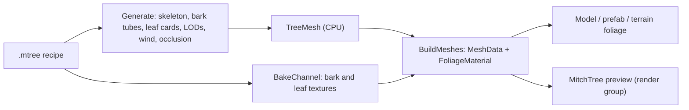

# MitchTree

MitchTree is the engine's procedural tree generator, along the lines of SpeedTree. A `.mtree` asset is a **recipe**: a seed plus reflected parameters for the trunk, up to four branch levels, leaves, materials, generated textures, wind and levels of detail. Loading one runs the generator, so a recipe works anywhere a model path does: the Model component, prefabs and terrain foliage. Havana's **MitchTree** window edits a recipe with a live preview drawn by the game renderer.

> Verified against engine commit a81f696c plus the MitchTree editor change, 2026-10-23.

## Overview

Generation is deterministic and runs on the CPU (`MitchTree::Generate`). The output is a `TreeMesh`: parts `Bark` and `Leaves`, each with shared vertices, an index list per level of detail and a wind stream, plus statistics. `ModelResource` turns that into GPU meshes with `FoliageMaterial` (wind, translucency, crown occlusion, see `Docs/Materials-and-Shaders.md`). Bark and leaf textures are generated from the recipe as virtual sub-assets (`<tree>.mtree#bark-color`). Saving a recipe regenerates every placed instance.

## Key Files

| Path | Role |
|------|------|
| `Modules/Moonlight/Source/Procedural/Tree/TreeRecipe.h` | The recipe types (`TreeRecipe`, `TrunkSettings`, `BranchLevel`, `LeafSettings`, materials, `BarkTexture`, `LeafTexture`, `WindSettings`, `LodSettings`), JSON, `Sanitize` |
| `Modules/Moonlight/Source/Procedural/Tree/TreeSkeleton.h` / `.cpp` | Weber–Penn style stems: crown shapes, arrangement, tropisms, forks, splits, wind sway weights |
| `Modules/Moonlight/Source/Procedural/Tree/TreeBark.cpp`, `TreeLeaves.cpp` | Bark tubes on rotation-minimizing frames with root flare and welded collars; leaf cards, crossed needle sprays, palm fronds; their levels of detail |
| `Modules/Moonlight/Source/Procedural/Tree/TreeGenerator.h` / `.cpp` | `Generate`, the `TreeMesh` output, baked crown occlusion |
| `Modules/Moonlight/Source/Procedural/Tree/TreeTextures.h` / `.cpp` | Generated bark (albedo, normal, ORM) and leaf atlases, `BakeChannel` (from a recipe file or one in memory), `WritePng` |
| `Modules/Moonlight/Source/Procedural/Tree/TreeModel.h` / `.cpp` | `BuildMeshes`: GPU meshes and FoliageMaterials for a `TreeMesh` (model loads and the editor preview) |
| `Modules/Moonlight/Source/Procedural/Tree/TreeAsset.h` / `.cpp`, `TreePresets.h` / `.cpp` | `.mtree` load/save and `TreeMetadata`; the built-in presets (Oak, Maple, Birch, Pine, Spruce, Palm, DeadSnag, Bush) |
| `Modules/Moonlight/Source/Graphics/ModelResource.cpp` | `.mtree` loads: generation on the loader thread, `BuildMeshes` on the main thread |
| `Modules/Havana/Source/Widgets/Tree/TreeWidget.h` / `.cpp` | The MitchTree editor: open documents, the File / View menu items and actions, recent trees, Save / Undo / Redo routing |
| `Modules/Havana/Source/Widgets/Tree/TreeDocument.h` / `.cpp` | One open recipe: sections and parameters, undo, background regeneration, save, OBJ export |
| `Modules/Havana/Source/Widgets/Tree/TreePreview.h` / `.cpp` | The 3D preview: a render-group camera, orbit controls, studio or scene lighting, capture |
| `Modules/Havana/Source/Widgets/Tree/TreeAutomation.h` / `.cpp` | `tree-*` editor automation commands |
| `Assets/Trees/Presets/` | The presets as `.mtree` files (checked against the code presets by `TreeGeneratorTests.cpp`) |

## How It Works

### Generation

`Generate` sanitizes a copy of the recipe, grows the skeleton (trunk, optional split leaders, then each enabled branch level breadth first), meshes the bark and leaves, bakes occlusion and builds the levels of detail. Every stem is seeded from its own stable id, so editing one level never reshuffles the others. Levels of detail are index lists over the shared vertices: bark drops rings, sides and thin stems; leaves keep `LeafKeep` of the cards per level, enlarged to cover the same crown. All parts share the tree's bounds and screen heights so bark and leaves switch level together.

The wind stream (`TreeVertex::Wind`, uploaded as `WindVertex`) carries R leaf flutter, G branch phase, B branch sway weight (normalized by `TreeMesh::MaxSway`) and A baked crown occlusion.

### Assets and instances

`TreeMetadata` has no import step: the recipe is the asset, and `ModelResource::LoadTreeAsync` generates on the loader thread. Parts are named `Bark` and `Leaves`, so a compact Model's per-part material edits survive regeneration: `Mesh::BindModelMesh` merges them against the generated material (`ImportedMaterialDefaults`). Saving (the editor, or any write the engine's asset watcher sees) runs `Model::ReloadAll`, which evicts the recipe and its texture channels and rebuilds every instance from a fresh resource. Instances are never updated in place, since components hold raw `MeshData` pointers.

### The MitchTree editor

Each recipe opens in its own **MitchTree** window, docked beside the World View when that panel is big enough, else floating. Every way in fires `OpenTreeEvent`:

- **File**: **New Tree** (a preset, then where to save it), **Open Tree...** and **Open Recent Tree** (kept in `.tmp/Havana.cfg` as `RecentTrees`).
- **View > MitchTree**: the open tree windows (picking one focuses it), recent trees, New Tree, Open Tree, **Edit Selected Tree** and **Trees Workspace** (the Terrain panel's Trees list).
- **Asset browser**: double-click a `.mtree`, or its context menu's **Edit in MitchTree**. The details pane shows the tree's kind, branch levels and seed above an **Edit in MitchTree** button.
- **A placed tree**: the **Edit in MitchTree** button at the top of its Model component, or the hierarchy context menu's **Edit in MitchTree**.
- **Terrain panel**: the Trees workspace's **Edit** and **New Tree**, and in the Foliage workspace a tree species' context menu (or a double-click).
- **Command palette**: New <Preset> Tree, Open Tree, Edit Selected Tree, Trees Workspace (actions `Tree.New.<Preset>`, `Tree.Open`, `Tree.EditSelected`, `View.TreesWorkspace`).

- **Layout**: a toolbar, a rail of pages, the page's settings, and the preview. All icons are the editor's Tabler set through `EditorIcons` (`Modules/Havana/Source/Utils/EditorIcons.h`). Planned features show as greyed-out icons whose tooltips start "Planned:", but only when Preferences > General > **Show planned tools** is on (it is off by default).
- **Rail**: pages grouped as Structure (Tree, Trunk, one page per branch level with its number, Add Level), Foliage (Leaves, Leaf Material, Leaf Texture), Bark (Bark Material, Bark Texture), and Motion & Detail (Wind, Levels of Detail). In a narrow window the rail shows only icons, with tooltips; it shows labels and group headings once the window is about 62 ems wide. Pages that have no effect as the recipe is set up are dimmed: switched-off levels, leaf pages without leaves, and texture pages with Generate off. The planned entries are Roots, Flowers & Fruit, Seasons, Collision and Impostor.
- **Page**: a header (icon, title, what the page controls), then the fields drawn from reflection (`ReflectionUI::DrawType`, with ranges and tooltips). A branch level's header switches it off or on, and removes it; the levels below then grow from the one above. The texture pages show the planned Scanned Sets (CC0 scans, P4b). The Tree page holds name, seed (with New Seed), crown and occlusion, plus statistics: generation time, stems, leaf cards, and triangles per level as bars, with the level the preview draws highlighted.
- **Toolbar**: Save, Undo, Redo (tooltips name the step), Presets (replaces the recipe and keeps its name), New Seed, Export OBJ, and Bake Textures (planned). On the right: generation time or status, then full-detail triangles, stems and leaf cards. Export writes full detail as OBJ + MTL, plus the generated textures as PNGs, into `<Name>.export/` beside the recipe.
- **Editing**: every change is one step on the document's own `UndoStack` (`RecipeEdit` before/after snapshots; drags of one control fold into one step). The tree regenerates on a worker thread (`std::async`), and the last good tree stays on screen meanwhile. Texture channels are re-baked only when their settings change (`BakeChannel` from the in-memory recipe, uploaded with `Texture::CreateFromImage`), so unsaved texture edits show too.
- **Preview** (`TreePreview`): the tree drawn by the game renderer (shadows, image-based light, translucency, wind) in a render group of its own (`CameraData::RenderGroup`, see `Docs/Rendering-Pipeline.md`), so the open scene never shows in it and it never shows in the scene. Left drag orbits, middle or Shift drag pans, the wheel zooms and F frames the tree. Its toolbar has toggles for Wind, Wireframe and Ground, Studio or Scene lighting, the level of detail (Auto, picked by screen size as in the game, or forced), the planned Bounds and Skeleton overlays, and Frame. The controls wrap onto more rows when the pane is narrow. Over the image are the drawn level and its triangles, a Generating badge, and the mouse controls while hovered. Studio lighting has a sun direction and height; Scene Lighting borrows the scene camera's sky, exposure and post settings, without fog or depth of field. The preview renders only while its window is shown.

### Terrain panel: Trees workspace

The seventh workspace lists the project's `.mtree` files (under `Assets/`). Each shows an icon for its kind of foliage (broadleaf, needles, fronds or bare), with **Edit** (opens MitchTree) and **Add to Foliage** (a species of the selected terrain's foliage, painted in the Foliage workspace). **New Tree** writes `Assets/Trees/<Preset>.mtree` and opens it.

### Automation

`tree-*` commands in `--editor-exec` scripts (full list in `TreeAutomation.h`):

- **Assets**: `tree-new`, `tree-place`, `tree-wait`, `tree-assert`, `tree-set`, `tree-foliage`.
- **The editor's active document**: `tree-open`, `tree-close`, `tree-assert-open <path> | <0|1>`, `tree-edit <field> | <json>`, `tree-preset`, `tree-seed`, `tree-undo`, `tree-redo`, `tree-save`, `tree-preview <option> | <value>`, `tree-page <page> [| level]` (shows a rail page), `tree-level <add|remove|toggle> [| level]`.
- **Checks**: `tree-wait-preview`, `tree-assert-stats <min> | <max>`, `tree-assert-dirty`, `tree-assert-lod`, `tree-assert-levels <levels> [| <on>]`, `tree-screenshot <path.png>` (the preview's own image, read back from the GPU).

The flows are `../Assets/Scenes/Tests/TreeFlows.edscript` and `../Assets/Scenes/Tests/TreeEditorFlows.edscript`.

## How to Extend

- **A recipe parameter**: add the field to its struct in `TreeRecipe.h` with `ME_FIELD( .. ).Range().Category().Tooltip()` in `TreeRecipe.cpp`, clamp it in `Sanitize`, and use it in the stage that needs it. The editor draws it automatically. Update the preset files with `ME_TREE_PRESETS_UPDATE=1 MitchEngine_Tests -tc="*preset assets*"`.
- **A preset**: add it to `TreePresets.cpp`, then regenerate the preset files as above.

## Caveats & Fragility

- **Presets are first drafts.** Crowns are sparse and conifers carry few needles. The defaults need an artist's pass.
- **Bark dominates the triangle count.** A full oak is over 100k triangles at full detail; the lower levels are what forests should draw.
- **Up to seven previews** can be open at once (render groups 1–7); further documents open with a blank preview.
- **The preview shares the scene's environment probe** only with Scene Lighting. Studio lighting uses a colour backdrop, because a second procedural sky would fight the scene camera over the one sky probe.
- **Saved files under `.tmp/` or outside `Assets/`** aren't seen by the asset watcher. The editor's Save regenerates instances itself, but other writes need `Model::ReloadAll`.
- **The D3D shaders aren't compiled on Linux** (no D3D compiler there). Windows compiles `Foliage` and `FoliageShadow` at load time.

## Related Docs

- `Docs/Materials-and-Shaders.md`: FoliageMaterial, the wind stream and `Wind.sh`.
- `Docs/Rendering-Pipeline.md`: render groups and the preview camera.
- `Docs/Foliage.md`: terrain foliage, which accepts `.mtree` species.
- `Docs/Editor-Havana.md`: documents, undo and automation.
