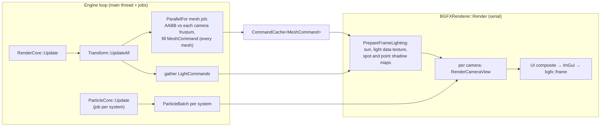

# Rendering Pipeline

Rendering is split into CPU **producers** and a serial **consumer**:

- **Producers** are `RenderCore` and `ParticleCore`. `RenderCore` runs a parallel job that fills one POD `MeshCommand` per mesh and gathers a `LightCommand` per light and a `DecalCommand` per decal; `ParticleCore` simulates particle systems into per-system batches.
- **The consumer** is `BGFXRenderer`. It renders every camera through the same chain into HDR targets:
  1. Shadow cascades.
  2. Clustered-forward PBR opaque pass (the sky behind it, then per-object outline hulls).
  3. Decals, projected onto the opaque surfaces and lit like them.
  4. SSAO, then screen-space edge outlines (optional toon ink).
  5. Height fog, optionally volumetric (light shafts, lit by every light).
  6. Transparent meshes.
  7. Particles.
  8. Temporal anti-aliasing (optional).
  9. Depth of field, bloom, eye adaptation, tonemapping, grading and FXAA.
  10. UI composite.

Ambient light comes from per-camera image-based-lighting probes. This doc maps the frame, the view-ID scheme, the lighting data paths and the sharp edges.

> Verified against engine commit 1fa55311, 2026-10-09 (overhaul Wave 3); skinned meshes against 07617c5f, 2026-10-09; fog against b7c61e56, 2026-10-10; decals against 8d958c0b plus the `Decal` component, 2026-10-15; background sky box loads against ac23d33f plus the background loads change, 2026-10-16; feature caps and scene draw statistics against 3f04199c plus the hardware profiles change, 2026-10-22.

## Overview

The hot-path design goal is a submit loop with **almost no virtual calls**. Everything the renderer needs to sort, batch and cull a mesh is precomputed into the `MeshCommand` by the parallel mesh job; binding its material (`Material::Use`, `GetRenderState`) is the one virtual step per draw or instance batch:

- `BatchKey`, `VertexBufferIdx` and `IndexBufferIdx`
- `IsTransparent` and `SupportsInstancing`
- `CastShadows`, `AlphaCutoff` and `WorldBounds`

Opaque meshes are auto-instanced. Scene views use `ViewMode::Sequential`, so submission order *is* draw order.

Backend selection: Vulkan is forced on Linux and D3D11 on UWP; other platforms take bgfx's default (D3D11/12 on Windows, Metal on macOS). Everything that differs between backends is handled once:

- clip-space depth range (`caps->homogeneousDepth`)
- render-target orientation (`caps->originBottomLeft`)
- shader profile (`Moonlight::GetPlatformString()`)

## Key Files

| Path | Role |
|------|------|
| `Source/Cores/Rendering/RenderCore.cpp` | Producer: transforms → per-camera AABB culling → `MeshCommand`s; gathers `LightCommand`s |
| `Source/Cores/Rendering/ParticleCore.cpp` | Producer: simulates `ParticleSystem`s in parallel → `ParticleBatch`es |
| `Modules/Moonlight/Source/Renderer.cpp` / `Renderer.h` | Consumer: `BGFXRenderer` — views, lighting setup, shadows, opaque/transparent/particle passes |
| `Modules/Moonlight/Source/RenderViews.h` | The fixed view IDs and the per-frame `ViewAllocator` |
| `Modules/Moonlight/Source/RenderCommands.h` | `MeshCommand`, `LightCommand`, `ParticleInstance` / `ParticleBatch` |
| `Modules/Moonlight/Source/Device/FrameBuffer.h` | Per-camera targets: HDR scene, final, post, bloom mips, AO, luminance, cluster textures |
| `Modules/Moonlight/Source/Lighting/ClusterBuilder.cpp` | CPU light-to-froxel assignment for clustered forward |
| `Modules/Moonlight/Source/Lighting/ShadowCascades.cpp` | Cascade splits and stable, texel-snapped fitting |
| `Modules/Moonlight/Source/Lighting/EnvironmentLighting.cpp` | IBL probes: capture, prefilter, irradiance, BRDF LUT |
| `Modules/Moonlight/Source/Graphics/DynamicSky.cpp` | Procedural sky: atmosphere tables, sun/moon/star placement, cloud noise and passes, the sky's scene light |
| `Assets/Shaders/Sky/Atmosphere.sh`, `Clouds.sh` | Atmosphere media and table lookups; cloud density, lighting and raymarch |
| `Assets/Shaders/Sky/ProceduralSky.frag`, `Clouds.frag`, `SkyViewLut.frag`, `SkyCapture.frag` | The sky backdrop (stars, Milky Way, moon, sun), the half-resolution cloud pass, the per-camera sky table, the probe capture |
| `Modules/Moonlight/Source/RenderPasses/PostProcess.cpp` | SSAO, fog (`RenderFog`, `FogUniforms`), temporal AA (`RenderTemporalAA`, `TemporalJitter`), depth of field (`RenderDepthOfField`), bloom, eye adaptation, tonemap + grading, FXAA |
| `Modules/Moonlight/Source/RenderPasses/PickingPass.cpp` | Editor entity-ID pass (see `Docs/Editor-Havana.md`) |
| `Modules/Moonlight/Source/Debug/DebugDraw.h` | Immediate-mode debug line API |
| `Modules/Moonlight/Source/Graphics/MeshLod.cpp` | Level-of-detail generation (meshoptimizer), relative screen height, level selection |
| `Modules/Moonlight/Source/Primitives/Primitives.cpp` | Shared Plane / Cube / Sphere / Cylinder / Capsule geometry |
| `Assets/Shaders/Lighting.sh` | BRDF, clustered light loop, shadow sampling, IBL — included by `Standard.frag` |
| `Assets/Shaders/Fog.sh` | Height-fog density, closed-form optical depth, view-ray reconstruction, Henyey-Greenstein phase, `fogForward` for transparents and particles |
| `Assets/Shaders/Post/FogScatter.frag`, `FogBlur.frag`, `Fog.frag` | Volumetric raymarch (half resolution), its depth-aware blur, and the composite (bilateral upsample or analytic fog) |
| `Assets/Shaders/Skinning.sh` | Bone palette uniform and `skinMatrix`, included by the `*Skinned` vertex shaders |

## How It Works

### Frame data flow

`RenderCore` refreshes the command of **every** mesh each frame, visible or not. Shadow passes need casters outside the camera, and each command's `VisibilityIndex` always matches this frame's per-camera `VisibleFlags`. The opaque loop skips commands whose flag is 0 for the camera being drawn.

### Views

bgfx runs views in ascending ID order, so producers must have lower IDs than their consumers. `RenderViews.h` holds the fixed IDs:

| View | Purpose |
|------|---------|
| 0 | Backbuffer clear |
| 1–32 | Ultralight GPU driver buffers |
| 33 | UI resolve |
| 34–223 | **Dynamic band**: `ViewAllocator` hands these out per frame in submission order |
| 224–225 | Picking ID pass + readback blit (editor) |
| 226 | UI composite |
| 227–242 | Editor offscreen work sampled by ImGui: shader graph previews, the asset browser's preview (240–241), `EditorCapture` (242) copying preview images to the CPU |
| 243–255 | ImGui (platform windows count down from 254; main pass is 255) |

`ViewAllocator::Allocate(name)` names each view for RenderDoc and returns `UINT16_MAX` when the band is exhausted; callers skip that pass. Allocation order per frame:

1. Spot-light and point-light shadow maps (the local shadow atlas).
2. For each camera (editor camera first, other cameras next, main camera last so it can sample render-to-texture cameras):
   1. Environment probe updates.
   2. 4 shadow cascades.
   3. Opaque.
   4. SSAO (3 views).
   5. Transparent.
   6. Particles.
   7. Temporal AA resolve (when on).
   8. Depth of field (when on, 7 views).
   9. Bloom down/up chain.
   10. Luminance + adaptation.
   11. Tonemap.
   12. FXAA.

### Render groups

`MeshCommand::RenderGroup` and `CameraData::RenderGroup` keep separate scenes in one renderer. A camera draws, shadows and picks only the meshes of its own group (`kMaxRenderGroups`). Group 0 is the world: `RenderCore`'s commands, its lights, the local shadow atlas, decals, particles and debug drawing. Other groups are editor previews (the MitchTree window, `Docs/MitchTree.md`). A preview pushes its own mesh commands, filled with `Moonlight::FillMeshCommand`, and its own camera into the camera cache.

- **Lighting**: other groups light with their camera's `GroupLights`, directional only, which a procedural sky still drives, plus their sky's ambient.
- **Shadows**: casters are gathered once per frame and batched per group. `SubmitShadowCasters` submits one group, and cascades fit that group's caster bounds.
- **Statistics**: preview cameras aren't counted in the scene's statistics. RenderCore skips them for culling, LOD selection and terrain views.
- **Mesh IDs**: `ClearMeshes` empties the cache on scene changes and bumps `GetMeshCacheGeneration()`; holders of command IDs push again when it changes.

### Inside `RenderCameraView`

1. **Targets**: the camera's `FrameBuffer` is resized to `OutputSize` and holds the targets below. Depth uses the best of D32F → D24S8 → D24 → D16.
   - `SceneBuffer`: RGBA16F colour plus sampleable depth.
   - `Buffer`: the BGRA8 final image, sharing that depth.
   - `PostBuffer`: LDR, used for FXAA.
   - Half-resolution bloom mips and AO targets.
   - 1×1 luminance targets.
   - The cluster textures.
   - `ParticleBuffer`: HDR colour *without* depth.
2. **Lighting setup**:
   - `PrepareCameraLighting` applies the camera's procedural sky settings (`DynamicSky::ApplySettings`), renders the sky's tables and clouds for a procedural background (`DynamicSky::Prepare`), resolves the sky's sun and moon directionals for procedural backgrounds, and builds the clusters and ambient fallback.
   - `EnvironmentLighting::Prepare` picks or refreshes the IBL probe.
   - `RenderSunShadows` renders the cascades.
3. **Opaque view** on `SceneBuffer`:
   - Clear to the linearised clear colour. A textured skybox gets a preceding view on the same HDR target: its mesh bounds are normalized to a unit cube, with a rotation-only view and fixed clipping. Source units, scene clip distances and orthographic zoom cannot clip the background. The panorama and the sky mesh load in the background: until both (and the sky material's shader) are ready the view just clears, and a panorama that failed to load samples black.
   - Opaque meshes: instanced batches keyed `(vertexBuffer, indexBuffer, BatchKey)` plus singles.
   - Procedural sky (`DynamicSky::Draw`), last: a far-plane triangle with `DEPTH_TEST_LEQUAL`, so it only shades pixels the scene left empty (see Procedural sky below).
4. **Decals** blend onto the opaque HDR colour (see Decals below), so the SSAO and fog that follow cover them too.
5. **SSAO** multiplies the opaque HDR colour (before transparents).
6. **Fog** covers the opaque HDR colour (see Fog below). From here on, forward shaders fog themselves (`u_fogForward`).
7. **Transparent view**: meshes sorted back to front, depth-write off; then legacy gizmo callbacks and the Debug Draw v2 lines.
8. **Particles** (see below).
9. **Post** into the final target, then the **UI composite** for the main camera.

### Anti-aliasing and RenderCore controls

Camera AA supports **Off**, **FXAA**, **TAA**, or **TAA + FXAA**, using the camera's
`PostProcess` component. FXAA runs after tonemapping; TAA resolves the HDR scene before bloom
and tonemapping. TAA reprojects history using camera matrices and depth, without per-object
motion vectors, so moving objects can ghost. `TemporalSharpness` counters its softening.
Cameras without an enabled `PostProcess` use FXAA on and TAA off. SMAA is not implemented.

`SetMSAALevel` requests **Off / 2x / 4x / 8x / 16x** on the **backbuffer**. Camera HDR color
and depth textures are single-sample, so this does not provide MSAA for scene geometry. The
backend may reduce the requested sample count. Scene MSAA would require multisampled camera
targets plus color/depth resolves compatible with the depth-sampling post passes.

Select **RenderCore** in the hierarchy's Entity Cores section to inspect grouped session
controls for presentation (VSync, backbuffer MSAA, game UI), LOD/debug drawing, shadows
(including point-light face resolution) and environment lighting. Performance and view tables
convert bgfx ticks using the CPU/GPU timer frequencies; open the Profiler for per-view GPU
timings. Shadow resolution choices account for the full atlas size and the GPU texture limit.

**Camera Post-processing** follows the main camera by default and can target another scene
camera. It reuses the component inspector, including undo, reset/copy/paste, prefab overrides,
and scene serialization. **Add PostProcess** creates the component as an undoable edit.
In Lit shading, Scene View continues to follow the main camera's post settings. The World and
Game View toolbar shading overrides (Unlit, Solid, Normals) instead use a neutral display
transform, without fog, exposure, grading, bloom, SSAO or vignette. The renderer restores the
camera's post settings after rendering each view. These inspection modes skip sun shadows,
environment probe preparation, decals and particles, and set `u_viewShading` per mesh draw;
Standard.frag shares the override across static, instanced, skinned and posed meshes while
retaining material alpha. Shading choices are per-user viewport preferences, not scene data. The additional
material diagnostics (metallic, roughness, occlusion, emissive, UVs, vertex normals, linear depth)
use the same path. Lighting Only retains scene lighting and post-processing on a neutral material.
`CameraData::ViewOptions` carries per-viewport visibility, effects, culling, exposure and depth
range overrides. Wireframe lazily creates line-list index buffers per mesh / LOD in MeshData;
vertices, skinning and animation remain shared, and the buffers are destroyed with the mesh.
Secondary cameras reset to the default options when they leave Game View.

### Lights and clustered forward

`Light` components (Directional / Point / Spot / Bar / Box / Rectangle) become `LightCommand`s every frame. Colour is linearised and multiplied by intensity; direction is the entity's forward axis.

Create them from the hierarchy's **Light → Bar Light / Box Light / Rectangle Light** menu, or change an existing Light's **Type**. A **Bar** is a continuous capsule along local X: **Bar Length** sets the segment length (default 1.2 m), and **Bar Radius** sets the tube radius (default 0.025 m). Centre it on a fluorescent tube and rotate its X axis along the tube. Rounded ends extend by the radius. A **Box** emits in every direction from a cuboid controlled by **Box Size**, its full local X/Y/Z dimensions. A **Rectangle** emits from a flat local XY face into its forward (+Z) hemisphere, with cosine angular falloff and no light behind the face. **Rectangle Width** and **Rectangle Height** set independent dimensions along local X/Y (default 2 m × 1 m); the creation preset points downwards. All follow the entity and parent rotation/scale; a bar uses the larger perpendicular scale for its circular radius, and X/Y scale stretches the corresponding rectangle dimensions. Their **Range** is the fade distance from the emitter surface, independent of transform scale. Gizmos show the emitter and, when selected, its fade volume (an enclosing box for Box/Rectangle). The rectangle's arrow shows its emitting side.

Bar/box/rectangle shading uses the closest point on the source for a continuous, inexpensive approximation, with the same surface-distance and angular falloff in materials, lit particles and volumetric fog. The falloff is `Intensity / (d² + A/π)`, where `d` is the distance to the closest point and `A` the emitter's projected area: the rectangle face, a quarter of the box's surface area (its mean silhouette), or the tube side-on. Far away it is the usual inverse square; on the emitter it stays at `π · Intensity / A` instead of spiking, so surfaces touching a panel and fog drifting through it are not blown out (exact on-axis for a disc). A larger emitter at the same intensity is therefore softer up close, not brighter. These are unshadowed extended sources, without physical area-light integration or soft shadows. They illuminate geometry but do not draw a visible fixture; use an emissive mesh for the tube or panel itself. Under a rotated, nonuniformly scaled parent, the source uses an orthonormal orientation and approximate world dimensions rather than a sheared emitter.

`PrepareFrameLighting` handles the lights frame-wide:

- **Directional lights**: up to 4, uploaded as uniforms. The first visible shadow caster takes slot 0. For a procedural background, directionals follow the sky's direction and radiance — except `Manual` lights, which keep their authored rotation, color and intensity alongside it (rig and fill lights; the sun disc, probes and sky stay astronomical). `Sun` and `Moon` bind explicit bodies; `Automatic` follows the sun and supplies moonlight if no explicit Moon exists, using the first shadow-casting Automatic light's tint, intensity and shadow controls (or the first Automatic if none cast shadows). A lunar slot is reserved even at the four-light limit, replacing the last other sky-driven directional if necessary (never a Manual light). Both bodies fade independently through dusk instead of switching at equal brightness. Legacy `Transform` sources load as Automatic. With no sky-driven directional (none, or Manual only), automatic celestial lights are supplied. Cameras without a procedural background retain authored rotations and colors for all sources. These are per-camera copies; other cameras and entity transforms stay independent.
- **Local lights (Point / Spot / Bar / Box / Rectangle)**: up to 256. Each is packed into **8 RGBA32F texels** of the 2048-wide light-data texture:
  1. Position and range.
  2. Colour and type (1 point, 2 spot, 3 bar, 4 box, 5 rectangle).
  3. Direction and cos(outer angle).
  4. cos(inner angle), bar radius and near-field area (extended emitters).
  5. Shadow slot (spot tile, or point light 0-1), texel scale and biases.
  6. World X axis and half length/width.
  7. World Y axis and half height.
  8. World Z axis and half depth.

Per camera, `ClusterBuilder` bins local lights into a **16×9×24 froxel grid**:

- Screen tiles × exponential depth slices.
- Each light is tested as a sphere: the slice range comes from its view depth, and the tile rectangle from the projected corners of its view-space box (full screen if it crosses the near plane).
- Bar/box/rectangle bounds include the emitter dimensions plus Range, so their ends remain lit when the centre is outside the view.
- The grid (offset, count) and the flattened index list go up as float textures (144×24 RGBA32F and 1024×128 R32F), so no compute shaders are needed.
- Limits: 64 lights per cluster and 131072 indices.

`Standard.frag` finds its cluster from `gl_FragCoord`, flipped for bottom-left-origin backends, and the view depth, then loops over the cluster's lights.

Shading (`Lighting.sh`) is GGX distribution, height-correlated Smith visibility, Schlick Fresnel and an energy-split Lambert diffuse. Point and spot falloff is windowed inverse-square that reaches zero at `Range`; spot cones are smoothstepped between the inner and outer angles.

### Shadows

- **Sun: cascaded shadow maps.**
  - Layout: 4 cascades in a 2×2 depth atlas (`Shadows.CascadeResolution`, default 2048 per cascade), using hardware compare samplers.
  - Splits: PSSM with λ = 0.75, out to `min(Light::ShadowDistance, camera far)`.
  - Stability: each cascade fits the **bounding sphere** of its frustum slice, so its size is rotation-invariant, and is **snapped to whole texels**, so edges don't shimmer.
  - Casters: the near plane is pulled back to the bounds of every caster (`m_casterBounds`), so tall or distant casters land in the map.
- **Spot lights**: the first 4 shadowed spots each get a tile of the local shadow atlas (`Shadows.SpotResolution`, default 1024), using a perspective projection slightly wider than the cone.
- **Point lights**: the first 2 shadowed point lights get six 90° faces each (a hair wider, so PCF at a face edge stays inside it) in the same atlas: `Shadows.PointResolution` (default 512) tiles in a 4×4 block to the right of the 2×2 spot block, so the atlas is 4096×2048 by default. The shader picks the face from the light-to-fragment direction's major axis. Spot and point faces share `u_localShadowMatrix[16]` (0-3 spots, 4-15 faces), the sampler and the PCF.
- **Casters**:
  - Drawn with one instanced depth-only shader (`ShadowDepth`) for every material, culled per cascade or spot frustum by `WorldBounds`.
  - Alpha-tested materials (`Material::GetAlphaCutoff() > 0`) bind their textures and discard in the depth pass too.
  - `Mesh::CastShadows` opts a mesh out.
- **Lookup**:
  - Cascade chosen by view depth; 3×3 PCF taps clamped inside the tile; 10% blend into the next cascade and a fade-out after the last.
  - Receiver biases are in **shadow texels**: `ShadowBias` pushes the receiver towards the light, and `ShadowNormalBias` along its normal **scaled by sin θ**. That's what keeps a sloped receiver out of its own PCF kernel.
- **Debug**: Scene View → View → *Shadow Cascades* tints the scene per cascade (action `View.ShadowCascades`).

### Image-based lighting

`EnvironmentLighting` keeps up to 3 probes, one per distinct background source:

- the procedural sky, captured by its own program (`Sky/SkyCapture.frag`: the sky table and a cheaper cloud march, no sun or moon disc, no stars), the planet's lit ground below the horizon;
- a skybox panorama, sampled as equirectangular;
- the clear colour.

A probe holds:

- a 128² RGBA16F capture, downsampled into separate 64/32/16 cubes (separate textures, so no read/write hazards);
- a 5-mip GGX-prefiltered specular cube (roughness = mip / 4, each level sampling the source sized for it);
- a 32² cosine-convolved irradiance cube.

A shared split-sum BRDF table is rendered once.

- **Refresh**: probes refresh only when their source key changes (`DynamicSky::GetEnvironmentKey`: the sun and moon moving about half a degree, the moonlight, the haze, the cloud settings and every 250 m the wind carries the clouds; the panorama texture; or the clear colour). A refresh is split over two frames, one step per frame engine-wide, after checking frame-buffer headroom.
- **Face addressing**: faces are addressed through `gl_FragCoord`, which maps to the same face texel on every backend.
- **Shading**:
  - Split-sum specular with Fdez-Agüera multiple-scattering compensation.
  - Frostbite's dominant direction for rough lobes.
  - Specular occlusion from material and SSAO occlusion.
  - Falls back to a hemisphere ambient until a probe is ready.
- **Controls**: `BGFXRenderer::EnableEnvironmentLighting` / `EnvironmentIntensity` (RenderCore inspector).

### Procedural sky

`DynamicSky` draws the camera background **Procedural Sky** and supplies its directional scene lighting through `Lighting/DirectionalLighting.h`. World directions: +Y up, +Z north, +X east. Everything is per camera (`ProceduralSkySettings` on the `Camera`), recomputed in `PrepareCameraLighting`.

- **Atmosphere** (Hillaire 2020): Rayleigh and Mie scattering plus ozone absorption over a 6360 km planet, in kilometres.
  - *Transmittance* (256×64) and *multiple scattering* (32×32, Hillaire's isotropic `1 / (1 - f)` approximation) tables are re-rendered only when the haze changes. `Turbidity` follows Linke: 1 is clean air, aerosol density `9 · (T - 1)`.
  - The *sky-view* table (256×128 RGBA16F) is rendered per camera each frame: world azimuth (wrapping) by a zenith angle squeezed towards the horizon at the camera's altitude, single scattering of both the sun and the moon plus the multiple-scattering term, and the lit planet surface below the horizon.
- **Sun, moon and stars**: the sun moves along the ecliptic for `Month`; `Time` is local solar time, which sets the sidereal time. The moon runs `MoonPhase` of a turn ahead of the sun in an orbit tilted by `MoonOrbitInclination` (default 5.145 degrees), crossing the ecliptic at `MoonAscendingNode`. Position, rising time and phase follow that geometry; phase advances with `TimeScale`. It can appear during daytime.
  - The **moon** is a sphere lit by the actual sun direction (Lommel-Seeliger). Its near side carries the real maria layout, Tycho/Copernicus/Kepler rays and two octaves of restrained analytic crater bowls and rims whose relief shows along the terminator, and earthshine shows on its night side. Celestial north is up on its disc. A circular camera-plane projection avoids off-axis stretching, surface noise is independent of clouds, and the complete lunar silhouette occludes stars and the sun even where unlit.
  - **Stars**: Pareto-distributed brightness on a thin spherical shell of 3D cells in the equatorial frame (3×3×3 neighbours), without cube-face seams. Direction derivatives give circular pixel-sized Gaussians at any aspect ratio or view position; stars are temperature-tinted, gently twinkling, and extinguished by atmosphere and clouds. The **Milky Way** is a band about the real galactic plane, brightest towards the galactic centre, with dust lanes. Both drown as the sky brightens.
- **Clouds** (Schneider 2015 noise, Hillaire 2016 integration, Wrenninge octaves): a shell from `CloudAltitude` to `+CloudThickness`.
  - Noise is generated at start-up on worker threads (128³ Perlin-Worley shape, 32³ Worley detail, 256² coverage/type weather map, all equalized so a threshold `t` keeps `1 - t` of the volume) and uploaded when clouds are first needed. The join there keeps captures repeatable.
  - Each camera marches 48 jittered samples (6 towards each light, sun and moon) at **half resolution** into `FrameBuffer::CloudHistory`, blended 10% per frame into last frame's result reprojected as if at infinity. The backdrop upsamples it bilinearly.
  - Wind carries the weather map and shapes towards `WindDirection` at `WindSpeed`, and the shapes slowly evolve. Far clouds fade into the haze over ~50 km.
- **The sky's scene light**: Automatic retains sun and moon together after atmosphere and clouds. Fog accumulates every directional light, with CSM visibility for the first caster. The sun keeps its shadow atlas until its direct light fades away, then moonlight takes over. During an eclipse the solar source remains available to receivers outside the umbra; its attenuation is evaluated per receiver. Explicit Sun/Moon directionals can coexist. The CPU marches cloud density (the same noise, detail erosion averaged) towards each body, including its setting limb, so cloud attenuation stays continuous at the horizon. Sky time advances only during Play and respects the game clock's pause and time scale; editing Time of Day still updates the view immediately. Cloud wind and evolution use the camera's separate runtime animation clock, so they can move while Time Scale holds the sun still. Stop restores the pre-Play celestial settings and cloud animation phase, including the persistent editor camera, and discards the viewport's playback history.
- **Art constants** (top of `DynamicSky.cpp`): sun illuminance 3.4 (about 3 on the ground at noon); `kSkyBrightness` and `kCloudBrightness` lift the scattered light, since a clean-air model and the octave approximation come out darker than real skies next to sunlit ground; `kTwilightLift` raises the setting sun's light up to 6× (an eye-adaptation stand-in, as the default exposure is fixed); full scene moonlight is 6% of the sun with a cool tint; atmosphere/cloud moon scattering uses 6% of that lifted scene level so clouds do not glow like daylight; night glow and the Milky Way sit just above the ACES toe (~0.0035).
- **Solar eclipses**: the moon masks the solar disc, while `SolarEclipse.sh` computes the uncovered area of the two angular discs at each world position. Lunar parallax at 384,400 km casts an umbra/penumbra across surfaces, decals, lit particles and fog; atmospheric and cloud scattering use the same shadow. The environment probe refresh key tracks eclipse contacts; cloud history resets when lighting changes. Solar radiance stays bright on the uncovered crescent; totality exposes a restrained corona. This is geometric overlap with a distant sun, not a full orbital ephemeris or a simulation of lunar eclipses.
  - To stage an eclipse: use a procedural sky, daytime, `MoonPhase = 0`, `MoonOrbitInclination = 0`. With `SunSize = 1`, `MoonSize = 1.1` gives totality and `MoonSize = 0.8` an annular ring; move phase slightly away from 0 for partial coverage. `MoonBrightness = 0` hides lunar light but still leaves its opaque silhouette. The real-scale eclipse footprint spans hundreds to thousands of kilometres, so a small scene normally lies entirely within one part of the shadow.
- **Orthographic cameras** see the sky as a 60° perspective tilted up 25°, so 2D scenes get a horizon near the bottom of the screen.

### Post-processing

Per camera, from `CameraData::Post`, which `CameraCore` copies from a `PostProcess` component (the editor view uses the main camera's):

- **SSAO**:
  - Horizon-based sampling at half resolution: eight directions with four quadratically spaced samples each, full-resolution edge-aware normals, a world-space radius and distance falloff. Samples only contribute newly hidden angles, so occluders are not counted repeatedly and strength stays consistent with scene scale.
  - Inverse-projection reconstruction supports perspective, orthographic and jittered cameras. Both projection axes set the sampling footprint; depth lookups snap to texel centres. Sky and off-screen samples do not occlude.
  - A symmetric 5×5 bilateral blur uses view-space depth, followed by a four-tap joint bilateral upsample at full resolution to preserve silhouettes. Neither stage interpolates across depth edges before weighting. Thin surfaces without matching half-resolution samples stay unoccluded.
  - `AORadius` is in metres; `AOIntensity` adjusts visibility after filtering. Zero radius or intensity skips the passes. The result multiplies the opaque HDR colour through its colour-only framebuffer, so sampled depth is not attached to the apply target.
- **Temporal anti-aliasing** (`TemporalAA`, off by default; the Lighting showcase uses it):
  - The renderer jitters the projection by a sub-pixel offset each frame (Halton 2, 3 over 8 frames). It shifts NDC through w, so either handedness works, and restores the matrix when the view is done. It also stores the unjittered view-projection.
  - `RenderTemporalAA` (`Post/TAA.frag`) runs on the HDR image once particles are in. It unjitters the current frame by sampling it at the jitter offset, and reprojects each pixel to last frame through the depth (`previous × inverse( current )` view-projection). It fetches the history there with a 5-tap Catmull-Rom, clips the history to the current 3×3 neighbourhood's mean ± deviation in YCoCg (variance clipping, so disocclusions and moved objects don't ghost), and blends 90% history with luma weights (Karis) against fireflies. `TemporalSharpness` adds back a little of the centre's contrast.
  - The result (`FrameBuffer::PostInput`, ping-ponged `TemporalHistory`) feeds bloom, eye adaptation and tonemapping. History is created on first use, dropped on resize, and invalid when TAA was off the frame before.
  - Captures stay repeatable: the jitter follows the camera's frame count, so `--frame-time` runs match.
- **Depth of field** (`DepthOfField`, off by default; perspective cameras): thin-lens signed CoC at full resolution, layer-aware colour downsample, conservative foreground-radius dilation, separate 64-tap circular near/far gathers at half resolution, then composition with full-resolution focal-plane edges. Runs after TAA and HDR shader graphs, before bloom/exposure/tonemapping. Targets are allocated on first use and released on resize/destruction. `DoFFocusDistance` is in metres; `DoFAperture` is an f-number; focal length follows vertical FOV and `DoFSensorHeight`. See [Depth of Field](Depth-of-Field.md) for controls, verification and limitations.
- **Bloom**: thresholded downsample chain (up to 6 RGBA16F mips) and additive tent upsample.
- **Eye adaptation**: log-average luminance into 1×1, adapted over time between min/max EV (`AutoExposure`).
- **Edge outlines** (`PostProcess.Outline`): a fullscreen pass over the opaque depth, before fog, inking view-depth silhouettes and crease folds (`OutlineThickness`, `OutlineDepthThreshold`, `OutlineNormalThreshold`, `OutlineColor`). **Per-object outlines** use the `Outline` component instead (colour + width in metres): the mesh is re-drawn inflated along its normals with the opposite cull after the sky — an inverted hull, so occlusion, skinning and vertex animation all apply. On a compact model's root the component outlines every part.
- **Tonemap**:
  - Exposure (manual stops or adapted), bloom mix and white balance.
  - ACES / AgX / Reinhard / none.
  - Saturation, contrast, lift/gamma/gain and vignette.
  - Accurate gamma encode, then an optional display-referred grading LUT (`Lut` on PostProcess): a `.cube` file parsed to an RGBA16F volume, or an unmipped image strip of N slices of N×N; `LutContribution` blends it. Stock grades ship in `Engine/Assets/Textures/LUTs` and `.cube` files hot reload. ±0.5 LSB dither last.
  - Writes luma to alpha only when FXAA follows.
- **FXAA** into the final target.

### Fog

Exponential height fog, set per camera on the `PostProcess` component: `Fog`, `FogColor` (ambient in-scattering), `FogDensity` (extinction per metre at `FogHeight`), `FogHeightFalloff`, `FogStartDistance`, `FogMaxOpacity`, `FogSunIntensity` and `FogAnisotropy` (Henyey-Greenstein *g*). `VolumetricFog`, `VolumetricDistance` and `VolumetricSteps` turn on raymarched lighting. `PostProcess::RenderFog` runs after SSAO:

- **Analytic** (default): one full-resolution pass (`Post/Fog.frag`) rebuilds each pixel's view ray from depth and integrates the height fog in closed form. It is lit by the ambient fog colour plus the unshadowed sun through the phase function, so the fog glows towards the sun.
- **Volumetric**:
  - `Post/FogScatter.frag` marches each ray at half resolution (up to `VolumetricDistance`, `VolumetricSteps` steps). Quadratic spacing concentrates samples near the camera to resolve small local lights; the intervals begin at `FogStartDistance`. Interleaved gradient noise jitters the samples, with a per-camera frame offset when temporal AA is enabled so the resolve averages out the pattern. Every step is lit by:
    - the ambient fog colour;
    - the sun through its cascaded shadow, one hardware-filtered tap (`sunShadowVolume`), giving light shafts and shadowed volumes;
    - the cluster's point and spot lights with their shadows (`volumeLocalLight`, isotropic phase, scaled by `FogSunIntensity`).
  - Fog beyond the march distance is added analytically.
  - A depth-aware 5×5 blur (`FogBlur.frag`) hides the jitter.
  - `Fog.frag` upsamples it with a joint bilateral filter (bilinear × depth similarity).
- **Composite**: `src + dst · src.a` (in-scattering, transmittance) onto `ParticleBuffer`, the HDR colour without the depth attachment, so depth can be sampled. The sky's distance is the camera's far plane, so the horizon fogs over while the zenith stays clear.
- **Transparents and particles** draw after the composite, so they fog themselves. `BindLighting` binds the fog uniforms (`FogUniforms`, shared with the pass), and `u_fogForward` turns on `fogForward` (`Fog.sh`, analytic) in `Standard.frag` and `Particle.frag` for every pass after the fog. Additive particles are dimmed by the transmittance; blended ones take the fog colour.

`Assets/Scenes/Showcase/Fog.lvl` (dusk sun through a slatted wall, a shadowed spot lamp, lanterns) is the visual reference.

### Decals

A `Decal` component (`Source/Components/Graphics/Decal.h`) projects a texture through a box: the entity's transform scaled by `Size` (metres). The texture's right is the box's X axis, its up the Y axis, and it projects along forward (Z), reaching `Size.z` deep. Each decal has an albedo (sRGB, alpha is coverage; empty projects a solid `Color`), an optional tangent-space normal map, metallic, roughness, normal strength, emissive colour and intensity, and `Opacity`. `AngleFade` / `AngleFadeWidth` fade the decal out on surfaces turned away from the projection; by default it is full up to 50° and gone at 70°. Overlapping decals draw in ascending `SortOrder`, then in gather order.

`RenderCore` rebuilds the `DecalCommand`s every frame, next to the lights. A decal whose albedo is still streaming in is left out, so it never flashes as a solid tint, and so is a decal with a zero scale. `BGFXRenderer::RenderDecals` then draws them:

- **View**: a sequential view on `ParticleBuffer` (HDR colour without depth), after the opaque pass and before SSAO. Only lit views draw decals; the inspection shading modes skip them.
- **Culling and order**: decals are culled by the box's world bounds against the frustum and stable-sorted by `SortOrder`.
- **Geometry**: the box's far faces only (`CULL_CW`), so each covered pixel shades once and the camera can stand inside a box.
- **Projection** (`Decal.frag`): the opaque surface's position is rebuilt from the scene depth and moved into the box's space; pixels outside the box are discarded.
- **Normals and footprint**: one-pixel steps towards the neighbour on the flatter side in each screen axis give a per-pixel surface normal and texture footprint, the same reconstruction SSAO uses. 2×2 quad derivatives would light curved surfaces in blocks and drop to the smallest mip along depth edges. The mip comes from that footprint and the texture size (`texture2DLod`). Textures are clamped, so filtering never wraps across the box.
- **Lighting**: the decal normal map bends the reconstructed normal (tangent = box X, bitangent = box Y), and the result is lit like `Standard.frag`: the sun with its cascaded shadow, the clustered point and spot lights, image-based ambient, plus emissive. It is alpha-blended over the lit surface.

The editor draws each decal's box with an arrow along the projection (and the texture's up when selected), a clickable icon, and **Create > Effects > Decal** (a 2×2 m decal projecting down). `Assets/Scenes/Showcase/Decals.lvl` exercises wrapping, angle fade, normal maps, emissive and sort order.

### Particles

`ParticleCore` (engine-owned, so it also runs in the editor) handles the CPU side:

- Each frame it loads textures on the main thread, then simulates every `ParticleSystem` as its own job.
- Each system fills a `ParticleBatch`: texture, blend, alignment, flipbook, softness, bounds, and 64-byte `ParticleInstance`s.

`RenderParticles` draws after the transparent view:

- **View**: a sequential view targeting `ParticleBuffer`, which is HDR colour only, so the scene depth can be read as a texture.
- **Ordering and culling**: systems are culled by bounds and drawn back to front. Alpha-blended systems also sort their particles.
- **Geometry**: quads are expanded in `Particle.vert` from `u_invView` axes, as billboards, velocity-stretched or horizontal.
- **Depth**: `Particle.frag` depth-tests against the scene depth and fades within `SoftParticleDistance` (soft particles).
- **Lighting** (`ParticleSystem::Lit`, set on the Smoke preset): the particle colour becomes an albedo lit like a volume by `volumeLighting` in `Lighting.sh`. That sums the sun with its cascaded shadow, the cluster's point and spot lights with their shadows (no N·L, half a Lambert lobe), and ambient irradiance from the environment probe. The particle pass binds the same lighting state as opaque draws, and the camera's clusters still match its view. Additive glows (fire, sparks) stay unlit.
- **Blending**: additive is premultiplied ONE/ONE; alpha uses the standard blend.

### Debug Draw v2, statistics, picking

- **Debug Draw v2** (`DebugDraw.h`): a thread-safe, immediate-mode line API:
  - Shapes: `Line`, `Ray`, `Arrow`, `Box`, `Circle`, `Sphere`, `Capsule`, `Cone`, `Axes`, `Frustum`, `Grid`.
  - Filled triangles (`Triangle`, `Triangles`): alpha blended, depth tested, never written to depth, drawn before the lines (the navmesh overlay uses them).
  - Every call takes a colour, a duration and flags (`NoDepthTest`, `EditorOnly`).
  - Collected once per frame and drawn in each camera's transparent view. `EditorOnly` lines go only to the editor camera.
- **Frame statistics**: `BGFXRenderer::GatherFrameStats` copies `bgfx::getStats()` into `FrameStats::RenderStats`, including bgfx's texture and render-target memory estimates and `MeshData::GetTotalGpuBytes`. Per-view GPU timings need `BGFX_DEBUG_PROFILER`, which is on only while the editor's Profiler window is open. `CountTriangles` also counts each mesh draw into a tally for the game's cameras, the editor's views, or the frame's local shadows (`SceneCounts`), and `RenderStats::SceneDrawCalls` / `SceneTriangles` report the game's (`Docs/Hardware-Profiles.md`).
- **Feature caps** (`BGFXRenderer::FeatureCaps`, set by an enforced hardware profile): they mask shadows (`AreShadowsActive`), shadow tile sizes (`CapShadowResolution`), environment lighting, and the camera's AO, bloom, depth of field, volumetric fog and TAA at render time. With instancing off, every instanced submit (opaque and shadow casters, not particles) draws one instance at a time. The authored settings are never changed.
- **Picking**: `PickingPass` renders entity IDs into a 32×32 target around the click and reads it back (see `Docs/Editor-Havana.md`).

### Levels of detail

A model whose import settings have **Generate LODs** on (`ModelResourceMetadata::GenerateLODs` and `LODs`, `Graphics/MeshLod.h`) gets simplified levels for each mesh, built with meshoptimizer when the model loads, on its loader thread.

- **Geometry.** Each level is only an index list over the full mesh's vertices, uploaded as one more index buffer (`MeshData::SetLods`, `GetIndexBuffer( lod )`). Skinning, the vertex buffer and bounds are shared. Levels simplify from the one before (nested), keeping attribute seams closed. Flat-shaded or unwelded meshes, which are all seams, fall back to collapsing across them. Small disconnected pieces are pruned once they're below the error. Each level keeps `Reduction` of the previous level's triangles, within `MaxError` (relative to the mesh's size). That error doubles per level, since each level shows at half the size. A level that can't get 10% smaller ends the chain. Meshes under `MinTriangles` (256) keep full detail.
- **Selection.** `RenderCore`'s mesh job measures each mesh's **relative screen height**: its world bounding sphere over the height the view sees at that distance (or the orthographic height). Level 1 draws below `TransitionHeight` (0.3 by default) and each further level below half the previous height (`SelectLod`). The camera is the scene view's while editing and the main camera in play. The chosen level's index buffer goes into the command (`IndexBufferIdx`, `Lod`), so the opaque, shadow, picking and instanced paths all draw the same level. Instancing batches by index buffer, so each level batches on its own. `RenderCore::LodBias` scales the height first (inspector, `--lod-bias`): above 1 keeps detail longer, and 0 always draws the coarsest level, which is handy for checking levels in a capture.
- **Test scene:** `Assets/Scenes/Tests/LodTest.lvl` lines up six plinths (2000 triangles, three levels down to 250) from 2 to 100 m. `--lod-bias 0` and `--lod-bias 100` show the coarsest and the full levels.

### Skinned meshes

`RenderCore`'s mesh job calls `Mesh::UpdateSkin` for skinned meshes. It writes a palette of mesh-space bone matrices (up to 128) and returns world bounds from the bones' reach in the current pose, which culling uses. The command carries `SkinPalette` / `SkinBoneCount` and clears `SupportsInstancing`.

`RenderSkinnedMesh` draws each skinned mesh on its own, with:

- a one-entry instance buffer;
- the skin weights on vertex stream 1;
- the `u_bones` uniform;
- the material's `GetSkinnedProgram()` (`StandardSkinned.vert` + `Standard.frag` for `StandardMaterial`).

The shadow and picking passes do the same, with `ShadowDepthSkinned` and `picking_skinned`. A material with no skinned program draws the bind pose. Bone animation itself is covered in `Docs/Animation.md`.

### Draw state binding (`BindMeshDrawState`)

Texture stages:

| Stage | Binding |
|-------|---------|
| 0 | Base colour |
| 1 | Normal |
| 2 | Opacity |
| 3 | Metallic-roughness |
| 4 | Emissive |
| 5 | Occlusion |
| 6–7 | Free |
| 8 | Light data |
| 9 | Cluster grid |
| 10 | Cluster indices |
| 11 | Sun shadow atlas |
| 12 | Local shadow atlas (spot tiles + point light faces) |
| 13 | Environment specular |
| 14 | Environment irradiance |
| 15 | BRDF LUT |

Missing maps fall back to neutral 1×1 textures (white; flat normal). `BindLighting` sets the lighting uniforms with every draw (bgfx uniform state is per draw), then `Material::Use()` and `GetRenderState()` apply.

### Portals and screen-space camera views

`PortalMaterial` ("Portal (Camera View)", `Shaders/Portal.frag`) shows another camera's image: `BindMeshDrawState` binds the camera named by `Material::ScreenViewCamera` (a camera cache id) to the diffuse slot, and the shader reads it at the fragment's own screen position. That camera's HDR image (`PostInput`, else `SceneColor`) is used, so the main camera's exposure, bloom and tonemapping apply once. A view cannot sample its own target, so in that view (and before linking) the material's `DiffuseColor` tint shows instead. The faces render double-sided so a camera inside the surface's box still sees the view.

- **Matching cameras:** `Camera::MatchMainCamera` copies the main camera's output size, field of view, far plane, projection and background every `CameraCore::LateUpdate`, so pixels line up.
- **Clip planes:** `Camera::SetClipPlane(point, normal)` stores a world plane. `CameraCore` moves it into view space each frame and `GetProjectionMatrix` makes it the near plane (Lengyel's oblique projection, both depth ranges). This hides everything behind a portal's exit. It is skipped while the camera is in front of the plane.
- **Ordering:** secondary cameras render before the main camera. One portal seen in another shows the other camera's image from this frame if it rendered first, or from last frame otherwise (recursion with a frame of lag).
- **From C#:** `Mesh.ShowCameraView(camera)` and `Camera.SetClipPlane`. The game's `Assets/Scripts/Portals/Portal.cs` builds a walk-through portal pair from these (`Assets/Scenes/Portals.lvl`).

## How to Extend

- **New pass that reads another pass's output**: allocate its view *after* the producer's (`m_views.Allocate`) and skip the pass when it returns `UINT16_MAX`.
- **New per-light data**: extend `LightCommand`, pack it into the light-data texels (`PrepareFrameLighting`, 8 texels per light; the texture is 2048 wide) and read it in surface and volume lighting (`Lighting.sh`).
- **New lit material**: include `Lighting.sh`, build a `Surface` and call `shadeLight` / `shadeClusteredLights` / `ambientLighting` like `Standard.frag`. See `Docs/Materials-and-Shaders.md`.

## Caveats & Fragility

- **Shadow cost on huge scenes**: the casters are gathered once a frame (a parallel scan of the mesh commands into compact records, grouped into instance batches) and culled against all of a pass's views in one parallel sweep (a bit per view). Each view then collects its casters' indices and copies their matrices straight into the instance buffer. At 57k meshes the four cascades cost about 1.4 ms of CPU in release on the software-rendering test machine, against 1.84 ms before; the frame's local shadow views share one cull. On the lavapipe software renderer the 57k-cube bench goes from 44 to 82 ms/frame with shadows; real GPUs pay far less, but this hasn't been measured on hardware yet.
- **Temporal AA reprojects camera motion only**: there are no per-object motion vectors, so moving and skinned objects rely on the neighbourhood clip, which trades their ghosting for a little softness while they move. Debug lines and gizmos drawn into the scene are resolved with it.
- **Cluster capacity**: more than 64 lights in one froxel silently drops the extras; more than 256 point/spot lights per frame are ignored.
- **Shadow budgets are fixed**: 4 spots, 2 point lights (12 extra shadow views a frame) and 1 directional light get shadows; further shadowed lights render unshadowed.
- **One sun in post**: only directional light 0 is shadowed; additional directionals are unshadowed.
- **Probe refresh hitch**: a sky probe refresh costs ~60 tiny passes over two frames, and the capture marches the clouds for six 128² faces. An animated time of day (`Camera::ProceduralSky.TimeScale > 0`) refreshes about every 3 in-game minutes, drifting clouds every 250 m of wind.
- **Cloud cost**: a half-resolution march of 48 samples, each sample inside a cloud adding 6 more towards each light; the most expensive pass of a cloudy frame. `CloudCoverage = 0` skips it. The history assumes the clouds are infinitely far, so a camera flying fast through them smears a little.
- **Cloud shadows are global**: the sun dims for the whole scene when a cloud covers it as seen from the camera; there are no moving shadow patches on the ground yet.
- **Sky noise start-up**: generating the cloud noise takes ~0.25 s on 32 threads in a `-O0` debug build (a worker thread, overlapped with loading).
- **Fog is screen-space, not froxels**: volumetric lighting exists only in front of opaque surfaces. Transparents and particles get analytic fog (no shafts). Fog uses the final HDR temporal AA resolve when enabled, with no separate fog history. Without temporal AA the sample pattern stays fixed and only the depth-aware blur hides it; bright point sources and thin shafts can still need more steps. The march costs `VolumetricSteps` shadow taps plus cluster light loops per half-resolution pixel.
- **Lit particles are per-pixel and isotropic**: no forward-scattering phase function, no self-shadowing within a plume, and each lit pixel walks its cluster's lights, which costs fill rate on big smoke.
- **Skinned meshes aren't instanced**: each costs one draw per view (camera, cascade, spot light), and its palette is uploaded with every draw.
- **Decals paint everything opaque in their box**: there is no receiver mask, so a character walking through a floor decal gets it projected onto its legs. Transparents and particles never receive decals (they draw later).
- **Decals replace, they don't modulate**: a decal is lit and alpha-blended over the finished surface. It can't change only the roughness or normal of what's underneath (no DBuffer), and the surface's own normal map doesn't show through its coverage.
- **Transparent sorting is per object** (plus per particle within alpha systems); intersecting transparents sort wrong (no OIT).
- **`CommandCache::Update`/`Pop` are unlocked**: safe only because mesh jobs write distinct slots and nothing `Push`es while they run.
- **Uniform names are global in bgfx**: the lighting uniforms (`u_lightParams`, `u_shadowMatrix`, `s_envSpecular`, …) must not be reused with other types.

## Related Docs

- `Docs/Materials-and-Shaders.md` — StandardMaterial, batch keys, shader cook and hot reload
- `Docs/Cores-and-Components-Reference.md` — `Light`, `Mesh`, `PostProcess`, `ParticleSystem`, `Camera`
- `Docs/Jobs-and-Events.md` — the job system behind the mesh and particle jobs
- `Docs/Animation.md` — clips, Animators and where skin palettes come from
- `Docs/Editor-Havana.md` — picking, the scene view and its overlays
- `Docs/State-of-the-Engine.md` — what's left to improve
