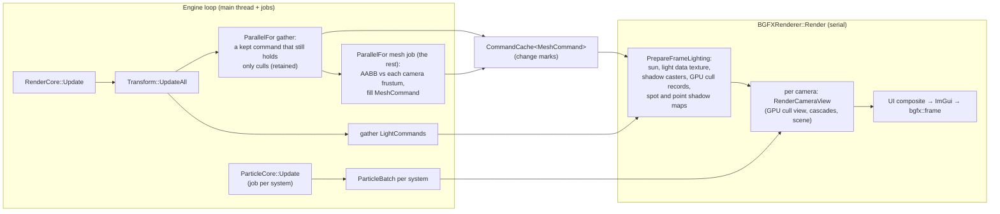

# Rendering Pipeline

Rendering is split into CPU **producers** and a serial **consumer**:

- **Producers** are `RenderCore` and `ParticleCore`. `RenderCore` runs a parallel job that fills one POD `MeshCommand` per mesh and gathers a `LightCommand` per light and a `DecalCommand` per decal; `ParticleCore` simulates particle systems into per-system batches (a GPU-simulated system only runs its emitter there; a compute pass moves its particles).
- **The consumer** is `BGFXRenderer`. It renders every camera through the same chain into HDR targets:
  1. Shadow cascades.
  2. Clustered-forward PBR opaque pass, after a depth prepass of the same surfaces (the sky behind it, then per-object outline hulls).
  3. Decals, projected onto the opaque surfaces and lit like them.
  4. SSAO, then screen-space edge outlines (optional toon ink).
  5. Height fog, optionally volumetric (light shafts, lit by every light).
  6. Transparent meshes.
  7. Particles.
  8. Temporal anti-aliasing (optional).
  9. Depth of field, bloom, eye adaptation, tonemapping, grading and FXAA.
  10. UI composite.

Ambient light comes from per-camera image-based-lighting probes. This doc maps the frame, the view-ID scheme, the lighting data paths and the sharp edges.

> Verified against engine commit 1fa55311, 2026-10-09 (overhaul Wave 3); skinned meshes against 07617c5f, 2026-10-09; fog against b7c61e56, 2026-10-10; decals against 8d958c0b plus the `Decal` component, 2026-10-15; background sky box loads against ac23d33f plus the background loads change, 2026-10-16; feature caps and scene draw statistics against 3f04199c plus the hardware profiles change, 2026-10-22; rectangle beams and temporal volumetric fog against 94407e9d plus the concert lighting change, 2026-10-29; volumetric light samples against 78e47156 plus that change (ME-364), 2026-11-12; render textures, the camera order and lazy post targets against 89e036be plus the render texture change, 2026-10-29; the depth prepass against 78e47156 plus the depth prepass change, 2026-11-12; per-instance data against 78e47156 plus that change (ME-365), 2026-11-12; GPU particles and the frame compute pass against ff71f21c plus the GPU particles change, 2026-11-14; the particle instance limit against f8240c1b plus the ME-379 change, 2026-11-15; compute environment probe filtering against f8240c1b plus the ME-385 change, 2026-11-15; froxel fog against f8240c1b plus the ME-376 change, 2026-11-15; retained mesh commands against 35a9c19b plus the ME-390 change, 2026-11-15; GPU-driven culling against a4d109f1 plus the ME-389 change, 2026-11-15.

## Overview

The hot-path design goal is a submit loop with **almost no virtual calls**. Everything the renderer needs to sort, batch and cull a mesh is precomputed into the `MeshCommand` by the parallel mesh job; binding its material (`Material::Use`, `GetRenderState`) is the one virtual step per draw or instance batch:

- `BatchKey`, `VertexBufferIdx` and `IndexBufferIdx`
- `IsTransparent` and `SupportsInstancing`
- `CastShadows`, `AlphaCutoff` and `WorldBounds`

Opaque meshes are auto-instanced. Scene views use `ViewMode::Sequential`, so submission order *is* draw order.

Backend selection: Vulkan is forced on Linux and D3D11 on UWP; other platforms take bgfx's default (D3D11/12 on Windows, Metal on macOS). Everything that differs between backends is handled once:

- clip-space depth range (`caps->homogeneousDepth`)
- render-target orientation (`caps->originBottomLeft`)
- shader profile (`Moonlight::GetPlatformString()`)

## Key Files

| Path | Role |
|------|------|
| `Source/Cores/Rendering/RenderCore.cpp` | Producer: transforms → per-camera AABB culling → `MeshCommand`s; gathers `LightCommand`s |
| `Source/Cores/Rendering/ParticleCore.cpp` | Producer: simulates `ParticleSystem`s in parallel → `ParticleBatch`es |
| `Modules/Moonlight/Source/Particles/GpuParticles.h` / `.cpp`, `Assets/Shaders/Particles/ParticleSim.comp` | GPU particle simulation: the per-system compute buffers, the per-frame step and the compute shader |
| `Modules/Moonlight/Source/Renderer.cpp` / `Renderer.h` | Consumer: `BGFXRenderer` — views, lighting setup, shadows, opaque/transparent/particle passes |
| `Modules/Moonlight/Source/RenderViews.h` | The fixed view IDs and the per-frame `ViewAllocator` |
| `Modules/Moonlight/Source/RenderCommands.h` | `MeshCommand`, `LightCommand`, `ParticleInstance` / `ParticleBatch` |
| `Modules/Moonlight/Source/MeshBatchRegistry.h`, `Utils/CommandCache.h` | Retained mesh commands: stable instance-batch ids by mesh command id, and the mesh cache's change marks |
| `Modules/Moonlight/Source/Culling/GpuMeshCulling.h` / `.cpp`, `Assets/Shaders/Culling/GpuCull*.comp`, `GpuCull.sh` | GPU-driven culling and indirect draws (ME-389): the CPU bookkeeping (`GpuCullState`), the buffers and the cull dispatches (`GpuMeshCulling`) |
| `Modules/Moonlight/Source/Device/FrameBuffer.h` | Per-camera targets: HDR scene, final, post, bloom mips, AO, fog (march, history, blur), luminance, cluster textures |
| `Modules/Moonlight/Source/Graphics/Texture.h`, `RenderTextureSettings.h` | Render textures: a `.rendertexture` loads as a `Texture` that owns its render target; `Texture::Sampleable` keeps a camera from sampling its own |
| `Modules/Moonlight/Source/Lighting/ClusterBuilder.cpp` | CPU light-to-froxel assignment for clustered forward |
| `Modules/Moonlight/Source/Lighting/ShadowCascades.cpp` | Cascade splits and stable, texel-snapped fitting |
| `Modules/Moonlight/Source/Lighting/EnvironmentLighting.cpp` | IBL probes: capture, prefilter, irradiance, BRDF LUT |
| `Modules/Moonlight/Source/Graphics/DynamicSky.cpp` | Procedural sky: atmosphere tables, sun/moon/star placement, cloud noise and passes, the sky's scene light |
| `Assets/Shaders/Sky/Atmosphere.sh`, `Clouds.sh` | Atmosphere media and table lookups; cloud density, lighting and raymarch |
| `Assets/Shaders/Sky/ProceduralSky.frag`, `Clouds.frag`, `SkyViewLut.frag`, `SkyCapture.frag` | The sky backdrop (stars, Milky Way, moon, sun), the half-resolution cloud pass, the per-camera sky table, the probe capture |
| `Modules/Moonlight/Source/RenderPasses/PostProcess.cpp` | SSAO, fog (`RenderFog`, `FogUniforms`), temporal AA (`RenderTemporalAA`, `TemporalJitter`), depth of field (`RenderDepthOfField`), bloom, eye adaptation, tonemap + grading, FXAA |
| `Modules/Moonlight/Source/RenderPasses/PickingPass.cpp` | Editor entity-ID pass (see `Docs/Editor-Havana.md`) |
| `Modules/Moonlight/Source/Debug/DebugDraw.h` | Immediate-mode debug line API |
| `Modules/Moonlight/Source/Graphics/MeshLod.cpp` | Level-of-detail generation (meshoptimizer), relative screen height, level selection |
| `Modules/Moonlight/Source/Primitives/Primitives.cpp` | Shared Plane / Cube / Sphere / Cylinder / Capsule geometry |
| `Assets/Shaders/Lighting.sh` | BRDF, clustered light loop, shadow sampling, IBL — included by `Standard.frag` |
| `Assets/Shaders/Fog.sh` | Height-fog density, closed-form optical depth, view-ray reconstruction, Henyey-Greenstein phase, `fogForward` for transparents and particles |
| `Assets/Shaders/Post/FogScatter.frag`, `FogScatterLights.frag`, `FogResolve.frag`, `FogBlur.frag`, `Fog.frag` | Volumetric raymarch (half resolution; the `Lights` one integrates each local light on its own, `VolumetricLightSamples`), its temporal resolve against the reprojected history, the depth-aware blur, and the composite (bilateral upsample or analytic fog) |
| `Assets/Shaders/Post/FogFroxelInject.comp`, `FogFroxelBlend.comp`, `FogFroxelIntegrate.comp`, `FogFroxel.frag`, `FogFroxel.sh` | Froxel volumetric fog (compute, `BGFXRenderer::EnableFroxelFog`): light the grid, blend it with its reprojected history, integrate front to back, composite |
| `Assets/Shaders/Skinning.sh` | Bone palette uniform and `skinMatrix`, included by the `*Skinned` vertex shaders |

## How It Works

### Frame data flow



Every mesh has a command every frame, visible or not: shadow passes need casters outside the camera. Most commands are not rebuilt, though: a static mesh keeps its command across frames (see Retained mesh commands below), and only its visibility runs. Each camera's `VisibleFlags` holds one byte per mesh cache id, and a command's `VisibilityIndex` is its own id, so a kept command always matches this frame's flags. After the mesh jobs, `RenderCore` compacts each camera's flags into `CameraData::VisibleMeshes`: the mesh cache ids it sees, ascending (they come out of the flags in id order, with no sort). That is the order a full scan visits commands, so instance batches, and with them draw order, come out the same. The opaque loop walks that list instead of the whole cache. It still applies the per-command checks (`Visible`, material, render group, the camera's flag), so the list only decides which commands get looked at, not what is drawn.

Meshes the GPU-driven path draws (see GPU-driven culling below) are left out of the list: `RenderCore` masks them off with `BGFXRenderer::GetGpuCulledMeshes()` and marks the camera `VisibleMeshesExcludeGpu`.

The list is stamped with the renderer frame it was built for (`VisibleMeshesFrame`, against `BGFXRenderer::GetFrameIndex()`). A camera whose list isn't from this frame scans every command as before. That covers editor previews (render group != 0, no `RenderCore` visibility), cameras that don't cull, and any frame no presented world's `RenderCore` prepared (killcams share one mesh cache, ME-323). In Drumsmith's ~16k-mesh festival venue (debug build, three cameras) the summed `Meshes` scopes dropped from ~2.4 ms to ~0.55 ms a frame; compacting costs ~0.1 ms per camera, one job per camera. Picking still scans the flags; it only runs on a click.

### Retained mesh commands

ME-390. Mesh cache ids are stable slots: a mesh keeps its id from the frame it is registered until it goes, and `CommandCache` hands freed ids out again. Before ME-390, `RenderCore` rebuilt every command from the ECS every frame and the renderer re-gathered every shadow caster. On a scene of 57,600 static cubes that was most of the frame. Now both are kept, and only what changed is rebuilt.

- **What is kept.** The command of an entity's own `Mesh` component, once the mesh job has built it. The mesh must not be skinned, have vertex animation or posed vertices, or be a portal image. `RenderCore::m_retainedOwner` records, per cache id, the entity whose command it is. Compact model parts, terrain patches and foliage are still gathered every frame, but their commands are written only when they differ (see Changes below), so an unchanged one is not a change either.
- **The check** (`retainedHolds` in `RenderCore::Update`, run on the gather workers). A kept command still holds when all of these are true:
  - the entity's transform is clean and its world matrix equals the command's;
  - the mesh's geometry and material pointers, `CastShadows` (with the entity's active state), `InstanceData`, `PortalClipPlane` and type match the command;
  - what the command took from its material still holds (see Material revisions below): its shader is loaded, and its `IsTransparent`, `SupportsInstancing`, `GetAlphaCutoff`, custom shadow program, `CastsShadows` and `GetInstanceBatchKey` match;
  - no screen-door fade, occluder fade or LOD crossfade is running;
  - the level of detail this frame's LOD camera picks is the one shown, with the same vertex and index buffers;
  - the `Outline` is unchanged.

  Then only its visibility runs: the cull against every camera on the kept `WorldBounds`, the camera flags, and the command's `Visible` byte, written in place. Anything else goes to the mesh job as before. `PrepareForDraw` runs for every rebuilt mesh, and for a kept one whenever its material is re-checked.
- **Material revisions** (ME-399). Re-reading 57,600 separate material objects every frame (the batch key alone was about 0.36 ms of a 1.2 ms gather, all memory latency) is what a static frame used to cost. Now a material says when it changed (`Moonlight::MaterialRevision`, `Graphics/MaterialRevision.h`):
  - Each `Material` has a revision. Its setters (`SetDiffuseColor`, `SetTiling`, `SetOffset`, `SetRenderMode`, `SetFaceMode`, `SetBlendMode`, `SetSupportsInstancing`, `SetTexture`, `ClearTextures`, `LoadShader`; `StandardMaterial::SetOpacity` ... `SetInvertRoughness`; `FoliageMaterial::SetFoliage`) bump it when the value differs, and so do `OnDeserialize`, `CopyValues`, assigning one material over another, and a `ShaderGraphMaterial` sync that changed something. Code that writes a public field directly calls `MarkChanged()` after.
  - A global change count moves with every bump. An *external* count moves when something materials read but don't own changes: a texture's GPU handle (async load finishing, reload, render target re-creation; `Texture.cpp`), a shader program rebuilt (`RebuildProgramsUsing`: hot reloads and async loads finishing), a shader graph asset re-parsed.
  - `RenderCore` reads both counts before the gather and keeps, per cache id, the material revision and `CastsShadows()` the command was last checked against (`m_retainedMaterial`). No count moved since the last gather: a kept command doesn't touch its material at all. Only material revisions moved: it compares its material's revision, and re-checks the material when that moved. The external count moved: every kept command re-checks its material once (and calls `PrepareForDraw`, so shader graph materials sync).
  - A kept command's material check is the old one (`retainedMaterialDiffers`); a revision only decides whether it runs.
  - **A missed bump** (a field written directly, no `MarkChanged()`) leaves a static mesh drawing with its old batch key, transparency or flags until something else rebuilds it. `--verify-retained-meshes` runs the material check on every kept command whose revision said "unchanged" and logs `materials changed without a revision bump`, naming the material type, entity and the first value that differs (and the rebuild comparison still runs). Debug builds also check one kept command in 61 each frame, so a missed bump shows in the log without the flag. `Engine/Tools/AuditMaterialWrites.py` lists direct writes statically: it compiles every file that mentions a material with the draw-state fields made `const` (`ME_MATERIAL_FIELD`). The one expected hit is `PrepareTerrainDraw`, whose terrain patch materials are never kept commands.
  - `--no-material-revisions` re-checks every kept command's material every frame (the A/B switch).
- **Changes.** The mesh cache tracks them (`CommandCache::TrackChanges`, on for the mesh cache):
  - `Push`, `Pop` and `Update` mark the id in `Changed`. That is one byte per id, so parallel writers of different ids don't race.
  - Code that edits a command in place calls `MarkChanged( id )`: foliage hiding a distant instance, `UpdateMeshMatrix`.
  - `Clear` and `ClearMeshes` set `AllChanged`.
  - The mesh job compares a rebuilt command with the kept one (`Moonlight::SameMeshCommand`: every field but `Visible`), and writes and marks it only if it differs.

  Once a frame, at the start of `PrepareFrameLighting`, the renderer takes the marks (`TakeMeshChanges`). `BGFXRenderer::GetMeshChanges()` lists the ids changed since the last frame, ascending. `AreAllMeshesChanged()` says to treat every id as changed (the cache was cleared, tracking was off, or retention is off). `Visible` is not a change: it follows the cameras every frame. Data behind a command's pointers (material values, a skin palette's contents) isn't tracked either; the draw reads it live.
- **Shadow casters** follow the changes (`GatherShadowCasters` calls `UpdateShadowCasters`):
  - The caster records are dense and in no particular order (a shadow map keeps only depth, so caster order never shows). `m_shadowCasterOf` maps a cache id to its record, and each changed id is re-made, updated or removed.
  - A frame where more than an eighth of the commands changed, or all of them, rebuilds every record in parallel (`RebuildShadowCasters`), as every frame did before.
  - Each render group's caster bounds grow as casters arrive. They are recomputed only when a caster moved or went.
  - Batches come from a `Moonlight::MeshBatchRegistry` (`MeshBatchRegistry.h`): stable batch ids keyed by geometry, material key and group, membership by command id, and an emptied id reused by the next new key.
  - `CullShadowCasters` builds each view's caster list during its parallel sweep, so `SubmitShadowCasters` walks only that view's casters, instead of every caster once per view. Any member of a batch binds it: they share geometry, and the material where it matters.
- **Invalidation**:
  - A scene load or `ClearMeshes` bumps the cache generation, so `RenderCore` forgets every kept command, and sets `AllChanged`.
  - An entity removed, or a mesh disabled or released, forgets its id.
  - A prefab spawn or a new mesh is gathered and built like any new mesh.
  - Material swaps, `CastShadows` edits, `InstanceData`, transform moves, outline edits and LOD changes fail the check.
  - `DitherFade` and occluder fades fail it while they run.
  - Portal images, skinned and vertex-animated meshes are never kept.
  - A killcam's `HideCommands` empties commands through `Update`, so they fail the check and are rebuilt when the world is presented again.
- **Not noticed:** a `MeshData` whose `Bounds` is edited in place while it keeps its vertex and index buffers: the kept world bounds stay the old ones. Nothing in the engine does that; replacing the geometry changes the buffers.
- **Switches.** `BGFXRenderer::RetainMeshCommands` (RenderCore inspector > Rendering > Retained Mesh Commands; `--no-retained-meshes` starts with it off) rebuilds every command and re-gathers every caster each frame, as before: the A/B switch. `--verify-retained-meshes` (`VerifyRetainedMeshes`) rebuilds every kept command anyway and logs an error naming the first one that differs from the rebuild. It also checks the retained casters, their batches and their bounds against a full rebuild every frame. It is a debug mode and costs more than the old path.
- **Measured** (ME-390, 2026-11-15; Release, Vulkan, RTX 4090, 1920x1080 window on the desktop, `.tmp/ME-389/cubes57k.lvl`: 57,600 static instanced cubes in 8 colours, four sun cascades, 400 frames, medians of three runs each, load average about 5 to 8 on 32 threads):

| Scope (main thread, ms) | Before | Retained | `--no-retained-meshes` |
| -- | -- | -- | -- |
| Frame (`MainLoop`) | 7.52 | 3.80 | 7.07 |
| `RenderCore::Update` | 4.03 | 1.35 | 3.27 |
| . `RenderCore::Gather` | 1.22 | 1.30 | 1.23 |
| . `Render Prep: Mesh Commands` | 0.87 | (no items) | 0.92 |
| . `RenderCore::VertexAnimation` | 0.42 | 0.00 | 0.43 |
| `Renderer::GatherShadowCasters` | 0.65 | 0.003 | 0.99 |
| `Renderer::SubmitShadowCasters` (4 cascades) | 0.50 | 0.35 | 0.48 |

  With the camera inside the field (15k visible): frame 6.03 to 2.95 ms, `RenderCore::Update` 3.28 to 1.32 ms. Screenshots with `--frame-time` fixed are identical to the pixel (without it the clouds differ run to run, because the frame times do), and so are the 22 showcase scenes of the engine's screenshot regression at tolerance 0 (`--verify-retained-meshes` on, nothing reported). What a static frame still paid then was the gather's check, mostly the material reads (removed by ME-399, below), the camera loops (`Meshes`, `Instanced Meshes`) and the cascades' matrix copies: the GPU-driven path (ME-389) is what would remove those. With retention off the casters cost more than before ME-390 (the full rebuild also keeps the batch registry), so the switch is for comparisons, not a fallback. In Drumsmith's venue (5120x1440, a busy machine, so read as indicative) `RenderCore::Update` went from about 1.0 to 0.43 ms and `GatherShadowCasters` from 0.19 to 0.05 ms; about one frame in five rebuilds the casters, because the band, crowd and stage effects change more than an eighth of the commands.
- **Measured, material revisions** (ME-399, 2026-11-15; Release, Vulkan, RTX 4090, 1920x1080 window on the desktop, under the GPU lock, load average 7 to 11 on 32 threads; 400 frames, 100 warm-up; three runs each, alternating with `--no-material-revisions` on the same build; GPU culling on unless said): on `cubes57k.lvl`, `RenderCore::Gather` went from 1.04-1.20 ms to 0.44-0.46 ms (`RenderCore::Update` 1.05-1.22 to 0.45-0.47). The frame itself (`MainLoop` about 1.9 ms) didn't move with GPU culling on; with `--no-gpu-culling` it went from 3.74 to 2.99 ms (gather 1.23 to 0.53). In Drumsmith's venue (the RenderDocBench shot at 2560x1440, `--frame-time` fixed, 1305 draws) the gather went from 0.28-0.29 ms to 0.19-0.21 ms. `--verify-retained-meshes` costs about 2 ms more on the cubes (every kept command is rebuilt).
- **The GPU-driven path** (ME-389, next section) is built on this: its per-mesh records are indexed by mesh cache id and updated from `GetMeshChanges()` (all of them on `AreAllMeshesChanged()`), and its batches come from `MeshBatchRegistry`s fed the same way. Commands carry `Retained` and `Active` (both part of `SameMeshCommand`) so that path knows which commands stay current without being rewritten, and an entity turned off or on is a change.

### GPU-driven culling and indirect draws

ME-389. On a backend with compute and draw indirect, retained static meshes that would go into an opaque instance batch are culled per view in compute and drawn with indirect draws, and so are their shadow casters. The CPU never walks them per camera or per cascade and never copies their matrices. Everything else stays on the CPU path, which is unchanged.

- **Who is on it.** Two sets share one record per mesh command id:
  - **Opaque** (`BGFXRenderer::GpuOpaqueKey`): a command RenderCore keeps across frames (`MeshCommand::Retained`, an entity's own static `Mesh`, see Retained mesh commands), active, in render group 0, opaque, instancing-capable, not skinned or posed, no LOD crossfade running, no `Outline`. Its batch key is the CPU path's: geometry and `BatchKey`.
  - **Shadow** (`GpuShadowKey`): a retained, active caster as `MakeShadowCaster` makes it, not skinned, in group 0, keyed like the CPU's shadow batches.
  - Only batches with at least `kGpuCullMinBatchMembers` (16) members are drawn by the GPU path. Smaller ones stay on the CPU path, which culls them exactly and skips the ones no view sees. The GPU path submits one draw per batch per view, even when nothing in it survives.
  - Terrain patches, foliage, compact model parts, transparents, skinned and vertex-animated meshes, outlined meshes and LOD crossfades stay on the CPU path. So do editor previews (other render groups), the overdraw and wireframe views, and picking.
- **Bookkeeping on the CPU** (`Moonlight::GpuCullState`, `Culling/GpuMeshCulling.h`). `UpdateGpuCulling` runs once a frame right after `GatherShadowCasters` and reads the same change list (`GetMeshChanges()`; every id on `AreAllMeshesChanged()`, the first frame, or when the path comes back on).
  - Membership lives in two `MeshBatchRegistry`s, one per set.
  - Each member's record is six vec4s: the instance matrix as `InstanceMatrix` makes it (with `InstanceData` in the spare row), then its world bounds.
  - A membership change lays the sets out again (`BuildGpuCullSet`). Batches go in order of their lowest member, members ascend inside a batch, and each batch is padded to whole groups of 256, so a compute group belongs to one batch. A relayout also rebuilds the opaque mask and lists the ids that left the path.
  - Each batch keeps the union of its members' bounds. A view whose frustum misses that box skips the batch's draw, which is what keeps local shadow views and far batches from turning into empty draws.
- **Records on the GPU.** The record buffer is written by compute, and bgfx does not allow a CPU update of a compute-write buffer (Debug builds assert "Can't update GPU write buffer from CPU"). So rows always go up through a staging buffer, and `GpuCullScatter.comp` writes them into place in a "GPU Cull Update" view. Every record is staged on the first frame, after a reset, when the buffer grows, or when a quarter or more of the records changed (`PlanGpuCullUpload`); otherwise only the changed rows are. The view is allocated before every cull view; when the band is full, the frame falls back to the CPU path. A static frame uploads nothing. The other compute-written buffers (group scratch, totals, culled instances, indirect arguments) are never updated from the CPU either; the member list and the group and batch tables are compute-read only.
- **The cull** (`GpuMeshCulling::Cull`, `Assets/Shaders/Culling/GpuCull.sh`). One cull covers one set and up to 16 views at once (dispatch y = view). It takes three dispatches:
  1. `GpuCullCount.comp`: each group counts its members inside the view, using the CPU's `Frustum::Intersects` test on the record's bounds.
  2. `GpuCullOffsets.comp`: one 256-thread workgroup per (batch, view) scans the batch's group counts in groupshared memory (a chunk of 256 groups at a time, carrying the running sum, so any batch size works) to give each group its first output slot, and writes the draw's indexed indirect arguments (`indexCount, visible, 0, 0`, then `0`).
  3. `GpuCullWrite.comp`: each visible member writes its matrix at its rank, found with a groupshared scan.

  The output keeps member order, which is the CPU path's order when every member is visible, and does not depend on thread timing. Under a depth prepass it is written backwards, as the CPU path reverses its batches. Shadow sets get the plain world matrix (the `InstanceData` row cleared).
- **Views.** Each camera on the path allocates "`<label>` GPU Cull" right before its cascades: the cascade cull (the shadow set, four views) and the camera cull (the opaque set, one view, against the projection it draws with) both run there. Local shadows get "GPU Cull Local Shadows" before their views. RenderDoc labels these compute blocks with the preceding view's name (bgfx's Vulkan markers), so look for the dispatches just before the first cascade.
- **Output and fallbacks.** Each cull takes a region of one per-frame instance buffer (`padded members × views` 64-byte matrices) and of one indirect buffer (`batches × views` entries). When either is full, that cull fails and its meshes are drawn by the CPU path this frame:
  - shadows: `CullShadowCasters` over every caster;
  - opaque: the camera scans every command, because RenderCore's list left the GPU meshes out.

  The buffers then grow to the frame's demand.
- **Draws.**
  - Opaque: `SubmitGpuOpaque` binds each batch's region as instance data (`setInstanceDataBuffer` on the dynamic buffer), sets `m_bindIndirect` so `BindMeshDrawState`'s prepass submit is indirect too, and submits the colour draw with the indirect buffer. The batches go after the CPU path's batches, or first under a prepass, since the whole order runs backwards there.
  - Shadows: `SubmitGpuShadowCasters` does the same per cascade or local view. The CPU's caster cull then runs only over the casters the path doesn't draw (`GetCpuShadowCasters`).
  - The camera loops skip the GPU path's meshes. RenderCore leaves them out of `VisibleMeshes`; ids that left the path this frame (`GetOpaqueLeft`) are merged back in, in order.
  - Materials and shaders are unchanged: `Standard.vert`, `ShadowDepth.vert` and graph shaders read the same `i_data0..3`.
- **What the CPU doesn't know.** There is no readback, so a GPU batch counts every member in the draw and triangle statistics (an upper bound): the scene's triangle count reads high while the path is on. Draw counts are real. `RenderCore` still culls every mesh on its gather workers for the cameras' `VisibleFlags` (picking and the CPU path read them).
- **Switches.** `BGFXRenderer::EnableGpuCulling` (RenderCore inspector > Rendering > GPU Culling, which also shows the member and dispatch counts; `--no-gpu-culling` starts with it off). The path also needs `IsComputeActive()`, `BGFX_CAPS_DRAW_INDIRECT`, `FeatureCaps.Instancing` and `RetainMeshCommands`. Without any of them every mesh takes the CPU path, as before. The renderer logs which applies at startup ("GPU culling: ...").
- **Measured** (ME-389, 2026-11-15; Release, Vulkan, RTX 4090, 1920x1080 window on the desktop, under the GPU lock, load average about 3 to 5 on 32 threads; 400 frames, 100 warm-up, medians of three runs each, taken back to back with `--no-gpu-culling` on the same build; `.tmp/ME-389/cubes57k.lvl`, 57,600 retained cubes in 8 colours, four sun cascades):

| Scope (main thread median, ms) | CPU path | GPU path | CPU path, camera inside | GPU path, camera inside |
| -- | -- | -- | -- | -- |
| Frame (`MainLoop`) | 3.71 | **1.89** | 2.88 | **1.74** |
| `RenderCore::Update` | 1.23 | 1.00 | 1.19 | 0.99 |
| `Renderer::Render` | 2.34 | 0.80 | 1.57 | 0.60 |
| . `Render Camera` (camera loops, cascades) | 1.51 | 0.05 | 0.87 | 0.05 |
| . . `RenderSunShadows` | 0.50 | 0.008 | 0.58 | 0.008 |
| . `Renderer::Frame` (bgfx encode, present) | 0.80 | 0.74 | 0.66 | 0.51 |

  `RenderCore::Update` drops too, because the cameras' lists no longer carry the 57,600 ids. Screenshots are identical to the pixel with `--frame-time 0.016` in all four camera variants (corner, inside, top, no shadows). On the GPU (RenderDoc, Debug build, one replayed frame) the six cull dispatches (cascades plus camera) take 0.078 ms. The cascades' offsets pass was 0.037 ms in that capture (one thread walked 225 groups); ME-402 made it a workgroup scan, and repeat captures of the same scene measure the offsets dispatches at 3 to 6 us both ways, so that 0.037 ms was a one-off. They replace a 0.058 ms copy of the transient instance data, so the frame's GPU total moved from 1.467 to 1.493 ms. The draws are the same 40, with the same instance counts.

  Drumsmith's venue (the RenderDocBench shot, Release, 1780x1366 window as the window manager gave it, two runs each) is a scene this was not built for: few large batches, many small ones, and four cameras. The frame went from 4.37 / 4.38 to 3.89 / 3.96 ms median: `Render Camera` 0.90 to 0.54 ms, sun shadows 0.32 to 0.05 ms. `Renderer::Frame` went from 2.03 to 2.1-2.3 ms. Draws are 1,313 against the CPU path's 1,243 to 1,657, which varies with the screen feeds' phase. On the GPU (RenderDoc, Debug) the whole frame is 9.215 against 9.143 ms, within capture noise, and the shadow views are the same 0.568 ms. Screenshots differ from the CPU path's by 5-14k pixels of 2.4 M, as two CPU runs differ from each other (the screen feeds' phase and particles).

  Before batches below 16 members were kept on the CPU and draws were skipped by batch bounds, the venue regressed: about 2,000-2,450 draws, mostly empty indirect draws of small batches into every cascade and local shadow view, and `Renderer::Frame` +0.9 ms.

### Views

bgfx runs views in ascending ID order, so producers must have lower IDs than their consumers. `RenderViews.h` holds the fixed IDs:

| View | Purpose |
|------|---------|
| 0 | Backbuffer clear |
| 1–8 | UI band: RmlUi documents render into their offscreen target at 1 (`RenderView::RmlUi`); the rest is headroom for UI layers |
| 9–223 | **Dynamic band**: `ViewAllocator` hands these out per frame in submission order |
| 224–225 | Picking ID pass + readback blit (editor) |
| 226 | UI composite |
| 227–242 | Editor offscreen work sampled by ImGui: shader graph previews, the asset browser's preview (240–241), `EditorCapture` (242) copying preview images to the CPU |
| 243–255 | ImGui (platform windows count down from 254; main pass is 255) |

`ViewAllocator::Allocate(name)` names each view for RenderDoc and returns `UINT16_MAX` when the band is exhausted; callers skip that pass. Allocation order per frame:

1. Spot-light and point-light shadow maps (the local shadow atlas).
2. GPU-driven culling (ME-389): "GPU Cull Update" (the changed records' scatter, only on frames with changes) is allocated in `PrepareFrameLighting` before the local shadow maps above; "GPU Cull Local Shadows" right before the local shadow views.
3. Frame compute (`RunFrameCompute`): work that runs once a frame before any camera reads it. Today that is one `GPU Particles` view, allocated only when a GPU particle system stepped. Compute that reads a camera's own results (its shadows, depth or lights) cannot go here: it runs inside the camera's list instead, like froxel fog below.
4. For each camera: render texture cameras first (by entity GUID, see Render textures below), so every later view samples this frame's image; then the editor camera, the other cameras, the main camera, and split-screen cameras last (they draw into the main camera's output):
   1. Environment probe updates.
   2. "`<label>` GPU Cull" (the camera's cascade and opaque culls, when the GPU-driven path is on).
   3. 4 shadow cascades.
   4. Depth prepass (when on, see Depth prepass below).
   5. Opaque.
   6. SSAO (3 views).
   7. Fog: with froxel fog, `Fog Froxel Inject`, `Fog Froxel Blend` (temporal only) and `Fog Froxel Integrate` (compute, one view each), then the `Fog` composite; otherwise `Fog Scatter`, `Fog Resolve` (temporal only), `Fog Blur` and `Fog`.
   8. Transparent.
   9. Particles.
   10. Temporal AA resolve (when on).
   11. Depth of field (when on, 7 views).
   12. Bloom down/up chain.
   13. Luminance + adaptation.
   14. Tonemap.
   15. FXAA.

### Render groups

`MeshCommand::RenderGroup` and `CameraData::RenderGroup` keep separate scenes in one renderer. A camera draws, shadows and picks only the meshes of its own group (`kMaxRenderGroups`). Group 0 is the world: `RenderCore`'s commands, its lights, the local shadow atlas, decals, particles and debug drawing. Other groups are editor previews (the MitchTree window, `Docs/MitchTree.md`). A preview pushes its own mesh commands, filled with `Moonlight::FillMeshCommand`, and its own camera into the camera cache.

- **Lighting**: other groups light with their camera's `GroupLights`, directional only, which a procedural sky still drives, plus their sky's ambient.
- **Shadows**: casters are kept across frames, updated from the mesh cache's changes, and batched per group (see Retained mesh commands). `SubmitShadowCasters` submits one group, and cascades fit that group's caster bounds.
- **Statistics**: preview cameras aren't counted in the scene's statistics. RenderCore skips them for culling, LOD selection and terrain views.
- **Mesh IDs**: `ClearMeshes` empties the cache on scene changes and bumps `GetMeshCacheGeneration()`; holders of command IDs push again when it changes. A preview that writes its commands through `Push`/`Update` gets its shadow casters updated like any other change.

### Inside `RenderCameraView`

1. **Targets**: the camera's `FrameBuffer` is resized to `OutputSize` and holds the targets below. They're built here, on the camera's first draw, not when the camera is added (`CameraCore::OnEntityAdded`) or resized before then (`FrameBuffer::Resize`): built at a guessed size first, every camera was built twice, and bgfx frees a destroyed framebuffer only once the frame using it is done. Depth uses the best of D32F → D24S8 → D24 → D16.
   - `SceneBuffer`: RGBA16F colour plus sampleable depth.
   - `Buffer`: the BGRA8 final image, sharing that depth. A render texture camera has none (`OwnsOutput` false): its final image goes into the texture.
   - `PostBuffer`: LDR, used for FXAA.
   - Half-resolution bloom mips, AO and volumetric fog targets, created on first use like the temporal, depth of field, cloud and graph targets, so a camera that never uses them spends no bgfx framebuffers (128 in all by default).
   - 1×1 luminance targets for auto exposure, also created on first use (`EnsureAutoExposureTargets`). Like bloom they're optional: when they can't be made the camera renders at a fixed exposure and tries again the next frame.
   - The cluster textures.
   - `ParticleBuffer`: HDR colour *without* depth.
2. **Lighting setup**:
   - `PrepareCameraLighting` applies the camera's procedural sky settings (`DynamicSky::ApplySettings`), renders the sky's tables and clouds for a procedural background (`DynamicSky::Prepare`), resolves the sky's sun and moon directionals for procedural backgrounds, and builds the clusters and ambient fallback.
   - `EnvironmentLighting::Prepare` picks or refreshes the IBL probe.
   - `RenderSunShadows` renders the cascades.
3. **Depth prepass view**, then the **opaque view**, both on `SceneBuffer` (see Depth prepass below; with the prepass off there is only the opaque view):
   - Clear to the linearised clear colour, in the first of the views. A textured skybox gets a preceding view on the same HDR target: its mesh bounds are normalized to a unit cube, with a rotation-only view and fixed clipping. Source units, scene clip distances and orthographic zoom cannot clip the background. The panorama and the sky mesh load in the background: until both (and the sky material's shader) are ready the view just clears, and a panorama that failed to load samples black.
   - Opaque meshes: instanced batches keyed `(vertexBuffer, indexBuffer, BatchKey)` plus singles (each instance's matrix carries its per-instance data, see Per-instance data below). The loop first sorts the visible commands into the batches and a list of single draws (`m_opaqueDraws`: skinned, posed, not instanced, and the outgoing level of a LOD crossfade), then submits: the singles as visited and the batches as first seen, or exactly backwards under a prepass.
   - Procedural sky (`DynamicSky::Draw`), last: a far-plane triangle with `DEPTH_TEST_LEQUAL`, so it only shades pixels the scene left empty (see Procedural sky below).
4. **Decals** blend onto the opaque HDR colour (see Decals below), so the SSAO and fog that follow cover them too.
5. **SSAO** multiplies the opaque HDR colour (before transparents).
6. **Fog** covers the opaque HDR colour (see Fog below). From here on, forward shaders fog themselves (`u_fogForward`).
7. **Transparent view**: meshes sorted back to front, depth-write off; then legacy gizmo callbacks and the Debug Draw v2 lines.
8. **Particles** (see below).
9. **Post** into the final target (a render texture camera's texture), then the **UI composite** for the main camera.

### Per-instance data

Meshes that differ only in a value the shader could read per instance would otherwise split into one batch per value, since anything a material uploads in `Use()` has to be in its batch key. `Mesh::InstanceData` (ME-365) carries three floats per mesh past the batch key, in the instance data instead: three spare floats in the instance's matrix, so the stride stays one `mat4` (64 bytes) and nothing else about instancing changes.

- **Where.** A world matrix is affine, so its bottom row is always (0, 0, 0, 1). `BGFXRenderer::InstanceMatrix` writes `InstanceData` into the first three (`matrix[c][3]`, the `w` of instance attributes `i_data0..2`) as it fills the opaque batches, a single instanced draw (posed vertices, the outgoing level of a LOD crossfade) or a transparent one. The vertex shader takes them out and rebuilds the matrix with (0, 0, 0, 1).
- **Who reads it.** Only draws whose program is the stock `Standard` program (`StandardMaterial` and the subclasses that keep its shaders; the same program check as the depth prepass). `Standard.vert` adds `xy` to the mesh's uv before the material's tiling and offset: with `Tiling` one tile of an atlas, `InstanceData.xy` = (column, row) picks the tile, so meshes in different atlas tiles share one draw. `z` is free. Any other program, and every shadow, picking, overdraw and outline draw, gets the plain matrix, so a value set on a mesh with another material is ignored, not misread as a matrix.
- **Both passes.** The depth prepass draws with the same `Standard.vert` and the same instance buffer, so it sees the same values; the uv offset only matters to it when the surface has an alpha cutoff (`StandardDepth.frag` samples with that uv).
- **Unchanged otherwise.** With `InstanceData` zero (the default, and every existing mesh) the shader rebuilds exactly the matrix it was given and adds 0 to the uv, so existing instanced materials draw as before. It's runtime only, like `DitherFade`: not saved, not in the inspector.
- **Limits.** Skinned meshes (`StandardSkinned.vert`) don't read it: they draw one at a time anyway, so a material's own `Offset` does the same job. Shadow casters don't carry it: an alpha-tested caster whose cutout depends on the atlas tile would test the material's tile, not the instance's.
- **Drumsmith's crowd** uses it to wear twelve atlas variants from one packed atlas: 404 instanced draws of its venue's crane shot became 42 (`Docs/Venue-and-Band.md` in the game).

### Depth prepass

The opaque loop draws in mesh command order, which is creation order, not front to back, and nearly every surface runs one expensive lit shader. A scene with three layers of geometry behind a pixel therefore shades about three fragments for it. The depth prepass (ME-363) removes that: each camera first draws its opaque surfaces depth-only into a view named `<label> Depth Prepass`, then the opaque view shades only what ended up in front.

- **Views.** The prepass view is allocated right before the opaque view, on the same target (`SceneBuffer`), with the same view and projection matrices (temporal jitter included) and `ViewMode::Sequential`. Whichever scene view comes first does the clear: the skybox view, else the prepass, else the opaque view. A camera that gets no prepass view (the dynamic band is full) renders without one.
- **Which draws take part.** Draws whose colour program is the stock `Standard` or `StandardSkinned` program (`StandardMaterial`, its legacy names, a subclass that keeps the shader): singles, skinned meshes, posed vertices, instance batches and the outgoing level of a LOD crossfade. `BindMeshDrawState` decides by comparing program handles, because the depth programs are those same vertex shaders with a depth-only fragment shader. A material with its own shaders (shader graphs, foliage, terrain, unlit, portals) is not in the prepass and draws once in the opaque view, as before.
- **One bind, two submits.** `BindMeshDrawState` binds the buffers, the instance data and everything a discard can depend on (base colour and opacity maps, `u_drawParams`, `u_portalClipPlane`, `u_eraParams`, the bone palette, and the material itself when the surface can drop fragments). It submits that to the prepass view with `BGFX_DISCARD_NONE`, so the bindings stay, then binds the shading maps and lighting and returns for the colour submit. Both draws read the same instance data buffer. The prepass costs one more `bgfx::submit` per draw, not a second bind or a second copy of the transforms.
- **The depth programs** (`m_depthPrepassPrograms`): `Standard.vert` or `StandardSkinned.vert` with
  - `StandardDepthSolid.frag` for a surface that drops nothing (no alpha cutoff, no screen-door fade, no portal clip plane). It has no `discard`, so the GPU skips the fragment stage: Drumsmith's venue prepass runs 0 fragment shader invocations.
  - `StandardDepth.frag` otherwise: the three discards of `Standard.frag` and nothing else.
- **What the prepass has to honour.** A fragment the prepass keeps and the colour pass drops leaves a hole (depth with no colour, and nothing behind it passes); one the prepass drops and the colour pass keeps is drawn without its depth. So:
  - The discards live in `Assets/Shaders/StandardCutout.sh`, which both `Standard.frag` and `StandardDepth.frag` include: the portal clip plane, the screen-door fade, and the alpha cutoff with its uv (tiling, offset, affine mapping) and base alpha (three-point filtering). Change a discard there, never in one of the two shaders.
  - The vertex shader binary is the colour pass's own, with the same uniforms and instance data, so clip-space positions match bit for bit. A separate depth-only vertex shader would not guarantee that.
  - The solid variant is chosen on the CPU from the same values the shader would test (`Material::GetAlphaCutoff()`, `MeshCommand::DitherFade`, `PortalClipPlane`), per draw or per batch. The batch key already separates those.
- **Depth states.** The prepass writes depth with `LESS`. Under a prepass every colour draw tests `LEQUAL`. The prepassed ones don't write depth, so their fragment shader runs only where the depth test passes, whatever the shader discards. The others still write theirs and treat the prepass depth as an upper bound. `LEQUAL` rather than `EQUAL` costs nothing and keeps a fragment that lands in front of the prepass depth.
- **Order under a prepass.** Without one, the first surface drawn at a given depth keeps the pixel: it writes that depth and `LESS` rejects the next. With one, every surface at the prepass depth passes and the last drawn keeps it. So the opaque view submits backwards under a prepass (last batch first, each batch's instances reversed, then the single draws last to first), and two coplanar surfaces show the same one as without a prepass. The limit is triangles inside one mesh: two of them at exactly the same depth (duplicated or coincident faces in a model) swap which one shows, because a mesh's triangles can't be drawn backwards without a second index buffer. That was the only difference found between prepass on and off: 3 pixels of 7.4 million in Drumsmith's venue bench frame, and up to a few dozen pixels in a 1080p close-up of low-poly characters, on slivers too small to see. Depth is identical everywhere.
- **Not used** in the overdraw view, which counts every layer, or in wireframe.
- **Switches.** `BGFXRenderer::EnableDepthPrepass` (RenderCore inspector > Rendering > Depth Prepass; `--no-depth-prepass` starts with it off) and the `DepthPrepass` feature cap, which a hardware profile or quality preset sets with `"DepthPrepass": false` (`Docs/Hardware-Profiles.md`). Both must be on.
- **Statistics.** Prepass submits count as draws and triangles, per view and in the scene totals, like shadow casters.
- **Measured** on Drumsmith's venue (RTX 4090, 5120x1440, Vulkan, RenderDoc counters): the main opaque view went from 22.2 M fragment shader invocations (3.0 per pixel) to 7.37 M (1.0 per pixel), and its GPU time from 12.6 ms to 7.5 ms as RenderDoc times it (it times each draw on its own, so read the ratio). The prepass view next to it: the same 378 draws, 0 invocations, 0.01 ms. Forcing every prepass draw through `StandardDepth.frag` instead cost 13.4 M invocations and 0.02 ms. On the CPU (Release build, same scene, about 390 more draws a frame) the mesh submit loops took 0.51 ms a frame against 0.49 ms, and `bgfx::frame` showed no difference above its run-to-run noise of about 0.1 ms.

### Anti-aliasing and RenderCore controls

Camera AA supports **Off**, **FXAA**, **TAA**, or **TAA + FXAA**, using the camera's
`PostProcess` component. FXAA runs after tonemapping; TAA resolves the HDR scene before bloom
and tonemapping. TAA reprojects history using camera matrices and depth, without per-object
motion vectors, so moving objects can ghost. `TemporalSharpness` counters its softening.
Cameras without an enabled `PostProcess` use FXAA on and TAA off. SMAA is not implemented.

`SetMSAALevel` requests **Off / 2x / 4x / 8x / 16x** on the **backbuffer**. Camera HDR color
and depth textures are single-sample, so this does not provide MSAA for scene geometry. The
backend may reduce the requested sample count. Scene MSAA would require multisampled camera
targets plus color/depth resolves compatible with the depth-sampling post passes.

Select **RenderCore** in the hierarchy's Entity Cores section to inspect grouped session
controls for presentation (VSync, backbuffer MSAA, game UI), LOD/debug drawing, shadows
(including point-light face resolution) and environment lighting. Performance and view tables
convert bgfx ticks using the CPU/GPU timer frequencies; open the Profiler for per-view GPU
timings. Shadow resolution choices account for the full atlas size and the GPU texture limit.

**Camera Post-processing** follows the main camera by default and can target another scene
camera. It reuses the component inspector, including undo, reset/copy/paste, prefab overrides,
and scene serialization. **Add PostProcess** creates the component as an undoable edit.
In Lit shading, Scene View continues to follow the main camera's post settings. The World and
Game View toolbar shading overrides (Unlit, Solid, Normals) instead use a neutral display
transform, without fog, exposure, grading, bloom, SSAO or vignette. The renderer restores the
camera's post settings after rendering each view. These inspection modes skip sun shadows,
environment probe preparation, decals and particles, and set `u_viewShading` per mesh draw;
Standard.frag shares the override across static, instanced, skinned and posed meshes while
retaining material alpha. Shading choices are per-user viewport preferences, not scene data. The additional
material diagnostics (metallic, roughness, occlusion, emissive, UVs, vertex normals, linear depth)
use the same path. Lighting Only retains scene lighting and post-processing on a neutral material.
`CameraData::ViewOptions` carries per-viewport visibility, effects, culling, exposure and depth
range overrides. Wireframe lazily creates line-list index buffers per mesh / LOD in MeshData;
vertices, skinning and animation remain shared, and the buffers are destroyed with the mesh.
Secondary cameras reset to the default options when they leave Game View.

### Lights and clustered forward

`Light` components (Directional / Point / Spot / Bar / Box / Rectangle) become `LightCommand`s every frame. Colour is linearised and multiplied by intensity; direction is the entity's forward axis.

Create them from the hierarchy's **Light → Bar Light / Box Light / Rectangle Light** menu, or change an existing Light's **Type**. A **Bar** is a continuous capsule along local X: **Bar Length** sets the segment length (default 1.2 m), and **Bar Radius** sets the tube radius (default 0.025 m). Centre it on a fluorescent tube and rotate its X axis along the tube. Rounded ends extend by the radius. A **Box** emits in every direction from a cuboid controlled by **Box Size**, its full local X/Y/Z dimensions. A **Rectangle** emits from a flat local XY face along its forward (+Z) axis through the same **Inner / Outer Cone Angle** a spot light uses, with no light behind the face. The cone is measured from the closest point on the face, so the beam starts the full panel size and widens from there (a rounded frustum: a stage panel, a soft box, a lens array); the intensity is flat inside the inner angle and feathers to zero at the outer one, so the gap between the two is the edge softness. An outer angle of 89 (the maximum) is a near hemisphere with a soft rim. **Rectangle Width** and **Rectangle Height** set independent dimensions along local X/Y (default 2 m × 1 m); the creation preset points downwards with a 40 / 60 cone. All follow the entity and parent rotation/scale; a bar uses the larger perpendicular scale for its circular radius, and X/Y scale stretches the corresponding rectangle dimensions. Their **Range** is the fade distance from the emitter surface, independent of transform scale. Gizmos show the emitter and, when selected, its fade volume (an enclosing box for Box/Rectangle). The rectangle's arrow shows its emitting side.

Bar/box/rectangle shading uses the closest point on the source for a continuous, inexpensive approximation, with the same surface-distance and angular falloff (`localLightCone`) in materials, lit particles and volumetric fog. The falloff is `Intensity / (d² + A/π)`, where `d` is the distance to the closest point and `A` the emitter's projected area: the rectangle face, a quarter of the box's surface area (its mean silhouette), or the tube side-on. Far away it is the usual inverse square; on the emitter it stays at `π · Intensity / A` instead of spiking, so surfaces touching a panel and fog drifting through it are not blown out (exact on-axis for a disc). A larger emitter at the same intensity is therefore softer up close, not brighter. These are unshadowed extended sources, without physical area-light integration or soft shadows. They illuminate geometry but do not draw a visible fixture; use an emissive mesh for the tube or panel itself. Under a rotated, nonuniformly scaled parent, the source uses an orthonormal orientation and approximate world dimensions rather than a sheared emitter.

`PrepareFrameLighting` handles the lights frame-wide:

- **Directional lights**: up to 4, uploaded as uniforms. The first visible shadow caster takes slot 0. For a procedural background, directionals follow the sky's direction and radiance — except `Manual` lights, which keep their authored rotation, color and intensity alongside it (rig and fill lights; the sun disc, probes and sky stay astronomical). `Sun` and `Moon` bind explicit bodies; `Automatic` follows the sun and supplies moonlight if no explicit Moon exists, using the first shadow-casting Automatic light's tint, intensity and shadow controls (or the first Automatic if none cast shadows). A lunar slot is reserved even at the four-light limit, replacing the last other sky-driven directional if necessary (never a Manual light). Both bodies fade independently through dusk instead of switching at equal brightness. Legacy `Transform` sources load as Automatic. With no sky-driven directional (none, or Manual only), automatic celestial lights are supplied. Cameras without a procedural background retain authored rotations and colors for all sources. These are per-camera copies; other cameras and entity transforms stay independent.
- **Local lights (Point / Spot / Bar / Box / Rectangle)**: up to 256. Each is packed into **8 RGBA32F texels** of the 2048-wide light-data texture:
  1. Position and range.
  2. Colour and type (1 point, 2 spot, 3 bar, 4 box, 5 rectangle).
  3. Direction and cos(outer angle).
  4. cos(inner angle), bar radius and near-field area (extended emitters).
  5. Shadow slot (spot tile, or point light 0-1), texel scale and biases.
  6. World X axis and half length/width.
  7. World Y axis and half height.
  8. World Z axis and half depth.

Per camera, `ClusterBuilder` bins local lights into a **16×9×24 froxel grid**:

- Screen tiles × exponential depth slices.
- Each light is tested as a sphere: the slice range comes from its view depth, and the tile rectangle from the projected corners of its view-space box (full screen if it crosses the near plane).
- Bar/box/rectangle bounds include the emitter dimensions plus Range, so their ends remain lit when the centre is outside the view.
- A spot is bounded by the smallest sphere around its cone out to Range (a spherical sector: the shader lights nothing past the outer angle), not the whole Range sphere, so a narrow follow spot touches a fraction of the clusters. `ClusterBuilderTests` samples points throughout cones from 8 to 120 degrees and checks each lands in a cluster listing the spot.
- The lists are built without per-cluster containers: a count pass (capped at 64, first lights by index), offsets, then a fill pass writing indices straight into the index list. Drumsmith's festival venue (27 lights, ~60k assignments per camera) went from ~1.1 ms to ~0.2 ms a camera in a debug build.
- The grid (offset, count) and the flattened index list are built on the CPU and go up as float textures (144×24 RGBA32F and 1024×128 R32F), so clustered lighting doesn't need compute shaders. Compute is used where a backend supports it, behind a fallback (`Docs/Materials-and-Shaders.md`, Compute shaders); GPU particles are the first user.
- Limits: 64 lights per cluster and 131072 indices.

`Standard.frag` finds its cluster from `gl_FragCoord`, flipped for bottom-left-origin backends, and the view depth, then loops over the cluster's lights.

Shading (`Lighting.sh`) is GGX distribution, height-correlated Smith visibility, Schlick Fresnel and an energy-split Lambert diffuse. Point and spot falloff is windowed inverse-square that reaches zero at `Range`; spot and rectangle cones ramp (squared) from the outer angle to full at the inner one (`localLightCone`).

### Shadows

- **Sun: cascaded shadow maps.**
  - Layout: 4 cascades in a 2×2 depth atlas (`Shadows.CascadeResolution`, default 2048 per cascade), using hardware compare samplers.
  - Splits: PSSM with λ = 0.75, out to `min(Light::ShadowDistance, camera far)`.
  - Stability: each cascade fits the **bounding sphere** of its frustum slice, so its size is rotation-invariant, and is **snapped to whole texels**, so edges don't shimmer.
  - Casters: the near plane is pulled back to the bounds of every caster (`m_casterBounds`), so tall or distant casters land in the map.
- **Spot lights**: the first 4 shadowed spots each get a tile of the local shadow atlas (`Shadows.SpotResolution`, default 1024), using a perspective projection slightly wider than the cone.
- **Point lights**: the first 2 shadowed point lights get six 90° faces each (a hair wider, so PCF at a face edge stays inside it) in the same atlas: `Shadows.PointResolution` (default 512) tiles in a 4×4 block to the right of the 2×2 spot block, so the atlas is 4096×2048 by default. The shader picks the face from the light-to-fragment direction's major axis. Spot and point faces share `u_localShadowMatrix[16]` (0-3 spots, 4-15 faces), the sampler and the PCF.
- **Casters**:
  - Drawn with one instanced depth-only shader (`ShadowDepth`) for every material, culled per cascade or spot frustum by `WorldBounds`.
  - Kept across frames: only casters whose mesh command changed are re-made (Retained mesh commands above).
  - Alpha-tested materials (`Material::GetAlphaCutoff() > 0`) bind their textures and discard in the depth pass too.
  - `Mesh::CastShadows` opts a mesh out.
- **Lookup**:
  - Cascade chosen by view depth; 3×3 PCF taps clamped inside the tile; 10% blend into the next cascade and a fade-out after the last.
  - Receiver biases are in **shadow texels**: `ShadowBias` pushes the receiver towards the light, and `ShadowNormalBias` along its normal **scaled by sin θ**. That's what keeps a sloped receiver out of its own PCF kernel.
- **Debug**: Scene View → View → *Shadow Cascades* tints the scene per cascade (action `View.ShadowCascades`).

### Image-based lighting

`EnvironmentLighting` keeps up to 3 probes, one per distinct background source:

- the procedural sky, captured by its own program (`Sky/SkyCapture.frag`: the sky table and a cheaper cloud march, no sun or moon disc, no stars), the planet's lit ground below the horizon;
- a skybox panorama, sampled as equirectangular;
- the clear colour.

A probe holds:

- a 128² RGBA16F capture, downsampled into separate 64/32/16 cubes (separate textures, so no read/write hazards);
- a 5-mip GGX-prefiltered specular cube (roughness = mip / 4, each level sampling the source sized for it);
- a 32² cosine-convolved irradiance cube.

A shared split-sum BRDF table is rendered once.

- **Refresh**: probes refresh only when their source key changes (`DynamicSky::GetEnvironmentKey`: the sun and moon moving about half a degree, the moonlight, the haze, the cloud settings, every 250 m the wind carries the clouds, and only coarse camera terms, a kilometre of altitude or four of travel, because all procedural cameras share one probe and the editor and main cameras would otherwise recapture it in turns; the panorama texture; or the clear colour). Two ways to run a refresh, chosen per frame by `IsComputeActive()` (`EnvironmentLighting::UseCompute`, set in `RenderCameraView` before `Prepare`):
  - **Compute**: the capture stays six draws (in six framebuffer views, headroom for 6 checked), then the whole filter chain runs in the same frame as dispatches in later views: one `EnvDownsample.comp` view per downsample (64, 32, 16; a dispatch must see the previous result, and within one view all dispatches run before all draws), then one `Environment Filter` view holding the five `EnvPrefilter.comp` mips and the `EnvIrradiance.comp` irradiance (they only read finished cubes). A refresh is complete in **one frame** and no frame buffers are held. Each dispatch binds the source cube through a sampler (stage 0) and writes one mip of the destination as a write-only `rgba16f` image (`bgfx::setImage( 1, cube, mip, Write )`, `IMAGE2D_ARRAY_WO`: bgfx exposes a cube as a 2D array, so the face is the z group index, 6 groups). No typed UAV is read (D3D11). The probe textures are created `BGFX_TEXTURE_COMPUTE_WRITE` (the capture cube stays a render target); a probe is destroyed and recreated if the path flips (a profile change).
  - **Fallback** (compute off or the programs missing): the original ten-frame split (`kRefreshSteps`: the capture, the three smaller source copies, the five specular mips, the irradiance), one step per frame engine-wide, after checking frame-buffer headroom. Each step's six faces each hold a framebuffer until the frame is done, so a step needs 6 rather than the 36 a one-frame filter took. It stays the reference.
  - The first eight refreshes log "Environment probe refreshed in N frame(s) (compute|framebuffers)".
- **Face addressing**: the fragment filters address faces through `gl_FragCoord`, which maps to the same face texel on every backend. The compute filters address texel (x, y) of face z directly from `gl_GlobalInvocationID` into the image (memory row 0 is the face's t = 0 row, the same convention), and share the direction maths with the fragment path in `Env/EnvMath.sh`. Checked bit-for-bit: on lavapipe and an RTX 4090 every face of every filtered mip (source copies, the five specular mips, irradiance) is identical between the compute and the fallback path.
- **Shading**:
  - Split-sum specular with Fdez-Agüera multiple-scattering compensation.
  - Frostbite's dominant direction for rough lobes.
  - Specular occlusion from material and SSAO occlusion.
  - Falls back to a hemisphere ambient until a probe is ready.
- **Controls**: `BGFXRenderer::EnableEnvironmentLighting` / `EnvironmentIntensity` (RenderCore inspector).

### Procedural sky

`DynamicSky` draws the camera background **Procedural Sky** and supplies its directional scene lighting through `Lighting/DirectionalLighting.h`. World directions: +Y up, +Z north, +X east. Everything is per camera (`ProceduralSkySettings` on the `Camera`), recomputed in `PrepareCameraLighting`.

- **Atmosphere** (Hillaire 2020): Rayleigh and Mie scattering plus ozone absorption over a 6360 km planet, in kilometres.
  - *Transmittance* (256×64) and *multiple scattering* (32×32, Hillaire's isotropic `1 / (1 - f)` approximation) tables are re-rendered only when the haze changes. `Turbidity` follows Linke: 1 is clean air, aerosol density `9 · (T - 1)`.
  - The *sky-view* table (256×128 RGBA16F) is rendered per camera each frame: world azimuth (wrapping) by a zenith angle squeezed towards the horizon at the camera's altitude, single scattering of both the sun and the moon plus the multiple-scattering term, and the lit planet surface below the horizon.
- **Sun, moon and stars**: the sun moves along the ecliptic for `Month`; `Time` is local solar time, which sets the sidereal time. The moon runs `MoonPhase` of a turn ahead of the sun in an orbit tilted by `MoonOrbitInclination` (default 5.145 degrees), crossing the ecliptic at `MoonAscendingNode`. Position, rising time and phase follow that geometry; phase advances with `TimeScale`. It can appear during daytime.
  - The **moon** is a sphere lit by the actual sun direction (Lommel-Seeliger). Its near side carries the real maria layout, Tycho/Copernicus/Kepler rays and two octaves of restrained analytic crater bowls and rims whose relief shows along the terminator, and earthshine shows on its night side. Celestial north is up on its disc. A circular camera-plane projection avoids off-axis stretching, surface noise is independent of clouds, and the complete lunar silhouette occludes stars and the sun even where unlit.
  - **Stars**: Pareto-distributed brightness on a thin spherical shell of 3D cells in the equatorial frame (3×3×3 neighbours), without cube-face seams. Direction derivatives give circular pixel-sized Gaussians at any aspect ratio or view position; stars are temperature-tinted, gently twinkling, and extinguished by atmosphere and clouds. The **Milky Way** is a band about the real galactic plane, brightest towards the galactic centre, with dust lanes. Both drown as the sky brightens.
- **Clouds** (Schneider 2015 noise, Hillaire 2016 integration, Wrenninge octaves): a shell from `CloudAltitude` to `+CloudThickness`.
  - Noise is generated at start-up on the background lane (a Low-priority `Sky Noise` task, ME-319; 128³ Perlin-Worley shape, 32³ Worley detail, 256² coverage/type weather map, all equalized so a threshold `t` keeps `1 - t` of the volume) and uploaded once ready. `--frame-time` runs wait for it on first use, which keeps captures repeatable.
  - Each camera marches 48 jittered samples (6 towards each light, sun and moon) at **half resolution** into `FrameBuffer::CloudHistory`, blended 10% per frame into last frame's result reprojected as if at infinity. The backdrop upsamples it bilinearly.
  - Wind carries the weather map and shapes towards `WindDirection` at `WindSpeed`, and the shapes slowly evolve. Far clouds fade into the haze over ~50 km.
- **The sky's scene light**: Automatic retains sun and moon together after atmosphere and clouds. Fog accumulates every directional light, with CSM visibility for the first caster. The sun keeps its shadow atlas until its direct light fades away, then moonlight takes over. During an eclipse the solar source remains available to receivers outside the umbra; its attenuation is evaluated per receiver. Explicit Sun/Moon directionals can coexist. The CPU marches cloud density (the same noise, detail erosion averaged) towards each body, including its setting limb, so cloud attenuation stays continuous at the horizon. Sky time advances only during Play and respects the game clock's pause and time scale; editing Time of Day still updates the view immediately. Cloud wind and evolution use the camera's separate runtime animation clock, so they can move while Time Scale holds the sun still. Stop restores the pre-Play celestial settings and cloud animation phase, including the persistent editor camera, and discards the viewport's playback history.
- **Art constants** (top of `DynamicSky.cpp`): sun illuminance 3.4 (about 3 on the ground at noon); `kSkyBrightness` and `kCloudBrightness` lift the scattered light, since a clean-air model and the octave approximation come out darker than real skies next to sunlit ground; `kTwilightLift` raises the setting sun's light up to 6× (an eye-adaptation stand-in, as the default exposure is fixed); full scene moonlight is 6% of the sun with a cool tint; atmosphere/cloud moon scattering uses 6% of that lifted scene level so clouds do not glow like daylight; night glow and the Milky Way sit just above the ACES toe (~0.0035).
- **Solar eclipses**: the moon masks the solar disc, while `SolarEclipse.sh` computes the uncovered area of the two angular discs at each world position. Lunar parallax at 384,400 km casts an umbra/penumbra across surfaces, decals, lit particles and fog; atmospheric and cloud scattering use the same shadow. The environment probe refresh key tracks eclipse contacts; cloud history resets when lighting changes. Solar radiance stays bright on the uncovered crescent; totality exposes a restrained corona. This is geometric overlap with a distant sun, not a full orbital ephemeris or a simulation of lunar eclipses.
  - To stage an eclipse: use a procedural sky, daytime, `MoonPhase = 0`, `MoonOrbitInclination = 0`. With `SunSize = 1`, `MoonSize = 1.1` gives totality and `MoonSize = 0.8` an annular ring; move phase slightly away from 0 for partial coverage. `MoonBrightness = 0` hides lunar light but still leaves its opaque silhouette. The real-scale eclipse footprint spans hundreds to thousands of kilometres, so a small scene normally lies entirely within one part of the shadow.
- **Orthographic cameras** see the sky as a 60° perspective tilted up 25°, so 2D scenes get a horizon near the bottom of the screen.

### Post-processing

Per camera, from `CameraData::Post`, which `CameraCore` copies from a `PostProcess` component (the editor view uses the main camera's):

- **SSAO**:
  - Horizon-based sampling at half resolution: eight directions with four quadratically spaced samples each, full-resolution edge-aware normals, a world-space radius and distance falloff. Samples only contribute newly hidden angles, so occluders are not counted repeatedly and strength stays consistent with scene scale.
  - Inverse-projection reconstruction supports perspective, orthographic and jittered cameras. Both projection axes set the sampling footprint; depth lookups snap to texel centres. Sky and off-screen samples do not occlude.
  - A symmetric 5×5 bilateral blur uses view-space depth, followed by a four-tap joint bilateral upsample at full resolution to preserve silhouettes. Neither stage interpolates across depth edges before weighting. Thin surfaces without matching half-resolution samples stay unoccluded.
  - `AORadius` is in metres; `AOIntensity` adjusts visibility after filtering. Zero radius or intensity skips the passes. The result multiplies the opaque HDR colour through its colour-only framebuffer, so sampled depth is not attached to the apply target.
- **Temporal anti-aliasing** (`TemporalAA`, off by default; the Lighting showcase uses it):
  - The renderer jitters the projection by a sub-pixel offset each frame (Halton 2, 3 over 8 frames). It shifts NDC through w, so either handedness works, and restores the matrix when the view is done. It also stores the unjittered view-projection.
  - `RenderTemporalAA` (`Post/TAA.frag`) runs on the HDR image once particles are in. It unjitters the current frame by sampling it at the jitter offset, and reprojects each pixel to last frame through the depth (`previous × inverse( current )` view-projection). It fetches the history there with a 5-tap Catmull-Rom, clips the history to the current 3×3 neighbourhood's mean ± deviation in YCoCg (variance clipping, so disocclusions and moved objects don't ghost), and blends 90% history with luma weights (Karis) against fireflies. `TemporalSharpness` adds back a little of the centre's contrast.
  - The result (`FrameBuffer::PostInput`, ping-ponged `TemporalHistory`) feeds bloom, eye adaptation and tonemapping. History is created on first use, dropped on resize, and invalid when TAA was off the frame before.
  - Captures stay repeatable: the jitter follows the camera's frame count, so `--frame-time` runs match.
- **Depth of field** (`DepthOfField`, off by default; perspective cameras): thin-lens signed CoC at full resolution, layer-aware colour downsample, conservative foreground-radius dilation, separate 64-tap circular near/far gathers at half resolution, then composition with full-resolution focal-plane edges. Runs after TAA and HDR shader graphs, before bloom/exposure/tonemapping. Targets are allocated on first use and released on resize/destruction. `DoFFocusDistance` is in metres; `DoFAperture` is an f-number; focal length follows vertical FOV and `DoFSensorHeight`. See [Depth of Field](Depth-of-Field.md) for controls, verification and limitations.
- **Bloom**: thresholded downsample chain (up to 6 RGBA16F mips) and additive tent upsample.
- **Eye adaptation**: the scene's average luminance, adapted between min/max EV (`AutoExposure`) over the time since the camera last rendered (render texture cameras can skip frames). The average comes from one of two paths, chosen each frame by `BGFXRenderer::IsComputeActive()` (`PostProcess::UseComputeMetering`); the `Adapt` pass and the tonemapper after it are the same for both.
  - **Histogram (compute)**: a luminance histogram of the HDR image (`PostInput`) averaged between two percentiles, so a lamp or a patch of black doesn't steer the exposure. `PostProcess::RenderHistogramLuminance` allocates three views after the scene: "Luminance Histogram" and "Luminance Histogram Merge" (`TextureHistogram`, below) and "Metering" (`ExposureHistogram.comp`: one thread walks the 64 bins, takes the mean log2 luminance of the samples between `AutoExposureLowPercentile` and `AutoExposureHighPercentile` (defaults 10% and 90%), and writes `exp2` of it into a 1×1 R32F compute-write texture, `m_meteredLuminance`, that `Adapt` samples where it would sample the log-average target). The histogram spans the adaptation range plus two stops each side in log2 luminance (64 bins, about a quarter stop each at the default range; values outside land in the end bins). It cannot go in `RunFrameCompute`: it reads the image drawn this frame. If the programs are still loading, that frame uses the log-average chain. No readback: the result stays on the GPU. The compute objects are made on first use, so a backend without compute never loads the `.comp` files.
  - **Log average (fallback, and the reference)**: `Luminance.frag` averages the log luminance of a 16×16 grid of taps into 1×1. The percentile fields do nothing here. `--no-histogram-exposure` forces this path on a compute-capable GPU, for A/B stills.
  - **`TextureHistogram`** (`RenderPasses/TextureHistogram.h`) is not specific to exposure: it bins any texture into 64 buckets with no atomics (they aren't portable through bgfx). `HistogramBin.comp` gives each 16×16-thread group a tile of a sample grid (default 256×144 samples over the texture); each thread bins one sample into groupshared memory and 16 threads count four bins each, writing the group's 16-vec4 histogram; `HistogramMerge.comp` (one dispatch, in the next view so it sees every group) adds the groups. The binned value is `dot( texel, Weights )`, through log2 when `Logarithmic`, spread over `[Min, Max]`. `GetMerged()` is the 16-vec4 merged buffer (bin `b` is element `b / 4`, component `b % 4`, float counts) for a following compute pass to read, whether that is a percentile average like `ExposureHistogram.comp` or a CDF for equalising a noise texture or a sky. To reuse it: own a `TextureHistogram`, fill `TextureHistogram::Params`, call `Dispatch( binView, mergeView, texture, params )` in two views you allocate after whatever draws the texture and before whatever reads the result, and bind `GetMerged()` read-only in your next dispatch. The grid samples with bilinear taps, so a feature smaller than the grid spacing (about 20 px at 5120×1440) can be missed; raise `GroupsX` / `GroupsY` for fine detail.
  - Checked on Vulkan, on lavapipe and an RTX 4090: a dark scene with a bright emissive panel (about 1% of the pixels, 2000× the scene) darkens the log-average path's picture (a ground pixel 197 → 189 of 255 on the 4090, against the same scene without the panel) and barely moves the histogram path's (215 → 213). Lavapipe and the 4090 give the same pixels to within a level. Not run on D3D11, D3D12, Metal or OpenGL; the shaders compile for every portable profile (`ShaderGraphTests.cpp`). The histogram meters on the pixels between the percentiles of the whole image, so a large black background counts as scene: widen `AutoExposureLowPercentile` to exclude it.
- **Edge outlines** (`PostProcess.Outline`): a fullscreen pass over the opaque depth, before fog, inking view-depth silhouettes and crease folds (`OutlineThickness`, `OutlineDepthThreshold`, `OutlineNormalThreshold`, `OutlineColor`). **Per-object outlines** use the `Outline` component instead (colour + width in metres): the mesh is re-drawn inflated along its normals with the opposite cull after the sky — an inverted hull, so occlusion, skinning and vertex animation all apply. The opaque loop notes the outlined commands it passes, so the hull pass draws just those instead of scanning every mesh command again. On a compact model's root the component outlines every part.
- **Tonemap**:
  - Lens distortion (`LensDistortion`, off at 0): the HDR image and bloom are sampled through a fisheye map (the angle from the middle grows evenly, over up to 1.35 rad at the corners), corners held, so the middle is magnified by `PostProcessSettings::LensDistortionZoom`; a camera widens its field of view by that to keep its framing. `LensFringe` samples red and blue a little inside and outside toward the edges.
  - Exposure (manual stops or adapted), bloom mix and white balance.
  - ACES / AgX / Reinhard / none.
  - Saturation, contrast, lift/gamma/gain and vignette.
  - Accurate gamma encode, then an optional display-referred grading LUT (`Lut` on PostProcess): a `.cube` file parsed to an RGBA16F volume, or an unmipped image strip of N slices of N×N; `LutContribution` blends it. Stock grades ship in `Engine/Assets/Textures/LUTs` and `.cube` files hot reload.
  - Film grain (`FilmGrain`, off at 0): monochrome triangular noise in cells `FilmGrainSize` pixels across, weighted toward the midtones. `FilmGrainFrame` picks the pattern; -1, the default, is a new one each tonemap pass, while a fixed number holds it, so a game stepping its image at a low frame rate steps the grain with it.
  - ±0.5 LSB dither last.
  - Writes luma to alpha only when FXAA follows.
- **FXAA** into the final target.

### Fog

Exponential height fog, set per camera on the `PostProcess` component: `Fog`, `FogColor` (ambient in-scattering), `FogDensity` (extinction per metre at `FogHeight`), `FogHeightFalloff`, `FogStartDistance`, `FogMaxOpacity`, `FogSunIntensity` and `FogAnisotropy` (Henyey-Greenstein *g* for the directional lights). `VolumetricFog`, `VolumetricDistance` and `VolumetricSteps` (up to 256; a hardware profile's `MaxVolumetricSteps` cap applies) turn on raymarched lighting, `FogLocalAnisotropy` is the local lights' *g* in it (0 even, so a lit beam seen from the front glows more as it rises), `VolumetricLightSamples` (default 0, up to 32) changes how the local lights are sampled (below), and `VolumetricTemporal` (default on) accumulates the march over frames. `PostProcess::RenderFog` runs after SSAO:

- **Analytic** (default): one full-resolution pass (`Post/Fog.frag`) rebuilds each pixel's view ray from depth and integrates the height fog in closed form. It is lit by the ambient fog colour plus the unshadowed sun through the phase function, so the fog glows towards the sun.
- **Volumetric**:
  - `Post/FogScatter.frag` marches each ray at half resolution (up to `VolumetricDistance`, `VolumetricSteps` steps). Quadratic spacing concentrates samples near the camera to resolve small local lights; the intervals begin at `FogStartDistance`. Interleaved gradient noise jitters the samples, with a per-camera frame offset (the fog's own `FogFrame` when it is temporal, otherwise temporal AA's) so a resolve averages out the pattern. Every step is lit by:
    - the ambient fog colour;
    - the sun through its cascaded shadow, one hardware-filtered tap (`sunShadowVolume`), giving light shafts and shadowed volumes;
    - the cluster's point, spot and bar/box/rectangle lights with their shadows and cones (`volumeLocalLightDir`, Henyey-Greenstein phase with `FogLocalAnisotropy` against the direction to the source, scaled by `FogSunIntensity`).
  - With `VolumetricLightSamples` above 0 the pass is `Post/FogScatterLights.frag` instead. The march keeps the ambient colour and the sun, and the local lights leave it: each light of the frame (not a cluster's list) is integrated on its own (`fogLightBeam`).
    - The ray is clipped to the light's range sphere and, for a spot, to its cone (`fogRaySphere`, `fogRayCone`); a light the ray misses costs its two or three data texels and one that is off (black) two.
    - What is left takes `VolumetricLightSamples` jittered samples, spaced evenly in the angle seen from the light (equi-angular), so they follow the inverse-square falloff and stay bounded looking down a beam. The fog between the camera and a sample is the closed form (`fogOpticalDepth`).
    - Each sample is the same light evaluation as the march's (`localLightGeometry`, `localLightAttenuation`, `localLightCone`, the same phase), so the two paths converge to the same picture. Spot and point shadows take one hardware-filtered tap (`fogLocalShadow`) where the march takes nine.
    - Bar, box and rectangle lights are bounded by a sphere around the emitter only (no cone or face clip), so a large one needs more samples than a spot.
    - It is a separate program so that cameras without the setting run the shader they always did.
  - Fog beyond the march distance is added analytically.
  - With `VolumetricTemporal`, `FogResolve.frag` blends the march into last frame's resolve (`FrameBuffer::FogHistory`, ping-ponged, 0.9 history weight), reprojected through the opaque depth with the fog's own previous view-projection (`FogPreviousViewProjection`, so it works without temporal AA; the sky reprojects at the far plane). A 3×3 neighbourhood box of the raw march, widened by half its extent, clamps the history so moving lights and disocclusions trail for a few frames instead of ghosting. The history is dropped on resize, Play/Stop, when fog is off for a frame, and on a cut (the camera jumping more than 5 m or turning more than about 25°).
  - A depth-aware blur (`FogBlur.frag`) hides the jitter: 5×5 for a single frame's march, 3×3 once a history has converged.
  - `Fog.frag` upsamples it with a joint bilateral filter (bilinear × depth similarity).
- **Froxel** (compute, ME-376): with `BGFXRenderer::EnableFroxelFog` (off by default; `--froxel-fog`, or Froxel Fog under the renderer settings in `RenderCore`'s inspector) and `IsComputeActive()`, volumetric fog is a camera-aligned grid instead of the march. The cells are square on screen, `PostProcess::FroxelGridRows` (90) rows and as many columns as the aspect needs (160 at 16:9, 320 at 32:9), and `VolumetricSteps` slices deep (8-128, so `MaxVolumetricSteps` caps it), spaced exponentially in view depth from `max(camera near, FogStartDistance, 0.5 m)` to `VolumetricDistance`; fog in front of the first boundary is lit with the first slice, fog beyond the grid stays analytic. Three dispatches, each in its own view after the camera's SSAO and outline (so after both shadow passes), over RGBA16F 3D textures on the `FrameBuffer` (`FroxelRaw`, `FroxelHistory[2]`, `FroxelIntegrated`, made on the first froxel frame and remade when the grid changes):
  - `FogFroxelInject.comp` lights each cell at a point jittered through it (a new point every frame when temporal, the centre otherwise): the ambient fog colour, every directional light with the sun's cascade tap (`sunShadowVolume`) and phase, and the local lights of the cell's cluster (`froxelLocalLight`: the range sphere and spot cone reject a light before anything else is fetched, the closest-source shape and cones of `localLightGeometry` / `localLightAttenuation`, one shadow tap like `FogScatterLights.frag`, `FogLocalAnisotropy` phase). The 1 / d² peak is softened to about half a cell (one point stands for the cell). It writes light (rgb) and extinction (a).
  - `FogFroxelBlend.comp` (with `VolumetricTemporal`) reprojects each cell's centre into last frame's grid (the previous view matrix and P[0][0], P[1][1], so a zoom reprojects too), clamps that history to the box of this frame's cell and its six neighbours widened by half, and keeps 0.9 of it. The history rules are the march's: dropped on resize, Play/Stop, fog off, a cut, a grid change, and when a camera switches between the two paths.
  - `FogFroxelIntegrate.comp` walks each column front to back with the march's accumulation and writes, per cell, the in-scattering and transmittance up to its far boundary.
  - `FogFroxel.frag` composites: one trilinear lookup at the pixel's screen position and depth (no resolve, blur or bilateral upsample), plus the analytic fog beyond the grid, with the same blend as `Fog.frag`.
  - `VolumetricLightSamples` doesn't apply (every cell is lit from its cluster); it still picks the march's shader when froxel fog is off. Without RGBA16F 3D image writes (`BGFX_CAPS_FORMAT_TEXTURE_3D` and `_IMAGE_WRITE`), or while a froxel shader loads, the march runs instead.
  - Cost and look, on the venue bench frame (5120×1440, RTX 4090, RenderDoc-serialised, 2026-11-15): 320×90×64 cells cost 0.36-0.55 ms for the three dispatches and the composite (inject about 0.24 ms, blend 0.05, integrate 0.03, composite 0.06; one run measured the blend at 0.2) against 1.47-1.51 ms for the `VolumetricLightSamples` 8 march and 25 ms for the per-step march. But the picture is not the same: narrow beams come out softer and wider, the bright core near each fixture is weaker, and with a long lens (`cam_foh`) beams seen across a few slices break into stipples. Finer grids help little (512×144×64: 0.79 ms, still soft; 320×90×128: 0.66 ms, closer), because a beam narrower than a cell is averaged over it. RMSE against the march: 0.02 (`cam_crowd`) and 0.04 (`cam_foh`), where two march runs differ by 0.003. That is why it is off by default; it suits broad haze and sun shafts more than stage beams. `--froxel-grid-rows N`, `--froxel-slices N` and `--froxel-near M` change the grid for comparisons.
- **Composite**: `src + dst · src.a` (in-scattering, transmittance) onto `ParticleBuffer`, the HDR colour without the depth attachment, so depth can be sampled. The sky's distance is the camera's far plane, so the horizon fogs over while the zenith stays clear.
- **Transparents and particles** draw after the composite, so they fog themselves. `BindLighting` binds the fog uniforms (`FogUniforms`, shared with the pass), and `u_fogForward` turns on `fogForward` (`Fog.sh`, analytic) in `Standard.frag` and `Particle.frag` for every pass after the fog. Additive particles are dimmed by the transmittance; blended ones take the fog colour.

`Assets/Scenes/Showcase/Fog.lvl` (dusk sun through a slatted wall, a shadowed spot lamp, lanterns) is the visual reference. It is missing from the Drumsmith checkout, so the froxel path was compared on the venue bench shots only.

### Decals

A `Decal` component (`Source/Components/Graphics/Decal.h`) projects a texture through a box: the entity's transform scaled by `Size` (metres). The texture's right is the box's X axis, its up the Y axis, and it projects along forward (Z), reaching `Size.z` deep. Each decal has an albedo (sRGB, alpha is coverage; empty projects a solid `Color`), an optional tangent-space normal map, metallic, roughness, normal strength, emissive colour and intensity, and `Opacity`. `AngleFade` / `AngleFadeWidth` fade the decal out on surfaces turned away from the projection; by default it is full up to 50° and gone at 70°. Overlapping decals draw in ascending `SortOrder`, then in gather order.

`RenderCore` rebuilds the `DecalCommand`s every frame, next to the lights. A decal whose albedo is still streaming in is left out, so it never flashes as a solid tint, and so is a decal with a zero scale. `BGFXRenderer::RenderDecals` then draws them:

- **View**: a sequential view on `ParticleBuffer` (HDR colour without depth), after the opaque pass and before SSAO. Only lit views draw decals; the inspection shading modes skip them.
- **Culling and order**: decals are culled by the box's world bounds against the frustum and stable-sorted by `SortOrder`.
- **Geometry**: the box's far faces only (`CULL_CW`), so each covered pixel shades once and the camera can stand inside a box.
- **Projection** (`Decal.frag`): the opaque surface's position is rebuilt from the scene depth and moved into the box's space; pixels outside the box are discarded.
- **Normals and footprint**: one-pixel steps towards the neighbour on the flatter side in each screen axis give a per-pixel surface normal and texture footprint, the same reconstruction SSAO uses. 2×2 quad derivatives would light curved surfaces in blocks and drop to the smallest mip along depth edges. The mip comes from that footprint and the texture size (`texture2DLod`). Textures are clamped, so filtering never wraps across the box.
- **Lighting**: the decal normal map bends the reconstructed normal (tangent = box X, bitangent = box Y), and the result is lit like `Standard.frag`: the sun with its cascaded shadow, the clustered point and spot lights, image-based ambient, plus emissive. It is alpha-blended over the lit surface.

The editor draws each decal's box with an arrow along the projection (and the texture's up when selected), a clickable icon, and **Create > Effects > Decal** (a 2×2 m decal projecting down). `Assets/Scenes/Showcase/Decals.lvl` exercises wrapping, angle fade, normal maps, emissive and sort order.

### Particles

`ParticleCore` (engine-owned, so it also runs in the editor) handles the CPU side:

- Each frame it loads textures on the main thread, then simulates every `ParticleSystem` as its own job.
- Each system fills a `ParticleBatch`: texture, blend, alignment, flipbook, softness, bounds, and 64-byte `ParticleInstance`s.

`RenderParticles` draws after the transparent view:

- **View**: a sequential view targeting `ParticleBuffer`, which is HDR colour only, so the scene depth can be read as a texture.
- **Ordering and culling**: systems are culled by bounds and drawn back to front (by the centre of their bounds, on the CPU, for both paths). Alpha-blended systems also sort their particles, by view-space depth (the view matrix's depth row, back to front): a CPU system with `std::sort` on the instances, a GPU system on the GPU (see GPU simulation).
- **Geometry**: quads are expanded in `Particle.vert` from `u_invView` axes, as billboards, velocity-stretched or horizontal.
- **Depth**: `Particle.frag` depth-tests against the scene depth and fades within `SoftParticleDistance` (soft particles).
- **Lighting** (`ParticleSystem::Lit`, set on the Smoke preset): the particle colour becomes an albedo lit like a volume by `volumeLighting` in `Lighting.sh`. That sums the sun with its cascaded shadow, the cluster's point and spot lights with their shadows (no N·L, half a Lambert lobe), and ambient irradiance from the environment probe. The particle pass binds the same lighting state as opaque draws, and the camera's clusters still match its view. Additive glows (fire, sparks) stay unlit.
- **Blending**: additive is premultiplied ONE/ONE; alpha uses the standard blend.
- **Upload and the instance limit**: a CPU system's instances go up through bgfx's transient instance buffer in chunks (`getAvailInstanceDataBuffer`, one draw per chunk, like `RenderMeshInstanced`). That buffer is bgfx's transient vertex buffer, which every instance-data allocation of the frame shares (mesh instances, particles). `BGFXRenderer::Create` sets `init.limits.maxTransientVbSize` to 64 MB (`kTransientInstanceBufferBytes`; bgfx's default is 6 MB, which held about 98,000 instances and silently dropped the rest, so four 100,000-particle systems drew ~98,000 of 400,000). 64 MB holds about 1,000,000 64-byte particle instances a frame, and costs 64 MB of host-visible memory per frame in flight (bgfx keeps a buffer per submitted frame). When a frame still needs more, the overflow is not drawn: `FrameStats::RenderStats::DroppedParticles` counts those instances (also `DroppedParticles` in `--perf-report`) and a warning is logged once. GPU systems use their own buffer and are not affected. Repro scenes: `.tmp/ME-379/` (four 100,000-particle systems, CPU and GPU).

#### GPU simulation

`ParticleSystem::Simulation = GPU` moves the particles to a compute shader, for Additive and Alpha systems alike, while `IsComputeActive()` holds; otherwise the system silently uses the CPU path (the inspector says why). The CPU simulation stays the reference.

- **Decided on the main thread**: `ParticleCore`'s prep loop calls `UpdateSimulationMode( IsComputeActive() )` and creates the system's `GpuParticleBuffers` there: two `BGFX_BUFFER_COMPUTE_READ_WRITE` dynamic vertex buffers of `MaxParticles` 64-byte records (state, and the instances `Particle.vert` reads). Switching path or changing `MaxParticles` restarts the system.
- **The emitter stays on the CPU**: in the job, `StepGpu` runs the same emitter code as `Simulate` (clock, looping and burst re-arm, script bursts, rate). It turns this frame's spawns into a range of the slot ring, starting where the last one ended; when the ring is full the newest particles replace the oldest (the CPU path drops new ones instead). It fills a plain `GpuParticleStep`: the settings, the emitter matrix, dt, the spawn range, a reset flag and a seed.
- **Dispatch**: `RunFrameCompute` (before every camera) dispatches each batch's pending step once and clears it, so a frame rendered twice doesn't step twice. `ParticleSim.comp` runs one thread per slot, in place. A slot in the spawn range is born the way `Emit` does it, from a per-slot hash rather than the CPU's xorshift. A live slot is aged and moved the way `Simulate` does it, and every slot writes its instance the way `FillBatch` does; dead slots write a zero-size, zero-alpha instance. While the program is loading, or after a failed hot reload, nothing is dispatched; the buffers keep any pending reset and aren't drawn until a dispatch has initialised them.
- **Draw**: the same `RenderParticles` code, with `setInstanceDataBuffer` on the instance buffer for the slots used so far, instead of a transient upload. Additive systems draw in slot order (no sort needed); Alpha systems draw the camera's sorted copy (below). The uniforms, textures, shader graph binding and lighting are shared with the CPU path. Shader-graph particle materials, `Lit`, soft particles and fog work unchanged.
- **Alpha sort** (ME-381, `GpuParticleSorter` in `GpuParticles.cpp`; `Particles/ParticleSort.sh`, `ParticleSortLocal.comp`, `ParticleSortGlobal.comp`, `ParticleSortGather.comp`). An Alpha system is sorted back to front per camera that draws it, on the GPU, with no readback:
  - **Where**: in `RenderParticles`, after the systems are culled and ordered, in a "Particle Sort" view allocated just before the camera's "Particles" view. The sort needs the camera's view matrix, so it can't live in `RunFrameCompute` (which runs before any camera and doesn't know which cameras will draw what); running every camera's sort there would also sort systems a camera culls. Views run in id order, so the simulation (frame compute view) runs before every sort, and each sort before its camera's draws. Only the systems the camera draws sort.
  - **What**: the live particles are all inside the ring segment of `GpuLiveCount` slots ending at the emitter's cursor (`ParticleBatch::GpuRingEnd`; the live estimate is conservative), so only that segment is sorted, padded to a power of two (at least 512). The first pass builds one entry per slot, `(key, slot)` in a vec4, with key = minus the view-space depth (the CPU's sort key, `dot( view depth row, position )`; ascending key is back to front). Dead slots get a huge key, padding a huge key and a slot past the capacity, so both sort after every live particle; ties go by slot (the CPU's `std::sort` leaves ties unspecified, and its pool order isn't birth order anyway).
  - **How**: a bitonic sort written as flip and disperse steps that all sort ascending (`ParticleSort.sh` explains it). Steps whose blocks fit in 512 entries run in groupshared memory (256 threads a group): `ParticleSortLocal.comp` builds the entries and sorts each block, and finishes each later merge. Larger steps are one `ParticleSortGlobal.comp` dispatch each. `BuildGpuSortPasses` is the schedule: 131,072 entries (100,000 live slots) take 45 dispatches, plus the gather. bgfx puts a compute-to-compute barrier before every dispatch on Vulkan. `ParticleTests` runs the same network on the CPU and checks it against `std::sort`, for counts from 1 to 20,000, with ties, dead slots and padding.
  - **Gather and the draw count**: `ParticleSortGather.comp` writes the camera's own instance buffer (`GpuParticleSortTarget`, `MaxParticles` records) in sorted order. Where the backend has `BGFX_CAPS_DRAW_INDIRECT` (logged at startup: "alpha sort draws indirect"), the thread at the last live entry also writes the draw's indexed indirect arguments, so dead particles are cut from the draw without a readback; otherwise the draw covers the segment and dead particles are degenerate quads.
  - **Extra cameras** (`ParticleSystem::GpuSortCameras`): `Every` (default) sorts for every camera. `MainCamera` lets render texture cameras (the venue's screen feeds) skip their sort and gather with the main camera's latest order instead. Feeds render before the main camera, so that is last frame's order; this frame's births (the slots after that order's ring end) are appended after it, drawn on top. `PlanGpuSort` only allows it when the order is from this frame or the last and the births follow it exactly in the ring; a restart, an overflowing burst or a missed frame sorts as usual. The feed then shows the main camera's order from its own angle, which can be visibly wrong when the two look from opposite sides.
  - **Per-camera state**: each system keeps one `GpuParticleSortTarget` per camera that drew it (keyed by the camera's frame buffer), created on the main thread on first use and dropped after 600 frames without a draw. Memory per camera: `MaxParticles` x 64 bytes of instances plus 16 bytes per sort entry (about 8.5 MB at 100,000).
  - **Fallbacks**: no compute at all means the CPU path (it sorts as before). While the sort programs load, or with `--no-gpu-particle-sort` (`BGFXRenderer::EnableGpuParticleSort`, a debug and measuring switch), an Alpha GPU system draws in slot order (birth order), unsorted.
  - **Cost** (ME-381, 2026-11-15, RTX 4090, Vulkan, Release, 1920x1080, one Alpha system with a 100,000 pool at 200,000/s, lifetime 1 to 2 s, RenderDoc `GPU Duration` of one replayed frame, scenes in `.tmp/ME-381/scenes`): the sort of 100,000 live slots (131,072 entries) is 46 dispatches and **0.17 ms** (the simulation dispatch is 0.02 to 0.03 ms; the draw 0.30 ms). With 30,000/s the segment is 60,000 slots (65,536 entries), 37 dispatches, 0.13 ms, and the indirect draw drew the 45,306 live particles. Cost is per camera per system, so a venue with two feed cameras sorting a 100,000-particle system pays it three times (or once with `MainCamera`).
- **No readback**: `GetParticleCount()` (and so C#'s `ParticleSystem.ParticleCount` and the core's total) is an estimate: particles spawned within the longest lifetime, at most `MaxParticles`. Culling uses a conservative box: the shape, plus the furthest a particle can travel in its longest life at its top speed, gravity and noise, plus its largest size (and stretch). In World space it is the union over the frames whose particles may still be alive, so a moving emitter's trail stays inside. `ParticleTests` checks that every particle of a CPU simulation with the same settings stays inside it, for several shapes, both spaces and a moving emitter. The rendered result is checked by `Tools/GpuParticlesCompare.py` (RunChecks): five cases drawn by both paths side by side, compared by coverage, mean colour and centre of mass, and again under a `"Compute": false` profile for the fallback (`Docs/Build-System.md`). The fifth is Alpha, aimed at the camera and running from red to blue over its life, so a missing or reversed sort changes the mean colour (with `--no-gpu-particle-sort` the GPU half's red is 4x the CPU's and the check fails).

### Debug Draw v2, statistics, picking

- **Debug Draw v2** (`DebugDraw.h`): a thread-safe, immediate-mode line API:
  - Shapes: `Line`, `Ray`, `Arrow`, `Box`, `Circle`, `Sphere`, `Capsule`, `Cone`, `Axes`, `Frustum`, `Grid`.
  - Filled triangles (`Triangle`, `Triangles`): alpha blended, depth tested, never written to depth, drawn before the lines (the navmesh overlay uses them).
  - Every call takes a colour, a duration and flags (`NoDepthTest`, `EditorOnly`).
  - Collected once per frame and drawn in each camera's transparent view. `EditorOnly` lines go only to the editor camera.
- **Frame statistics**: `BGFXRenderer::GatherFrameStats` copies `bgfx::getStats()` into `FrameStats::RenderStats`, including bgfx's texture and render-target memory estimates and `MeshData::GetTotalGpuBytes`. Per-view GPU timings need `BGFX_DEBUG_PROFILER`, which is on only while the editor's Profiler window is open. `CountTriangles` also counts each mesh draw into a tally for the game's cameras, the editor's views, render texture cameras, or the frame's local shadows (`SceneCounts`), and `RenderStats::SceneDrawCalls` / `SceneTriangles` report the game's, with the local shadows and render texture cameras added (`Docs/Hardware-Profiles.md`).
- **Feature caps** (`BGFXRenderer::FeatureCaps`, set by an enforced hardware profile): they mask shadows (`AreShadowsActive`), shadow tile sizes (`CapShadowResolution`), environment lighting, the depth prepass, and the camera's AO, bloom, depth of field, volumetric fog and TAA at render time. With instancing off, every instanced submit (opaque and shadow casters, not particles) draws one instance at a time. The authored settings are never changed. A camera's own pass switches mask its sun cascades, AO and volumetric fog the same way (Render textures below).
- **Picking**: `PickingPass` renders entity IDs into a 32×32 target around the click and reads it back (see `Docs/Editor-Havana.md`).

### Levels of detail

A model whose import settings have **Generate LODs** on (`ModelResourceMetadata::GenerateLODs` and `LODs`, `Graphics/MeshLod.h`) gets simplified levels for each mesh, built with meshoptimizer when the model loads, on its loader thread.

- **Geometry.** Each level is only an index list over the full mesh's vertices, uploaded as one more index buffer (`MeshData::SetLods`, `GetIndexBuffer( lod )`). Skinning, the vertex buffer and bounds are shared. Levels simplify from the one before (nested), keeping attribute seams closed. Flat-shaded or unwelded meshes, which are all seams, fall back to collapsing across them. Small disconnected pieces are pruned once they're below the error. Each level keeps `Reduction` of the previous level's triangles, within `MaxError` (relative to the mesh's size). That error doubles per level, since each level shows at half the size. A level that can't get 10% smaller ends the chain. Meshes under `MinTriangles` (256) keep full detail.
- **Selection.** `RenderCore`'s mesh job measures each mesh's **relative screen height**: its world bounding sphere over the height the view sees at that distance (or the orthographic height). Level 1 draws below `TransitionHeight` (0.3 by default) and each further level below half the previous height (`SelectLod`). The camera is the scene view's while editing and the main camera in play. The chosen level's index buffer goes into the command (`IndexBufferIdx`, `Lod`), so the opaque, shadow, picking and instanced paths all draw the same level. Instancing batches by index buffer, so each level batches on its own. `RenderCore::LodBias` scales the height first (inspector, `--lod-bias`): above 1 keeps detail longer, and 0 always draws the coarsest level, which is handy for checking levels in a capture.
- **Test scene:** `Assets/Scenes/Tests/LodTest.lvl` lines up six plinths (2000 triangles, three levels down to 250) from 2 to 100 m. `--lod-bias 0` and `--lod-bias 100` show the coarsest and the full levels.

### Skinned meshes

`RenderCore`'s mesh job calls `Mesh::UpdateSkin` for skinned meshes. It writes a palette of mesh-space bone matrices (up to 128) and returns world bounds from the bones' reach in the current pose, which culling uses. The command carries `SkinPalette` / `SkinBoneCount` and clears `SupportsInstancing`.

`RenderSkinnedMesh` draws each skinned mesh on its own, with:

- a one-entry instance buffer;
- the skin weights on vertex stream 1;
- the `u_bones` uniform;
- the material's `GetSkinnedProgram()` (`StandardSkinned.vert` + `Standard.frag` for `StandardMaterial`).

The shadow and picking passes do the same, with `ShadowDepthSkinned` and `picking_skinned`. A material with no skinned program draws the bind pose. Bone animation itself is covered in `Docs/Animation.md`.

### Draw state binding (`BindMeshDrawState`)

Texture stages:

| Stage | Binding |
|-------|---------|
| 0 | Base colour |
| 1 | Normal |
| 2 | Opacity |
| 3 | Metallic-roughness |
| 4 | Emissive |
| 5 | Occlusion |
| 6–7 | Free |
| 8 | Light data |
| 9 | Cluster grid |
| 10 | Cluster indices |
| 11 | Sun shadow atlas |
| 12 | Local shadow atlas (spot tiles + point light faces) |
| 13 | Environment specular |
| 14 | Environment irradiance |
| 15 | BRDF LUT |

Missing maps fall back to neutral 1×1 textures (white; flat normal), and so does a render texture camera's own target in its views, except in the base colour and emissive stages, which get black (`Texture::Sampleable`). `BindLighting` sets the lighting uniforms with every draw (bgfx uniform state is per draw), then `Material::Use()` applies; the render state comes from `GetRenderState()`.

The order inside `BindMeshDrawState` matters to the depth prepass: buffers (and, for a skinned draw, the weights stream and `u_bones`), stages 0 and 2, `u_drawParams` and `u_portalClipPlane` come first, then the prepass submit, then the remaining stages, the lighting and `Material::Use()`. The caller sets the transform or the instance data before calling it. Anything new that a discard or the vertex position depends on belongs before the prepass submit.

### Portals and screen-space camera views

`PortalMaterial` ("Portal (Camera View)", `Shaders/Portal.frag`) shows another camera's image: `BindMeshDrawState` binds the camera named by `Material::ScreenViewCamera` (a camera cache id) to the diffuse slot, and the shader reads it at the fragment's own screen position. That camera's HDR image (`PostInput`, else `SceneColor`) is used, so the main camera's exposure, bloom and tonemapping apply once. A view cannot sample its own target, so in that view (and before linking) the material's `DiffuseColor` tint shows instead. The faces render double-sided so a camera inside the surface's box still sees the view.

- **Matching cameras:** `Camera::MatchMainCamera` copies the main camera's output size, field of view, far plane, projection and background every `CameraCore::LateUpdate`, so pixels line up.
- **Clip planes:** `Camera::SetClipPlane(point, normal)` stores a world plane. `CameraCore` moves it into view space each frame and `GetProjectionMatrix` makes it the near plane (Lengyel's oblique projection, both depth ranges). This hides everything behind a portal's exit. It is skipped while the camera is in front of the plane.
- **Ordering:** secondary cameras render before the main camera. One portal seen in another shows the other camera's image from this frame if it rendered first, or from last frame otherwise (recursion with a frame of lag).
- **From C#:** `Mesh.ShowCameraView(camera)` and `Camera.SetClipPlane`. The game's `Assets/Scripts/Portals/Portal.cs` builds a walk-through portal pair from these (`Assets/Scenes/Portals.lvl`).

### Render textures

A camera can render into a texture asset that any material samples: a security monitor, a studio feed, a live close-up on an LED wall. The asset is a `.rendertexture` file, the JSON of `RenderTextureSettings` (these are the defaults; sizes clamp to 1–4096, `Wrap` is `Clamp`, `Repeat` or `Mirror`, missing keys keep their defaults):

```json
{ "Width": 640, "Height": 360, "Mips": true, "Wrap": "Clamp" }
```

- **The texture.** It loads as an ordinary `Moonlight::Texture` (`Get` / `GetAsync<Texture>`), so anything that takes a texture path can name it: StandardMaterial slots (emissive for a screen, diffuse for a lit print), shader graph texture properties, decals and particles. Uses that need an image's pixels leave render textures out: terrain layers and a camera's skybox (their pickers don't list them) and grading LUT strips. `LoadAsync` reads the settings through the VFS, and `FinishAsyncLoad` creates a BGRA8 render-target texture (opaque black until a camera renders into it) and a framebuffer on it; the texture owns both. It holds the camera's final, tonemapped image display-encoded, like an image file, so shaders decode it with `toLinear` as usual. With `Mips` the chain is regenerated after every render (where the format supports that). Saving the file hot reloads it: the target, and the handles materials bind, are recreated only when the settings changed (`GetRenderTargetRevision`), and a file that doesn't parse keeps the last good target. It has a `.meta` for its GUID (`RenderTextureMetadata`) and ships as is in cooks (`Docs/Cooking.md`).
- **The camera.** `Camera::TargetTexture` names the asset. A camera with one (`Camera::RendersToTexture`):
  - renders at the asset's size (`CameraCore::LateUpdate` sets its `OutputSize`), ignoring `Viewport` and `MatchMainCamera`;
  - never becomes the current camera on its own (`Camera::Init`, `CameraCore::OnEntityAdded`); made current anyway, it renders to the screen and ignores its target, and the inspector says so;
  - leaves debug lines and game UI out of the image;
  - renders every `UpdateInterval` frames (1, the default, is every frame), counted in frames so `--frame-time` captures stay repeatable. A new or recreated target renders at once, and feeds sharing an interval then take turns (phased by entity GUID). The texture keeps its last image in between, eye adaptation runs over the time since the camera last rendered (`CameraData::RenderDeltaSeconds`), and terrain keeps the camera as a LOD view on the frames it skips. While the target is loading, missing or not a `.rendertexture`, the camera renders nothing (its inspector says why).
- **Pass switches.** `Camera::SunShadows`, `AmbientOcclusion` and `VolumetricFog` (default on, any camera) mask the camera's sun cascades, SSAO and volumetric fog whatever its `PostProcess` asks for; volumetric off falls back to analytic fog. Spot and point shadows render once a frame for every camera and stay. With the asset's size and the interval, they are a feed's cost controls.
- **Order.** `BGFXRenderer::Render` renders the render texture cameras right after `PrepareFrameLighting`, before every other view, sorted by entity GUID (`CameraData::TargetOrder`: the same every run and in builds). The editor's scene view, the other cameras and the main camera therefore show this frame's image. A render texture camera that samples a texture rendered later in that order sees last frame's image, so chains and cycles lag a frame.
- **Never its own image.** While a camera renders into a texture, the renderer marks it as the drawing target (`Texture::SetDrawingTarget`), and every binder passes texture handles through `Texture::Sampleable`, which swaps that texture out: black in a material's base colour and emissive slots, the neutral fallback in its other slots, black for shader graph textures, decals, particles and shadow casters. A screen in its own camera's shot is black there and shows the feed in every other view.
- **Targets.** The camera's `FrameBuffer` has no output of its own (`OwnsOutput` false): the last post pass writes the texture's framebuffer. On a bottom-left-origin backend (OpenGL) the passes writing it flip (`PostProcess::FlippedTarget`), so the texture holds its top row first, like an image.
- **Upright on primitives.** The built-in primitives map v up their faces, while images run top to bottom, so a screen made from a primitive uses `Tiling` (1, -1) with `Offset` (0, 1) (`Docs/Materials-and-Shaders.md`); a graph flips with a Tiling And Offset node (`../Assets/ShaderGraphs/Examples/CameraFeed.shadergraph`).
- **Statistics.** Their draws count into a tally of their own that `GatherFrameStats` adds to the scene's draw calls and triangles. Their views are labelled "Texture".
- **Editor and scripts.** The Camera inspector previews the target live (its size and interval, or why there's nothing to show). The asset browser creates render textures (Create > Render Texture) and edits their settings (`Docs/Editor-Havana.md`), the `rtt-*` edscript commands check them, and C# has `Camera.TargetTexture` and `UpdateInterval` (`Docs/Scripting-DotNet.md`).

`../Assets/Scenes/Showcase/RenderTexture.lvl` (rebuilt by `../Tools/BuildRenderTextureShowcase.py`) shows each consumer, an update interval, masked passes and a screen in its own camera's shot; ConcertTest's LED wall shows a crowd camera's feed (`../Assets/Scenes/Tests/ConcertTest.md`).

### Overlay cameras

An overlay camera draws a layer over the main camera's image: a game's 3D HUD, or a rhythm game's note highway over a concert that cuts between shots underneath it. Set `Camera::Overlay` on a camera that isn't the main one.

- **Order and size.** Overlays render after the main camera and its split-screen cameras, in entity GUID order (`CameraData::TargetOrder`), at the main camera's output size (`CameraCore::LateUpdate`), always full screen. They never become the main camera on their own (`Camera::Init`). Their views land before the UI composite, so game UI stays on top.
- **The composite.** Each overlay renders its whole chain (post included) into its own output on a black background, then `PostProcess::RenderOverlayComposite` (`Post/OverlayComposite.frag`) blends it over the main camera's final image. Coverage comes from the overlay's depth: where it drew geometry its image replaces the scene; where it drew nothing its image adds on top, so bloom and additive or transparent effects over the black glow over the scene. The coverage is averaged over 3x3 depth samples to soften silhouettes.
- **Fading.** `OverlayFadeStart` / `OverlayFadeEnd` (metres from the overlay camera) fade it into the scene with distance, so a far edge melts away instead of cutting off (fog to black would leave a black band). `OverlayDarkOpacity` below 1 lets dark pixels show the scene through while bright ones (luma from 0.3) stay solid: a see-through backing under bright markings.
- **Separate scenes.** An overlay draws every mesh of the world it can see, like any camera: keep its content out of the main camera's view and vice versa (Drumsmith puts its venue kilometres from its highway), or use different render groups. Directional lights light both; local lights only light what's in their range.
- Overlays are skipped when there's no main camera. The overlay camera's `PostProcess` (or the default one) applies to the layer; turn its fog off, the fade replaces it.

## Screen-door fades (ME-279)

Opaque meshes fade without sorting by dropping texels against a 4x4 Bayer pattern (`Assets/Shaders/Dither.sh`).
- **The value:** `MeshCommand::DitherFade` is per draw.
  - 0 is solid.
  - `d` in (0, 1] drops the texels whose threshold is below `d`.
  - `-d` keeps only those, the complement.
- **Where it applies:** `BindMeshDrawState` sends it as `u_drawParams.x` to `Standard.frag`. Shadow casters dither too (`u_shadowAlpha.w`).
- **Batching:** instancing-capable materials draw only through instance data, so a fading mesh stays instanced. Its fade is mixed into its batch key (and its shadow caster's), so it batches only with equal fades.

**LOD crossfade:**
- When a mesh's selected level changes, `StepLodCrossfade` (in `MeshLod.h`) fades the new level in over `RenderCore::LodCrossfadeSeconds` (0.25; 0 switches at once). A change mid-fade restarts it from the level then shown, and the first frame takes the selection as is.
- The command draws the incoming level with `-t` and sets `CrossfadeLod`; the renderer adds the outgoing level with `+t`, so the two cover the surface exactly once. Shadows cast the incoming level whole.
- `LodCrossfadeFlows.edscript` pulls LodTest's camera back: mid-fade it draws the outgoing levels too (203 draws, against 185 before and 179 settled), with no holes and no pop.

**Camera occluders:**
- An `OccluderFade` component on a follow camera names a `Target`. Each frame `RenderCore` casts five rays from the camera to the target: the line, and four more `Radius` around it.
- The meshes on the entities hit, and on those entities' children, fade to `Amount` over `FadeSeconds`, then back once they're clear. `Mesh::DitherFade` holds the runtime value; it isn't saved.
- `Assets/Scenes/Tests/OccluderFadeTest.lvl` (reference in `Tests/Reference`): the wall in the way dithers 80% away while the one beside it stays solid.

**Shader graphs** (ME-283): the Lit, Unlit and CustomLit templates and the graph shadow caster template drop texels through `ditherDrops(u_drawParams.x, ...)` as well. The renderer sets `u_drawParams` for custom graph casters too, so graph materials fade and cast faded shadows like Standard ones. OccluderFadeTest's wall is a Toon graph material, with a Standard pillar in front of it. Transparent meshes don't use the fade.

## How to Extend

- **New pass that reads another pass's output**: allocate its view *after* the producer's (`m_views.Allocate`) and skip the pass when it returns `UINT16_MAX`.
- **New per-light data**: extend `LightCommand`, pack it into the light-data texels (`PrepareFrameLighting`, 8 texels per light; the texture is 2048 wide) and read it in surface and volume lighting (`Lighting.sh`).
- **New lit material**: include `Lighting.sh`, build a `Surface` and call `shadeLight` / `shadeClusteredLights` / `ambientLighting` like `Standard.frag`. See `Docs/Materials-and-Shaders.md`.

### Sprites

`SpriteRenderer` (LOOK-S2, `Source/Components/Graphics/SpriteRenderer.h`) draws a textured quad in its entity's local XY plane, facing local -Z, in orthographic or perspective views:
- **Fields:**
  - `Texture`; `Region`, an atlas rect in texels from the top left (zero size = the whole image); `Pivot` (0,0 bottom left).
  - The size comes from `PixelsPerUnit` (region texels per world unit) unless `Size` overrides it.
  - `FlipX`/`FlipY`; `Tint` (sRGB) and `Opacity`; `SortingLayer` and `OrderInLayer`.
  - `NineSlice` borders in texels: the corners keep their size and the middle stretches to `Size`. Scale the size, not the transform: a non-uniform transform scale stretches the borders too.
  - `Lit`; `PointFilter`, a nearest sampler for pixel art; `Blend` (Alpha or Additive).
- **Gathering.** `RenderCore` builds one `SpriteCommand` per enabled sprite every update (also in the editor), next to the decals. A sprite whose texture is streaming waits; one without a texture is a white unit square.
- **Drawing.** `BGFXRenderer::RenderSprites` (`RenderPasses/SpritePass.cpp`) runs after the transparent meshes and before particles, into the HDR colour without a depth attachment (`ParticleBuffer`).
  - Sprites sort by layer, then order, then back to front, then gathering order.
  - `BuildSpriteVertices` builds world-space quads into one transient vertex buffer per 65k vertices. Consecutive sprites with the same texture, lit flag, blend and filter draw as one batch: an atlas or a shared texture costs one draw.
  - `Sprite.frag` depth-tests against the opaque scene's depth like particles, so 3D geometry hides sprites behind it.
  - Unlit sprites get forward fog. Lit ones go through `shadeStandardSurface` as rough, non-metallic, two-sided surfaces facing the viewer: sun with cascaded shadows, clustered lights, ambient and fog.
- **Normal-mapped sprites** (LOOK-S9): `NormalMap` takes a tangent-space map laid over the texture (the same size and regions; red = the image's +u, green = its up, z rebuilt so BC5 works; import it as Normal Map).
  - Each vertex carries a tangent with handedness, so flips and rotations keep the relief right.
  - Lit sprites then shade with the scene's own lights; there's no separate 2D light type. Point and spot lights a little in front of the sprite plane (negative z for a camera looking down +z) light them per pixel through the clusters, and a directional light gives a fill.
  - Normal maps join the batch key.
  - 2D shadow casters aren't done.
  - `../Assets/Scenes/Showcase/Lights2D.lvl` shows it: a tiled stone wall and crates with generated normal maps (`../Tools/BuildSpriteArt.py`), three flat crates for comparison, a rotated crate and a hero, under three coloured point lights (two bob) and a dim moonlight.
- **World-space text** (LOOK-S12, `TextRenderer`, `Text/FontAtlas.h`): UTF-8 lines (`\n` breaks) in the entity's XY plane, facing -Z like sprites.
  - Fields: `Size` (line height in world units), `LineSpacing`, `Alignment` (left, center, right), `Anchor` (top, middle, bottom), `Color` and `Opacity`, and `Billboard`, which turns it to the main camera for name tags and damage numbers.
  - Lit or unlit, with sorting.
  - The glyphs: FreeType renders each one as a signed distance field (`FT_RENDER_MODE_SDF`, a 6 px spread at 48 px line height) into a 1024² atlas per font, shelf-packed on first use, with kerning.
  - Each glyph is a sprite command with `Sdf` set, so the sprite pass turns the distance into a pixel-wide antialiased edge (`fwidth`). Text stays crisp up close and far away, and batches with other glyphs of its font.
  - C#: `TextRenderer.Text`, `Color`.
  - Proof: `../Assets/Scenes/Showcase/WorldText.lvl`, a screenshot-regression reference with a sign, a floating title, billboarded tags and a damage number, lit text under a lamp, and small text far away. `WorldTextTests.cpp` covers UTF-8, glyph metrics and measuring.
  - Not done: screen-door dither fades (LOD crossfade, camera occluders); see the follow-up issue.
- **Tilemaps** (LOOK-S5, `Components/Graphics/Tilemap.h`): a grid in the entity's local XY plane. Cell (x, y) covers [x, x+1) × [y, y+1) times `CellSize`.
  - Cells hold an index into `Palette`, whose entries name sprites of `Sheet`.
  - An entry `@Base` autotiles: a cell shows `Base_<mask>`, where the mask holds its same-entry neighbours (1 up, 2 right, 4 down, 8 left), falling back to `Base`.
  - Tiles save as sorted `[x, y, index]` triples, and every change bumps a revision.
  - Drawing: `RenderCore` turns every filled cell into a sprite command, so a tilemap is one batch per sheet with the sprites' sorting, tint, lit and point-filter settings. That works for thousands of cells. Chunked static meshes aren't done.
  - Painting, with Paint on in the Tilemap inspector:
    - The World view's brush (`Havana/Source/Editor/TilemapPainter.cpp`) paints the selected palette entry with the left button and erases with the right, along the tilemap's plane. It is one undo step per stroke.
    - Edscript: `tile-set`, `tile-fill`, `tile-paint` (the brush at a view fraction), `tile-assert`, `tile-assert-count`.
  - Collision: a `TilemapCollider2D` gives Box2D segments along the filled cells' merged outline (runs of boundary edges joined, holes included). They rebuild when the revision changes.
  - C#: `Tilemap.GetTile/SetTile/ClearTile/FillRect/Clear/TileCount/WorldToCell`.
  - Proof: `TilemapTests.cpp` (cells, fills, autotile masks, outline merging, JSON) and `TilemapFlows.edscript` on `../Assets/Scenes/Tests/TilemapTest.lvl`. The flow fills an autotiled floor, sets a brick, paints with the brush and undoes it, sets a cell from C#, drops a crate in Play that lands on the painted floor, and saves and reopens.
  - Art: the generated `Tiles.spritesheet` has 16 Ground variants plus Brick, Stone, Grass and Dirt.
- **Sprite sheets** (LOOK-S3, `Graphics/SpriteSheet.h`): a `.spritesheet` is JSON naming its `Texture`, its `Slicing` and its `Sprites`. Each sprite has a name, a rect in texels, a pivot and 9-slice borders. It ships as data (cooks copy it) and is a cached `Resource`, so editing it hot reloads its users.
  - A `SpriteRenderer` with `Sheet` and `SpriteName` takes the region, pivot and borders from the sheet's sprite, and the image too unless `Texture` names one.
  - Slicing is `Grid` (cell size, offset, padding, skip empty cells) or `Auto` (one sprite per 8-connected island of texels at or above `AlphaThreshold`, in reading order). Names are `<image>_0`, `_1`... A re-slice keeps the pivots and borders of sprites whose names survive.
  - In the editor:
    - The sheet's inspector edits the slicing (Slice button), the sprites' names, rects, pivots and borders. It writes the file on every change.
    - Create > Sprite Sheet makes an empty sheet.
    - A texture's inspector has **Make Sprite Sheet** (auto-sliced, beside the image) and a **Pixel Art** preset (no compression, no mips; pair it with the sprites' Point Filter).
  - `../Assets/Textures/Sprites/Coins.spritesheet` cuts the generated coin strip into four frames. The Physics2D showcase shows them as point-filtered sprites. `SpriteSheetTests.cpp` slices grids (offset, padding, empty cells) and islands (diagonals join), round-trips the JSON, and slices the real `Coins.png` both ways.
- **Limits:** sprites don't write depth, so they never hide each other or later particles by depth (sorting decides), and they don't cast shadows. The editor's selection bounds (and Frame Selected) cover their quads (ME-278). World-view click picking draws them into the ID buffer top-most first, alpha-tested against their texture (`Picking/picking_sprite`: texels under half alpha don't pick, so a click goes through a coin's clear corners; ME-276/ME-278, `SpriteScriptFlows` / `SpritePickFlows.edscript`). In the World view a selected sprite gets a rect gizmo (ME-285, `Modules/Havana/Source/Editor/SpriteRectGizmo.*`). Edge and corner handles set `Size` as you drag, resizing about the pivot, with one undo step per drag, and 9-slice borders show as dashed guides (`SpriteGizmoFlows.edscript` drags it with SDL mouse events). Atlases pack at cook (`Docs/Cooking.md`); flipbooks play through the Animator (Sprite flipbooks in `Docs/Animation.md`).
- **Proof:** the `../Assets/Scenes/Showcase/Physics2D.lvl` showcase is all sprites: crates, balls, planks, a windmill blade, 9-slice stone ground, walls and posts, and a sky backdrop. The art is generated by `../Tools/BuildSpriteArt.py` into `Assets/Textures/Sprites/`. `SpriteTests.cpp` covers corners, pivots, regions, flips, 9-slice and commands.

### Render scaling

A camera can render below its output size and upscale the result (LOOK-S1): cheaper pixels for low-end targets and the Steam Deck, or the chunky look of pixel art.

- **Settings** (Camera component, "Render Scale" category; copied into `CameraData` by `CameraCore`):
  - `RenderScale`: 0.1–1, the fraction of the output size the scene renders at (0.5 = a quarter of the pixels).
  - `Upscale`: one of four filters (`Moonlight::UpscaleFilter`):
    - **Bilinear**: smooth.
    - **Nearest**: blocky at any ratio.
    - **Pixel**: integer nearest for pixel art. The scale snaps to 1/N, the internal size rounds up, and each texel becomes an exact N×N block anchored at the top left (the overflow is cropped).
    - **Sharp**: Catmull-Rom bicubic in 9 bilinear taps, then contrast-adaptive sharpening (AMD CAS) with `UpscaleSharpness`. This is an FSR1-style spatial upscale.
  - `DynamicResolution`: retunes the scale every 30 frames from the last frame's GPU time (`StepDynamicScale`) toward `DynamicTargetMs`, between `DynamicMinScale` and `RenderScale`.
    - It steps by 0.05: it drops at once when over budget and climbs one step when under 80% of the target.
    - Each change recreates the camera's targets. It is off by default because it makes captures timing dependent.
- **Two sizes per camera.**
  - `FrameBuffer::Width/Height` is the internal size that the scene, the clusters, TAA jitter and every post pass use.
  - `OutputWidth/OutputHeight` is the final image's size: the camera `Texture`, what the editor shows and its UV clamp.
  - `RenderCameraView` computes the internal size with `ComputeRenderSize` and recreates the targets when either size changes.
  - When the sizes differ, the output gets its own depth (`OutputDepth`, cleared by the upscale pass), because the scene's depth is the wrong size to share.
- **Where it runs.** When scaled, the post chain (tonemap, FXAA or AfterTonemap graphs) ends in `FrameBuffer::UpscaleInput` (BGRA8, internal size). `PostProcess::RenderUpscale` (`Assets/Shaders/Post/Upscale.frag`) then writes the real target: the camera's output, the backbuffer, a split-screen rect or a render texture.
  - The game UI composites afterwards at the output size, so it stays crisp.
  - At scale 1 nothing changes: no extra pass or target.
- **Caps** (`Docs/Hardware-Profiles.md`):
  - A quality preset or profile can set `MaxRenderScale`.
  - An *enforced* profile caps every camera's internal pixels at its `Resolution` (`FeatureCaps.MaxRenderPixels`): render-resolution enforcement.
  - The Resolution budget line reports the main camera's render size.
- **Pixel-sized settings follow the internal size**: outline thickness, the depth-of-field radius and star size. Mouse picking, `ScreenToRay` and the UI stay in output pixels.
- **Pixel-perfect cameras** (LOOK-S6, Camera "Pixel Perfect" category), for pixel art:
  - With `PixelPerfect`, `CameraCore` takes the largest whole factor N at which `ReferenceResolution` (default 320×180) fits the output (`ComputePixelPerfect`). It sets `RenderScale` to 1/N with the Pixel filter, so the internal size is ceil(output / N). A window that isn't a multiple shows a little more world, never a stretched texel. 320×180 art is 4× at 720p, 6× at 1080p, and 4× with 20 extra rows on a Steam Deck.
  - Orthographic cameras with `PixelsPerUnit > 0` size their view from the internal image, so a world unit is exactly that many texels. `PixelSnap` moves the eye along the view's right and up axes onto the texel grid (`SnapToTexelGrid`), so the image moves in whole texels.
  - Caps (`MaxRenderScale`, profile resolution) don't apply to these cameras. Temporal AA's jitter and the tonemapper's dither (`u_exposure.w`) are off: both are screen-fixed and would change under art that moves in whole texels.
  - **Proof:** `Tools/PixelShimmerCheck.py` captures `../Assets/Scenes/Tests/PixelPerfectTest.lvl` (from `../Tools/BuildPixelPerfectTest.py`: a camera panning 0.4 texels a frame over blocks off the grid) at six consecutive frames. It requires each pair to be identical or an exact whole-texel shift, and RunChecks runs it ("Pixel-perfect camera"). The same scene without `PixelSnap` fails it on every pair.
- **Proof:** `../Assets/Scenes/Showcase/RenderScale.lvl`, rebuilt by `../Tools/BuildRenderScaleShowcase.py` from the Lighting showcase. It is four split-screen cameras, one per filter: Bilinear and Sharp at 0.5, Nearest at 0.35 and Pixel at 0.25, so their blocks survive the regression's 2× downscale. `RenderScaleTests.cpp` covers sizes, caps and dynamic steps.

## Caveats & Fragility

- **Shadow cost on huge scenes**: the caster records and their instance batches are kept across frames and updated from the mesh cache's changes (ME-390), so a static frame doesn't gather them at all. They are culled against all of a pass's views in one parallel sweep that lists each view's casters, and each view copies its casters' matrices straight into the instance buffer. That copy is what is left: about 0.35 ms for the four cascades at 57.6k casters on an RTX 4090 workstation (Release), down from 0.50 ms when every view walked every caster. A frame where more than an eighth of the commands changed rebuilds the records in parallel, as every frame did before. On the lavapipe software renderer the 57k-cube bench goes from 44 to 82 ms/frame with shadows.
- **Temporal AA reprojects camera motion only**: there are no per-object motion vectors, so moving and skinned objects rely on the neighbourhood clip, which trades their ghosting for a little softness while they move. Debug lines and gizmos drawn into the scene are resolved with it.
- **Cluster capacity**: more than 64 lights in one froxel silently drops the extras; more than 256 point/spot lights per frame are ignored.
- **Shadow budgets are fixed**: 4 spots, 2 point lights (12 extra shadow views a frame) and 1 directional light get shadows; further shadowed lights render unshadowed.
- **One sun in post**: only directional light 0 is shadowed; additional directionals are unshadowed.
- **Probe refresh hitch**: a sky probe refresh on the fallback path costs ~60 tiny passes over ten frames (on compute: the six capture draws plus 4 views and 9 dispatches, in one frame), and the capture marches the clouds for six 128² faces. An animated time of day (`Camera::ProceduralSky.TimeScale > 0`) refreshes about every 3 in-game minutes, drifting clouds every 250 m of wind.
- **Cloud cost**: a half-resolution march of 48 samples, each sample inside a cloud adding 6 more towards each light; the most expensive pass of a cloudy frame. `CloudCoverage = 0` skips it. The history assumes the clouds are infinitely far, so a camera flying fast through them smears a little.
- **Cloud shadows are global**: the sun dims for the whole scene when a cloud covers it as seen from the camera; there are no moving shadow patches on the ground yet.
- **Sky noise start-up**: the cloud noise generates on the background lane (ME-319: a Low-priority `Sky Noise` task whose slices the lane's threads share, so it never holds up a scene read or terrain page queued behind it) in ~0.26 s in Release and ~1 s in a `-O0` Debug build (32 hardware threads, 4 lane threads), overlapped with loading. Until it's ready the sky draws without clouds (and the moon and Milky Way without their noise detail) instead of stalling the frame; the environment key changes when they appear, so the probe recaptures. Runs with `--frame-time` wait for it on the first frame, so repeatable captures always have clouds. The noise is deterministic: caching or cooking it would remove the start-up cost entirely.
- **Fog is screen-space** (the march, the default): volumetric lighting exists only in front of opaque surfaces. Froxel fog (above) builds a volume, but only its composite reads it so far; `fogForward` stays analytic for both paths. Transparents and particles get analytic fog (no shafts). The fog history reprojects through the opaque depth, so fog in front of a surface follows that surface; a light moving on its own trails for the few frames the neighbourhood clamp allows. With `VolumetricTemporal` off and no temporal AA the sample pattern stays fixed and only the depth-aware blur hides it. The march costs `VolumetricSteps` shadow taps plus cluster light loops per half-resolution pixel, so a 256-step march is a quality setting for static shots; `MaxVolumetricSteps` in a hardware profile caps it. The cluster loops are what cost: a cluster lists every light whose bounding sphere touches it, and a long narrow spot's sphere is most of a room, so in Drumsmith's venue (46 local lights) a step visited 45.8 lights on average to find the 4.2 that reached it, and the 64-step march was 24 ms of a 38 ms frame at 5120×1440 on an RTX 4090 (RenderDoc, serialised). `VolumetricLightSamples` 8 made the same picture in 1.4 ms: its cost is one cone test per light per pixel plus the samples of the beams the ray crosses, and no longer scales with the steps. Prefer it for more than a handful of local lights in fog; the per-step path stays the default so existing scenes neither look nor cost different. No hardware-profile cap covers the samples yet.
- **GPU particles**: an Alpha system pays a sort per camera per frame (0.17 ms at 100,000 live slots on the 4090; `GpuSortCameras = MainCamera` spares the feeds), and its order is per particle, so intersecting systems still sort per system. Each system dispatches `MaxParticles` threads every frame however many are alive, and draws every slot it has used since the pool last emptied (dead ones as degenerate quads). The random values differ from the CPU path's (same distributions), the pool overwrites its oldest particle when full, and the count and bounds are CPU estimates. Changing `Lifetime` while particles are alive can make the estimate end early, and particles still alive in slots past the new draw count then stop drawing. Run on Vulkan only, on lavapipe and on an RTX 4090 (NVIDIA's driver); D3D11 and Metal have not run it. On the 4090 (Release, four systems of 100,000 particles, 2026-11-14) the CPU path spent about 10.5 ms of worker time and 3.4 ms of main-thread job time a frame simulating and drew about 98,000 of the 400,000 particles (bgfx's transient instance buffer ran out and `RenderParticles` drops the rest without a warning); the GPU path spent about 0.02 ms of CPU job time and drew all of them. GPU cost (ME-380, 2026-11-15, RTX 4090 `vendor 0x10de device 0x2684`, logged at renderer init as `GPU: vendor ... device ...`; Vulkan, Release, 1920x1080, four Additive systems, emission 200,000/s, lifetime 1 to 2 s, pool size is **per system**; RenderDoc `EventGPUDuration` for one replayed frame at frame 120 of the run, so absolute values run a little high and wobble by tens of percent between captures; scenes and scripts in `.tmp/ME-380`):

| Pool per system | CPU path: draw | GPU path: dispatch (4 systems) | GPU path: draw (4 systems) | GPU path total | Windowed wall frame, CPU / GPU |
| -- | -- | -- | -- | -- | -- |
| 10,000 | 0.07 ms | 0.02 ms | 0.19 ms | 0.26 ms | 1.24 / 0.65 ms |
| 100,000 | 0.66 ms | 0.10 ms | 1.03 ms | 1.18 ms | 10.1 / 1.8 ms |
| 1,000,000 | 1.56 ms (only 1.05 M of 4 M instances; the 64 MB transient buffer ran out and 170k per frame are reported dropped) | 0.86 ms | 2.19 ms | 3.10 ms | 32.4 / 2.5 ms |

The dispatch is small and linear in slots (about 0.2 ms per million slots per frame, alive or dead; 0.025 ms for each 100,000-slot system). It only becomes visible at a million slots per system. The draw dominates on both paths: the additive quads are fill bound (135 M pixel shader invocations at 100k per system, 284 M at 1M; the GPU path draws every slot it has used, dead ones included as degenerate quads, and its random values differ, so its draw ms is not directly comparable with the CPU path's). The GPU path's real saving is the CPU: the windowed wall frame is the CPU job time at these sizes (the 4090 was GPU-idle), 10.1 ms vs 1.8 ms at 100k per system. The wall numbers are `--perf-report` averages over 270 frames on DISPLAY=:0 (the window manager resized the window, so the pixel counts are not exactly 1920x1080).
- **Lit particles are per-pixel and isotropic**: no forward-scattering phase function, no self-shadowing within a plume, and each lit pixel walks its cluster's lights, which costs fill rate on big smoke.
- **Skinned meshes aren't instanced**: each costs one draw per view (camera, cascade, spot light), and its palette is uploaded with every draw. Under a depth prepass that is two draws per camera, each replaying the palette.
- **The depth prepass relies on one vertex shader giving the same positions in two pipelines.** That holds on Vulkan with NVIDIA's driver and with lavapipe, the only backends it has been run on. A backend whose compiler rounds a position differently for the depth-only pipeline would leave speckled holes on Standard surfaces, as the colour draw's fragments fall behind the prepass depth. The `DepthPrepass` cap (or `--no-depth-prepass`) is the way out until it's fixed there. Materials with their own shaders get no prepass, so a scene made of shader graph or foliage materials gains nothing from it.
- **Framebuffer exhaustion**: bgfx has a fixed framebuffer pool (`BGFX_CONFIG_MAX_FRAME_BUFFERS`, 128, compiled into the prebuilt bgfx libraries). Each camera's targets take one each: scene, post, particles and output, plus the lazily created bloom mips (up to six), SSAO, volumetric fog, exposure, histories and the upscale input. A destroyed framebuffer stays counted until its frame is done, so rebuilding a camera briefly costs its targets twice. When creation fails it's logged once ("Out of framebuffers"), and a camera missing a core target is skipped ("Camera skipped"), retrying every 120 frames. Four Lighting-showcase cameras with bloom and SSAO exceed the pool; `RenderScale.lvl` turns bloom and SSAO off for that reason. Drumsmith's venue (highway, venue and two screen-feed cameras) peaks at about 65 in the game. The editor adds its own camera and panels on top of that.
- **A render texture costs a camera**: each feed runs the whole chain (clusters, sun cascades, post) at its asset's size, and its targets, plus the texture's own framebuffer, count against bgfx's framebuffer limit. `UpdateInterval`, a smaller asset and the pass switches are the controls. A feed that samples another rendered after it in the frame lags a frame.
- **Decals paint everything opaque in their box**: there is no receiver mask, so a character walking through a floor decal gets it projected onto its legs. Transparents and particles never receive decals (they draw later).
- **Decals replace, they don't modulate**: a decal is lit and alpha-blended over the finished surface. It can't change only the roughness or normal of what's underneath (no DBuffer), and the surface's own normal map doesn't show through its coverage.
- **Transparent sorting is per object** (plus per particle within alpha systems, on the CPU or GPU path); intersecting transparents sort wrong (no OIT).
- **`CommandCache::Update`/`Pop` are unlocked**: safe only because mesh jobs write distinct slots and nothing `Push`es while they run. The same goes for the change marks (`Changed`, one byte per id), which only `Push` resizes.
- **A command edited in place must be marked**: code writing a mesh command through `Get()` or `Commands[]` instead of `Update` calls `GetMeshCache().MarkChanged( id )`, or the retained shadow casters keep the old values (`--verify-retained-meshes` reports it).
- **GPU-driven culling** (ME-389) has only run on Vulkan, on an RTX 4090 and on lavapipe (ME-403 for the other backends). The CPU never learns how many instances survive, so the triangle statistics of GPU batches count every member (an upper bound). Every big-enough batch whose bounds touch a view costs a draw in that view even when nothing in it is visible; batches below 16 members stay on the CPU path for that reason. `RenderCore` still culls the GPU meshes on the CPU for the cameras' flags (ME-401). There is no occlusion culling (ME-400).
- **Uniform names are global in bgfx**: the lighting uniforms (`u_lightParams`, `u_shadowMatrix`, `s_envSpecular`, …) must not be reused with other types.

## Related Docs

- `Docs/Materials-and-Shaders.md` — StandardMaterial, batch keys, shader cook and hot reload
- `Docs/Cores-and-Components-Reference.md` — `Light`, `Mesh`, `PostProcess`, `ParticleSystem`, `Camera`
- `Docs/Jobs-and-Events.md` — the job system behind the mesh and particle jobs
- `Docs/Animation.md` — clips, Animators and where skin palettes come from
- `Docs/Editor-Havana.md` — picking, the scene view and its overlays
- `Docs/State-of-the-Engine.md` — what's left to improve
