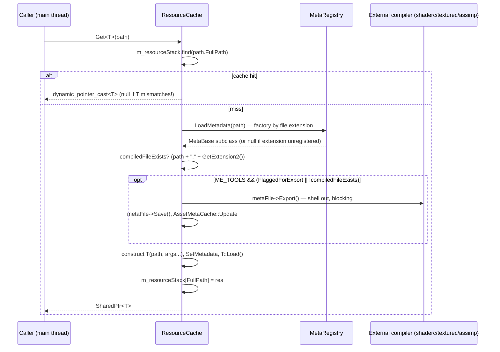

# Resources and Assets

All asset loading funnels through the `ResourceCache` singleton: a thread-safe, string-keyed map of `SharedPtr<Resource>` with synchronous loading plus **background loading** for textures, models, shaders and resident terrain, `.meta` JSON sidecars per asset (carrying asset GUIDs), and an editor/tools-only cook step (`Export()`) that compiles sources (`.png`, `.fbx`, `.vert`…) into runtime formats (`.dds`, `.assbin`, `.<platform>.bin`). Unreferenced resources are kept alive for a grace period, and tools builds hot reload assets when files change. This doc covers the load flow, async loads, the metadata/cook system, hot reload, the resource type inventory, and how to add a new type.

> Verified against engine commit dab803a2, 2026-10-08; model import (animation and skin data) against 07617c5f, 2026-10-09; pass-through assets against afce7083, 2026-10-09; async loading against 4d4de548, 2026-10-10; async shader loads against 488b07f1 plus the non-blocking shaders change, 2026-10-16; terrain resources against `73fbac9d` plus the resident terrain change, 2026-10-18.

## Overview

A `Resource` is anything constructed from a `Path` with a `Load()` override. `ResourceCache::Get<T>(path)` loads on the spot; components call it directly during deserialization (prefab JSON…), so a cold `Get<ModelResource>` reads and builds the model on the calling (main) thread. `GetAsync<T>(path)` returns at once and loads types that support it on loader threads. Textures (material, model and particle textures, asset-browser thumbnails) and models (`Model` components) load this way, so a scene's assets no longer block its first frame. A 2K texture cost about 30 ms of main-thread time before and costs under 0.1 ms now. Shaders load this way too (`Docs/Materials-and-Shaders.md`). Sound clips open in the background through FMOD's own non-blocking loader instead, and audio also has a streaming option (see `Docs/Audio.md`).

Cooking is driven by metadata, not by a build step: in `ME_TOOLS` builds, `Get` checks whether the asset's compiled twin exists / whether the source changed, and shells out to the appropriate compiler on the spot. Shipped (non-tools) builds only ever read the compiled files.

## Key Files

| Path | Role |
|------|------|
| `Modules/Dementia/Source/Resource/ResourceCache.h` | `Get<T>` template — the whole load/cook decision tree |
| `Modules/Dementia/Source/Resource/ResourceCache.cpp` | `Dump`, `TryToDestroy`, `LoadMetadata`, the async loader threads (`PumpAsyncLoads`, `WaitForAsyncLoads`, `CompleteLoad`), tools-only `FindByName` |
| `Modules/Dementia/Source/Resource/Resource.h` | Base class: `Load`, `Reload`, the async split (`SupportsAsyncLoad`, `LoadAsync`, `FinishAsyncLoad`), `IsLoading`, `HasLoadFailed`, `Metadata`, `FilePath` |
| `Modules/Dementia/Source/Resource/MetaFile.h` | `MetaBase` — sidecar contract: `Export()`, `GetExtension2()`, `FlaggedForExport` |
| `Modules/Dementia/Source/Resource/MetaRegistry.h` | Extension → metadata factory map, `ME_REGISTER_METADATA` |
| `Modules/Dementia/Source/Resource/AssetMetaCache.h` / `.cpp` | Timestamp cache backing the "was it modified" check |
| `Modules/Moonlight/Source/Graphics/Texture.h` / `Modules/Moonlight/Source/Graphics/Texture.cpp` | Texture resource + `texturec` cook |
| `Modules/Moonlight/Source/Graphics/ModelResource.h` / `Modules/Moonlight/Source/Graphics/ModelResource.cpp` | Assimp model resource + `assbin` cook |
| `Modules/Moonlight/Source/Graphics/ShaderFile.h` | Shader binary resource + `shaderc` cook (see `Docs/Materials-and-Shaders.md`) |
| `Source/Resources/JsonResource.h`, `Source/Resources/SoundResource.h` | Engine-side resource types |

## How It Works

### `Get<T>` decision tree



Details that matter:

- **Cache hits skip everything** — no metadata check, no export check, and the result is `dynamic_pointer_cast<T>`: calling `Get<Texture>` on a path already cached as another type returns **null silently**.
- The missing-file paths differ: source missing + compiled missing + not flagged → `YIKES("Failed to load resource: …")` and a null return; source missing but compiled present → logs `"Shit don't exist bro: …"` and **continues** (loads from the compiled file).
- The cache key is the raw `Path::FullPath` string — no normalization/dedup beyond what `Path` itself does.

### Async loads

`GetAsync<T>` runs the same decision tree up to the load. For a type whose `SupportsAsyncLoad()` is true, the resource is then cached and marked loading (`IsLoading()`), and it is queued:

1. A **loader thread** runs `LoadAsync()`, the CPU part (file IO and decoding; no GPU calls, no engine state). There are a few loader threads (a quarter of the cores, 1–4), separate from the job workers, so frame jobs never wait behind a file read.
2. The **main thread** runs `FinishAsyncLoad()` (the GPU upload). The engine calls `PumpAsyncLoads()` every frame before the late update and render, which finishes completed loads for up to 2 ms, always at least one.
3. The resource is then ready, or `HasLoadFailed()` (logged).

Rules:

- **`Get` always returns a loaded resource.** A `Get` of a path that is still loading finishes it on the spot: it runs the background part itself if no loader thread has started it, or waits for it. `CompleteLoad(resource)` does the same explicitly; hot reload uses it before `Reload()`.
- **Consumers must tolerate not-yet-loaded resources.** The renderer binds neutral fallbacks for a texture whose `TexHandle` isn't valid yet, and the asset browser shows the type icon until a thumbnail arrives.
- **`WaitForAsyncLoads()`** finishes everything and helps with queued loads (loading screens). It runs every background part first, then the main-thread parts **in request order**, so GPU objects (and their handles, which feed batch keys and draw order) are created in the same order every run. Deterministic runs (`--frame-time`) call it every frame instead of pumping, so captures never depend on IO timing. `PumpAsyncLoads` finishes in completion order.
- **`ReleaseAll()` cancels**: queued loads are dropped and marked failed, and the loader threads are joined. Engine shutdown does this before tearing the GPU down.
- **`GetPendingLoadCount()`** counts queued, running and not-yet-finished loads, for progress bars.
- To make a type async, override the three virtuals. Types that don't opt in load synchronously through `Load()` even when requested with `GetAsync`. Each async type's `Load()` is simply both parts:
  - `Texture` reads and parses the DDS in `LoadAsync` (`m_pendingImage`) and creates the bgfx texture in `FinishAsyncLoad`.
  - `ModelResource` reads the cooked `.assbin` with Assimp and builds the animation clips in `LoadAsync`. It makes meshes (GPU buffers), materials and the node tree in `FinishAsyncLoad`.
  - `ShaderFile` reads its compiled binary in `LoadAsync` and creates the bgfx shader in `FinishAsyncLoad`, which also builds the programs that were waiting for it (`Docs/Materials-and-Shaders.md`).
- **First-time cooks happen in the background too** (tools builds). When `GetAsync` finds an asset that needs cooking (no compiled file, or flagged for export) and its meta says the cook is safe off the main thread (`MetaBase::ExportsInBackground`: textures, models and shaders), the loader thread runs `Export()` and saves the meta before `LoadAsync`. The main thread only records the result in the meta cache, in `FinishAsyncLoad`. A scene full of new assets therefore opens at once, and its textures and models pop in as `texturec` and Assimp finish (several in parallel). A synchronous `Get` still cooks on the spot.
- **File-watcher changes never wait for an initial import.** A sidecar notification with unchanged import settings and GUID is ignored (the importer wrote it itself). Actual changes arriving while a resource loads are deferred until it is ready, with edited settings preserved if the first cook saves its older metadata. `PumpReimports` processes them without blocking; `WaitForReimports` explicitly drains the initial loads first.
- **Models expand when ready.** `Model::Init` requests its model with `GetAsync`, and while the model is loading the component waits in a pending list. `Model::ExpandPendingModels` runs right after the engine finishes loads each frame, before the cameras' late update and rendering, and creates private poses/render parts (or the legacy node entities) then. Expanded children saved in the scene exist meanwhile, without geometry. An `Animator` doesn't bind until its entity's `Model` is ready (`Model::IsReady`).

New model instances use a compact hierarchy: the Model owns private node transforms and render
parts, including FBX pivots and material splits. They retain individual bounds, LODs, materials,
shadow draws and picking without creating an entity for each part. Picking selects the model or
the nearest exposed node. The Model inspector lists source nodes and their materials; **Expose as
entity** creates a regular child with a `ModelNode` component. Parent cameras, lights, props and
scripts beneath it. Its source path is independent of the entity's name. Moving the exposed
entity edits a persistent attachment offset; its source node continues to drive the mesh.

Files without `Compact` keep their expanded hierarchy. **Compact hierarchy** is an undoable
conversion: it stores node/material edits in the Model and removes generated entities, while
preserving entities with custom components, authored children or component references and their
GUIDs. Existing mesh entities needed by those components remain renderable. The editor automation
commands are `model-compact` and `model-expose <source path or name>` on the selected Model.

Compact model files store `Compact: true`, `Parts` keyed by source-node/mesh paths, and authored
`Nodes` overrides. Path segments escape separators and distinguish duplicate sibling names by
occurrence, so unrelated siblings can be reordered without changing identities. Reordering
identically named siblings or renaming a source node still changes its path. Expanded imports
retain the earlier naming rules: identity wrappers without animation may collapse, and material
splits with empty/repeated names use `<node>_Mesh_<index>`.

Keep Assimp optimized even in engine Debug builds: `Tools/BuildAssimp.sh` builds the Linux static FBX/OBJ/Assbin importer and Assbin exporter with `CMAKE_BUILD_TYPE=Release`, then installs Assimp and zlib into `ThirdParty/Lib/Assimp/linux/Release`. An empty CMake build type produces unoptimized tangent-generation code. The 10,000-candle FBX has 19.54 million triangles; its optimized first cook took approximately 117 seconds on this development machine.

Models convert declared source units to metres by default (`ConvertUnits: true`); unitless files are treated as metres. `ImportScale` multiplies the converted size. Explicit `ConvertUnits: false` remains an override for incorrect source units. Sidecars that omit `ConvertUnits` are flagged for one recook even when the source timestamp is unchanged, then save the explicit setting.

For renamed textures, a model's `.meta` can contain a `TextureRemaps` object mapping the source filename to its replacement path, e.g. `"TextureRemaps": { "Old_Color.png": "../Textures/New_Color.png" }`. Paths are relative to the model, or project asset paths such as `Assets/Textures/New_Color.png`. The cook replaces matching texture references (including raw FBX material maps), accepting Windows or Unix source paths and preserving texture slots and wrap modes. Remaps apply only to that model. A newer sidecar containing remaps invalidates its older cook even when edited while the editor is closed; reopen scenes after reimporting to bind the repaired materials.

New model cooks store their effective import scale in the root node's `MitchEngineImportScale` metadata. Model components save that value as `BakedImportScale`. On reopening after an import-scale change, saved imported-node translations are multiplied by the new/old ratio, retaining local edits while matching the cooked vertices, bone offsets and animation keys. The placed Model entity is unchanged. Older scenes and cooks without this value repair a centimetre/metre mismatch only when at least two saved node translations, and at least 75% of comparable translations, agree on a factor of 100 or 0.01. Other legacy edits are preserved.

### Metadata sidecars

`LoadMetadata` looks up the file **extension** in the `MetaRegistry` and constructs the registered `MetaBase` subclass. If `<asset>.meta` exists it's parsed and deserialized; in **editor builds** a missing `.meta` is created on the spot and the asset is flagged for export. A sidecar that isn't valid JSON for its type (e.g. the Unity YAML `.meta` files that ship with asset packs) logs an error and loads with default settings instead of aborting; tools builds move it aside to `<asset>.meta.invalid`, so a fresh sidecar (and a stable GUID) is written in its place. `FlaggedForExport` is also set when `AssetMetaCache` (a JSON timestamp cache in `.tmp/MetadataCache.json`, loaded at `ResourceCache` construction and saved on every update and at destruction) sees a different `LastModified` than the sidecar — and it defaults to *modified* for assets it has never seen. The editor and game runs share that cache: it's written to a temp file and renamed into place, and an unreadable one is rebuilt rather than fatal.

Registered metadata types:

| Extension | Metadata type | Compiled twin (`GetExtension2`) | Cook tool |
|-----------|---------------|--------------------------------|-----------|
| `png`, `jpg` | `TextureResourceMetadata` (+Jpg) | `dds` | `texturec` (`--as dds`, optional `-m` mips). **Format:** `Auto` (the default) picks per image when it's cooked (`ResolveOutputFormat`): BC5 for normal maps (`Type: NormalMap`, or a file named like one: `normal` anywhere, or ending `_nrm`, `_nor`, `_ddn`, `_nm`; cooked with `-n`, and every shader rebuilds z from xy), BC3 when any pixel isn't opaque, BC1 otherwise; HDR images stay uncompressed. `None` keeps pixels exact (pixel art, fonts, UI, data); `BC1`, `BC3`, `BC4` and `BC5` force a format. bimg's `texturec` can't encode BC6H or BC7. |
| `fbx`, `obj` | `ModelResourceMetadata` (+Obj) | `assbin` | Assimp binary export (triangulated, smooth normals, tangents, at most 4 bone weights per vertex, left-handed); clips and skin weights survive into the `assbin` — see `Docs/Animation.md`. The prebuilt Linux Assimp only has the FBX, OBJ and Assbin importers. Texture references that don't exist (an artist's absolute or Windows path) are relinked by name: the same file next to the model or in a `Textures` folder, the same stem with a shipped image format, then the first image starting with the stem (`Texture_01.psd` → `Texture_01_A.png`); each relink is logged. **Import settings:** `ImportScale` and `ConvertUnits` (the FBX `UnitScaleFactor`, so centimetre assets like Synty's import at metre size) are baked into the cook: node translations, vertices, bone offsets and animation positions are scaled, and transforms keep a scale of 1. `DoubleSided` stamps every material in the file two-sided at cook time (`$mat.twosided`, mapped to `FaceMode` Both on load) for sources without back faces, such as Synty walls. Open scenes keep the old cook until they're reopened (models don't hot reload). **Levels of detail:** `GenerateLODs` with `LODLevels`, `LODReduction`, `LODTransition` and `LODMaxError` simplify each mesh when the model loads (not baked into the cook; `Docs/Rendering-Pipeline.md`) |
| `vert`, `frag` | `ShaderFileMetadata` / `FragShaderFileMetadata` | `<renderer>.bin` (e.g. `spirv.bin`, `dx11.bin`, `metal.bin`) | `shaderc` from `Tools/<platform>/` |
| `cube` | `ColorLutMetadata` | — | Parsed directly at load (Adobe/Resolve 3D LUT text): `LUT_3D_SIZE` N and N³ rows into an RGBA16F volume texture for the tonemap pass; non-identity domains warn and sample as 0..1 |
| `wav`, `mp3` | `AudioResourceMetadata` (+Mp3) — declared in `Source/Components/Audio/AudioSource.h` | — | none (pass-through: loaded by FMOD as is, see `Docs/Audio.md`) |
| `mat` | `MaterialResourceMetadata` (declared in `Modules/Moonlight/Source/Graphics/Material.h`) | `mat` | none (pass-through) |
| `inputactions` | `InputActionsMetadata` (`Source/Input/InputActionsAsset.h`) | `inputactions` | none (pass-through); a data asset, edited in the asset browser |
| `terrain`, `terrainc` | `TerrainMetadata`, `TerrainCookedMetadata` | same extension (pass-through) | Source manifest/pages or an explicit cooked package; `TerrainResource` decodes and prepares immutable resident CPU geometry in a background load (`Docs/Terrain.md`) |

**Changing formats in bulk:** `Tools/SetTextureFormat.py` rewrites the `"Format"` of texture metas under a folder (`--from None --to Auto` by default, `--exclude` globs, `--tracked-only`, `--dry-run`) and deletes their `.dds`, and `Havana --cook-textures [folder]` then cooks every texture whose `.dds` is missing or stale on all cores, without opening the editor (only textures that already have an engine `.meta`). Moving MitchGame's 448 tracked textures from `None` to `Auto` on 2026-10-24 took their cooked size from 6.67 GiB to 1.81 GiB, and the recook 82 s on 32 cores.

A metadata type can make its asset a **data asset** by returning a reflected object from `MetaBase::GetEditableType` / `GetEditableData`: the asset browser then draws it with the reflection inspector and writes it back through `SaveEditableData` (see `InputActionsMetadata`).

Extensions **not** in this table (e.g. `.json`, `.lvl`, `.html`) get **no metadata**: `LoadMetadata` returns null, no cook step runs, and `Get` goes straight to `T::Load()` on the source file.

### Lifetime: keep-alive eviction

`m_resourceStack` holds one owning `SharedPtr` per resource. `ResourceCache::Dump()` runs at the bottom of every frame but does its work at most four times a second: a resource whose only owner is the cache is remembered as unreferenced, and evicted once it has stayed unreferenced for `SetKeepAliveSeconds` (default 15 s). Anything referenced again before then is kept. `ReleaseAll()` drops every cache reference; `TryToDestroy(Resource*)` erases one refcount-1 entry immediately.

### Hot reload (tools builds)

`Engine::Run` starts a `FileWatcher` (`Modules/Dementia/Source/Resource/FileWatcher.h`) over `Assets/` and `Engine/Assets/` before `Game::OnStart`. It polls file modification times on a background thread (build artefacts like `.bin`, `.d`, `.dds`, `.assbin` are ignored) and `Engine::PollAssetChanges` consumes the changes at the start of each frame: `ResourceCache::OnFilesChanged` re-exports each affected cached resource from its metadata and calls `Resource::Reload()`. Slow cooks run on reimport threads: shaders, textures and models (`MetaBase::ExportsInBackground`). Their reload comes from `PumpReimports`, called at the start of each frame, so the editor never freezes on `shaderc`, `texturec` or an Assimp export. A file that changes again while compiling is compiled again before it reloads, and `WaitForReimports` drains them. Editing a `.meta` reimports the asset it describes, and changed `.prefab` files clear the prefab cache. A resource type only reloads if it overrides `Reload()`.

### Asset GUIDs

`MetaBase` reads and writes a `"GUID"` (hex) in each `.meta`; one is generated the first time a meta is written. Prefabs carry their GUID inside (`"AssetGUID"`). `AssetDatabase` (`Modules/Dementia/Source/Resource/AssetDatabase.h`) maps GUID ↔ project path:

- It is filled by scanning `.meta` files and prefabs, at startup in tools builds and lazily (`EnsureScanned`) in game builds.
- It is updated whenever a meta is read or saved.
- It follows editor moves (`Move`), keeping the former paths (`FindMovedPath`). `ResourceCache::Get` of a path that moved this session loads from the new path.

Components store asset paths; saved scenes and prefabs record the GUIDs behind them and remap moved paths on load (`Docs/Serialization-and-Scenes.md`, "Asset references").

### Tools-only path resolution

`ResourceCache::FindByName(root, filename)` (`ME_TOOLS` only) does a **recursive directory walk** matching by bare filename — convenient for editor asset lookups, `O(entire asset tree)` per call, and returns the *first* match, so duplicate filenames in different folders are ambiguous.

## How to Extend

### Add a resource type

1. Subclass `Resource`:

```cpp
// Source/Resources/CurveResource.h
#pragma once
#include "Resource/Resource.h"

class CurveResource
    : public Resource
{
public:
    CurveResource( const Path& path ) : Resource( path ) {}
    virtual bool Load() override;    // parse FilePath (or its compiled twin); return success
private:
    // parsed data
};
```

2. (Optional — only if the type needs cooking or import settings) add a `MetaBase` subclass and register it against the extension:

```cpp
struct CurveMetadata : public MetaBase
{
    CurveMetadata( const Path& p ) : MetaBase( p ) {}
    virtual std::string GetExtension2() const override { return "curvebin"; }
    virtual void Export() override { /* write FilePath + ".curvebin" */ }
    virtual void OnSerialize( json& outJson ) override {}
    virtual void OnDeserialize( const json& inJson ) override {}
};
ME_REGISTER_METADATA( "curve", CurveMetadata );
```

3. Load it anywhere with `ResourceCache::GetInstance().Get<CurveResource>( Path( "Assets/Curves/Jump.curve" ) )` and **store the `SharedPtr`** on whatever owns it — otherwise it is evicted after the keep-alive period.
4. If the resource wraps GPU/API handles, release them in the destructor — that *is* reliably called on eviction (unlike cores; see `Docs/ECS.md`).

## Caveats & Fragility

- **Synchronous cooks still block.** A cook requested with `Get` (or for a type without a background cook) runs on the main thread, as does the main-thread half of a model (meshes, materials, nodes: about a third of its load).
- **The cache is thread safe, GPU resources aren't**: `Get` takes a recursive mutex (held during `Load`), but loading textures/shaders/models creates bgfx objects, so call `Get`/`GetAsync` from the main thread (see `Docs/Jobs-and-Events.md`); only `LoadAsync` runs elsewhere.
- **Type-mismatched cache hits return null** (logged as an error). Two systems loading the same path as different types is still a bug.
- **Keep-alive is time-based, not budget-based**: there is no memory cap.
- **Editor builds mutate the asset tree on read**: missing `.meta` files are created, sidecars are rewritten, exports are triggered — running the editor is not read-only with respect to `Assets/`.
- **Cook failures are soft**: `Export()` implementations shell out and don't propagate failure; a failed compile typically surfaces later as a missing/stale compiled twin (`YIKES` on next run) or a broken load.
- **`AssetMetaCache` treats unknown assets as modified** — a fresh checkout re-exports everything it touches on first editor run.
- **Path-string keying**: `Assets/Foo.png` vs an absolute path to the same file are distinct cache entries; consistency of how callers build `Path`s is load-bearing.
- **`FindByName` first-match semantics** with duplicate filenames across folders.

## Related Docs

- `Docs/Materials-and-Shaders.md` — the `shaderc` cook in full detail
- `Docs/Jobs-and-Events.md` — why `Get` must stay on the main thread
- `Docs/Serialization-and-Scenes.md` — components resolving asset paths during deserialize
- `Docs/State-of-the-Engine.md` — async-loading and cache-policy improvement notes
