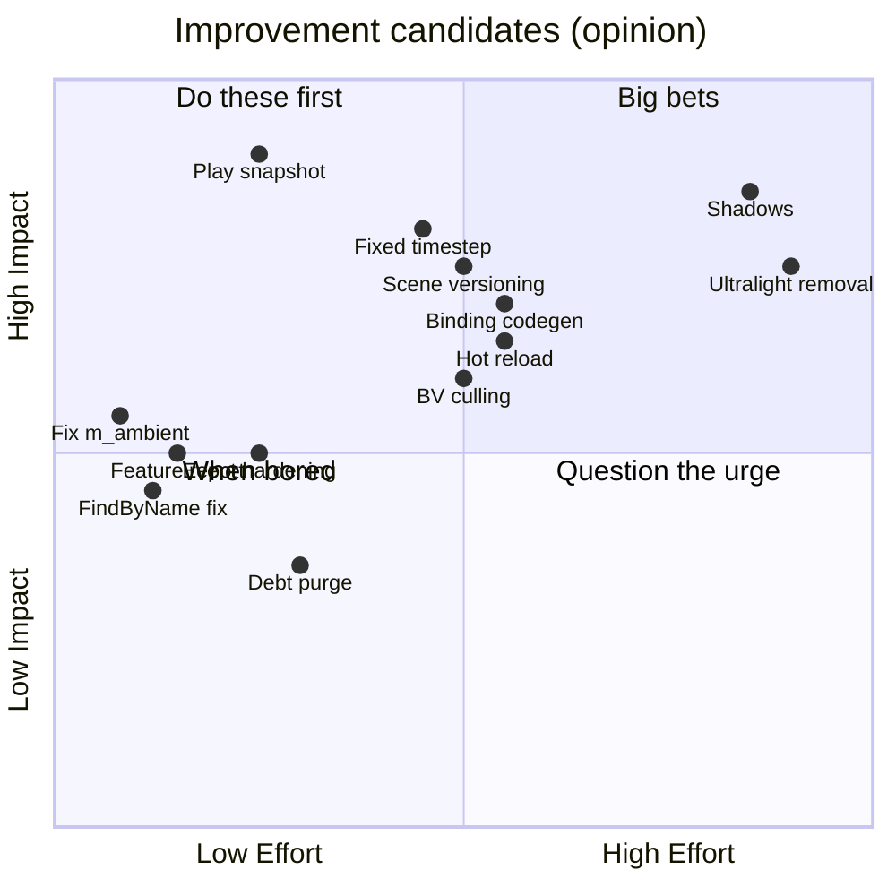

# State of the Engine

> **This doc is opinion.** Every other doc in `Docs/` is factual; this one rates, prioritizes, and recommends. Never cite it as a description of behavior — cite the subsystem docs. Assessed at engine commit 047f57b8, 2026-07-10; scorecard rows for the core runtime re-scored at dab803a2, 2026-10-08 (overhaul Waves 0–1); editor, serialization and rendering-tooling rows at 7e869c6e, 2026-10-09 (Wave 2); rendering, lighting and materials rows at 1fa55311, 2026-10-09 (Wave 3); physics at 8fdd99b1, 2026-10-09 (Wave 4); animation at 07617c5f, 2026-10-09; audio at afce7083, 2026-10-09; input at e0ca1f26, 2026-10-09; scripting at 6a4b006f, 2026-10-09; navigation at 8d6769a5, 2026-10-10; the Files & VFS row added 2026-10-24 (VFS-1); the Cooking row re-scored for Build Game (SHIP-3), 2026-10-25; the Projects row added for SHIP-4, 2026-10-25, and re-scored for the Hub (SHIP-5), 2026-10-29; the Player settings row added for PLAY-2 the Save games row for PLAY-4 and the Localization row for PLAY-6, 2026-10-29; the C# event bus (CS-8) and async/coroutines/tweens (CS-6) noted in the Scripting docs, 2026-10-29.

MitchEngine is a real, working engine: it ships Drumsmith, runs a full editor on Linux/Windows, hosts .NET 8 scripting, and has genuinely thoughtful hot paths (the precomputed render submit, automatic instancing, transform dirty caching). Its weaknesses are the classic solo-engine kind: half-migrations left in place (Mono→.NET, fixed→variable timestep), correctness debt that hasn't hurt *yet* (variable-dt physics, name-string schemas), and workflow traps that cost real work (Stop-reverts-to-last-save). The theme of this assessment: **finish or delete the half-things, then invest where the engine already punches above its weight.**

## 1. Maturity Scorecard

Ratings: **Solid** (rely on it) · **Usable** (works, know the sharp edges) · **Fragile** (works until it doesn't) · **Experimental** (incomplete by design) · **Abandoned-in-place** (do not extend).

| Subsystem | Rating | Why (one line) | Doc |
|-----------|--------|----------------|-----|
| Input | **Usable** | Action maps with prioritized, consuming contexts, composites, modifiers, interactive rebinding with persisted overrides, gamepads with deadzones and rumble, editable in the asset browser, local multiplayer (a map per player, pad pairing, join on button press, scriptable), unit tested; gamepad I/O unverified on hardware, pairing is by slot | [Input.md](Input.md) |
| Platform/Window/Input/Config | **Solid** | SDL2 everywhere, boring in the good way; project settings carry the product identity (name/org/version/icon), the startup scene game builds boot, and the SHIP-2 build lists, all on a Project tab with a round-trip test; DPI + crash-safe config are the gaps | [Platform-Window-Input-Config.md](Platform-Window-Input-Config.md) |
| ECS core | **Solid** | Generational ids, paged pools, deferred structural changes, lifecycle hooks, O(1) membership, unit tested | [ECS.md](ECS.md) |
| Frame loop & timing | **Usable** | Fixed timestep + pause/step/time scale/frame cap, deterministic `--frame-time`, full GPU teardown on exit; game code picks a stage (fixed / update / late update after animation), core dependencies, script `[ExecutionOrder]`; the engine's own stage order is fixed by design | [Architecture.md](Architecture.md) |
| Jobs | **Solid** | Work stealing, helping waits, allocation-free ParallelFor, stress tested | [Jobs-and-Events.md](Jobs-and-Events.md) |
| Events | **Solid** | Typed `Listen<T>` handlers (no id switches or casts), thread-safe queue, auto-deregistering receivers, safe re-entrant dispatch (handlers may destroy their own receiver), unit tested; no per-type unsubscribe | [Jobs-and-Events.md](Jobs-and-Events.md) |
| Rendering pipeline | **Solid** | Precomputed submit (only the material bind is virtual) + auto-instancing, AABB culling, generated mesh LODs picked by screen size, a view allocator, linear HDR with a full post stack (temporal AA with variance clipping), soft particles, lit projected decals; unverified on non-Vulkan backends and unmeasured on GPUs at 57k-mesh scale with shadows | [Rendering-Pipeline.md](Rendering-Pipeline.md) |
| Lighting & shadows | **Usable** | PBR + clustered point/spot lights, stable CSM sun shadows, spot and point-light shadows (cube faces in one atlas), IBL probes, lit smoke, height fog with volumetric light shafts (sun, point and spot lights), manual directional lights alongside the procedural sky, display-referred grading LUTs (.cube and strips, with stock grades), depth-edge toon outlines and per-object hull outlines; one shadowed sun, fixed shadow budgets, screen-space (not froxel) volumetrics | [Rendering-Pipeline.md](Rendering-Pipeline.md) |
| Materials & shaders | **Usable** | Metallic-roughness StandardMaterial, live shader hot reload with include tracking that compiles in the background, shaders that load and first-cook on loader threads (all engine shaders in parallel at startup, materials never block); shader graphs in the editor (Lit, Unlit, Particle, Decal, Post Process; typed compiler checked against shaderc on SPIR-V/GLSL/Metal; live per-node previews); batch-key discipline is manual; graphs on particles/decals/post have no per-instance overrides | [Materials-and-Shaders.md](Materials-and-Shaders.md) |
| Resources & assets | **Usable** | Hot reload, keep-alive cache, asset GUIDs, background texture and model loads and first-time cooks (the main thread only uploads and builds), background shader loads, hot-reload recompiles in the background, model unit conversion, a per-model double-sided import option, unit tested; synchronous `Get` cooks and a model's main-thread half still block | [Resources-and-Assets.md](Resources-and-Assets.md) |
| Files & VFS | **Usable** | Mount-table VFS behind `Path`/`File`: game root over engine root as a priority overlay, `user://` as the per-user writable root (OS pref dir in shipped builds, repo-local `.tmp/User` in dev), atomic mount snapshots for loader threads, golden-tested against the legacy resolver; every runtime loader reads through it (FMOD via file callbacks, chunked reads via `VfsFileStream`), the resource cache keys on logical paths, and a CI lint bans new raw reads; .mpak paks mount read-only over the roots (`--pak` boots a game from a directory with no Assets/; `pack-assets` builds one from named logical roots; `VfsFileStream` reads entry windows, so FMOD streams from the archive); `--record-deps` records what a run reads (the cooker's input); retail pak-only mode and terrain-archive stream adoption remain | [VFS.md](VFS.md) |
| Cooking | **Usable** | `Havana --cook` ships what scenes need (a static walk of scenes, prefabs and shader graphs, plus each scene recorded through the game with `--record-deps`) in runtime form only: `.dds`, `.assbin` and the target's shader profile, with sources, metas and editor content stripped; `AssetRegistry.json` stands in for them in cooked runs (stripped sources still "exist", import settings, GUIDs, model texture answers); RunChecks proves two showcases byte-identical from a cooked tree and from a pak in an empty directory. Build Game (`Havana --build-game`, File > Build Game) wraps a cook into a shippable folder: Retail executable, Release scripts, `Game.mpak` (auto-mounted), an app-local .NET, bundled libraries and a launcher. RunChecks runs it from outside the repo with no .NET install and matches the references. Terrain, compression, compiling on Windows/macOS (ME-265) and portable Linux binaries (SHIP-8) remain | [Cooking.md](Cooking.md), [Building.md](Building.md) |
| Projects | **Usable** | A project is a folder (`Assets/` + `Project/Game.meproj`); `--project` and File > Open Project open any of them, and a C#-only project needs no C++: it runs on the executable's own engine (the VFS `Engine/` mount), the generic Player runs it, and its scripts build into the project per executable. RunChecks opens the sample out of the repo in the editor and matches the Player's capture. Havana started outside a project opens the **Project Hub** (recent projects, new from a template, open any folder; File > Project Hub returns to it), and RunChecks drives it from an empty folder through creating a project to the editor opening it. One template so far (Empty); Build Game for C#-only projects (ME-266), the other templates (SHIP-6) and prebuilt binaries (SHIP-7) remain | [Projects.md](Projects.md) |
| Serialization & scenes | **Solid** | Versioned v2 format with GUIDs, references, migration and prefab links with stable source GUIDs; asset references are paths backed by asset GUIDs that follow moves and renames; declared renames (component, core, field and script aliases) keep old data loading; additive scenes stream in the background and unload as a unit (runtime only, no multi-scene editing) | [Serialization-and-Scenes.md](Serialization-and-Scenes.md) |
| Physics | **Solid** | Box3D and Box2D cores with the same model: fixed step + interpolation, compound bodies, joints, mover-based 3D and platformer characters, layer matrix, events and queries, unit + editor-flow tested; per-entity collision callbacks for C++ (`CollisionRouter`) and scripts; Box3D is pre-1.0, and Exit events have gaps (none on Stop, one-sided when a collider is destroyed mid-contact) | [Physics.md](Physics.md) |
| Navigation | **Usable** | Recast/Detour with tiled parallel async bakes saved next to the scene, areas with costs, modifiers, volumes and links, DetourCrowd agents with avoidance and link arcs, queries from C++ and C#, editor bake / overlay, runtime obstacle carving (background tile rebuilds), an out-of-date warning, named agent types (surfaces bake for one, agents and queries use theirs), unit + editor-flow + game-build tested; a re-bake per agent type | [Navigation.md](Navigation.md) |
| Animation | **Usable** | Clip import, bone entities, a real state machine (parameters, exit times, cross-fades, 1D and 2D blends, events), masked override and additive layers, root motion through the character controller, edit-mode previews that never leak into saves, root motion with turning, two-bone and look-at IK, and GPU skinning in the main, shadow and picking passes, unit + editor-flow tested; one-state previews, linear keys | [Animation.md](Animation.md) |
| Player settings | **Usable** | One versioned `user://Settings.json` (quality presets over the hardware caps, per-bus player volumes, persisted rebinds, language, text scale, reduce-motion, free-form `Game.*`), type- and range-checked, applied as it changes, saved atomically once changes settle, C# `Settings`; automated runs stay hermetic unless given `--user-dir`. A two-launch editor flow proves a C# rebind survives a restart. The stock options menu (PLAY-3) edits all of it by gamepad; no cloud sync, and only player 0's rebinds persist | [Player-Settings.md](Player-Settings.md) |
| Localization | **Usable** | Merged string tables (engine, project, UI-4 path) keyed by source text; RmlUi text nodes and engine-generated menu text translate, C# `Loc`; the `qps` pseudo-locale and a missing-string report prove coverage (the stock options menu reports none), and an editor table window edits and saves project tables. No CJK font ships, keys are exact text, bound `{{ values }}` aren't translated | [Localization.md](Localization.md) |
| Save games | **Usable** | Named slots in `user://Saves`: the scene snapshot (plus non-public `[Save]` script fields), name/scene/date/playtime metadata and a thumbnail, written atomically on a worker, loaded at the end of the frame, versioned with migrations; C# `SaveGame`. A two-launch flow round-trips the Playground. No additive scenes, physics velocities or cloud sync yet; whole-scene saves only | [Save-Games.md](Save-Games.md) |
| Audio | **Usable** | Mixer buses in Project Settings, listener, positioned sources with rolloff and doppler, overlapping one-shots, streamed sources for music, reverb zones, physics occlusion with lowpass, pause with the game, silent automated runs, clips that load in the background (plays wait for them, `Preload` opts out), unit + editor-flow tested; no sound propagation or FMOD Studio | [Audio.md](Audio.md) |
| Scripting (.NET 8) | **Usable** | Generated ABI from one manifest, hot reload that keeps field values, engine-owned lifecycle (start after physics sync, fixed update), a gameplay API (input actions, physics with collision / trigger callbacks, character, navigation, audio, scenes, debug draw), every component's fields by name, CLI builds on Linux, editor-flow tested; the script inspector draws Havana property rows for every field kind (strings, enums, Color/Vector4/Quaternion, lists, nested [Serializable] types, EntityRef/AssetRef with drag-drop, [Range]/[Header]/[Tooltip]/[ReadOnly] and friends) with save/load proven by flow; a Roslyn source generator gives `[GenerateSchema]` scripts compile-time field schemas, serializers and a schema hash (reflection-free, AOT-safe); no macOS host, Win64 CLI path untested | [Scripting-DotNet.md](Scripting-DotNet.md) |
| UI (RmlUi) | **Usable** | HTML/CSS documents (`UIDocument` + `RmlUiCore`) composited in the editor and game; mouse/keyboard input, gamepad and Tab focus navigation, dp text scale, string-table localization with fallback fonts, `.rml`/`.rcss` hot reload, the debugger on F7; inline engine actions (`load-scene`, `play-sound`, `quit`, `set-text`, document show/hide, player-settings verbs and "press a key" rebinding), a stock gamepad-navigable options menu (PLAY-3) the templates open on Pause, engine overlay documents with async scene loads under a progress-bound loading screen and boot splashes (PLAY-5), and C# view models (`UI.Model`, values survive hot reloads). Proofs: UITest capture, `UIFlows`, `UIModelFlows`, `UINavFlows`, `MainMenuFlows`, `OptionsFlows`, `LoadingFlows`. Ultralight is gone (UI-5). Gaps: no layers/filters/shader gradients, scalar-only bindings, synthesized text input, no designer yet (UI-6) | [UI-RmlUi-and-ImGui.md](UI-RmlUi-and-ImGui.md) |
| Editor (Havana) | **Solid** | Selection/undo/actions services, in-memory play snapshots, autosave + recovery, multi-object gizmos, reflection inspector with multi-edit, prefab overrides, asset browser v2 whose moves and renames keep references intact, scripted regression tests; non-reflected components are the gap | [Editor-Havana.md](Editor-Havana.md) |
| QA automation | **Solid** | doctest unit tests (448 cases), scripted editor flows per subsystem, deterministic `--frame-time` captures with screenshot regression over showcase scenes (also from a cooked tree and its pak), unattended runs that never touch user settings or speakers; the game repository's CI runs all of it (`RunChecks.sh`) | [Architecture.md](Architecture.md) |
| Build system | **Usable** | Sharpmake graph is coherent; features still follow which SDK directories exist, but generation now reports what it found and how to fix what's missing | [Build-System.md](Build-System.md) |

## 2. Platform Support Matrix

| Capability | Win64 | Linux | macOS | UWP |
|------------|-------|-------|-------|-----|
| Build + run game | ✅ primary | ✅ active dev | ⚠️ historically yes, not recently verified | ⚠️ configs exist, untested |
| Havana editor | ✅ | ✅ | ⚠️ unverified | — |
| Scripting (.NET 8) | ✅ (hot reload unverified) | ✅ (Nix shell; scripts built with the dotnet CLI) | ❌ no host path (Mono era ended) | ❌ |
| Audio (FMOD) | ✅ | ✅ | ✅ (SDK path exists) | ✅ (SDK path exists) |
| Navigation (Recast/Detour) | ⚠️ written, unverified | ✅ | ⚠️ written, unverified | ⚠️ untested |
| UI (RmlUi) | ⚠️ builds from source, unverified | ✅ | ⚠️ builds from source, unverified | ⚠️ untested |
| Profiling (Optick) | ✅ | ⚠️ engine parses `.opt` captures, but the build define is Win64-only | ❌ | ❌ |
| Graphics backend | D3D11/12 | Vulkan (forced) | Metal | D3D11 (forced; DX12 shader issues) |

The stated bar (per the game project's conventions) is: Win64/macOS/Linux must compile and run; UWP must not be actively broken. macOS is the platform most at risk of silent rot — no scripting, no CI, no recent verification.

## 3. Half-Finished & Vestigial Inventory

| Item | Location | State | Verdict |
|------|----------|-------|---------|
| ~~Ultralight~~ | — | — | Done (UI-5): the SDK, `UICore`, `BasicUIView`, the JS bridge and the GTK runtime deps are gone; RmlUi is the game UI and old scenes upgrade on load |

## 4. Improvement Themes

Impact (H/M/L) × Effort (S/M/L). Grouped so related items can share one work session.

### A. Correctness & data safety
| Item | Impact | Effort | Notes |
|------|--------|--------|-------|
| ~~Editor: snapshot world on Play~~ | — | — | Done (Wave 2): in-memory snapshot, selection and undo survive Stop |
| ~~Fixed timestep for physics~~ | — | — | Done (Wave 1 loop + Wave 4 Box3D core): fixed steps with interpolated poses |
| ~~Component/core rename migration~~ | — | — | Done: `ME_REGISTER_COMPONENT_ALIAS` / `ME_REGISTER_CORE_ALIAS`, `.FormerName()` on reflected fields, `[FormerName]` for scripts |
| ~~Fix `m_ambient`~~ | — | — | Done (Wave 3): ambient is image-based from per-camera environment probes |
| ~~Event-system hardening~~ | — | — | Done (Wave 1): auto-deregistering receivers, a thread-safe queue drained at frame start, safe re-entrant dispatch |
| ~~Quaternion transform sync in physics~~ | — | — | Done (Wave 4): poses sync as quaternions |

### B. Rendering
| Item | Impact | Effort | Notes |
|------|--------|--------|-------|
| GPU validation of the Wave 3 renderer | **H** | S | Measure the 57k-mesh bench with shadows and IBL on real hardware, and smoke-test D3D11/Metal (only Vulkan/lavapipe verified) |
| ~~Point-light shadows~~ | — | — | Done: six faces per light in the local shadow atlas |
| ~~Lit particles~~ | — | — | Done: `ParticleSystem::Lit` shades smoke with the sun, local lights, their shadows and ambient |
| ~~Parallel shadow caster culling~~ | — | — | Done: one gather per frame, one parallel cull per pass for all its views (-24% CPU at 57k meshes on a busy machine) |
| ~~Decals~~ | — | — | Done: `Decal` component, projected through a box onto opaque surfaces, lit with normal maps, angle fade and sort order |
| Decal receiver masks / DBuffer | M | M | Decals paint everything in their box and replace the surface's shading; a stencil or per-mesh "receives decals" bit, and a DBuffer for normal/roughness-only decals |
| ~~ShaderGraph finish-or-delete~~ | — | — | Done: rebuilt in Havana (`Docs/ShaderGraph.md`): five targets, live previews, shaderc-checked codegen |
| Shader graph follow-ups | M | M | Per-instance parameter overrides on particles / decals / post stacks; subgraphs; graph-driven picking (vertex offset) |

### C. Scripting
| Item | Impact | Effort | Notes |
|------|--------|--------|-------|
| ~~Binding codegen~~ | — | — | Done: `ScriptAPI.def` + `Tools/GenerateScriptAPI.py` generate both halves |
| ~~Hot reload~~ | — | — | Done: rebuild on a worker thread, swap the ALC, same handles, fields restored |
| ~~Collision/trigger callbacks + generic component get/set~~ | — | — | Done: `OnCollisionEnter/Exit`, `OnTriggerEnter/Exit`, and `Entity.GetField/SetField` over reflection paths |
| macOS .NET host | M | M | Same hostfxr dance with the osx-x64/arm64 host pack; restores platform parity |
| ~~Fix `World_FindByName`~~ | — | — | Done: searches the whole world |

### D. Editor & workflow
| Item | Impact | Effort | Notes |
|------|--------|--------|-------|
| ~~Finish Ultralight removal~~ | — | — | Done (UI-5): RmlUi replaced it, with no fps cap and no GTK3 dependency tail |
| ~~Undo coverage + dirty-scene indicator~~ | — | — | Done (Wave 2): transactions cover properties, create/delete/duplicate, reparenting and components; `*` in the title when dirty |
| ~~Generation-time feature report~~ | — | — | Done: generation prints each optional feature, on / OFF, with the fix |
| ~~Async first-time cooking~~ | — | — | Done: a `GetAsync` of an uncooked texture or model cooks it on the loader thread; hot-reload recompiles (shaders too) run on reimport threads |
| **Hardware target profiles (budgets)** | M | M | *Started (`Docs/Hardware-Profiles.md`).* Done: JSON profiles (Xbox 360, 2004 PC, Switch, Steam Deck built in; projects add, replace or `Extends`), Project Settings > Hardware with live budgets and a feature caps table, the scene view verdict, `--budget-hud`, perf-report budgets, sustained-over warnings, and enforcement (shadows and their resolution, AO, bloom, DoF, volumetric fog, TAA, IBL, instancing, texture size). Next: a host speed factor so frame times mean something for a slower target, render-resolution enforcement (needs render scaling), CI failing on `PeakOverCount`, and per-asset accountability (which textures and meshes cost the most) |

### E. Debt removal (one satisfying purge)
Done (overhaul): the legacy job systems, Mono files, `Canvas.h`, `UpdateMesh`, `UWPWindow` and the boot-log noise are gone. The legacy `Collider2D` is gone too (Box2D colliders replaced it). The dead `Burst` chunking helpers and `Engine.h`'s stale includes are gone too, and `Engine` builds without `ME_TOOLS` again (additive scene streaming is part of every build).

## 5. Top 10 Priorities

1. ~~Snapshot-on-Play~~ — done in Wave 2 (in-memory snapshot; selection and undo survive Stop). → `Editor-Havana.md`
2. ~~Fix `m_ambient`~~ — done in Wave 3 (the legacy uniform is gone; ambient is image-based). → `Rendering-Pipeline.md`
3. ~~Debt purge (theme E)~~ — mostly done (see theme E for what's left).
4. ~~Fixed timestep for physics~~ — done (Wave 4: Box3D `PhysicsCore` in the fixed loop with interpolation). → `Physics.md`
5. ~~Scene versioning + rename aliases~~ — done (v2 format with migration; component/core aliases, field and script `FormerName`s; asset references follow moves by GUID). → `Serialization-and-Scenes.md`
6. ~~Finish Ultralight removal~~ — done (UI-5: RmlUi replaced it; the SDK, `UICore`/`BasicUIView` and the GTK deps are gone). → `UI-RmlUi-and-ImGui.md`
7. ~~Script binding codegen~~ — done (`ScriptAPI.def` + generator with a `--check` mode). → `Scripting-DotNet.md`
8. ~~Script hot reload~~ — done (editing a `.cs` rebuilds and swaps in place; fields survive), and so are collision callbacks and generic component access. → `Scripting-DotNet.md`
9. ~~Bounding-volume culling~~ — done (AABB per mesh, tested in the mesh job). → `Rendering-Pipeline.md`
10. ~~Shadow mapping~~ — done in Wave 3 (cascaded sun + spot shadows). Next rendering priority: validate on real GPUs and non-Vulkan backends. → `Rendering-Pipeline.md`

## 6. Reassessment Triggers

Re-score the affected rows when any of these land: shadows/multi-light ship (lighting row) · scripting ships inside a released game build (scripting row) · a macOS build is verified again (platform matrix) · fixed timestep lands (frame loop + physics rows) · scene versioning lands (serialization row). Also re-stamp any subsystem doc whose behavior these changes touch — the freshness contract in [README.md](README.md) applies to this doc too.
