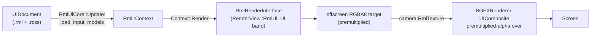

# UI: RmlUi and ImGui

Two UI systems coexist. **RmlUi** renders the game's HTML/CSS UI (`UIDocument` components shown by `RmlUiCore`) into a texture the renderer composites over the main camera, in the editor's game view as well as in shipped builds. **ImGui** renders editor chrome, debug tools and profiling overlays. Ultralight, the previous HTML UI, was removed in UI-5: its SDK, `UICore`, `BasicUIView`, the JS bridge and the GTK dependency stack are gone (see "Migrating Ultralight pages" below).

> Verified against the UI-5 engine commit, 2026-10-25.

## Overview

- `ThirdParty/RmlUi` + `ThirdParty/freetype` build from source on every platform behind `ME_RMLUI` (`DEFINE_ME_RMLUI`, always on; `Docs/Build-System.md`).
- `RmlUiCore` is engine-owned (`Engine::RmlUi`), joins every world and is re-added after each scene load (`Docs/Architecture.md`). It runs one `Rml::Context` per world.
- A `UIDocument` component names an `.rml` file, with `Visible` and `SortOrder` (applied as the document's `z-index`). Documents load lazily once the main camera has an output size.
- Files resolve through the VFS (game root over engine root, paks included). Time is fed simulated, so `--frame-time` captures are deterministic.
- ImGui is gated by `ME_IMGUI` (editor, tools or profiling builds). It lives in `Modules/ImGUI/`, with the render backend in Moonlight's `ImGuiRenderer`.

## Key Files

| Path | Role |
|------|------|
| `Source/Cores/UI/RmlUiCore.h` / `.cpp` | Context, document lifecycle, input, hot reload, inline actions, script view models, text scale and language |
| `Source/Components/UI/UIDocument.h` / `.cpp` | The component: document path, visibility, sort order |
| `Source/UI/Rml/RmlRenderInterface.*` | RmlUi on bgfx: compiled geometry, premultiplied alpha, scissor, transforms, stencil clip masks |
| `Source/UI/Rml/RmlInterfaces.*` | System (time, cursor, string table) and VFS file interfaces |
| `Source/UI/Rml/RmlInput.*` | Engine key codes to RmlUi key identifiers and characters |
| `Source/Scripting/Bindings/Systems/UIModel.bindings.cpp` + `Modules/ScriptCore/Source/Core/UI.cs` | `UI.Model(...)`, the C# view-model API |
| `Modules/Havana/Source/Editor/UIAutomation.cpp` | The `ui-click`, `ui-assert-text`, `ui-assert-focused`, `input-press`, `ui-set-text-scale`, `ui-set-language` edscript commands |
| `Assets/Shaders/UI/Rml.*` | Document shaders; `Assets/Shaders/UI.*` is the composite |

## How It Works

### Documents and the frame



- `RmlUiCore::Update` (in the engine's UI stage) sizes the context to `Camera::CurrentCamera->OutputSize`, applies hot reloads, binds view models, loads/shows documents, feeds input, then renders into its offscreen target in `RenderView::RmlUi`. That view is the first of the UI band (`UIFirst`/`UICount` in `RenderViews.h`), before every camera, so the `UIComposite` pass samples this frame's UI.
- `RmlRenderInterface` compiles geometry into static buffers once and re-submits it. Per draw it sets the transform, scissor and texture. `border-radius` clipping uses stencil clip masks (inverse masks fall back to no clip). Layers, filters and shader decorators (`linear-gradient`, `box-shadow`, `filter`) aren't implemented yet; the vertex-colour `horizontal-gradient`/`vertical-gradient` decorators and `font-effect` (glow, shadow, outline) work.
- `--no-ui` disables the composite. The editor's "Composite Game UI" render setting toggles it too.

### Input, navigation, text scale, localization

- Mouse, wheel, keyboard and synthesized text input feed the context each update while a document is visible (`WantsMouse()` tells game input to yield). In the editor, mouse positions map from the window into the game view.
- The gamepad navigates: the dpad moves focus through the documents' `nav`/`tab-index` properties and South activates. `input-press Gamepad/DPadDown` (or `Key/Tab`, `Key/Down`, ...) and `ui-assert-focused` drive it from flows.
- Text scales through dp units (`SetTextScale`, the context's density-independent pixel ratio; `ui-set-text-scale`).
- `SetLanguage( "es" )` loads `Assets/UI/Strings/es.json` and reloads documents; exact-match keys translate through `TranslateString`. Extra glyph coverage loads from `Assets/Fonts/Fallback/`.
- The UI's requested cursor applies through SDL. The RmlUi debugger toggles on **F7** outside retail.

### Wiring documents to the game

Three levels, simplest first:

1. **Inline actions** need no code. Any element can carry one in an event attribute:

   | Attribute | Effect |
   |---|---|
   | `onclick="load-scene:Assets/Main.lvl"` | Queues a scene load (never mid-event) |
   | `onclick="play-sound:Assets/Sounds/Click.wav"` | A 2D one-shot on the UI bus |
   | `onclick="quit"` | Leaves the game (logged and ignored in the editor) |
   | `onclick="set-text:#target\|New text"` | Replaces an element's content |
   | `onclick="load-scene-async:Assets/Main.lvl"` | Loads the scene in the background under the loading screen (below) |
   | `onclick="hide-document"` | Hides this document's `UIDocument` (a menu's Back) |
   | `onclick="show-document:Options"` / `toggle-document:Options` | Shows / toggles the `UIDocument` on the entity with that name (C#: `UI.Show`, `UI.Hide`, `UI.Toggle`, `UI.IsVisible`) |
   | `onclick="setting:Graphics.Quality\|Low"`, `setting-step:Audio.Music\|0.1`, `setting-toggle:...` | Sets, steps or flips a player setting (`Docs/Player-Settings.md`) |
   | `onclick="rebind:Jump\|0"` (`\|0\|Up` for a composite part) | "Press a key": the next control actuated becomes the binding; Escape or Start cancels |
   | `onclick="reset-bindings"`, `reset-settings`, `window-mode:borderless`, `tab:page-audio` | Clear rebinds, reset every setting, switch the window mode (ignored in the editor), show one `.tab-page` and mark the clicked `.tab` |

   The main menu (`Assets/UI/Main.rml`) and the project template's `ExampleMenu.rml` are built from these.
2. **C# view models** carry state. A script owns a named model, and a document opts in with `data-model="name"`:

   ```csharp
   var hud = UI.Model("hud");          // creates (or finds) the model
   hud.Set("score", 0);                // {{ score }}, data-if="score > 10", data-class-x="flag"
   hud.On("increment");                // <button data-event-click="increment">
   for (string e; (e = hud.PollEvent()) != ""; )
       if (e == "increment") hud.Set("score", hud.GetNumber("score") + 1);
   ```

   Values are numbers or strings (bools are 0/1) and live engine-side (`RmlUiCore::Model*`), so C# hot reloads keep the rendered state. Documents that loaded before their model reload once when it materializes (the `UI: rebound` log). Lists aren't bindable yet: write repeated elements out (see `Assets/UI/Drive/Slots.rml`).
   Settings need no model either: `RmlSettings` (`Source/UI/Rml/RmlSettings.h`) keeps attributed elements current whenever the player settings or a rebind change. `data-setting-text="Audio.Music"` (with `data-format="percent|scale|onoff"`) shows a value, `data-setting-selected="Graphics.Quality|Low"` and `data-window-mode="borderless"` set the `selected` class, and `data-binding="Jump|0"` shows a binding's control. At load it fills `data-options="quality"` / `"languages"` with choice buttons and `data-controls` with a row per action of the game input. While a rebind waits (and on the frame it ends) the documents get no keys, buttons or gamepad navigation.
3. **C++** uses the same store (`GetEngine().RmlUi->ModelSetNumber(...)`, `ModelPollEvent(...)`), or `GetContext()` for raw RmlUi.

### The stock options menu

`Engine/Assets/UI/Options/Options.rml` (PLAY-3) is a complete options menu built only from the above: Graphics (quality presets, window mode), Audio (a −/+ step per bus), Controls (every binding of the game's action map, rebindable), Accessibility (text size, reduce motion, language) and Back / Reset all. Every button is in the focus chain, and showing the document focuses the Graphics tab (`autofocus`), so a gamepad drives all of it. A project replaces it by shipping its own `Assets/UI/Options/Options.rml`. The project templates carry it on a hidden `Options` entity with `PauseMenu.cs` (Pause toggles it and pauses the game), and MitchGame's main menu opens it with `show-document:Options`.

### Overlays, loading screens and splashes

`RmlUiCore::ShowOverlay( path, sortOrder )` / `HideOverlay` show documents that belong to the engine rather than an entity, so they stay up while the scene changes under them. `LoadingScreen` (`Source/Engine/LoadingScreen.h`, PLAY-5) uses them:

- **`LoadSceneAsync( scene, document )`** (C# `World.LoadSceneAsync`, the `load-scene-async:` action) loads the main scene in phases:
  1. **Reading:** the file is read and parsed on a worker while the current scene keeps running under the loading document.
  2. **Instantiating:** the new scene is built through `Engine::LoadSceneFromData`.
  3. **Settling:** the screen stays up until `ResourceCache::GetPendingLoadCount()` has been 0 for three frames (60 s at most).
- **`MinimumSeconds`** holds the screen longer. The bar fills across that time, never ahead of the real progress.
- **The "loading" data model** carries `progress` (0..1), `percent`, `width` ("42%", for `data-style-width`), `scene`, `phase` and `product`. A log line marks each quarter.
- **The stock documents** are `Engine/Assets/UI/Loading/Loading.rml` and `Splash.rml`. Project Settings `Product.LoadingDocument` picks another loading document.
- **`Product.Splash`** (`[{ "Document": ..., "Seconds": 2 }]`) plays over the boot scene in game builds. Unattended runs skip it unless they pass `--splash`.
- **Cooking:** the cooker ships the folders of those documents.
- **Proof:** `LoadingFlows.edscript` (the `load-scene-async` and `play-splash` commands; a capture mid-load).

### The UI designer (UI-6)

**Window > UI Designer** (`Modules/Havana/Source/Widgets/UIDesigner/`) edits a loaded document and the stylesheets it links:
- **Tree:** the document's element tree (`tag#id.class`). Click an element with an id to select it, or press **Pick** and click it in the Game view (the nearest ancestor with an id is selected). An orange outline marks the selection over the Game view.
- **Style tab:** the color, background, font size, size, margin, padding and alignment as fields. They are written to the element's **inline style** in the `.rml` or to the **stylesheet rule** `#id`: the last linked `.rcss` that has that rule, else a new rule at the end of the first one.
- **Computed tab:** the border box (position and size in UI pixels) and every property RmlUi resolved. Properties set on the element come first; inherited ones and defaults are dimmed. It has a filter box.
- **Bindings tab:** the element's `data-*` attributes, plus its data model's current values (Copy puts `{{ key }}` on the clipboard).
- **Palette tab:** adds a panel, heading, text, button, image, text field, slider or checkbox as the selection's last child, each with a fresh id. Delete removes the selected element.
- **Preview:** the Game view's display presets (Freeform, aspect ratios, 720p, 1080p, 1440p, **Steam Deck** 1280×800). The UI lays out at the preset's size, and the Game view letterboxes it.
- **Write-back:** `RmlSourceEdit` (`Source/UI/Rml/RmlSourceEdit.h`) edits the text surgically. Only the edited start tag, declaration or element's lines change, so whitespace, comments and attribute order survive and the files stay the source of truth.
- **Live preview:** unsaved text is served to RmlUi in place of the files (`RmlUiCore::SetSourceOverride`, through `RmlFileInterface`) and reloaded like a hot reload. Save writes the files and drops the overrides. Undo steps back through every edit, across files. Opening another document discards unsaved edits, and the log says so.
- **Flow commands:**
  - `designer-open <entity>`, `designer-select <selector>`, `designer-pick <x> <y>` (UI pixels)
  - `designer-set <property> | <value>` (inline), `designer-rule <selector> | <property>: <value>` (an empty value removes)
  - `designer-insert <div|h1|p|button|img|text|range|checkbox>`, `designer-delete`
  - `designer-preview <preset>`, `designer-save`, `designer-undo`
  - Assertions: `designer-assert-selected #id`, `designer-assert-computed <property> | <value>` (as RmlUi prints it: colors are `#rrggbb`), `designer-assert-preview <w>x<h>`, `assert-file-contains <path> | <text>` (`!=` negates)
- **Proof:** `UIDesignerFlows.edscript` (inline and rule edits, a Steam Deck preview, picking, a palette button added and deleted; both test files end as committed), with `RmlSourceEditTests.cpp` for the write-back.

### Engine-native elements (UI-8)

`Source/UI/Rml/RmlElements.cpp` registers three elements with RmlUi's factory:

| Element | Shows |
|---------|-------|
| `<sprite sheet="Assets/X.spritesheet" name="X_3"/>` | A sheet's sprite: its region of the sheet's image |
| `<sprite anim="Assets/X_Walk.spriteanim" fps="12"/>` | A flipbook (a `.spriteanim`), looping on the UI clock (simulated time, so captures repeat). `fps` overrides the file's rate |
| `<viewport src="Assets/Textures/RenderTexture/Feed.rendertexture"/>` | A render texture's live image, for minimaps and character previews; a camera renders into it (`Docs/Rendering-Pipeline.md`, Render textures) |
| `<input-glyph action="Jump" index="0"/>` | The action's binding as text, such as a key cap. It follows rebinds, and the text is data, not translated |

- **Sizing:** sprites and viewports size themselves from the region or the texture; CSS `width` and `height` override. Paths are project paths (`Assets/...`, `Engine/Assets/...`), not relative to the document.
- **Render textures:** `RmlRenderInterface::LoadTexture` maps a `.rendertexture` source to the render texture's own target. The asset owns that target, so RmlUi never destroys it, and it's read from the asset at draw time, so a resized or reloaded target keeps showing. The UI draws before the cameras, so a viewport shows the feed's previous frame.
- **Proof:** the UITest capture (`Assets/Scenes/Tests/Reference/UITest.png`) shows a viewport fed by a camera filming a spinning cube, the coin sprite, the hero's walk flipbook and the Jump key cap.
- **Not done:** device glyphs (Xbox / PlayStation / Deck icons; PLAY-8) and the ShaderGraph UI target. See the follow-up issue.

### The Game View's mouse (ME-262)

In the editor the game's UI reads ImGui's absolute mouse (`io.MousePos`, so a Game View undocked into its own window works). It maps that through `Input::GameViewMapping`: where the Game View draws the game's image, the drawn size, and game pixels per screen pixel on each axis. Fixed display modes shrink a larger render into the panel, so the mapping scales as well as offsets.
- **Only the Game View sets the mapping.** The World View used to overwrite the offset when it rendered last.
- **Real-mouse checks:** `ui-click` dispatches straight to an element, so it never tests this path. `GameMouseFlows.edscript` does:
  - `ui-mouse-move <selector>` warps the OS pointer to the element's centre as the Game View shows it, computed from the image's rect and the context's size (not from the mapping under test);
  - `ui-mouse-down` / `ui-mouse-up` press through `Input::SetSimulatedMouseButtons`.
- **Proof:** the flow clicks a button in Freeform, Fixed 1080p and Ultra-Wide (letterboxed). With the old offset-only mapping, all three missed.
- **Not covered:** an undocked Game View is the same math, but no flow drives it.

### Hot reload

`.rml`/`.rcss` edits arrive as `AssetsChangedEvent`. An `.rcss` edit reloads stylesheets in place (DOM state survives); an `.rml` edit reloads the documents loaded from it. Both log `UI: reloaded N document(s)`, which flows wait on.

### Migrating Ultralight pages

- **Scenes:** a saved `BasicUIView` loads as a `UIDocument` pointing at the same path with `.rml` instead of `.html` (`SceneSerializer::UpgradeComponent`; re-saving writes the new form). Write that `.rml` next to the old page.
- **Markup:** RmlUi has no default stylesheet (block elements need `display: block`), no JavaScript, and no `<script>`. Images resolve relative to the document.
- **Logic:** JS functions become view-model values the script sets (`setCredits(n)` becomes `slots.Set("credits", n)` plus `{{ credits }}`). Timers and animations move into the script's `OnUpdate` or into RCSS `@keyframes`/transitions. The `PlaySound`/`LoadScene`/`Quit` globals became the inline actions above.
- **C#:** the `BasicUIView` script class is gone. Its `BasicUIView_ExecuteJS` ABI slot stays (order is the ABI) as a stub that warns once.
- **C++:** subclasses of `BasicUIView` (`OnUILoad` + `BindJSCallback`) port to inline actions or a model; the game's `MenuController` and the template's `ExampleMenuController` were deleted that way.

### ImGui

- Backend init happens in `Engine::Init` (`ImGui_ImplSDL2_InitForOther`): SDL owns native windows and queued input, while bgfx owns graphics surfaces. The render backend is Moonlight's `ImGuiRenderer`, driven by `BGFXRenderer::BeginFrame`/`EndFrame` at **view 255**.
- Consumers: the whole Havana editor (`Docs/Editor-Havana.md`), component/core `OnEditorInspect` methods, `DebugTools` in `ME_GAME_TOOLS` builds, and the `ME_BASIC_PROFILER` overlay. In game builds those two form the debug overlay: hidden by default, **F3** toggles it, `--debug-overlay` starts with it shown and `--no-debug-overlay` keeps it off.
- Panels can detach into native windows on Windows, macOS and Linux/X11. `Window/PlatformWindowHooks.cpp` installs only ImGui's renderer callbacks, with stable bgfx view IDs from `RenderView::ImGuiPlatformFirst` through `ImGuiPlatformLast` (currently 12 detached windows). SDL retains its platform callbacks and viewport data; detached close/resize/move events never affect the main engine window. Linux editors prefer X11/XWayland; explicitly selecting `SDL_VIDEODRIVER=wayland` keeps panels in the main window because SDL cannot provide global mouse coordinates there.
- Detached windows render through bgfx window swap chains (`bgfx::createFrameBuffer( SwapChain )`, resized in place with `bgfx::updateSwapChain`). On Linux the SDL window is made resizable after creation, so tiling compositors (Hyprland) can resize it from their borders. Compositor move animations desynchronise XWayland's pointer from the window while dragging, which makes detached panels jump; on Hyprland disable animations for the editor's floating windows (a `noanim` window rule on class `Havana`).
- Tooltips and drag previews stay in their host viewport. This policy is applied centrally in the ImGui submodule's `BeginTooltipEx` (`ThirdParty/ImGui/imgui.cpp`), covering built-in widget tooltips as well as editor calls. Keep that customization when updating the submodule. The regression tests in `Tests/Source/ImGuiViewportTests.cpp` exercise host selection, edge tooltips, drag previews and reattachment without a GPU.

## How to Extend

1. **New screen:** write `Assets/UI/<Name>.rml` + `.rcss`, add a `UIDocument` to an entity in the scene, and wire buttons with inline actions or a C# model. Give focusable elements `tab-index: auto; nav: auto;` so keyboards and gamepads reach them.
2. **New inline action:** add a branch to `RmlActionListener::ProcessEvent` in `RmlUiCore.cpp` (keep the `verb:argument` shape) and document it in the table above.
3. **New automation:** UI edscript commands live in `UIAutomation.cpp`; prove behaviour with a flow under `Assets/Scenes/Tests/` (see "Proof").
4. **Editor/debug UI:** prefer ImGui. Override `OnEditorInspect` on your component/core (free in editor builds), or extend `DebugTools` for game-tools builds. Lay it out with property rows and the `ImGuiTheme` size and color tokens (see "Lay out editor UI" in `Docs/Editor-Havana.md`) so it matches the rest of the editor.

## Caveats & Fragility

- **UI follows `Camera::CurrentCamera`:** with no main camera (or a zero-size output) documents don't load and nothing composites.
- **No layers yet:** `filter`, `box-shadow`, `mask-image` and shader gradients render nothing; inverse clip masks don't clip.
- **Data bindings are scalar:** numbers and strings only (no lists or structs), and a model's values bind lazily, so a document can briefly render before its first `Set`.
- **Synthesized text input:** typed characters come from key events (US layout); real `SDL_TEXTINPUT`/IME routing is still to do.
- **`RmlUiCore` must be re-added after world unloads** (`Engine::LoadScene` does it); a manually constructed world without that step has components but no UI.

## Proof

- `Assets/Scenes/Tests/UITest.lvl`: screenshot regression (text, image, rounded clip, transform, a button) in RunChecks' test-scene pass.
- `Tests/Source/RmlUiTests.cpp`: no leaked geometry handles on the bgfx Noop backend. `SerializationTests.cpp`: the `BasicUIView` upgrade.
- `UIFlows.edscript` (clicks, assertions, `.rcss` hot reload; it edits the stylesheet, so it self-skips while another Havana is open), `UINavFlows.edscript` (Tab/ShiftTab and dpad focus, South activates, captures at text scale 1.5 and in Spanish), `UIModelFlows.edscript` (`UIProbe.cs` renders a bound value, a click raises `increment`, a C# hot reload keeps the score and runs the edited logic), `MainMenuFlows.edscript` (the ported main menu: keyboard focus, the Options menu opens and closes, then a click loads a scene), and `OptionsFlows.edscript` (the stock options menu by dpad and South only: a quality preset, two volume steps, a rebind of Jump to J and a cancelled one, each checked in the player settings).

## Related Docs

- `Docs/Rendering-Pipeline.md`: the UI band and the composite blend
- `Docs/Architecture.md`: `RmlUiCore`'s place in the frame loop and scene loads
- `Docs/Scripting-DotNet.md`: `UI.Model` from C#
- `Docs/Input.md`: actions, gamepads and the UI's input yield
